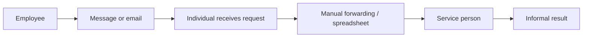
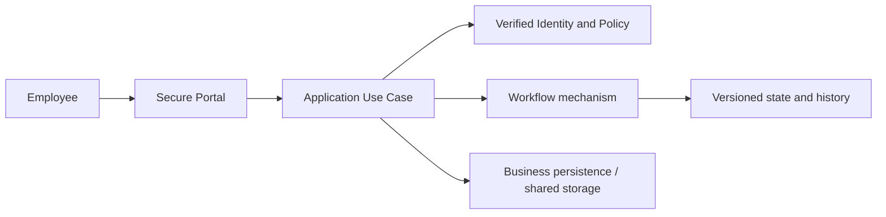

# DX-OS — Problem Statement & Need Analysis

> **Status:** PROPOSED — VALIDATION REQUIRED
> **Baseline:** `origin/main` `e06fa429cfd92b032c166eb3ebf32803d13191c2`
> **Evidence classification:** Working hypothesis based on DX-OS project scenario, not verified field research.

## 1. Problem statement

Internal employees may request support through independent channels such as chat, email, telephone and informal spreadsheets. Without a common request record, assignment and history, stakeholders can have difficulty answering: **Who owns this request? What is its current state? Who is permitted to act next? What happened and when?**

**Proposed problem statement:** Internal service handling lacks a consistent, auditable way to submit, assign, execute and confirm service requests. Repeating technical functions separately for each internal-service application creates unnecessary implementation duplication and inconsistent security/behavior.

The scenario is a **hypothesis** for the OLP project; the repository does not independently demonstrate the prevalence of this problem in a named organization.

## 2. Stakeholders and jobs to be done

| Stakeholder | Job to be done | Important question |
|---|---|---|
| Employee/requester | Report a problem and verify its resolution | Can I track my request and confirm the result? |
| Technician/operator | Work on assigned eligible requests | Is this request assigned to me and can I transition it? |
| Coordinator/manager | Triage, prioritize and route work | Which requests have no owner or are stalled? |
| System administrator | Configure trusted authentication and operational infrastructure | Are identities, configuration and access boundaries sound? |
| Future application developer | Reuse Identity/Workflow/Data/Gateway mechanisms | Can Facility be built without Core changes? |

Roles listed here are analysis roles, not authorization grants. Exact application actor matrices belong in each business contract.

## 3. AS-IS analysis (hypothesis; to validate)

| Observed/assumed pain | Consequence to validate | Required evidence |
|---|---|---|
| Requests dispersed across channels | Requests may be missed or duplicated | Interview/observation, anonymized channel sample |
| Unclear owner | Slow handoff or duplicate handling | Assignment case studies |
| State not explicit | Employees cannot see progress | Process walkthrough |
| Permission not enforced systematically | Incorrect person may update a request | Current access-control analysis |
| History hard to reconstruct | Weak accountability | Sample audit/review exercise |
| Separate apps duplicate auth/storage/workflow | Maintenance burden | Code comparison / development effort study |

No quantitative rates, costs or SLA improvements are claimed without baseline data.

## 4. TO-BE behavior

A request should have an authoritative owner, business eligibility checks, documented states/transitions, concurrency protection and an appropriately visible history. The application governs its business rules; Core contributes provider-neutral mechanisms.

## 5. Root cause hypotheses vs solution assumptions

| Hypothesis | How to validate | If false, design consequence |
|---|---|---|
| Fragmented channels cause poor traceability | Stakeholder interviews and example cases | Narrow the scope to an integration/tracking aid |
| Reusable technical functions exist across applications | Compare Helpdesk and Facility flows | Reduce generalized Core surface |
| A state machine meets MVP process complexity | Map real transitions, exceptions and deadlines | Consider future BPMN/workflow orchestration requirements |
| One backend modular monolith is sufficient | Assess load, deployment and transaction needs | Revisit topology only with evidence |

## 6. Functional needs derived from the problem

| Need ID | Need | Candidate verification |
|---|---|---|
| N-01 | Authenticated request creation | Verified principal; forged headers denied |
| N-02 | Clear assignment/ownership | Eligibility and assignment checks |
| N-03 | Visible request lifecycle | List/detail and state transition tests |
| N-04 | Authorized workflow actions | Tenant, ACL, assignee and role negatives |
| N-05 | Reliable history | State and history atomicity under concurrent writes |
| N-06 | Resolution acknowledgement | Requester-only confirm where business contract requires it |
| N-07 | Multi-application reuse | Facility slice without Workflow/Identity/Data Core special cases |
| N-08 | Deployable demonstration | Repeatable environment and live E2E evidence |

## 7. Nonfunctional requirements to agree

Security boundaries, data integrity, error semantics, auditability, testability, maintainability, local reproducibility, and provider replaceability are candidate quality attributes. Numerical latency, uptime, SLA targets and maximum attachment sizes are **TBD** until supported by use cases and an environment specification.

## 8. Assumptions, limitations and decisions

- The Helpdesk scenario is the project demonstration target, not an externally validated market requirement.
- Facility is a reuse case; workflow states, request categories and actors require Application review.
- Historical `request/*` prototype must not silently become the generic Core contract.
- Generic Workflow HTTP exposure must not bypass Application authorization.
- DB transactions and object-store writes are not collectively atomic by default.

## 9. Acceptance for this problem analysis

- [ ] Interview/observation evidence or explicit sign-off that the AS-IS is a competition scenario assumption.
- [ ] Stakeholder roles and rights confirmed by the Application owner.
- [ ] Problem–need–use case traceability checked.
- [ ] MVP scope and excluded features approved.
- [ ] No fabricated quantitative metrics or guaranteed SLA claims.
- [ ] Security and architectural risks surfaced for review.

## 10. References

- [Root README](../../README.md)
- [Project Overview](project-overview.md)
- [Scope and MVP](scope-and-mvp.md)
- [Application documents](../03-applications/README.md)

**Review outcome:** PENDING business validation and sign-off.
