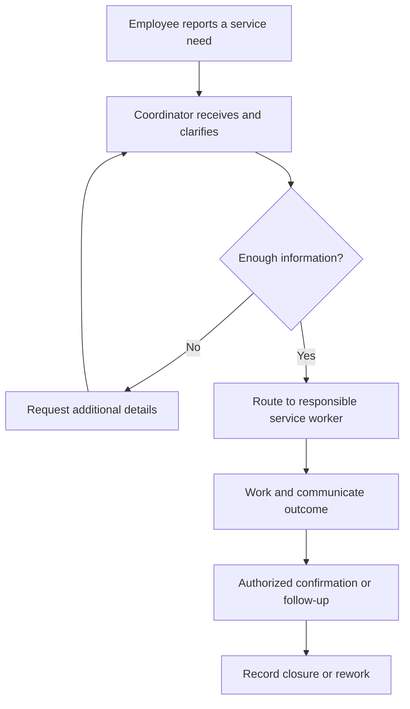

# DX-OS Open-Core — Problem Statement

> **Document ID:** G1-F02  
> **Purpose:** Define a falsifiable problem and needs model for internal service requests and shared workflow capabilities.  
> **Scope:** Hypothetical multi-department organization; candidate IT Helpdesk and Facility Maintenance scenarios; proposed reuse hypothesis.  
> **Authority:** The Document Register controls document status and ownership. This draft does not establish an approved business contract.

## 1. Purpose and Analysis Boundary

DX-OS explores whether internal service-request applications benefit from an auditable request lifecycle and from reuse of a common identity, authorization, workflow, gateway, and data foundation. This statement separates **reference-context hypotheses** from **verified project-source facts**. It does not assume the solution is necessary or already successful. Specific workflows, business transitions, API availability, and product scope require subsequent business-contract review and testing.

The enterprise scenario below is **hypothetical**, not a surveyed client. No organization size, request volumes, SLA performance, cost savings, interview responses, or usability measurements are known.

## 2. Reference Context and Stakeholders

Consider an organization in which employees submit software-support or facilities-maintenance requests. The following roles describe an analysis model, **not** confirmed staffing or a complete authorization matrix.

| Stakeholder | Candidate responsibility | Information need |
| --- | --- | --- |
| Requester / employee | Submit a request, provide details, check outcome | Current stage, responsible party, result |
| Intake / coordinator | Review, classify, route or request clarification | Queue, relevant facts, handoff history |
| Technician / service worker | Carry out assigned work and report outcome | Work context, authorization, progress |
| Manager / acceptance reviewer | Oversee work or validate outcomes where authorized | Exceptions, accountability, completion evidence |
| Platform operator | Configure and operate common capabilities | Security boundaries, configuration, logs, operability |

The current use of email, messaging, spreadsheets, or manual handoffs is an **illustrative possibility**, not an observed finding that any particular tool fails.

## 3. Candidate AS-IS Process

This flow is a **reference hypothesis**. Alternative real-world workflows may differ, and no survey has confirmed it.

| Actor | Candidate activity | Information passed | Possible friction (unverified) |
| --- | --- | --- | --- |
| Requester | Describe a service need through an available channel | Request description, urgency, contact | Missing required facts; uncertain status |
| Coordinator | Read, clarify, and route the request | Classification, assignment context | Repeated data entry; ambiguous ownership |
| Worker | Perform work and relay results | Work notes, resolution evidence | Scattered history; delayed handoff |
| Reviewer / requester | Confirm suitability or request rework | Acceptance/rejection reason | Unclear confirmation or closure authority |
| Manager / operator | Check workload and exceptions | Progress records and event history | Incomplete visibility across channels |

*Figure 1 — Candidate AS-IS interaction flow for analysis only. It is not a validated client process, an approved TO-BE model, or an implemented Workflow definition.*

## 4. Pain-Point Hypotheses and Impacts

The hypotheses below are questions for validation. None is a confirmed customer observation.

| Pain-point ID | Affected actor | Hypothesized symptom and impact | Evidence status |
| --- | --- | --- | --- |
| PP-01 | Requester | Difficult to learn request progress or next responsible party | **UNVALIDATED** |
| PP-02 | Coordinator | Manual clarification/routing may produce repeated handoffs | **UNVALIDATED** |
| PP-03 | Technician | Incomplete context may slow diagnosis and resolution | **UNVALIDATED** |
| PP-04 | Reviewer / manager | Missing authorization and transition history may obscure decisions | **UNVALIDATED** |
| PP-05 | Platform operator / developer | Similar applications may repeat infrastructure integration and lifecycle logic | **UNVALIDATED** |

A system that merely centralizes a form would not necessarily resolve PP-04 or PP-05. Conversely, disciplined operating procedures or existing tools may resolve some symptoms without a new platform.

## 5. Symptoms, Possible Causes, and Alternatives

| Observed only if validated | Possible cause to test | Alternative explanation or non-platform response |
| --- | --- | --- |
| Progress unknown (PP-01) | No shared status or ownership convention | Existing tools may support status; training or process conventions may suffice |
| Repeated routing (PP-02) | Unspecified intake criteria or handoff obligations | Poorly defined responsibilities rather than deficient software |
| Missing work context (PP-03) | Information requirements not standardized | Forms and operational checklists could address the gap |
| Decisions difficult to audit (PP-04) | History or authorization evidence not retained centrally | Existing systems may already log events but expose them poorly |
| Repeated application code (PP-05) | No reusable common service contracts | Duplication may be negligible for a small number of applications; reusable Core may add overhead |

**Root-cause discipline:** Lack of DX-OS is not a root cause. Identity, Workflow, Gateway, and Data are *candidate response capabilities*, justified only if the requirements and reuse tests support them.

## 6. Business and Platform Needs

These IDs are provisional analysis anchors, not approved G2 requirements.

| Need ID | Stakeholder | Desired outcome / capability | Linked hypotheses |
| --- | --- | --- | --- |
| NEED-01 | Requester | Submit a request and access an authorized progress view | PP-01 |
| NEED-02 | Coordinator / worker | Clarify, route, and process work with explicit responsibility | PP-02, PP-03 |
| NEED-03 | Requester / reviewer | Understand outcome and handle confirmation or rework when permitted | PP-01, PP-04 |
| NEED-04 | Manager / operator | Examine attributable action and transition history subject to access rules | PP-04 |
| NEED-05 | Application developer / operator | Reuse published identity, workflow, authorization, and data interfaces across distinct definitions | PP-05 |
| NEED-06 | Platform operator | Deploy, observe, and recover a limited local demonstration without relying on privileged browser database access | PP-04, PP-05 |

Needs express user or platform outcomes rather than preselecting Spring classes, table structures, or HTTP endpoints.

## 7. Candidate TO-BE Outcomes and Scenario Boundaries

A possible future internal service portal could collect requests, expose authorized views, support controlled transitions, and keep an attributable event history. These are **desired outcomes**, not claims of currently functioning UI or APIs.

**IT Helpdesk (candidate primary demonstration).** A requester reports a software incident; intake triages it; an authorized worker responds; the outcome is communicated and confirmed/closed as defined by an agreed business contract. Exact states, eligibility, negative branches, and closure semantics remain to be ratified.

**Facility Maintenance (candidate second business definition).** A requester reports a physical-facility issue; intake evaluates it; an authorized worker repairs it; the result is reviewed and closed or returned for rework under approved rules. Distinct stages test configurability rather than copying Helpdesk transitions.

[Issue #53](https://github.com/lexuanbao258-collab/dxos-open-core/issues/53) describes draft candidate business flows and explicitly states the v1.2 contract is pending team ratification. [Issue #39](https://github.com/lexuanbao258-collab/dxos-open-core/issues/39) describes the independently consumable Portal, whereas [Issue #40](https://github.com/lexuanbao258-collab/dxos-open-core/issues/40) records a local MVP deployment/demo direction. The issues are **project design sources**, not evidence of customer discovery or complete implementation. Access Request may serve as a further **design-only reuse exercise**; it is not a committed third application.

## 8. Platform Reuse Hypothesis and Falsification

**H-PLATFORM-01:** Given two sufficiently different business definitions, a published common Core can support both without business-specific changes to shared engine algorithms or unauthorized direct database access from the Portal.

This hypothesis would be weakened or falsified if the second use case requires hidden department-specific branches inside Core, mutable shared contracts without change control, direct Portal access to workflow tables, or an unverified mock being presented as real reuse.

**Candidate proof protocol:** (1) define and independently review both use cases; (2) fix a Core source baseline; (3) document changes needed to add the second definition and Application adapter; (4) run authorized transition, error, isolation and history tests for each; (5) compare Core code/diff and runtime evidence at exact SHAs. The successful completion of this protocol has **not** been established by this document.

## 9. Validation and Measurement Plan

| Validation ID | Claim / uncertainty | Proposed method | Measurement / acceptance input | Baseline |
| --- | --- | --- | --- | --- |
| VAL-01 | PP-01 progress visibility affects requesters | Interview/observe representative requesters, with consent | Time or steps to identify stage and responsible party | **BASELINE UNKNOWN** |
| VAL-02 | PP-02 routing friction exists | Map current handoffs and clarification cycles | Number and reasons for handoffs | **BASELINE UNKNOWN** |
| VAL-03 | PP-03 missing facts cause rework | Review anonymized cases or pilot task walkthroughs | Missing-fact and rework cases | **BASELINE UNKNOWN** |
| VAL-04 | PP-04 auditing and permissions are needed | Stakeholder interviews; threat/authorization scenarios | Reconstructable event sequence; correctly blocked invalid actions | **BASELINE UNKNOWN** |
| VAL-05 | H-PLATFORM-01 reuse is practical | Compare two reviewed definitions, source diffs and tests | Core algorithm changes, contract stability, repeatable behavior | **BASELINE UNKNOWN** |
| VAL-06 | NEED-06 reproducibility | Independent clean-install and restart test | Steps, failures, evidence and recovery outcome | **BASELINE UNKNOWN** |

No target percentage, ROI, SLA, operational volume, or time-savings figure is asserted. Acceptance thresholds, samples, and data-collection ethics must be agreed before formal evaluation.

## 10. Evidence and Assumptions Register

Confidence here describes **support for the claim type**, not a numerical probability.

| Claim ID | Claim classification | Source / confidence | Validation still required |
| --- | --- | --- | --- |
| CLM-01 | Project-source fact: draft Internal Service Portal contract exists | [Issue #53](https://github.com/lexuanbao258-collab/dxos-open-core/issues/53); **source-supported** | Verify current ratification and accepted contract revision |
| CLM-02 | Project-source fact: independent HTTP Portal/Core boundary is proposed | [Issue #39](https://github.com/lexuanbao258-collab/dxos-open-core/issues/39); **source-supported** | Verify implementation and security acceptance separately |
| CLM-03 | Project-source fact: local reproducible demo direction is recorded | [Issue #40](https://github.com/lexuanbao258-collab/dxos-open-core/issues/40); **source-supported** | Verify release baseline, deployment and live E2E evidence |
| CLM-04 | Reference-context hypothesis: fragmented service channels affect users | **No field evidence provided; unvalidated** | Survey/interview, observe actual tool/process usage |
| CLM-05 | Root-cause hypothesis: poor handoffs and histories create friction | **No field evidence provided; unvalidated** | Process mapping, negative cases, alternative-cause checks |
| CLM-06 | Platform hypothesis: shared Core reduces duplication at acceptable cost | **No comparative evidence provided; unvalidated** | Two-definition implementation comparison and maintainability assessment |

This register must not be transformed into evidence of interviews, customer demand, or accepted performance without additional primary sources.

## 11. Scope Boundaries and Risks

**In analysis scope:** Internal request lifecycle; authorized submission, routing, work, confirmation and history; candidate reuse across Helpdesk and Facility; operational verification criteria.

**Out of MVP scope:** ERP, inventory/procurement, asset management, BPMN editor, generalized AI features, large-scale business-process expansion, and an architecture rewrite solely for microservices. These are scope constraints reflected in project issues; they are not a statement that such features can never be added.

Material risks include solution bias, workflow transition disagreement, unsupported API assumptions, misleading mock demonstrations, wrong security/tenant visibility, unintended shared Core coupling, and insufficient real-world validation. See G2 business contracts, G3 architecture and G7 testing for detailed treatment when those documents exist.

## 12. Problem-to-Need Traceability (Provisional)

| Problem | Need | Candidate G2 requirement (not approved) | Planned validation |
| --- | --- | --- | --- |
| PP-01 | NEED-01, NEED-03 | REQ-CAND-01: authorized request status and outcome view | VAL-01 |
| PP-02 | NEED-02 | REQ-CAND-02: explicit routing and actor eligibility | VAL-02 |
| PP-03 | NEED-02 | REQ-CAND-03: mandatory information for transitions | VAL-03 |
| PP-04 | NEED-04 | REQ-CAND-04: attributable transition history and access controls | VAL-04 |
| PP-05 | NEED-05 | REQ-CAND-05: second workflow definition without shared Core algorithm modification | VAL-05 |
| PP-04/05 | NEED-06 | REQ-CAND-06: independently reproducible local setup | VAL-06 |

IDs here are local to this draft; canonical cross-gate IDs must be reconciled in the approved traceability register before they are promoted.

## 13. Related Documentation and Next Decisions

The accompanying G1-F01 Project Overview supplies the high-level product narrative. `product-vision.md`, `scope-and-mvp.md`, and `glossary.md` should be linked by relative paths **only after those paths are verified in the target documentation repository**. G2 must review problem/need validity, actor eligibility, candidate transitions, application data ownership, API capability gaps, acceptance scenarios, and authorization constraints before freezing a contract.

For implementation status and evidence, consult separately reviewed exact-SHA source/test artifacts, not narrative assertions in this problem statement. A GitHub issue describes intentions and open work unless an actual accepted result is explicitly established by referenced evidence.

**Prepared artifact only. G1-F02 review and G1 Gate acceptance remain unverified.**
