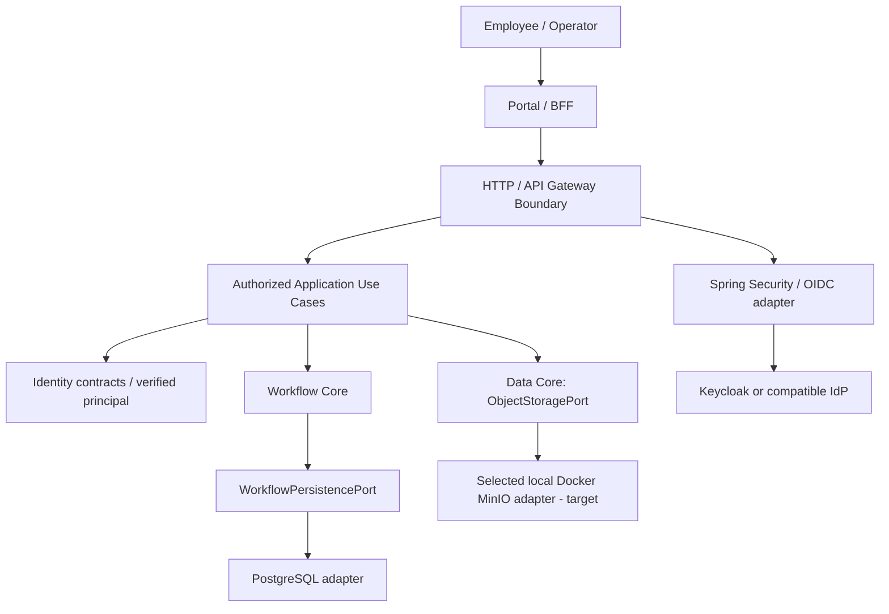

# DX-OS Open-Core — Project Overview

> **Document status:** PROPOSED — REVIEW REQUIRED
> **Decision basis:** P01=B (Product & Architecture Overview); P02=C with P06=B (no unverified detailed AS-IS, retain hypotheses); P03=B (Reusable Internal Service Platform); P04=B (Helpdesk golden path + Facility vertical slice); P05=C (hybrid glossary); P07=C (goal-oriented overview, detailed progress tracked elsewhere).
> **Source reference baseline:** `origin/main` — `e06fa429cfd92b032c166eb3ebf32803d13191c2` (2026-10-28). This is a reference point, not a claim of end-to-end verification.
> **Document owner:** TRICORE — responsible owner and reviewers to be assigned.
> **Purpose:** Orient readers to the product, rationale, users, boundaries and intended outcomes; not a release or testing report.

## 1. DX-OS in one minute

**DX-OS Open-Core** is a proposed **reusable capability foundation for internal service applications**. Its initial product demonstration is **IT Helpdesk**; a smaller but real **Facility** vertical slice is planned to test whether another application can use the same Core contracts without copying or modifying application-specific logic inside Core.

The name **DX-OS does not mean a computer operating system**. The intended shared capabilities are exactly four: **Identity**, **Workflow**, **Data Management** and **API Gateway**. The architecture direction selected by TRICORE is a **Java/Spring Boot Modular Monolith** applying **Hexagonal Architecture (Ports & Adapters)** and the **Dependency Inversion Principle (DIP)**. Browser-facing Portal/BFF components may run separately; that does not turn the backend Core into microservices.

**Product proposition:** create new internal service applications by composing reusable mechanisms for verified identity, controlled workflow, provider-neutral file storage and consistent HTTP entry, while keeping each application's business rules and data ownership independent.

## 2. Problem addressed and intended value

Internal support requests **may** be received through multiple channels (e.g., messaging, email, calls and spreadsheets). Such fragmentation can make assignment, status visibility and reconstruction of decisions difficult. **These are problem hypotheses motivating the demonstration, not claims based on a completed enterprise field study.** Validation methods and evidence gaps belong in [Problem Statement](problem-statement.md).

| Audience | Need / intended value | What would demonstrate it |
|---|---|---|
| Employee / requester | Submit a request and follow its progress | Authorized create/read/status journey |
| IT technician / Facility operator | See assigned work and perform allowed steps | Role/resource-policy and transition tests |
| Team manager | Identify responsibility and review processing history | Auditable, queryable records with defined visibility |
| Application developer | Reuse capabilities instead of rebuilding integrations | Second application uses shared contracts without Core-domain changes |
| System administrator / deployer | Configure and operate a reproducible system | Clean installation and documented security/operational constraints |

**No numeric productivity, SLA or cost improvement is claimed without measurements.** The problem statement describes needs; architecture selection is an engineering response to those needs, not proof that each organization requires four Core modules.

## 3. Product structure and ownership

*This is a simplified **runtime interaction view**, not a Java import graph or proof of complete integration. Infrastructure adapters depend **inward** on the port interfaces they implement.*

| Capability / layer | Shared or owned responsibility | Explicit boundary |
|---|---|---|
| **Identity Core** | Provider-neutral principal and authority concepts; trusted principal access through an application port and verified adapter | No self-built password database; no Helpdesk-specific resource ACL |
| **Workflow Core** | Definitions, states, transitions, lifecycle, exact versions and history invariants | Does not assign technicians or decide Facility-specific permissions |
| **Data Core** | Provider-neutral Object Storage API (`ObjectStoragePort`) | Does **not** own every PostgreSQL table, business repository or Workflow persistence contract |
| **API Gateway capability** | HTTP entry/exposure, common authentication boundary, routing/error conventions | Does not execute business transitions or replace Application resource authorization |
| **Helpdesk / Facility Applications** | Use cases, business rules, tenant/resource permissions, business facts, attachment ownership | Must not hardcode vendor SDK semantics into reusable Core |
| **Infrastructure** | OIDC, private PostgreSQL 17 and selected local Docker MinIO adapters/configuration | Candidate adapter implementation and integration remain unverified |

**Ownership rule:** `WorkflowPersistencePort` belongs to Workflow, even if a PostgreSQL implementation is developed by a Data/infrastructure contributor. Business tables belong to the corresponding Application.

## 4. Demonstration strategy: one product and one reuse proof

### 4.1 IT Helpdesk — primary golden path

Target request journey: **create → triage/review → assign → in progress → resolve → requester confirmation → close**. `CONFIRMED` and `CLOSED` must not be treated as interchangeable. Exact states, actor permissions, exception flows and transition acceptance must be aligned with the approved Business Contract; this line is a **product-level target**, not proof that every step is implemented in the selected baseline.

The demo should include meaningful rejection paths: unauthenticated calls, unauthorized resource access, forbidden transitions and concurrent modification conflicts. A smooth UI walkthrough alone is insufficient.

### 4.2 Facility — second-application vertical slice

Facility should implement one real, narrowly scoped request flow with **Facility-owned** roles/rules/business records while reusing relevant Identity, Workflow, Data and Gateway mechanisms. Facility details (actors, transitions, endpoints and minimal completion criteria) require business approval. A mock-only Facility screen or merely adding a second workflow definition **does not** prove end-to-end reuse.

**Reuse acceptance hypothesis:** adding the Facility slice does not require changing Core domain rules or creating Facility-specific branches inside `WorkflowRuntime` or other shared Core implementations.

## 5. Architectural direction and provider independence

| Architectural choice | Why it fits the demonstration | Boundary / limitation |
|---|---|---|
| **Modular Monolith** | Enables shared process and simpler local transactions while isolating logical capabilities | Package names alone do not prove modularity; enforce dependency rules |
| **Hexagonal / DIP** | Consumers depend on stable capability-owned ports rather than PostgreSQL or storage SDKs | An adapter swap still needs semantic contract/conformance tests |
| **Verified OIDC identity** | Decouples Core identity concepts from Keycloak credentials | `issuer + sub` continuity across providers needs deliberate linking/migration |
| **Generic Workflow State Machine** | Reuses controlled transitions/history for different request applications | Business authorization remains Application-owned; BPMN breadth is out of scope |
| **ObjectStoragePort** | Keeps Data Core independent of the selected MinIO adapter | Portability is a contract goal; real provider substitution and data migration are not verified |
| **Application-owned data** | Avoids turning Data Core into a central repository for all business modules | Shared physical PostgreSQL does not imply shared schema ownership |

The selected MVP runtime direction is **Java 21, Spring Boot, Gradle, private PostgreSQL 17, local Docker MinIO and Keycloak**. MinIO uses an S3-compatible protocol; this is not an AWS S3 deployment claim. The Data Core port exists at the pinned source baseline, while the MinIO implementation and real integration remain candidate work. See [ADR-007](../08-decisions/ADR-007-data-storage.md), the [deployment topology](../01-architecture/deployment-topology.md), [System Architecture](../01-architecture/system-architecture.md), [Core-Application Boundary](../01-architecture/core-application-boundary.md), and [Dependency Rules](../01-architecture/dependency-rules.md).

## 6. Boundaries of the MVP and non-goals

The near-term demonstration aims to validate a secure Helpdesk golden path, Workflow consistency, capability contracts, a Facility reuse slice, reproducible installation and appropriate open-source licensing/attribution review.

The following are **not automatically promised by this MVP**: a general-purpose operating system; a full ERP/CRM; BPMN editor or arbitrary process automation; microservice decomposition; enterprise-scale high availability; automatic migration between all storage providers; seamless user identity continuity across new OIDC issuers; or measurable business improvement before field validation.

The authoritative **proposed scope**, MoSCoW priorities, exclusions and acceptance cases are specified in [Scope and MVP](scope-and-mvp.md). Business rules require a separately reviewed/approved contract, including Issue #53 where applicable.

## 7. Product success criteria (targets, not completed results)

| ID | Target outcome | Required proof |
|---|---|---|
| PO-01 | The four Core capabilities have unambiguous ownership | Architecture, contracts and dependency review |
| PO-02 | Helpdesk performs its approved end-to-end journey | Authenticated live integration evidence and negative tests |
| PO-03 | Workflow history/state/version semantics remain consistent | Contract, transaction and concurrency evidence |
| PO-04 | Facility reuses Core without changing Core domain logic | Source diff and second-application E2E evidence |
| PO-05 | Storage implementation can be selected behind one port | Real-provider conformance tests and explicit migration limits |
| PO-06 | Access to business resources respects verified identity and resource policy | Security-negative and authorization tests |
| PO-07 | Release can be installed and reviewed by another developer | Pinned clean-install/release evidence, documented configuration |
| PO-08 | Distribution obligations are satisfied | License/attribution review and approval by rights holders |

A source file, open/draft PR, passing fake test or design sign-off **is not** by itself a verified integrated release. This overview intentionally avoids a changing per-PR progress table.

## 8. Where to find implementation status and evidence

This document explains **what DX-OS is intended to be**, not the current completion percentage. Review current state using commit-pinned evidence, not product-level descriptions.

- [Existing Core contracts](../contracts/README.md) — existing contract baseline during docs migration.
- [Evidence index](../evidence/README.md) — current legacy evidence index; legacy paths remain canonical until approved migration.

**Reference snapshot:** `origin/main` `e06fa429cfd92b032c166eb3ebf32803d13191c2`. Check subsequent merges and independent evidence before reporting implementation or release status.

## 9. Document navigation and governance

| Read next | Question answered |
|---|---|
| [Problem Statement](problem-statement.md) | Which needs and current-process hypotheses motivate DX-OS? |
| [Product Vision](product-vision.md) | What reusable platform value does DX-OS aspire to create? |
| [Scope and MVP](scope-and-mvp.md) | What is committed or proposed for the demo? |
| [Glossary](glossary.md) | What do key business and technical terms mean? |
| [System Architecture](../01-architecture/system-architecture.md) | How is the product structured? |
| [Identity Architecture](../02-core/identity/identity-architecture.md) | How is trusted identity abstracted? |
| [Workflow Architecture](../02-core/workflow/workflow-architecture.md) | How are state transitions and concurrency handled? |
| [Data Architecture](../02-core/data/data-architecture.md) | How are object storage providers abstracted? |
| [Gateway Architecture](../02-core/gateway/gateway-architecture.md) | Where are HTTP/session/authentication boundaries? |

**Review policy:** Product direction may be selected while implementation or test evidence remains pending. Changes to approved business requirements, Core contracts, security boundaries or licensing must be explicitly reviewed and traced through Issues/PRs.

**Sign-off:** Product owner — PENDING; Application/business owner — PENDING; Architecture reviewer — PENDING. This document must not be marked VERIFIED solely because it is merged.
