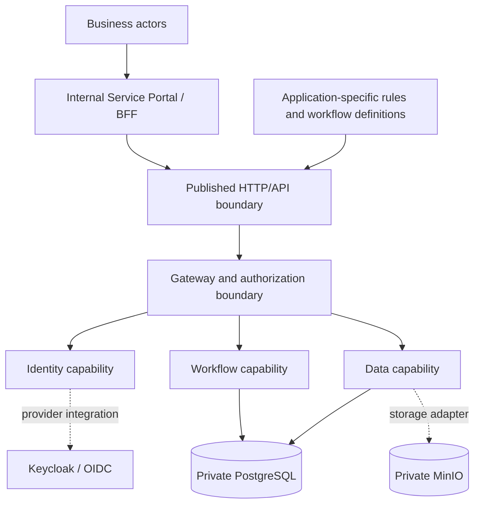

# DX-OS Open-Core — Project Overview

> **Document ID:** G1-F01  
> **Purpose:** Introduce the product problem, intended solution, stakeholders, scope, and validation approach.  
> **Scope:** High-level product and engineering context; not an implementation or acceptance report.

## Purpose

DX-OS Open-Core is a proposed reusable platform for building internal enterprise request-processing applications. Its design separates shared capabilities—identity, workflow, data management, and API gateway—from application-specific rules and user interfaces. The first reference journey is an IT Helpdesk request. A second distinct business workflow is intended to test whether the same Core can be reused without embedding department-specific logic in Core modules. This document explains the hypothetical organizational problem, the intended consumers, the principal boundaries, and the proof required to support the reuse claim. Detailed business rules, API contracts, architectural decisions, and test results belong to their dedicated documents.

## Problem Context and Evidence Boundary

In the **hypothetical reference organization**, employees submit internal requests (for example, software incidents or facility problems), while responsible teams triage, assign, perform, and confirm work. When requests are dispersed across messages or manually maintained records, an organization *may* have difficulties with consistent ownership, authorization, transition history, and reporting.

These are **design hypotheses**, not validated findings about a particular enterprise. No verified survey sample, request volume, baseline completion time, financial return, or quantified performance improvement is available for assertion here. User interviews, process observations, or controlled measurements must be documented separately before such claims can be made. The draft business contract explicitly treats its reference organization as hypothetical ([Issue #53](https://github.com/lexuanbao258-collab/dxos-open-core/issues/53)).

The engineering question is not only how to build a ticket screen, but **whether multiple request applications can share trustworthy platform capabilities without duplicating identity, workflow authorization, and persistence mechanisms**.

## Stakeholders

| Group | Intended interest or responsibility |
| --- | --- |
| Requesters (employees) | Submit requests; track permitted requests; view outcomes and history. |
| Intake coordinators and service managers | Triage requests and oversee permitted operational actions. |
| IT technicians / facility workers | Perform assigned work within workflow and resource permissions. |
| Acceptance or confirmation actors | Evaluate outcomes and perform authorized confirmation or closure actions. |
| Platform engineers and application developers | Maintain Core contracts, adapters, and independently integrated applications. |
| Security and architecture reviewers | Inspect trust boundaries, decisions, and supporting evidence. |
| Open-source contributors and OLP evaluators | Reproduce a scoped deployment and verify the stated architecture and limitations. |

The exact actor-role-to-authority mapping is a **business and security contract question**, not a permission grant implied by this table.

## Product Objectives

DX-OS aims to:

1. Reuse shared identity, workflow, data, and API exposure capabilities across distinct business applications.
2. Make authorized workflow transitions and history inspectable without reducing workflow behavior to an editable status column.
3. Preserve a clear boundary between platform rules and application-owned forms, validation, and business facts.
4. Offer an independently consumable HTTP interface for a sample Portal, rather than coupling its UI directly to Core Java services or database access.
5. Enable reproducible installation and evidence-based verification of security, business journeys, and reuse.

These are **qualitative objectives**. Success measures, baselines, thresholds, and empirical outcomes must be defined and collected in dedicated scope, testing, and evidence artifacts; no improvement percentage is assumed.

## Solution Overview

The intended design has two logical layers: a **headless reusable Core** and one or more **independent application consumers**. The Portal/BFF consumes published, authorized backend HTTP interfaces; the Core must not depend on a specific department's process definition or UI.

**Diagram interpretation:** This is a **conceptual responsibility and integration map**, not a deployment topology, a class dependency diagram, or proof that all connections are live. The Application owns its business rules and definitions; Core owns reusable runtime capabilities. The eventual authorized call chain and persistence transaction boundaries require separate contract and integration review. External products appear only as selected reference adapters/providers, not as proof of validated runtime integration.

### Shared Core Capabilities

| Capability | Intended responsibility | Key boundary |
| --- | --- | --- |
| Identity | Integrate verified OIDC principals and canonical identity information | Identity provider credentials and token validation do not become application-controlled trust claims. |
| Workflow | Execute configured state transitions with authorization, versioning, and history | Business workflow definitions must not require department-specific changes to the shared engine. |
| Data Management | Define structured/unstructured storage access contracts and adapters | Application-specific facts and object access rules must retain explicit ownership. |
| API Gateway | Expose permitted capabilities across a trusted request boundary | A UI-visible action is not proof that the backend authorizes the actual resource. |

The exact service interfaces, trust checks, adapter behavior, and transaction semantics are specified and validated in Core and Integration documentation, not established by this overview.

## Application Scenarios

### Primary Reference: IT Helpdesk

An employee reports a software issue; responsible personnel triage and work on the request; an authorized actor confirms or closes the outcome. The reference Golden Path includes authenticated entry, validated creation, permitted transitions, and an authorized view of history. States and roles remain subject to the ratified business contract and published runtime definition.

### Reuse Demonstration: Distinct Business Workflow

The current OLP MVP planning in [Issue #40](https://github.com/lexuanbao258-collab/dxos-open-core/issues/40) identifies **Facility Maintenance** alongside IT Helpdesk as two candidate definitions in one Portal. [Issue #53](https://github.com/lexuanbao258-collab/dxos-open-core/issues/53) retains the associated business rules and transition names as draft pending ratification. **Access Request** is mentioned there as a design-only reuse exercise, not an approved third implementation.

The decisive reuse question is whether a distinct workflow can be introduced through application-owned definitions, validations, and integration without modifying the published Core algorithm. A second screen alone does not demonstrate Core reuse.

## MVP Summary and Non-Goals

**Intended MVP journey:** authenticated Portal access; a request created through an authorized API; a valid workflow transition and durable history; a permitted user inspecting the outcome; and negative checks for invalid tokens, forbidden resources, illegal transitions, and concurrency conflicts. A second business definition is used to examine reuse. The exact in-scope acceptance scenarios and exclusions must be ratified in the separate MVP scope and business contract.

**Non-goals for this scoped demonstration:** building a full enterprise resource planning (ERP) suite, asset inventory/procurement, a business process model and notation (BPMN) designer, arbitrary enterprise automation, or a speculative microservices rewrite. No unregistered API, client-side admin credential, or direct Portal database access is part of the intended architecture.

## Technology Context

The current local demonstration direction documented in [Issue #40](https://github.com/lexuanbao258-collab/dxos-open-core/issues/40) is **Keycloak/OIDC → Portal/BFF → Java Backend/Gateway/Workflow → private PostgreSQL 17**, with **self-hosted MinIO** behind an object-storage port. This describes a selected deployment direction, **not** an assertion of a completed clean installation, live E2E approval, or deployment portability. Technology choices, exact versions, security configurations, and adapter acceptance belong to the Architecture, Core, and Deployment records.

## Reuse Hypothesis and Verification

**Hypothesis:** A common Core can support at least two distinct request workflows by varying application-owned business definitions and adapters while preserving the published Core contracts and algorithms.

A credible reuse demonstration should provide all of the following:

- Two genuinely distinct business definitions and explicit actor/transition rules.
- The same Core revision for both scenarios, with no department-specific branching introduced into Core.
- An independent application consumer accessing published HTTP capabilities, without direct Core service injection or database access.
- Evidence of allowed transitions, denied actions, visibility protection, version/concurrency handling, and auditable history.
- A pinned code revision, executable reproduction steps, observed test outputs, and independent review of the claim.

An accepted architecture decision, a mock UI, or an unexecuted test plan cannot substitute for runtime evidence. Until a pinned end-to-end run and review are available, the reuse claim remains **to be demonstrated**.

## Assumptions, Risks, and Limitations

| ID | Assumption or risk | Required follow-up |
| --- | --- | --- |
| AS-01 | Enterprise process pain points are hypothetical. | Collect and cite real observations or keep claims explicitly hypothetical. |
| AS-02 | The business contract and second workflow details are subject to ratification. | Confirm the current approved scope and authoritative workflow definitions. |
| RK-01 | Application/Core boundaries may diverge during parallel development. | Review contracts and track design–code discrepancies at pinned revisions. |
| RK-02 | Identity and Gateway integration could be described as secure without full negative-test evidence. | Require exact-SHA authorization and resource-visibility verification. |
| RK-03 | Two workflow configurations might be mistaken for proven end-to-end reuse. | Validate independent HTTP consumption and unchanged Core behavior. |
| RK-04 | Deployment choice could be mistaken for reproduced installation. | Produce clean-environment installation and restart evidence. |

## Related Documentation and Sources

The following are **intended documentation paths**, not hyperlinks: they must be linked only after repository existence and baseline verification.

- `docs/00-project/problem-statement.md` — problem evidence and hypotheses.
- `docs/00-project/product-vision.md` — product principles and outcomes.
- `docs/00-project/scope-and-mvp.md` — scope, Golden Paths and acceptance boundaries.
- `docs/01-architecture/system-architecture.md` — system architecture and its rationale.
- `docs/09-evidence/README.md` — evidence navigation and runtime proof.

Public planning sources used for this draft:

- [Issue #53 — Business Rules & API Contract](https://github.com/lexuanbao258-collab/dxos-open-core/issues/53)
- [Issue #39 — Independent Internal Service Portal](https://github.com/lexuanbao258-collab/dxos-open-core/issues/39)
- [Issue #40 — Reproducible Deployment and OLP Demo](https://github.com/lexuanbao258-collab/dxos-open-core/issues/40)
- [Issue #27 — Core E2E Demonstration](https://github.com/lexuanbao258-collab/dxos-open-core/issues/27)

This overview is a **draft design description**. Document ownership, lifecycle, approved baseline, independent review, and Gate outcome must be recorded in their respective G0/G1 governance artifacts.
