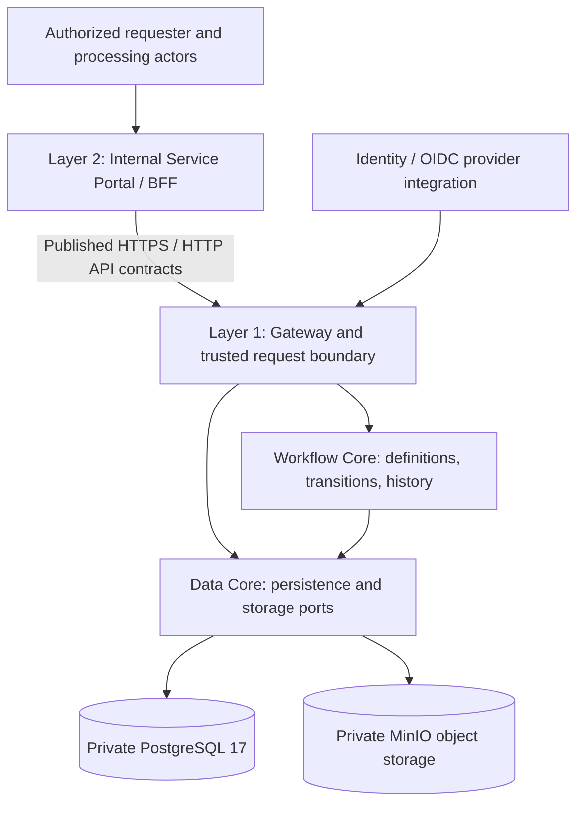

# DX-OS Open-Core — Scope and MVP

> **Document ID:** G1-F04  
> **Purpose:** Define a bounded, testable MVP comprising a reusable Headless Core, an independent application consumer, end-to-end business journeys, and evidence of reuse.  
> **Scope:** Product scope and candidate MVP acceptance boundaries; not a statement of completed implementation or gate approval.

## 1. Purpose and Scope Authority

DX-OS Open-Core is a proposed reusable foundation for internal enterprise service-request workflows, supported by a separate application consumer. This document records **proposed scope commitments**, dependencies, exclusions, and criteria that would make a future acceptance claim testable. It does **not** approve a business contract, establish an implementation baseline, certify an API as active, or declare an end-to-end (E2E) test successful.

**Scope authority and conflicts:** the current design is informed by [Portal Issue #39](https://github.com/lexuanbao258-collab/dxos-open-core/issues/39), [Release/Demo Issue #40](https://github.com/lexuanbao258-collab/dxos-open-core/issues/40), and [Business Contract Issue #53](https://github.com/lexuanbao258-collab/dxos-open-core/issues/53). Issue #40 describes an official local-demo provider decision; Issue #53 explicitly describes its MVP v1.2 business contract as **DRAFT pending team ratification**. A reviewer must reconcile any later approved decisions before freezing this scope. The canonical document lifecycle and approval authority remain with the G0 Document Register and governance process.

## 2. Goals and Non-Goals

### 2.1 Goals

- Demonstrate one **real, authorized IT Helpdesk business journey** from browser identity through published Backend APIs to durable Workflow state and audit/history, including resolution, confirmation, and closure where supported by the ratified contract.
- Provide the smallest viable **Headless DX-Core** capabilities for Identity, Gateway, Workflow, and Data without embedding application-specific business rules in reusable Core modules.
- Demonstrate a **separately buildable/runnable Internal Service Portal** consuming the Core via HTTP/API, not Java dependency injection or direct database access.
- Test the hypothesis that **two distinct business Workflow Definitions** can use the same Core contracts and processing algorithm without changing Core code merely to support a second application scenario.
- Produce reproducible installation instructions, security and transaction negative tests, and evidence tied to an exact tested code revision. All outcomes remain unverified until executed and reviewed.

### 2.2 Explicit Non-Goals

ERP, inventory/asset management, procurement/purchasing, 88 use cases, BPMN editor/designer, AI features, a speculative microservices rewrite, simultaneous cloud-storage provider variants, production-wide policy-engine expansion, and a third implemented Access Request application are **OUT** of this MVP. A conceptual Access Request reuse exercise may appear in design evidence, not in implementation-completion claims.

## 3. System and Responsibility Boundaries

*Logical target design only; arrows are conceptual responsibilities, not evidence of deployed or tested runtime paths. The final port/adapter topology must be verified in G3/G4/G6.*

| Responsibility | Owned by | Boundary constraint |
| --- | --- | --- |
| Authentication and canonical verified subject | Identity / trusted Backend integration | Browser-supplied identities, `X-User` or `X-Role` are not trusted authority |
| API exposure and authorized operation handoff | Gateway / Backend | Enforce actual resource visibility and grants server-side |
| Workflow definition, state transition, instance version and history | Workflow Core | Application cannot write a status column to bypass the engine |
| Structured data and authorized object-storage access | Data Core / Backend adapters | Portal cannot access DB or MinIO credentials directly |
| Forms, domain facts, validation, role-facing UX | Application | Workflow state machine remains provider-neutral and application-independent |

## 4. MVP Classification (MoSCoW)

**MUST/SHOULD/COULD/OUT express scope priority, not build status.** `ACTIVE`, `PLANNED`, or `BLOCKED` may describe an API only when supported by the exact contract and corresponding evidence. No implementation classification is assigned by this draft.

| ID | Capability / deliverable | Priority | Acceptance boundary / dependency |
| --- | --- | --- | --- |
| MVP-01 | OIDC/Keycloak login and verified canonical principal | MUST | Real auth flow, expected subject verification, negative authentication evidence; #24 |
| MVP-02 | Trusted Backend/Gateway authorization | MUST | Operation grant, resource visibility, actor eligibility, tenant boundary; #22/#23 |
| MVP-03 | Definition-driven workflow transitions and history | MUST | Valid/invalid transitions, optimistic version behavior, history integrity; #22/#27 |
| MVP-04 | Private PostgreSQL 17 structured persistence | MUST | Durable state/history, rollback/concurrency evidence, non-admin DB role; #25/#27/#40 |
| MVP-05 | Independently runnable Internal Service Portal over HTTP | MUST | No Java Core injection, direct DB access, client secrets or invented APIs; #39 |
| MVP-06 | Primary IT Helpdesk golden path | MUST | Authenticated request → processing → resolution → authorized confirmation/closure, subject to ratified business contract; #53/#39/#27 |
| MVP-07 | Second Workflow Definition reuse demonstration | MUST | Distinct Facility Maintenance candidate definition using unchanged published Core algorithm/contract; actual support demonstrated by tests; #27/#40/#53 |
| MVP-08 | Security and transaction negative-path test suite | MUST | 401, visible-forbidden 403, hidden 404, IDOR/BOLA, version conflict, rollback, uncertain commit handling; #23/#27/#40 |
| MVP-09 | Reproducible private local demo installation | MUST | Clean install/run/restart for Keycloak, Portal/BFF, Backend, PostgreSQL, MinIO; #40 |
| MVP-10 | MinIO adapter and secure object-storage integration | MUST as local stack component | Private volume/credentials and reviewed adapter; attachment UI is **not accepted** until secure Backend API tests exist; #26/#40 |
| MVP-11 | Authorized request list/detail/history UI | MUST for demonstrable journey | Real API capability and visibility semantics; unsupported endpoints remain BLOCKED, not fabricated; #39/#53 |
| MVP-12 | Independent evidence, API documentation, licensing readiness | MUST for release claim | Pin SHA, test results, reviewer decisions, #37 OpenAPI, #38 license/SPDX and #40 release checks |
| MVP-13 | Convenient search/filter UI | SHOULD | Only if supported by reviewed published listing contract; #39/#53 |
| MVP-14 | Real authorized attachment upload/download | SHOULD, conditional | Promote to actual acceptance only after secure storage/API contract and negative tests; #26/#39 |
| MVP-15 | UX refinements beyond essential flows | COULD | Must not displace security or E2E gates |
| MVP-16 | ERP, inventory, procurement, BPMN editor, AI, additional application implementations | OUT | Explicitly excluded from MVP |

**Dependency-sensitive interpretation:** A MUST item may remain unimplemented or blocked. Reclassification is a governed scope change requiring impact analysis; it is never hidden by relabeling incomplete functionality as ACTIVE.

## 5. Application Scope and Golden Paths

### 5.1 GP-IT-01 — Primary Helpdesk Journey (MUST)

**Candidate actor chain:** requester → authorized intake/coordinator → authorized IT technician → authorized confirmation/closure actor. Specific role names, preconditions, and state/transition keys must come from an **approved** version of Issue #53 or its successor contract.

**Required behavioral outcomes:** (1) verified OIDC session; (2) authorized request creation with validated business facts; (3) authorized triage/assignment or equivalent approved processing transition; (4) permitted work progression and resolution; (5) requester or authorized actor confirmation and closure; (6) persisted state, version, and ordered history displayed through authorized API calls. Where the contract calls a state `CONFIRMED`, do not infer it is identical to `CLOSED`; reconcile the final transition matrix before acceptance.

**Alternates/negative checks:** insufficient input, reasoned rejection, actor not eligible, invalid transition, stale version, duplicate click, lost response/`COMMIT_OUTCOME_UNKNOWN`, 401, visible-but-forbidden 403, hidden-resource 404, and cross-tenant/resource-ID substitution. The correct behavior must be verified, including **no blind retry** after uncertain commit outcome.

**Completion criterion:** one reproducible E2E run across browser/Portal → trusted HTTP Backend/Gateway → Workflow → private PostgreSQL, with actual state/history and independent review on pinned SHA. A mock or a diagram is not E2E evidence.

### 5.2 GP-FAC-01 — Facility Maintenance Reuse Candidate

The proposed second domain describes a physical repair request with intake, assignment, work, acceptance, and potential rework. The **candidate** business workflow remains subject to #53 ratification. This track must demonstrate a genuinely distinct business definition, not merely renamed IT states or two styled UI pages.

**Minimum reuse-proof threshold:** a separately identifiable Facility Workflow Definition is loaded or activated through the published supported mechanism; appropriate actors and transition restrictions are tested; identical Core contract and transition algorithm handle both IT and Facility; Core code remains unchanged specifically to implement the second business process. If Facility UI and E2E acceptance are incomplete, state that limitation explicitly; do **not** claim a second fully delivered application.

### 5.3 Access Request — Design Exercise Only

Access Request can illustrate how another definition might reuse Core. It is **not a third MVP implementation** and carries no requirement for end-user implementation, production deployment, or a third Golden Path.

## 6. Reuse Hypothesis and Falsifiable Proof

**H-RUSE-01:** DX-Core supports two meaningfully different internal-request workflows through stable provider-neutral Core contracts, varying domain definitions and Application-layer behavior without editing Core's processing algorithm for the second workflow.

| Proof dimension | Required observable evidence | Falsification / limitation |
| --- | --- | --- |
| Same Core | Test both definitions against identical build and pinned commit | Separate fork, application-specific branch, or altered algorithm invalidates claim |
| Distinct behavior | Different domain states, actors, transition and validation cases | Renamed labels with identical semantics are insufficient |
| Security isolation | Actor/resource and negative authorization tests for each definition | UI-only role hiding does not count |
| Persistence and audit | Durable per-instance state/history, version/concurrency tests | Fixtures or memory-only mocks do not prove runtime behavior |
| Published integration boundary | Both consumers/definitions invoke documented Core-facing contracts | Direct Java injection/DB writes defeat architectural reuse proof |

Do not equate two definitions existing in a repository with successful reuse verification.

## 7. Security, Consistency, and Storage Acceptance Constraints

- **Identity and authorization:** real Keycloak/OIDC Authorization Code + PKCE for browser login; verified principal at the trusted boundary; exact operation grants, tenant membership, resource visibility, state/actor eligibility and server-side enforcement. Portal UI visibility is not an authorization control.
- **Response boundaries:** verify invalid/expired credential → 401; visible but forbidden → 403; non-visible resource → 404 where the approved contract specifies this privacy policy. Check IDOR/BOLA and revoked permissions.
- **Workflow integrity:** enforce state/transition preconditions, expected version, no duplicate effect and appropriate concurrency conflict. Core owns authoritative instance/state/history; Application owns business facts.
- **Transactions:** prove consistency for Workflow state/history in the relevant PostgreSQL transaction; do not claim PostgreSQL–MinIO atomicity. For uncertain `COMMIT_OUTCOME_UNKNOWN`, use observation/reconciliation rather than blind write retry.
- **Storage:** local private MinIO volume behind server-side `ObjectStoragePort`; least-privileged credentials and object-level authorization. Attachment acceptance depends on real reviewed Backend endpoints; do not leak privileged keys into Portal.
- **Deployment:** pin environment and code revisions; confirm clean install/restart, data persistence, configuration, no committed secrets and documented known limitations.

## 8. API Capability Classification and Contract Gap

Each UI action must map to an **actually published** Backend API, not an assumed method or mock-only response. An authoritative API inventory is **not verified for this document**. The table below specifies what must be checked; it does **not** assert an endpoint exists or is ACTIVE.

| Capability needed by Portal | Proposed classification in this document | Evidence needed before `ACTIVE` |
| --- | --- | --- |
| OIDC session and verified identity | NOT VERIFIED | Supported flow and test/PR at exact SHA |
| Create/transition/read Workflow | NOT VERIFIED | Published OpenAPI/contract plus authorization and runtime tests |
| Authorized list/filter/assignment/history | NOT VERIFIED | Explicit secured endpoint and E2E evidence; #53 flags capability gaps |
| Attachment upload/download | NOT VERIFIED | Reviewed secure Backend API and MinIO adapter tests |

For the implementation-facing API register, use only `ACTIVE`, `PLANNED`, or `BLOCKED` when evidence warrants; **NOT VERIFIED here means this overview has not determined the implementation classification**, not a new official API lifecycle state. Mock Portal screens must be labeled `DEVELOPMENT/MOCK`. Do not enable blocked production routes to make a demo appear complete.

## 9. Acceptance and Evidence Matrix

| Acceptance ID | Requirement / acceptance test | Proof required | Current evidence status |
| --- | --- | --- | --- |
| AC-MVP-01 | Real verified authentication | OIDC login, subject and negative-token tests at SHA | NOT VERIFIED |
| AC-MVP-02 | Actual server-side grants and visibility | 401/403/404, cross-tenant and resource test output | NOT VERIFIED |
| AC-MVP-03 | GP-IT-01 E2E | Browser/API/PostgreSQL state+history trace, independent review | NOT VERIFIED |
| AC-MVP-04 | Transaction and concurrency correctness | Rollback, conflict, duplicate and uncertain-write scenarios | NOT VERIFIED |
| AC-MVP-05 | Facility reuse | Two distinct definitions, unchanged Core code, isolated cases | NOT VERIFIED |
| AC-MVP-06 | Portal/Core HTTP independence | Build/run commands and network/API evidence | NOT VERIFIED |
| AC-MVP-07 | Local private providers and reproducible demo | Clean install, restart and storage durability evidence | NOT VERIFIED |
| AC-MVP-08 | Source-open release readiness | Reviewed OpenAPI, SPDX/license, notices and demo artifacts | NOT VERIFIED |

**Acceptance policy:** measurable acceptance criteria, reproducible test procedure, exact code/docs SHA, test evidence, reviewer independent of author, and approval by designated authority. No result in this table is a pass or a claim that a feature is absent.

## 10. Measurement Plan — No Invented Baselines

| Candidate metric | Measurement proposal | Baseline / result |
| --- | --- | --- |
| Time to find status or assignee | Time a representative actor executing identical reference tasks in AS-IS and target process | **BASELINE UNKNOWN** / not measured |
| Authorized traceability | Count of required history events retrievable by eligible actors | **BASELINE UNKNOWN** / not measured |
| Denial correctness | Ratio of blocked unauthorized/invalid attempts in a predefined negative suite | **BASELINE UNKNOWN** / not measured |
| Reuse effort | Count and nature of Core code changes needed for a second definition | **BASELINE UNKNOWN** / not measured |
| Clean deployment | Repeatable time and success/failure of fresh install and restart | **BASELINE UNKNOWN** / not measured |

No percentage improvement, SLA, ROI, dataset size, installation success rate or test count is asserted without measured sources.

## 11. Dependencies, Risks, and Scope Change

| Risk / dependency | Potential impact | Control / review action |
| --- | --- | --- |
| #53 is draft | Role/state/business acceptance unresolved | Ratify use cases, transition matrix, data ownership and endpoint gap before freezing Portal UX |
| #22/#23/#24 security and HTTP | Portal action may not have a safe live endpoint | Keep integration explicitly blocked/mock until independently verified |
| #25/#26/#27 runtime persistence | No safe E2E proof of persistence or object storage | Verify PostgreSQL/MinIO adapters, transaction boundary and Core tests |
| #37/#38 docs and licensing | Release claim incomplete | Review API docs, license metadata and compliance evidence |
| #39/#40 Portal and packaging | No reproducible full-stack demonstration | Run real user journeys and clean installation at pinned SHA |
| G0 baseline and G1 review | Unverified status or stale references | Reconcile canonical Register, PR evidence and Gate Review before sign-off |

**Change control:** any proposed MUST/SHOULD/OUT change requires scope-impact analysis across contracts, security, architecture, tests, ownership, timeline and evidence; record the decision/review in the existing governance process and update the Document Register, affected requirements and related issues. Avoid changing committed MVP scope silently or retroactively claiming completed work.

## 12. Traceability and Related Documentation

| Scope / objective | Problem and product link | Verification destination |
| --- | --- | --- |
| Secure internal request handling | G1 Problem Statement: stakeholder needs / pain-point hypotheses | G2 use cases and business rules; G7 security/E2E tests |
| Reusable Core and second definition | G1 Project Overview reuse hypothesis | G3/G4 boundary and contract review; G7 reuse proof |
| Independent application | #39 Portal and #53 draft business contract | G5 application specifications; G6 real HTTP contract |
| Reproducible open-source demo | #40 release direction | G8 installation evidence and G9 licensing review |

**Public issue sources:** [#39 Portal](https://github.com/lexuanbao258-collab/dxos-open-core/issues/39), [#40 Packaging/Demo](https://github.com/lexuanbao258-collab/dxos-open-core/issues/40), [#53 Business Contract DRAFT](https://github.com/lexuanbao258-collab/dxos-open-core/issues/53). Internal documentation links to G1 Project Overview, Problem Statement, Product Vision, G0 Design Process, Document Register, Style Guide and G1 Gate review must be added **only after tracked paths are verified** to avoid broken links.

**Review disposition:** This is an authoring draft, not independent acceptance. Document lifecycle and reviewer/approver information must be confirmed in the canonical G0 records. **G1-F04: DRAFT / NOT REVIEWED.**
