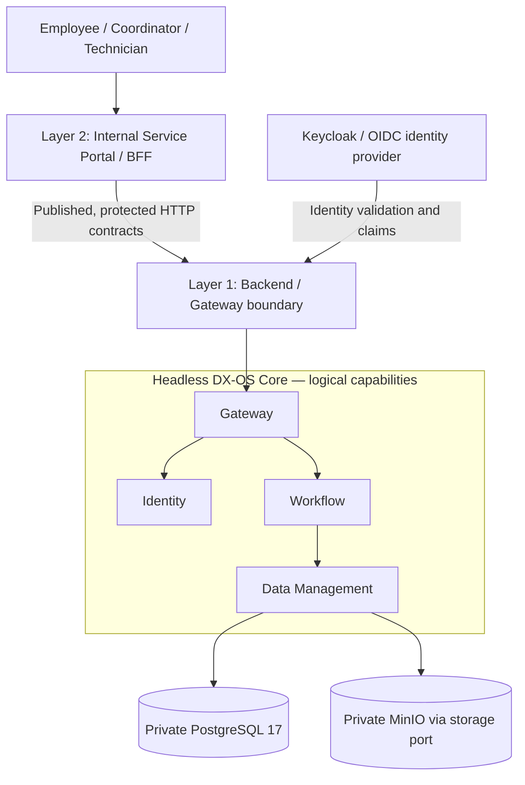

# DX-OS Open-Core — Architecture Documentation

> **Document ID:** G3-F01  
> **Purpose:** Entry point, reader journeys, architectural boundaries and review map for G3 System Architecture.  
> **Scope:** Architecture-level documentation, not a substitute for ADRs, API contracts or implementation evidence.  
> **Review qualification:** Authoring draft; refer to the Document Register for the canonical document lifecycle and owner.

## Purpose and Source Snapshot

This portal helps newcomers, developers and independent reviewers navigate the architecture of DX-OS Open-Core: a reusable, headless foundation for internal service applications. The solution is **not a general-purpose operating system** and the Portal is **not** a Java module permitted to bypass published Core interfaces.

**Inventory snapshot:** the code repository [`lexuanbao258-collab/dxos-open-core`](https://github.com/lexuanbao258-collab/dxos-open-core) was inspected at commit [`0f0c3ba0c3eecda0a5c4a798a3cc14b808351bed`](https://github.com/lexuanbao258-collab/dxos-open-core/commit/0f0c3ba0c3eecda0a5c4a798a3cc14b808351bed). This is an **observed inventory snapshot, not an approved G3 baseline**. The documentation repository's remote and full SHA, independent review results and G3 gate decision are not established here. Verified links below refer to files found at this exact code-repository commit; their internal metadata may refer to a different historical baseline and must be reconciled.

## Architecture at a Glance

**Diagram classification:** conceptual/target relationships, **not** a verified runtime request trace, one-to-one deployment map or proof of direct module dependencies. The drawn arrows summarize the intended request boundary and relevant providers; exact ownership and ports require the detailed architecture/contracts. The MinIO and PostgreSQL deployment choices reflect the local MVP direction recorded in [Issue #40](https://github.com/lexuanbao258-collab/dxos-open-core/issues/40); no attachment or full-stack LIVE acceptance is implied.

## Architectural Principles

| Principle | Design intent | Verification question |
| --- | --- | --- |
| Reusable Core | Identity, Gateway, Workflow and Data expose application-neutral behavior | Do distinct business definitions use the same Core contracts and implementation? |
| Explicit ownership | Core owns state/version/history; Applications own business facts and decisions | Can an application modify Workflow state directly or access Core persistence? |
| Ports and adapters | External providers are reached through controlled interfaces | Are JDBC, OIDC and object storage concerns confined to approved adapters? |
| Server-enforced security | Verified principal, exact operation grants, resource/tenant visibility and actor eligibility | Do negative HTTP tests reject forged, hidden and unauthorized actions? |
| Evidence before claims | Documentation design, implementation and acceptance are distinct | Is the asserted behavior demonstrated at a pinned source SHA? |
| Minimal delivery | Prefer a reproducible, security-reviewed local MVP over speculative expansion | Does the golden path run through real protected HTTP and persisted history? |

These are **design principles**, not evidence that all invariants are implemented. In the existing architecture drafts, identifiers such as `SYS-ADR-01` designate design discussions; they are not proof that a numbered ADR file is approved.

## System and Application Boundaries

**Layer 1 — Headless Core:** common identity/principal representation, protected API mediation, generic workflow definitions/instances/transitions/history and provider-neutral data/storage capabilities. Identity verification and workflow authorization are different checks; a business role does not automatically grant authority.

**Layer 2 — Applications:** the Internal Service Portal and domain-specific behavior for IT Helpdesk and Facility Maintenance. The Application owns request fields, validation, triage decisions, assignment and resolution/repair facts subject to reviewed business contracts. No Portal-to-PostgreSQL access, privileged MinIO credentials in browser code, unregistered Core APIs, or direct Java service injection across the consumer boundary.

**Primary candidate:** IT Helpdesk (`SUBMITTED → TRIAGED → IN_PROGRESS → RESOLVED → CONFIRMED` in the PR #76 candidate); `assign` is a distinct Application operation, not the `triage` Workflow transition. **Secondary candidate:** Facility Maintenance, whose full journey and acceptance/closure policy remain deferred/unratified. An Access Request example is a design exercise, not an additional committed LIVE application. See [Issue #53](https://github.com/lexuanbao258-collab/dxos-open-core/issues/53) and [PR #76](https://github.com/lexuanbao258-collab/dxos-open-core/pull/76).

## Architecture Document Map

The entries marked **Verified at source snapshot** have actual repository files at the SHA above. File existence is **not** document approval. Entries marked **Planned / not found at snapshot** intentionally have **no broken links**.

| Architecture document | Purpose | Inventory qualification |
| --- | --- | --- |
| `README.md` (this file) | Navigation, boundaries, evidence rules | New working draft; not yet committed to verified source snapshot |
| `system-context.md` | C4 System Context and external actors | Planned / not found at snapshot |
| [System Architecture](system-architecture.md) | Overall architecture, logical components and intended flows | Verified at source snapshot; proposed review draft |
| [Core–Application Boundary](core-application-boundary.md) | Data/business ownership and interface boundary | Verified at source snapshot; proposed review draft |
| [Dependency Rules](dependency-rules.md) | Dependency direction and forbidden coupling | Verified at source snapshot; proposed review draft |
| `technology-stack.md` | Technology rationale, status, alternatives | Planned / not found at historical snapshot; tracked on this branch |
| [Deployment Topology](deployment-topology.md) | Local MVP target layout and network boundaries | Verified at source snapshot; TARGET, not deployed/verified |

**Historical navigation finding:** the [docs index](../README.md) was found at the same snapshot. The intended `docs/08-decisions/README.md` ADR index was **not found** at that snapshot; its existence in a local authoring package did not establish a tracked/approved Git file. Core module deep dives and integration documents require path verification before linking; a link does not establish document approval.

**Current-branch navigation:** [Technology Stack](technology-stack.md) and [ADR governance](../08-decisions/README.md) are tracked on `docs/core-architecture-alignment`. Their presence does not change the historical inspection result or imply approval.

## Reader Journeys

| Reader | Recommended sequence | Desired outcome |
| --- | --- | --- |
| Newcomer | [Documentation home](../README.md) → this page → [System Architecture](system-architecture.md) → future `system-context.md` | Understand goals, actors and the conceptual architecture |
| Developer | [Core–Application Boundary](core-application-boundary.md) → [Dependency Rules](dependency-rules.md) → relevant capability/API contracts | Identify owned state, permitted interfaces and forbidden coupling |
| Independent reviewer | [System Architecture](system-architecture.md) → [Core–Application Boundary](core-application-boundary.md) → [Deployment Topology](deployment-topology.md) → exact source/test evidence | Challenge assumptions, authorization boundaries, acceptance and reproducibility |

## C4 View Guide

- **Context:** users, adjacent systems, trust boundaries and DX-OS system scope; intended `system-context.md` is not yet verified.
- **Container:** Portal/BFF, modular backend, Keycloak and private persistence/storage boundaries; use System Architecture for the currently available high-level design.
- **Component:** internal capabilities, module contracts, ports and adapters; detailed component views belong in the appropriate Core documents, not in this portal.

A conceptual Mermaid chart is not automatically a formal, reviewed C4 model. Each detailed diagram must identify scope, ownership, trust boundary, assumptions and evidence qualification.

## Decisions, Contracts and Evidence

The intended traceability chain is **Problem / Need → G1 MVP Scope → G2 Use Case / Business Rule → G3 Architecture → ADR → Core/API Contract → Source/Test → Evidence → Reviewer Decision**. Do not convert design intent into `ACTIVE`, `VERIFIED`, `Accepted ADR` or Gate `PASS` merely because it appears in a document or PR.

Decision governance belongs in the architecture decision index once that file is confirmed in the reviewed repository. Issue/PR links establish **source context**, not approval: [#39 Portal boundary](https://github.com/lexuanbao258-collab/dxos-open-core/issues/39), [#40 local deployment / demo](https://github.com/lexuanbao258-collab/dxos-open-core/issues/40), [#53 draft Application contract](https://github.com/lexuanbao258-collab/dxos-open-core/issues/53), [PR #76 Application drafts](https://github.com/lexuanbao258-collab/dxos-open-core/pull/76).

For any claim of an implemented capability, reviewers must record exact code revision, contract revision, test command/run, result and reviewer findings. Distinguish **MOCK / DEVELOPMENT**, **CANDIDATE**, **PLANNED / DEFERRED**, **LIVE / verified by evidence** and **Gate decision**. Their meanings must not be conflated with document lifecycle (`Planned`, `Draft`, `In Review`, `Approved`, `Superseded`).

## Open Architecture Questions and Review Map

| Question | Governing artifact / review needed |
| --- | --- |
| Are the reviewed code/docs SHAs and owners/approvers fixed? | G0 baseline-and-ownership + Document Register + Gate review |
| Do existing architecture metadata SHA and current inventory snapshot agree? | Source comparison and independent G3 review |
| Are the `SYS-ADR-*` choices represented by actual approved ADRs? | Verified ADR inventory and decision review |
| Is business contract v1.2 ratified and the Helpdesk/Facility transition policy consistent? | [Issue #53](https://github.com/lexuanbao258-collab/dxos-open-core/issues/53) and G2 business review |
| Can the Portal invoke real protected APIs without bypassing security? | [Issue #39](https://github.com/lexuanbao258-collab/dxos-open-core/issues/39), secure HTTP integration evidence |
| Is end-to-end local deployment reproducible and independently verified? | [Issue #40](https://github.com/lexuanbao258-collab/dxos-open-core/issues/40), exact-sha run evidence |

## Maintenance and Acceptance

Architecture changes that affect published contracts, security, dependency direction, ownership or provider strategy require impact analysis, applicable ADR review, updated diagrams and downstream tests. Editorial-only changes use ordinary pull-request review. The Document Register is authoritative for document status; issue and Gate records are authoritative for blockers and final decisions.

**G3-F01 acceptance requires:** file/link verification on the actual docs baseline; correct conceptual labeling; no duplicated decision authority; traceability to G1/G2 and verified source; independent architecture review; and an authorized Gate decision. **This working draft has not been independently reviewed or approved.**
