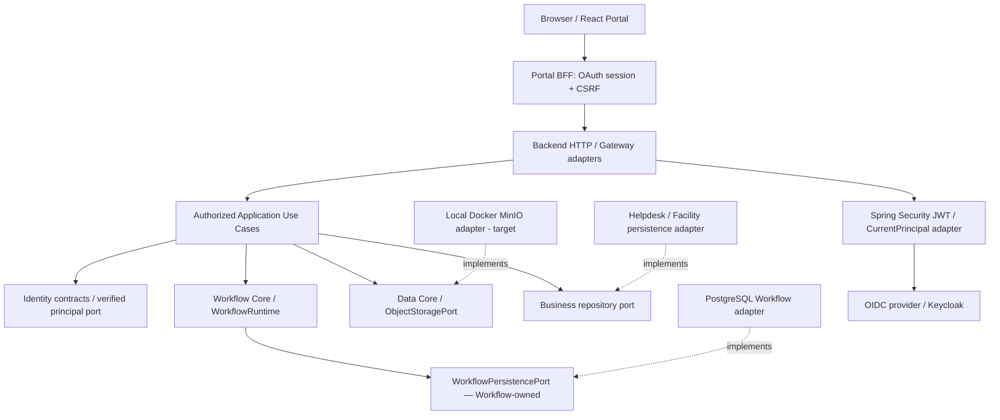
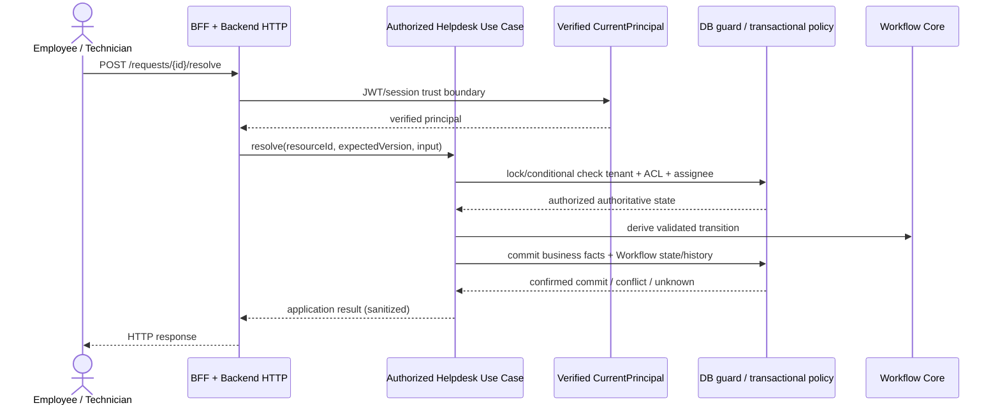

# Core ↔ Application Boundary — Architecture Design & Independent Review

> **Evidence rule:** `BASELINE` = observed in the pinned main source/contracts; `CANDIDATE` = unmerged work on a named PR; `PROPOSED` = target boundary; `UNVERIFIED` = acceptance evidence is not established. Selecting a design direction is **not** proof that its implementation or tests are accepted. No tests were executed in preparation of this document. Existing `docs/contracts/` and `docs/evidence/` remain canonical during the documentation migration.

## 1. Purpose, scope, architectural assumptions

This document establishes **what belongs in a reusable Core capability and what belongs in a specific Application**, so DX-OS can demonstrate IT Helpdesk and Facility reuse without turning Core into a renamed Helpdesk module. It supplements [System Architecture](system-architecture.md), not replaces individual contracts or approved ADRs.

**Foundation decisions selected by the team:** SYS-ADR-01 B Modular Monolith; SYS-ADR-02 B Hexagonal Architecture / DIP; SYS-ADR-06 B capability/application-owned data; SYS-ADR-08 B generic state-machine Workflow. Backend modular monolith can coexist with separately deployed browser Portal, BFF, and reverse proxy; *logical modules are not necessarily deployable microservices*.

**Out of scope:** approving new production endpoints, modifying Java implementation, redefining immutable Flyway migrations, asserting cross-provider compatibility without tests, or committing to a BPMN engine. The BFF is an HTTP-facing component, not an additional fifth Core capability.

### Boundary decision test

A function belongs to **Core** when it represents a *domain-neutral shared capability*, has an application-neutral contract and invariants, and can serve materially different applications without an app-name-specific branch. A function belongs to an **Application** when its truth depends on Helpdesk/Facility actors, business resource types, approval eligibility, SLA, assignment, resolution, ownership, retention or UI task vocabulary. A function belongs to an **Adapter** when it translates between an existing port/use case and Spring, OIDC/Keycloak, PostgreSQL/JDBC, object storage, HTTP, or other providers.

**Important nuance:** “Reused twice” alone does not create a good Core; accidental abstractions must still be coherent, stable and independently testable. Conversely a Core capability need not expose its own REST controller.

## 2. Boundary model: ownership, invocations, dependencies

This depicts **conceptual calls and implementations**. Java source dependency points from an adapter **toward** the port it implements. A verified principal is produced by a trusted framework boundary; creating an `AuthenticatedPrincipal` manually does not prove authentication. All business operations must pass an authorized Application seam; Gateway must not directly expose unguarded Core mutation.

**Mandatory module import rules (target):**

| Source | Permitted | Forbidden or must be reviewed |
|---|---|---|
| `core.identity` | Pure identity values/contracts | Spring Security, Keycloak, business roles, Workflow |
| `core.workflow` | Pure workflow model and its persistence port | Helpdesk, Facility, JDBC, HTTP DTOs, Identity runtime imports |
| `core.data` | Object storage contracts and neutral value types | Request/Helpdesk/Facility business entities, provider SDKs |
| Gateway HTTP adapters | Inbound DTOs, auth integration, authorized Application operations | Business SQL, direct unguarded `WorkflowRuntime` mutation |
| `application.helpdesk` | Core contracts, authorized orchestration, its business ports | Keycloak SDK/HTTP controller specifics; direct Workflow SQL coupling as target |
| `application.facility` | Same shared capability contracts with Facility policy | Changes to generic Core to accommodate Facility-only rules |
| Infrastructure / adapters | Provider libraries and outbound Core/Application ports | Defining or bypassing business authorization policy |
| BFF | Session/OAuth/CSRF/allowlisted backend transport | Final ticket-level authority decisions, direct database writes |

**ArchUnit checks should test imports and package dependencies**; source-code import tests alone cannot prove HTTP route exposure, transaction authorization, or runtime database privileges.

## 3. Four Core Capabilities — responsibility and exclusion matrix

| Capability | Owned reusable mechanisms | Explicitly outside Core | Application consumer |
|---|---|---|---|
| **Identity** | Identity representations, exact authorities, identity errors; `CurrentPrincipal` trusted access port in Application seam | Password IAM, Helpdesk coordinator/assignee eligibility, resource ACL | Helpdesk/Facility access policies |
| **Workflow** | Definitions, exact versions, instance lifecycle, transition ID, optimistic concurrency, immutable history, `WorkflowPersistencePort` | IT ticket assignment, resolution text, Facility repair policy, JWT parsing | Use case chooses definition, requests transition after authorization |
| **Data Management** | `ObjectStoragePort`, key/metadata/stream/write-mode/error semantics; reusable data facilities explicitly contracted | Ownership of *all* tables, ticket retention rules, Workflow transition semantics | App determines object visibility and links to business resources |
| **API Gateway** | HTTP entry/exposure, coarse authenticated boundary, common transport/security/error conventions | Resource ACL, assignment, transition legality, database transaction policy | Routes to authorized application use cases |

**Data naming warning:** a physical PostgreSQL database is infrastructure shared by several owners. **Workflow owns its persistence semantics** even if the concrete adapter is implemented under `infrastructure.persistence`. Object storage is not the same as Workflow relational persistence. Avoid claiming Data Core provides a magical ACID transaction across PostgreSQL and MinIO.

## 4. Application boundary and business ownership

| Business concern | IT Helpdesk owner | Facility owner | Reusable Core used |
|---|---|---|---|
| Request submission | Ticket type, title, requester eligibility | Facility issue/location/asset fields | Identity, Gateway, Workflow |
| Assignment | Coordinator rules, technician eligibility, assignment version | Facility dispatcher/maintenance team rules | Workflow lifecycle can coexist, but assignment remains app state |
| Resolve / repair completion | Resolution evidence, assignee constraints | Repair record, asset safety/inspection rules | Generic `executeTransition` |
| Confirmation | Original requester condition | Requester/inspector policy | Workflow transition + verified Identity |
| Attachments | Ownership, permitted media, retention | Site photos and work orders | `ObjectStoragePort` provider-neutral storage |
| Search/reporting | Ticket queries, filters, SLA | Facilities and assets | App persistence/query adapters; not generic Workflow policy |

**Facility is an acceptance target / proposed vertical slice**, not evidence that a merged, live Facility application is already complete. Keep state definitions under the owning app or a controlled definition registry; generic Workflow Core must never enumerate app names to grant transitions.

## 5. Authoritative policy decision and enforcement points

**Two axes must be satisfied:**

1. **Operation authority:** verified principal has the exact authority to invoke an operation. No wildcard, case conversion or prefix matching assumed.
2. **Resource/business authorization:** application checks tenant membership, ticket visibility, assigned technician, requester confirmation eligibility, resource ACL, and command-specific conditions.

A successful authority check is **necessary but not sufficient** for mutation. Workflow domain validation of a transition is **neither authentication nor business authorization**.

The sequence is a **target design**, not proof that current `WorkflowRuntime` and Helpdesk SQL implementation share this orchestration boundary. The exact SQL operation and authorized transaction design are **open** (SYS-ADR-05), particularly for revoke races and ambiguous commit results.

### Security failure cases

| Case | Expected behavior |
|---|---|
| Missing/invalid JWT | Reject before protected lookup; 401 transport mapping |
| Authenticated without exact operation authority | Deny; 403 unless policy intentionally hides resource |
| Guess a cross-tenant ticket ID | No existence leak; usually 404/HIDDEN policy |
| Forged `X-User`, `X-Role`, `actorId` | No independent authority from client-supplied values |
| Authority valid, assignee differs | Deny before mutation |
| ACL revoked while command is racing | Enforce chosen transaction/recheck/conditional policy; cannot claim safe until PostgreSQL E2E |
| Uncertain post-COMMIT response | Reconcile authoritative outcome; never blind retry |

## 6. Public APIs versus internal contracts

**Recommended default:** external clients call **business APIs** (`/api/v1/mvp/requests` in the candidate Helpdesk implementation). Internally, a controller delegates to an authorized application use case. The common Gateway capability defines transport/exposure mechanisms; Core's Java interfaces need not become direct HTTP endpoints. The generic Workflow API, if offered, must be restricted and disabled unless its production authorization boundary has independent evidence.

Avoid exposing `WorkflowRuntime.executeTransition(command)` directly to a browser request or accepting client-supplied actor references as trusted. Avoid using the BFF allowlist as a substitute for backend authorization.

### Error ownership

| Origin | Error family | Transport concern |
|---|---|---|
| Identity / security | Missing, invalid, expired, insufficient authority | 401 vs 403 |
| Application policy | Hidden, forbidden, business ineligible, stale assignment | 403/404/409 as defined by business API |
| Workflow | Invalid transition, version conflict, completed, unknown commit | Stable sanitized mapping, often 409/5xx depending on code |
| Data Object Storage | Invalid input, not found, conflict, unavailable, access failure | No raw SDK exception/credentials |
| Gateway | Validation, feature disabled, rate/size limits | Consistent HTTP response contract |

The HTTP mappings are **proposed**, not automatically normative from Core error enums; detailed behavior belongs to reviewed API contracts.

## 7. Data ownership, persistence and transaction boundaries

**Selected SYS-ADR-06 B: capability/application-owned data.**

| Data | Semantic owner | Physical storage (illustrative) | Access route |
|---|---|---|---|
| Workflow definitions, instance, history | Workflow | PostgreSQL schema | Workflow-owned port / guarded adapter |
| Ticket/requester/assignee/resolution | Helpdesk | PostgreSQL tables | Helpdesk application repository/transaction boundary |
| Facility work order/asset/location | Facility | Own business tables | Facility repository |
| Object keys, bytes, metadata | Data storage contract + adapter | Selected local Docker MinIO target | `ObjectStoragePort`; app separately owns resource-object relation |
| Identity business mapping/membership | Owning application/security policy | Business data store | Authorized policy services; no implicit trust of IdP role alone |

**Invariant:** if an operation changes business facts and Workflow state/history as one business command, partial commit is unacceptable. The existing `WorkflowPersistencePort` contract expects *confirmed durable commit* on successful return; `PostgresWorkflowPersistence` has its own JDBC transaction control. A composite Helpdesk transaction therefore **cannot just wrap it with a Spring `@Transactional` and assume atomicity**. Choose and test a transaction owner/interface extension, guarded SQL command, or another reviewed strategy; do not weaken existing port guarantees silently.

**Separate consistency domain:** Object storage + relational metadata is not a single ACID transaction. App workflows must define staging/finalization, cleanup/reconciliation, idempotency and orphan handling where needed.

## 8. Boundary decision examples (edge cases)

| Scenario | Correct owner | Why |
|---|---|---|
| Define `it-helpdesk@1` states | Helpdesk definition / registry provisioning | States convey business meaning; Workflow validates generic graph |
| Enforce `transitionId` exists in pinned definition | Workflow | Generic state-machine invariant |
| Only assigned technician may resolve | Helpdesk Application | Business eligibility tied to ticket |
| Map JWT resource roles to exact operation authorities | Identity infrastructure adapter / security boundary | Provider-specific claim mapping outside pure Core |
| Build canonical verified subject `issuer + sub` | Identity integration adapter | Prevent cross-issuer collision; requires migration plan on provider switch |
| Check `expectedVersion` and atomically append history | Workflow port/adapter | Generic optimistic concurrency and history semantics |
| Enforce object `CREATE_ONLY` under races | Data storage adapter implementing `ObjectStoragePort` | Provider-specific atomic conditional write |
| Allow requester to view uploaded attachment | Helpdesk/Facility authorization | Object ownership belongs to business resource |
| Map HTTP 401/403/404 and strip forged headers | Gateway HTTP/security boundary | Inbound transport concern |
| Handle `RESOLVED → CONFIRMED` requester policy | Helpdesk Application | Workflow knows transition, not who should approve |
| Control ticket search pagination/filter | Helpdesk Application | Query is business-entity-specific |
| Choose database schema/user grants | Infrastructure + owning capability | Physical protection implements owner contract |

**Anti-pattern:** `if (app.equals("FACILITY")) ...` inside Workflow Core, or shared `DataService` switching on request type to update unrelated business tables. Reuse should arise from stable interfaces and separate definitions, not application-name branching.

## 9. Architecture options and trade-offs

| Topic | A | B (selected / recommended) | C | Trade-off / follow-up |
|---|---|---|---|---|
| Core ↔ Application | App-specific logic in Core | Explicit Application use cases consuming neutral Core ports | Separate services for every Core | B preserves reuse without distributed failure modes |
| Authorization | Gateway-only | Verified Identity + app resource policy + DB guards | Workflow owns ticket ACL | B requires careful transaction race evidence |
| Data ownership | Central Data owns all tables | Each capability/application owns semantics | Database per module | B improves boundaries; shared DB needs grants and conventions |
| Workflow model | Hardcode ticket enums | Versioned generic state machine | BPMN engine | B meets MVP; BPMN timers/parallel flows excluded |
| Provider integration | Import SDK in business layer | Adapter implements owned port | Generic abstraction for every low-level SDK operation | B creates only abstractions justified by contracts |
| Transaction | Disjoint commits | Composite atomic database command (design pending) | Saga/eventual consistency | B appropriate to one-DB MVP, but requires port/transaction design |

## 10. Mapping to code and PR evidence

| Evidence | Status | Boundary meaning / caveat |
|---|---|---|
| `docs/contracts/identity-core.md` | BASELINE | Identity facts are not proof of authentication; exact authority matching |
| `docs/contracts/workflow-core.md` | BASELINE | Workflow owns domain and persistence port; actor trusted upstream |
| `docs/contracts/data-core.md` | BASELINE | `ObjectStoragePort` neutral API, stream ownership and errors |
| `docs/architecture/data-persistence-boundaries.md` | BASELINE | Data vs Workflow vs application data ownership; no S3+DB atomic guarantee |
| `core/workflow/WorkflowRuntime.java` | BASELINE | Generic runtime; does not authenticate actor |
| `core/workflow/WorkflowPersistencePort.java` | BASELINE | Atomic instance/history and confirmed-commit semantics |
| `infrastructure/workflow/PostgresWorkflowPersistence.java` | BASELINE | Concrete JDBC adapter; self-managed transaction |
| `application/identity/CurrentPrincipal.java` | BASELINE | Trusted principal port implemented in infrastructure |
| `infrastructure/identity/security/SpringSecurityCurrentPrincipal.java` | BASELINE | OIDC/JWT verified context mapping outside Identity Core |
| PR #47 AuthorizedWorkflowService | CANDIDATE | Pre-check seam, not proof of production transaction ACL |
| PR #48 Exact Authority tests | CANDIDATE | Operation authorities only, not resource policy or production exposure |
| PR #63 Helpdesk backend | CANDIDATE | Candidate 9 business routes and guarded SQL; independent integration acceptance still required |
| PR #70 Portal BFF | CANDIDATE | Server OAuth session/CSRF/relay; separate HTTPS/cookie release gates |
| PR #71 Portal adapter | CANDIDATE | Frontend integration; mock vs live must be evidenced |

Reference repository: https://github.com/lexuanbao258-collab/dxos-open-core . Pinned baseline `main`: `e06fa429cfd92b032c166eb3ebf32803d13191c2`. Historical docs may contain stale claims; source and recorded evidence must be evaluated at their own commit SHA.

## 11. Risks, gaps and independent reviewer findings

| Priority | Risk | Effect | Required action |
|---|---|---|---|
| P0 | Application directly uses Workflow SQL functions | Incomplete provider substitution, blurred ownership | Record approved transactional API/adapter seam and conformance plan |
| P0 | Pre-execution ACL without transactional protection | TOCTOU, unauthorized mutation | Negative ACL/revoke race tests on disposable PostgreSQL |
| P0 | Composite business/workflow commit unresolved | Partial facts vs state/history | Resolve SYS-ADR-05, pin exact implementation tests |
| P1 | Generic Workflow route exposed before authorized use case | Security bypass | Default OFF + route enumeration + HTTP tests |
| P1 | Identity provider switch changes canonical subject | Resource ownership discontinuity | Controlled migration/linking, not email guesswork |
| P1 | Data centralization absorbs business repositories | God module, weak ownership | Declare owners and restrict cross-module queries |
| P1 | Duplicate DTOs/contracts in Core and Application | Contract drift | One authoritative contract per boundary |
| P1 | Facility called reuse without real independent rules | Unproven Open-Core value | Facility vertical slice and no Core-specific modifications |
| P2 | Documentation files are scaffolds only | Reviewer confusion | Proposed/Implemented/Verified metadata and link checks |

## 12. Architecture acceptance criteria

| ID | Acceptance criterion | Evidence required | Status |
|---|---|---|---|
| BND-01 | Core packages don't import applications, Spring Web or provider SDKs | ArchUnit/package scan pinned SHA | UNVERIFIED |
| BND-02 | Workflow Core has zero Helpdesk/Facility-specific branching | Source review + ArchUnit/tests | UNVERIFIED |
| BND-03 | Identity verified principal comes from adapter, not request header | Mock and real OIDC tests | PARTIAL/CANDIDATE |
| BND-04 | Exact operation authority is not mistaken for resource grant | Negative authorization suite | PARTIAL/CANDIDATE |
| BND-05 | All protected mutations go through authorized Application seam | Route inventory + integration tests | UNVERIFIED |
| BND-06 | Gateway Generic API disabled unless explicit approval | Profile/flag/HTTP test | UNVERIFIED |
| BND-07 | Workflow state/history atomic under concurrent transitions | PostgreSQL tests + JDBC evidence | PARTIAL, release gate UNVERIFIED |
| BND-08 | Helpdesk facts+Workflow commit atomic | Real DB failure injection | UNVERIFIED |
| BND-09 | ACL revoke race cannot commit unauthorized update | Deterministic race test | UNVERIFIED |
| BND-10 | Object-storage adapter preserves byte, metadata, stream and conflict semantics | Provider contract suite | UNVERIFIED |
| BND-11 | Switching provider needs no Core domain edits where port semantics hold | Second adapter tests/change-diff | UNVERIFIED |
| BND-12 | IT Helpdesk golden path E2E works at pinned integrated SHA | Keycloak+BFF+Backend+DB evidence | UNVERIFIED |
| BND-13 | Facility vertical slice uses shared Core unchanged | Diff + tests + demo | UNVERIFIED |
| BND-14 | No raw SDK/SQL/token errors cross Core public boundary | Negative tests/log review | UNVERIFIED |
| BND-15 | Database vs object storage failures handled with recovery policy | Failure/retry/orphan tests | UNVERIFIED |
| BND-16 | Source mappings and links remain valid after docs migration | Link check + `git diff --check` | UNVERIFIED |

`PARTIAL/CANDIDATE` is not a pass. Test evidence needs command, environment, commit SHA, logs/JUnit XML and independent sign-off.

## 13. Decision register and sign-off

| Decision | Current design disposition | Approver / unresolved evidence |
|---|---|---|
| SYS-ADR-01 — Modular Monolith | Team selected B | Verify dependencies, no claim of deployable Core services |
| SYS-ADR-02 — Hexagonal + DIP | Team selected B | Adapter conformance and no SQL bypass |
| SYS-ADR-06 — Capability-owned Data | Team selected B | Ownership map + schema/repository boundaries |
| SYS-ADR-08 — Generic State Machine | Team selected B | App-specific definitions + Facility reuse proof |
| SYS-ADR-04 — Authorization enforcement | Previous team direction Application-enforced | Transaction/race evidence open |
| SYS-ADR-05 — Transaction model | OPEN | Must choose composite atomic boundary vs alternatives |
| SYS-ADR-07 - Object storage provider | MinIO selected for architecture; implementation acceptance OPEN | Contract conformance and recovery |
| SYS-ADR-10 — Generic API exposure | Previous Gateway direction restricted/default OFF | Backend tests and approval open |
| SYS-ADR-11 — Reuse proof | Helpdesk + Facility vertical slice proposed | Actual integration proof open |

**Reviewer disposition:** **ACCEPT ARCHITECTURAL INTENT; IMPLEMENTATION/RELEASE NOT ACCEPTED.** The proposed boundaries are defensible for a three-person OLP team, but the transaction+authorization security gates and genuine second-application reuse remain blockers. No source change or Git commit is authorized by this document.

## 14. References

- [System Architecture](system-architecture.md) — system overview and foundation options.
- [Architecture baseline](../architecture/README.md) — legacy canonical overview during migration.
- [Identity Core contract](../contracts/identity-core.md).
- [Workflow Core contract](../contracts/workflow-core.md).
- [Data Core contract](../contracts/data-core.md).
- [Data & persistence boundaries](../architecture/data-persistence-boundaries.md).
- [Workflow authorization](../contracts/workflow-authorization.md).
- [PR #47 AuthorizedWorkflowService](https://github.com/lexuanbao258-collab/dxos-open-core/pull/47).
- [PR #48 Exact Workflow Authorities](https://github.com/lexuanbao258-collab/dxos-open-core/pull/48).
- [PR #63 Helpdesk Backend](https://github.com/lexuanbao258-collab/dxos-open-core/pull/63).
- [PR #70 Portal BFF](https://github.com/lexuanbao258-collab/dxos-open-core/pull/70).
- [PR #71 Portal Integration](https://github.com/lexuanbao258-collab/dxos-open-core/pull/71).
