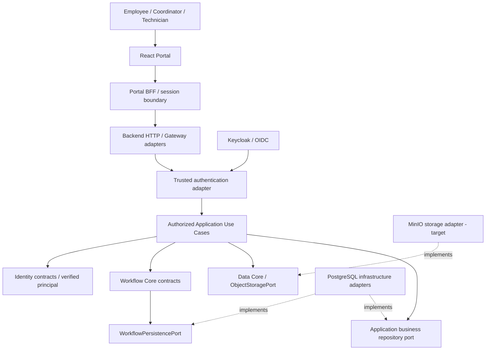

# DX-OS Open-Core — Core / Application Boundary

> **Document ID:** G3-F03  
> **Document status:** DRAFT — PROPOSED REVISION / NOT REVIEWED  
> **Owner:** TRICORE — assignment pending confirmation  
> **Source inspection commit:** [`0f0c3ba0c3eecda0a5c4a798a3cc14b808351bed`](https://github.com/lexuanbao258-collab/dxos-open-core/commit/0f0c3ba0c3eecda0a5c4a798a3cc14b808351bed)  
> **Original file blob:** `697ccaa4818bb45829496a34b20c72a91af4125b`  
> **Scope:** architectural ownership, dependencies, authorization and consistency; not an approved implementation specification.

## 1. Purpose and evidence policy

**TO-BE / PROPOSED boundary:** IT Helpdesk and future Applications consume DX-OS-owned published contracts and own their business models, use cases, and resource authorization policies. No Application should call Flowable Engine APIs, PostgreSQL drivers, Keycloak or MinIO SDKs, or APISIX implementation APIs. Workflow Core retains process semantics even when a Data/infrastructure adapter implements its persistence port. Structured Data and object storage are separate capabilities; neither owns Helpdesk business facts merely because it stores them. Replacing a provider requires contract conformance and assessment of migration, errors, security, and consistency.

This document refines the [existing boundary review draft](https://github.com/lexuanbao258-collab/dxos-open-core/blob/0f0c3ba0c3eecda0a5c4a798a3cc14b808351bed/docs/01-architecture/core-application-boundary.md) without reassigning domain ownership or asserting acceptance. The original was marked `PROPOSED — REVIEW REQUIRED`, used an earlier historical source baseline `e06fa429cfd92b032c166eb3ebf32803d13191c2`, and recorded sixteen `BND` conditions. The current inspection revision is **not** a claim that the source was rebuilt or tested at this commit.

**Evidence vocabulary:** `BASELINE` means content observed at the pinned Git commit; `CANDIDATE` means proposal/PR not accepted by a separate gate; `PROPOSED` means design intent; `UNVERIFIED` means no sufficient acceptance evidence. A design direction marked *selected* is not an approved numbered ADR, verified Java dependency, or runtime PASS. Only the canonical Document Register may assign a formal document lifecycle status after it is established in the reviewed documentation baseline.

**Boundary decision test:** place a responsibility in Core only if it is a coherent, domain-neutral capability with a stable owner-defined contract and invariants that do not branch on application names. Place behavior whose correctness depends on IT or Facility policy in the Application. Place framework/provider conversions in adapters. Reuse alone does not justify accidental abstractions, and a Core capability does not need a public REST API.

## 2. Architectural foundation and decisions

| Decision reference from existing draft | Selected direction or open question | Verification / approval qualifier |
| --- | --- | --- |
| `SYS-ADR-01` | B — Spring Boot **Modular Monolith**; modules are not microservices | Design direction selected in source draft; independent approval not verified |
| `SYS-ADR-02` | B — Hexagonal architecture / DIP, owner-defined ports and adapters | Architectural intent; import/conformance evidence required |
| `SYS-ADR-06` | B — capability- and Application-owned data semantics | Physical DB sharing must not erase logical ownership |
| `SYS-ADR-08` | B — generic state machine Workflow | Requires separate definitions and actual reuse tests |
| `SYS-ADR-04` | Application-side resource authorization/enforcement direction | Race, resource-scope and route tests still needed |
| `SYS-ADR-05` | Transaction consistency model OPEN | Atomicity, rollback, unknown outcomes and recovery need decision |
| `SYS-ADR-07` | Local MinIO storage direction | Provider conformance and error recovery unverified |
| `SYS-ADR-10` | Restrict generic Gateway Workflow API; default-off direction in draft | Exposure needs exact active-profile and HTTP evidence |
| `SYS-ADR-11` | Helpdesk + Facility reuse-proof direction | Facility E2E proof not established |

These identifiers preserve the original discussion and **must be reconciled with actual ADR files and governance**. At the pinned commit, `docs/08-decisions/README.md` could not be fetched; no ADR status is promoted to `Accepted` here.

## 3. System boundary and dependency direction

This is **a conceptual runtime-and-port view**, not proof of active deployment or exact Java imports. Adapters depend inward on owner-defined ports; dependencies must not be reversed. Gateway dispatches only through authorized Application operations, not directly to an unguarded Workflow mutation endpoint. The BFF is a separate HTTP/session component, **not a fifth Core capability**.

| Consumer or owner | Allowed boundary | Forbidden or evidence-requiring dependency |
| --- | --- | --- |
| Identity Core | Principal/authority value objects and neutral contracts | Keycloak/Spring Security details or Helpdesk-specific roles in Core |
| Workflow Core | Definitions, instances, versions, transition/history rules, Workflow-owned persistence port | Facility/Helpdesk entities, JWT parsing, direct business assignment logic |
| Data Core | Generic object storage semantics and `ObjectStoragePort` | Ownership of all business tables or Workflow state |
| Gateway / HTTP adapter | Authenticated entry point, routing, error/exposure conventions | Unchecked Core mutation or direct ticket SQL |
| Helpdesk Application | IT business rules, authorized orchestration, assignments/resolution facts | Direct modification of Workflow tables; importing concrete IdP SDKs as domain logic |
| Facility Application | Facility eligibility, repair outcomes, acceptance and assignment business decisions | Adding `if facility` branches to generic Workflow Core |
| Persistence/OIDC/MinIO adapters | Implement Core/Application ports, map framework/provider results | Ownership or bypass of business policy |
| Portal/BFF | Published HTTP APIs, session/CSRF and transport safeguards | Java Core injection, privileged DB/storage writes, final resource grants |

**Executable dependency policy is a target.** ArchUnit/import checks can detect package coupling but cannot prove DB authorization, HTTP exposure, transaction atomicity, race handling or storage integrity.

## 4. Four Core capabilities: ownership and exclusions

| Core | Owns | Excludes / defers to Application or adapter |
| --- | --- | --- |
| **Identity** | Provider-neutral identity representation, trusted principal contract and normalized authority semantics | Password authentication provider, resource-specific ACL/assignee eligibility, raw token processing in domain logic |
| **Workflow** | Generic definition/instance lifecycle, expected version, permitted transition mechanics and successful history; `WorkflowPersistencePort` | IT SLA/assignment/resolution, Facility acceptance/rework decisions, Spring/JDBC implementation |
| **Data** | Object storage port, keys/metadata/write/error contracts where formally defined | Universal ownership of PostgreSQL business tables, access policy for a specific attachment |
| **API Gateway** | External HTTP exposure, authentication boundary, generic transport/security conventions and permitted handoff | Final request-level authorization, business transitions, transaction policy |

At the pinned SHA, the following **documentation contracts** were verified to exist: [Identity Core](https://github.com/lexuanbao258-collab/dxos-open-core/blob/0f0c3ba0c3eecda0a5c4a798a3cc14b808351bed/docs/contracts/identity-core.md), [Workflow Core](https://github.com/lexuanbao258-collab/dxos-open-core/blob/0f0c3ba0c3eecda0a5c4a798a3cc14b808351bed/docs/contracts/workflow-core.md), [Data Core](https://github.com/lexuanbao258-collab/dxos-open-core/blob/0f0c3ba0c3eecda0a5c4a798a3cc14b808351bed/docs/contracts/data-core.md). Their existence does not validate all runtime behavior or prove the complete provider adapter contract suite.

## 5. Application ownership: distinct use cases, shared capabilities

| Concern | IT Helpdesk candidate | Facility candidate | Boundary test |
| --- | --- | --- | --- |
| Business request | IT issue/details and requester | Facilities issue/location and requester | Application owns domain facts |
| Assignment | Separate Application command from `triage` in current IT candidate | Whether assignment is a Workflow transition remains POLICY OPEN | Never infer one application's transition semantics from another |
| Completion | `RESOLVED → CONFIRMED` candidate endpoint | Repair acceptance actor and closure semantics unresolved | Neither is a generic Core rule |
| Authorization | Original requester, current assignee, coordinator eligibility | Acceptance actor, current technician, facility scope not ratified | Exact authority plus target resource permissions |
| Audit/state | Workflow state/version/successful history in Core | Same reusable mechanism if second definition is proven | Core algorithm unchanged, app definitions/policies differ |
| Attachments | Protected attachment contract pending | Protected attachment contract blocked | No fabricated atomic DB + object-storage write |

The **IT-focused first MVP** is the Golden Path. Facility's full business journey is deferred; a smaller reuse-proof vertical slice is a *candidate goal*. Neither Portal mock demonstrations nor a second JSON definition alone prove independently verified multi-Application reuse.

## 6. Authorization, trust and public contract boundaries

1. The IdP authenticates; a trusted Backend adapter must **verify** the principal. `AuthenticatedPrincipal` constructed from untrusted input is not authentication evidence.
2. The Gateway/HTTP boundary validates the applicable authenticated context and exact operation authority. An authority such as `workflow:transition` is **not** an unrestricted grant over all resources.
3. The authorized Application use case checks the target resource, tenant/ownership scope, current assignment or relevant actor eligibility and policy **at the point of mutation**.
4. Workflow Core enforces valid transition/version semantics. The Application must not mutate state/history through direct JDBC or exposed generic endpoints.
5. Deny missing/invalid authentication, disallowed visible actions and concealed/nonexistent resources without leaking protected object existence. Exact HTTP status mapping must be reviewed against the actual published API (common candidates: 401/403/hidden 404).
6. Revoke or replace assignments safely. A stale permission snapshot must not authorize the eventual commit after a revocation race.
7. Rejection messages must not leak raw JWT, framework, SDK or SQL internals; record auditable server-side failures according to reviewed logging/privacy rules.

**API split:** a public HTTP route is not a Core Java port. Review route inventories and deployment flags separately from package-level dependency maps. Source docs alone do not demonstrate a secure default-off generic Workflow API.

## 7. Data, transaction and unknown-outcome boundaries

| Data or event | Semantic owner | Implementation and consistency requirement |
| --- | --- | --- |
| Workflow definition/instance/version/history | Workflow Core | Persistence adapter must implement the reviewed durability/version contract |
| Request, assignment, resolution, repair and acceptance facts | Corresponding Application | Application repository and transaction orchestration within approved boundary |
| Object content and metadata transport | Data Core port + storage adapter | Business reference/ACL decided by Application |
| Verified authentication context | Trusted Identity adapter/Application seam | Never persisted/derived from forged request headers |

The **same physical PostgreSQL instance does not mean one domain owns every table**. Business request plus Workflow writes may require one well-defined JDBC/transaction boundary for a composite operation; this has to be confirmed for specific paths using rollback, failure injection and concurrency tests. Merely calling two services does not establish atomicity. PostgreSQL plus MinIO do **not** provide a distributed atomic transaction by default. Define safe staging, reconciliation and orphan cleanup for failure paths before promising attachment consistency.

- **Stale expected Workflow version:** reject conflict with no extra committed transition/history.
- **Assignment concurrency:** use an Application-owned version policy only where the actual contract requires it; the IT version model is not automatically a Facility contract.
- **Unknown commit:** do not blindly retry or show success. Reconcile through an approved operation identity/readback strategy.
- **Revocation race:** enforce authorization at the correct transactional point, not only before acquiring a lock.
- **Partial write or storage failure:** state what committed, rollback when supported, and use explicit recovery where boundaries cannot be atomic.

## 8. Edge-case boundary decisions

| Case | Correct owner | Invalid shortcut |
| --- | --- | --- |
| Workflow transition permission | Core validates machine constraints; Application checks business/resource eligibility | Gateway token check alone authorizes any workflow |
| New business definition | Application supplies rules/definition through reviewed contracts | Core imports `HelpdeskStatus` or `FacilityStatus` |
| Assignment | Business Application | Reclassify it into Workflow Core merely because both Apps assign people |
| Data access | Domain owner + adapter | Data Core becomes God repository for all entities |
| File evidence | Business scope/ACL in Application; byte storage through Data port | Object upload makes request closure automatic |
| Local HTTPS/BFF | Deployment/HTTP trust boundary | Browser calls database or supplies trusted identity headers |

## 9. Claim-to-test-to-evidence review matrix (original BND IDs preserved)

**All results below are `UNVERIFIED IN THIS REVIEW` unless separately established by a pinned, independent execution record.** `CANDIDATE / PARTIAL` described in the historic source draft is not converted into PASS. Tests listed are **required evidence**, not assertions of execution.

| ID | Boundary claim / invariant | Required test or inspection | Evidence required | Result |
| --- | --- | --- | --- | --- |
| BND-01 | Core excludes App business-specific logic | Source import/class inspection | Core package diff, reviewed SHA | UNVERIFIED |
| BND-02 | Ports owned inward; adapters implement them | ArchUnit plus port/conformance inspection | Dependency report, contract suite | UNVERIFIED |
| BND-03 | Verified principal originates at trusted boundary | OIDC + forged-header negative tests | HTTP results, principal binding, pinned SHA | UNVERIFIED |
| BND-04 | Exact operation authority != target resource authorization | Cross-resource/tenant authorization negatives | Request/response and identity assertions | UNVERIFIED |
| BND-05 | Protected mutations only via authorized Application seam | Route inventory and HTTP integration | Endpoint exposure and call-path evidence | UNVERIFIED |
| BND-06 | Generic Gateway Workflow API restricted/default OFF | Active-profile negative HTTP checks | Config, tests and effective routes | UNVERIFIED |
| BND-07 | Workflow transition + history consistent under concurrency | Disposable PostgreSQL deterministic race tests | Transaction/locking results and logs | UNVERIFIED |
| BND-08 | Helpdesk business facts + Workflow commit consistently | Failure injection in real PostgreSQL | Rollback and state/history assertions | UNVERIFIED |
| BND-09 | Revoked assignment cannot race into unauthorized commit | Deterministic ACL revocation/commit test | Lock/commit timing and final state | UNVERIFIED |
| BND-10 | Storage adapter preserves bytes, metadata, streams, conflicts | Provider contract tests | MinIO/object adapter conformance logs | UNVERIFIED |
| BND-11 | Provider replacement preserves Core contract | Second-adapter test and Core diff | Stable Core API plus conformance output | UNVERIFIED |
| BND-12 | IT Helpdesk Golden Path E2E works | Keycloak/BFF/Backend/PostgreSQL integration | Clean install, HTTP flow, test and Git SHA | UNVERIFIED |
| BND-13 | Facility distinct workflow reuses generic Core unchanged | Second definition and vertical-slice tests | Core diff and workflow evidence | UNVERIFIED |
| BND-14 | Raw SDK/SQL/token errors do not cross public boundaries | Error contract negatives and log inspection | Sanitized HTTP output, server logging | UNVERIFIED |
| BND-15 | Database-object-store failures are recoverable | Failure/retry/orphan tests | Reconciliation and cleanup evidence | UNVERIFIED |
| BND-16 | Documentation/code mappings and links valid after migration | Markdown/link checks and Git diff inspection | Exact docs SHA, link report | UNVERIFIED |

The independent review record must cite **command, environment, exact code/doc SHAs, expected versus actual result, artifacts (e.g. JUnit/XML/logs), reviewer and decision**. A prior PR comment without evidence scope must not be applied to every row.

## 10. Source mapping and historical reconciliation

| Repository artifact inspected at `0f0c3ba0c3eecda0a5c4a798a3cc14b808351bed` | Observed fact | Limit / action |
| --- | --- | --- |
| [Original Core/Application Boundary](https://github.com/lexuanbao258-collab/dxos-open-core/blob/0f0c3ba0c3eecda0a5c4a798a3cc14b808351bed/docs/01-architecture/core-application-boundary.md) | Existing 14-section Review Draft; BND-01–16 and SYS-ADR references | Historic `source_baseline` is `e06fa429...`, not automatically current acceptance |
| [System Architecture](https://github.com/lexuanbao258-collab/dxos-open-core/blob/0f0c3ba0c3eecda0a5c4a798a3cc14b808351bed/docs/01-architecture/system-architecture.md) | Design draft for modular monolith, ports, four capabilities | Proposed design != approved ADR or runnable integration |
| [Dependency Rules](https://github.com/lexuanbao258-collab/dxos-open-core/blob/0f0c3ba0c3eecda0a5c4a798a3cc14b808351bed/docs/01-architecture/dependency-rules.md) | Target import/invariant rules described | ArchUnit enforcement not verified here |
| [Legacy Architecture Overview](https://github.com/lexuanbao258-collab/dxos-open-core/blob/0f0c3ba0c3eecda0a5c4a798a3cc14b808351bed/docs/architecture/README.md) | Existing older overview | Legacy migration must be reconciled before claiming canonical replacement |
| [Identity contract](https://github.com/lexuanbao258-collab/dxos-open-core/blob/0f0c3ba0c3eecda0a5c4a798a3cc14b808351bed/docs/contracts/identity-core.md) | Provider-independent identity contract documented | Trusted runtime verification remains test-dependent |
| [Workflow contract](https://github.com/lexuanbao258-collab/dxos-open-core/blob/0f0c3ba0c3eecda0a5c4a798a3cc14b808351bed/docs/contracts/workflow-core.md) | Core Workflow contract documented | DB atomicity/race behavior requires execution evidence |
| [Data contract](https://github.com/lexuanbao258-collab/dxos-open-core/blob/0f0c3ba0c3eecda0a5c4a798a3cc14b808351bed/docs/contracts/data-core.md) | Object storage contract documented | MinIO conformance/recovery not established here |

`docs/08-decisions/README.md` was **not found** at this pinned SHA. G0/G1/G2 working drafts described in the documentation workstream were not treated as merged unless verified in the same repository baseline. Relative links are intentionally limited to verified existing files; the table uses immutable GitHub links instead of guessing whether migration targets will coexist.

## 11. Open architectural issues, owners and impact

| Finding | Decision/review needed | Proposed accountability | Impact if unresolved |
| --- | --- | --- | --- |
| BND-GAP-01 | Ratify transaction model and cross-App write boundaries (`SYS-ADR-05`) | Backend/Workflow + Application + reviewer | False atomicity, partial writes |
| BND-GAP-02 | Choose reliable commit-time resource authorization/revocation strategy | Identity/Security + Application | Unauthorized state changes |
| BND-GAP-03 | Verify public API exposure, BFF identity handoff and default-off generic endpoints | Gateway + Security | Direct Core mutation, spoofing |
| BND-GAP-04 | Determine Facility assignment, acceptance/closure and rework semantics | Business owner + Application | Incorrect reuse proof or transitions |
| BND-GAP-05 | Pin/reconcile old docs baseline and validate links/ADR files | Architecture doc owner + reviewer | Unsupported approval and broken references |
| BND-GAP-06 | Define object-store recovery, privileges and conformance gate | Data/Infrastructure + Security | Orphaned or leaked artifacts |
| BND-GAP-07 | Produce independent multi-App reuse evidence without Core-specific branches | Core + Application + gate reviewer | Unsupported open-core product claim |

Review ownership labels are **proposals, not recorded assignments**. Track final blockers through the verified project's Open Issues process and the stage review; do not invent issue IDs or approval timestamps.

## 12. Change control and acceptance

Changes to Core public contracts, actor/authority semantics, persistence or transaction guarantees, API exposure, or application workflow ownership require impact analysis across G1 scope, G2 business contracts, G3 architecture/dependency documents, G4 integration and G5 tests; create/modify ADRs under ratified governance where appropriate.

**Document acceptance prerequisites:** original BND IDs preserved, coherent ownership/dependency matrix, no invalid links, traceable decision references, exact source baseline, and an independent reviewer disposition recorded against a docs SHA. **Implementation/release acceptance additionally requires** the specific executable evidence for BND-01–16 at pinned code/runtime revisions. There is no recorded Gate PASS in this authoring exercise.

**Current disposition: DRAFT / NOT REVIEWED.** No source code was modified or runtime tests executed for this revision.
