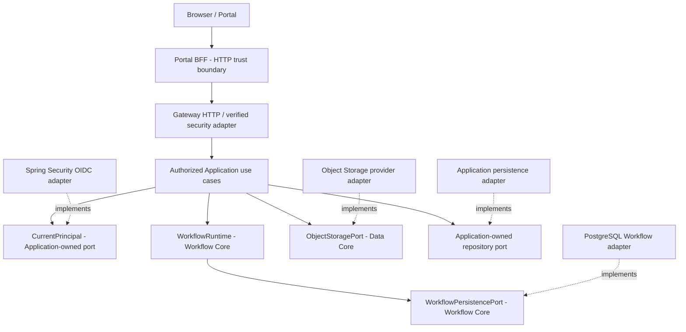

# DX-OS Open-Core — Dependency Rules and Architecture Enforcement

> **Document:** `docs/01-architecture/dependency-rules.md`  
> **Lifecycle:** DRAFT — PROPOSED / NOT REVIEWED; canonical lifecycle belongs to the Document Register.  
> **Source inventory SHA:** `0f0c3ba0c3eecda0a5c4a798a3cc14b808351bed` (read-only document/contract inspection).  
> **Historical baseline cited by original draft:** `e06fa429cfd92b032c166eb3ebf32803d13191c2`.  
> **Owner and independent approver:** TO ASSIGN / NOT RECORDED.  
> **Scope:** Java modular monolith, authorized HTTP boundaries, provider-owned adapters, architecture tests and waivers.  
> **Evidence boundary:** No source graph, build, ArchUnit, CI, real PostgreSQL or security tests were executed for this revision.

## 1. Purpose and Decision Qualification

**Target import rule:** Core-owned contracts and Application use cases must not import Keycloak, Flowable, PostgreSQL JDBC, MinIO, or APISIX SDK types. Infrastructure adapters may import those implementations while depending inward on the relevant published port. APISIX edge checks cannot replace Backend trusted-principal verification, exact operation authority, or Application resource policy. Verify these rules with source import checks and provider conformance tests before claiming enforcement.

Define testable rules translating the **selected design direction** into enforceable source constraints and separately verified runtime invariants. The four logical Core capabilities are Identity, Workflow, Data Management and API Gateway; four capabilities **do not imply four microservices or four pure `core.*` packages**. In the inspected historical baseline, Gateway-facing code sits in `gateway.*`, not a verified `core.gateway` pure-Java package.

The source draft labels **SYS-ADR-01=B** (Modular Monolith), **SYS-ADR-02=B** (Ports & Adapters/DIP), **SYS-ADR-06=B** (capability/application-owned data), **SYS-ADR-08=B** (generic Workflow state machine) as team-selected directions. **SYS-ADR-04, SYS-ADR-05, SYS-ADR-07, SYS-ADR-10 and SYS-ADR-11** are also referenced in the corresponding boundary review. These identifiers are **design-discussion references**, not proof of approved standalone ADR documents or executable tests. The separate decision-record and formal ADR governance must resolve statuses.

**Out of scope:** rewriting Java source, changing Flyway V1–V4, approving HTTP routes, selecting an unreviewed transaction model, claiming provider substitution, or certifying integrated release.

## 2. Boundary Vocabulary and Architecture Model

| Boundary | Definition | Non-equivalence |
| --- | --- | --- |
| Source dependency | Java imports, inheritance, type and method references | Not the same as runtime call direction |
| Runtime interaction | A controller/use case invokes a service or port | Not proof of allowed compile-time dependency |
| Capability | Shared contract and invariants with logical owner | Not a deployable service requirement |
| Application | Business facts, eligibility, tenant/resource ownership | Not a generic Workflow rule |
| Provider adapter | External/framework implementation of owner-defined port | Does not own port semantics |
| Trust | Verified authentication and subsequent authorization | Not inferred from client headers or UI role |
| Transaction | Writes that truly commit/rollback atomically | Not implied by an outer `@Transactional` |



**Diagram classification:** conceptual runtime invocation and port implementation, **not** a source dependency graph nor proven integrated topology. In Java the adapter depends **inward** on the interface it implements; the Core must not depend outward on provider classes.

## 3. Baseline Inventory versus Target Structure

| Observed/referenced at historical source baseline | Design implication and caution |
| --- | --- |
| `core.identity` | Provider-neutral principal and authority contracts; no IAM provider runtime imports |
| `core.workflow` / `WorkflowRuntime` / `WorkflowPersistencePort` | Owns generic workflow and persistence semantics |
| `core.data` / `ObjectStoragePort` | Storage semantics; not an owner of every relational table |
| `application.identity.CurrentPrincipal`, `application.authorization` | Trusted principal seam and resource authorization orchestration |
| `infrastructure.identity.security`, `infrastructure.workflow` | Concrete Spring/OIDC and PostgreSQL adapters |
| `gateway.workflow` | HTTP candidate requires route registration and security verification |
| `request.*` | Legacy prototype; exposure requires a separate review, not automatic exemption |
| `backend/build.gradle` | The original draft reports no ArchUnit dependency at its baseline; **not reverified by a build in this revision** |
| Portal BFF / Helpdesk / Facility candidates | PR-local work and mock flows are not automatically integrated at main |

Paths and design facts above come from the original inspected documentation and contracts. A **compiled package inventory at the final review SHA is still required**; the table is not an import-scan result.

## 4. Target Import Matrix

**YES** = published port/type allowed; **NO** = forbidden; **CONDITIONAL** = only explicitly reviewed transport/legacy use; **BOOTSTRAP** = composition root only.

| Importing package | Own Core | Other Core | Application | Gateway/HTTP | Infrastructure/provider |
| --- | --- | --- | --- | --- | --- |
| `core.identity` / `core.workflow` / `core.data` | YES | NO by default | NO | NO | NO |
| `application.*` | YES through published contracts | YES through published contracts | YES, only published seams | NO | NO |
| `gateway.*` | CONDITIONAL transport mapping | CONDITIONAL, not unguarded mutation | YES, authorized use cases | YES | NO |
| `infrastructure.*` | YES, implements ports | CONDITIONAL for composition | YES, implements ports | CONDITIONAL wiring | YES |
| `request.*` legacy | CONDITIONAL | CONDITIONAL | CONDITIONAL | CONDITIONAL | CONDITIONAL, time-bounded debt |
| `DxosApplication` / bootstrap | BOOTSTRAP | BOOTSTRAP | BOOTSTRAP | BOOTSTRAP | BOOTSTRAP |

An allowed dependency is not blanket permission for private model access, access-control bypass or unregistered endpoint activation.

## 5. Normative Target Rules — DR-01 through DR-16

| ID | Rule (preserved semantic intent) | Priority | Evidence required |
| --- | --- | --- | --- |
| **DR-01** | `core.identity` has no Spring/Security/Keycloak, infrastructure, Gateway or Application dependency. | P0 | ArchUnit + import audit |
| **DR-02** | `core.workflow` depends only on JDK and Workflow-owned contracts; no other Core capability, Application or provider imports. | P0 | ArchUnit |
| **DR-03** | `core.data` owns provider-neutral `ObjectStoragePort`; no provider SDK, JDBC, Workflow or business models. | P0 | ArchUnit + contract review |
| **DR-04** | `WorkflowPersistencePort` remains Workflow-owned; adapters implement and preserve its complete semantics. | P0 | Source inspection + provider conformance tests |
| **DR-05** | Application use cases do not depend on HTTP controllers/DTOs or concrete infrastructure providers; migration seams must be explicit. | P0 target | ArchUnit + bounded exception registry |
| **DR-06** | Published business HTTP mutations invoke authorized Application use cases, not unguarded `WorkflowRuntime`. | P0 release | Route inventory + HTTP integration tests |
| **DR-07** | Gateway does not decide resource-level business permissions; Application checks tenant, ACL, assignment and actor eligibility. | P0 | Security negative tests |
| **DR-08** | Gateway does not directly execute business SQL/repository mutations. | P0 target | ArchUnit + code review |
| **DR-09** | `CurrentPrincipal` implementation obtains identity from trusted Spring Security context, never user-supplied headers/actor ID. | P0 | Forged-identity HTTP tests |
| **DR-10** | Infrastructure implements owner-defined ports; Core never imports provider implementations. | P0 | ArchUnit + source review |
| **DR-11** | Generic Core does not contain Helpdesk/Facility states, role names or business policy branches. | P0 | Source review + cross-app reuse evidence |
| **DR-12** | Core domain errors do not expose HTTP status, JDBC/SQL, credentials or SDK exceptions. | P1 | Dependency and error mapping tests |
| **DR-13** | Object Storage adapters preserve streaming, CREATE_ONLY, OVERWRITE, metadata, close behavior and normalized errors. | P1 | Same provider conformance suite |
| **DR-14** | Workflow adapter preserves snapshot checks, atomic state/history, durable success and unknown-commit semantics. | P0 | Real PostgreSQL concurrency/failure tests |
| **DR-15** | Architecture waivers are explicit, scoped, owned, reviewed and time-bounded; never blanket-ignore Application/Gateway. | P0 process | Waiver register + CI no-new-violation gate |
| **DR-16** | Documentation or design selection alone never activates production endpoints. | P0 | Registration/feature-flag and HTTP tests |

The rule table defines **TARGET constraints**. No row is labeled CI PASS, and source-structure plausibility is not runtime verification.

## 6. Four Capability Boundaries and Application Ownership

**Identity:** `core.identity` owns neutral principal/authority types. `application.identity.CurrentPrincipal` is the access seam; a trusted Spring Security adapter must produce the authenticated principal from validated identity context. A manually constructed principal or forged header is not proof of verification. Provider issuer/subject migration can require controlled identity linking.

**Workflow:** `core.workflow` owns definitions, state, transitions, version, history and `WorkflowPersistencePort`. Helpdesk assignment/resolution and Facility acceptance eligibility stay in their Applications. The persistence adapter's durable-return contract cannot silently be nested inside an unrelated business transaction.

**Data:** `ObjectStoragePort` owns provider-neutral storage semantics, not all business repositories. Real PostgreSQL and MinIO cannot be assumed to share a distributed ACID commit. If metadata references content, failure recovery and orphan cleanup must be explicit.

**Gateway:** the HTTP/security boundary verifies tokens and routes actions to an **authorized Application use-case seam**. Exact operation authority is necessary but not sufficient: Application verifies resource/tenant scope, current actor eligibility and concurrency under the intended transaction policy. A generic Workflow route stays restricted until approved and tested.

**Application reuse proof:** demonstrate the same Core contracts with Helpdesk golden path and a distinct Facility vertical slice **without generic Core source edits**. Facility's full business journey is deferred; an IT-only or mock UI demonstration is insufficient.

## 7. Correct and Incorrect Dependency Examples

```java
// Illustrative abstraction owned by Workflow Core (not a copy of the full interface)
interface WorkflowPersistencePort { /* load/transition semantics belong to Workflow */ }

// Infrastructure implements the complete real published port.
final class PostgresWorkflowPersistence implements WorkflowPersistencePort { /* ... */ }
```

```java
// INVALID: Core imports concrete persistence implementation.
import com.tricore.dxos.infrastructure.workflow.PostgresWorkflowPersistence;

// INVALID business-policy coupling inside generic Workflow Core:
if ("IT_HELPDESK".equals(resourceType) && "TECHNICIAN".equals(role)) {
    // Move eligibility checks to the Helpdesk authorized Application boundary.
}
```

These are **illustrative** snippets; they are not build-verified implementation code. Check exact interfaces and package names at the implementing commit before copying.

## 8. Incremental ArchUnit and CI Enforcement Plan

| Stage | Work item | Acceptance evidence |
| --- | --- | --- |
| A0 — Inventory | Pin final Git SHA, JDK and Gradle; export compiled production dependency graph | Reproducible graph, list of current violations and owner |
| A1 — Core rules | Introduce reviewed ArchUnit dependency and JUnit rules for DR-01–04/10 | Executable test results at SHA |
| A2 — No-new-violations | Fail PR if newly introduced forbidden dependency appears; scoped historic waivers only | Baseline delta + CI failure demonstration |
| A3 — Application/Gateway | Enforce DR-05–09/12/16 and inspect route registrations | ArchUnit plus HTTP/security tests |
| A4 — Provider contracts | Test DR-13/14 on actual configured providers | Storage conformance and real PostgreSQL tests |
| A5 — Reuse proof | Helpdesk + Facility share unchanged Core | Diff, integration tests and independent review |

**ArchUnit is not sufficient for ACL correctness, TOCTOU revocation races, HTTP exposure, SQL atomicity, lost updates, or unknown commits.** Runtime safeguards require tests at the concrete integration boundary. Avoid broad `ignoreDependency` calls, generic `..application..` exclusions or test-only green builds that conceal new coupling. A seeded forbidden-import test should fail CI before release.

## 9. Legacy Waiver Governance

A waiver requires: stable exception ID (`DEP-EX-nnn` proposed), exact DR ID, fully qualified source class/edge, business/security impact, reason for temporary retention, owner, independent reviewer, linked remediation issue, created date, **expiration date or explicit removal trigger**, and CI suppression scope. Waivers are **proposed, not granted**, until reviewed.

| Candidate waiver | Why candidate only | Release control |
| --- | --- | --- |
| `request.*` legacy prototype | Historic layered/JPA design outside new target seams | Review exact writable routes and deployed profiles |
| Unregistered generic Workflow controller | Source presence does not imply safe HTTP exposure | Verify route inventory, default-off semantics and authorization |

No blanket exemption for all `application.*` or `gateway.*`. New violations remain CI failures; expired waivers fail review.

## 10. Dependency Acceptance Criteria — DEP-AC-01 through DEP-AC-18

| ID | Required criterion | Verification class | This revision |
| --- | --- | --- | --- |
| DEP-AC-01 | Exact source SHA, JDK and build configuration pinned in review evidence. | Source/config inspection | NOT VERIFIED |
| DEP-AC-02 | Production class dependency graph exported from compiled code. | ArchUnit/CI executable | NOT VERIFIED |
| DEP-AC-03 | Identity Core has no forbidden dependencies. | ArchUnit/CI executable | NOT VERIFIED |
| DEP-AC-04 | Workflow Core has no forbidden dependencies. | ArchUnit/CI executable | NOT VERIFIED |
| DEP-AC-05 | Data Core has no forbidden dependencies. | ArchUnit/CI executable | NOT VERIFIED |
| DEP-AC-06 | Infrastructure implements ports without reverse Core-to-provider import. | ArchUnit/CI executable | NOT VERIFIED |
| DEP-AC-07 | WorkflowPersistencePort ownership and semantics unchanged. | Source/config inspection | NOT VERIFIED |
| DEP-AC-08 | Verified identity cannot be forged through actor IDs or headers. | Runtime security/DB | NOT VERIFIED |
| DEP-AC-09 | Business routes dispatch via authorized Application use cases. | Runtime security/DB | NOT VERIFIED |
| DEP-AC-10 | Exact authority cannot bypass resource/tenant ACL. | Runtime security/DB | NOT VERIFIED |
| DEP-AC-11 | Rejected mutation leaves business data, state and history unchanged. | Runtime security/DB | NOT VERIFIED |
| DEP-AC-12 | Concurrent writes do not cause lost update or partial history. | Runtime security/DB | NOT VERIFIED |
| DEP-AC-13 | Unknown commit outcome reconciled without blind repeat. | Runtime security/DB | NOT VERIFIED |
| DEP-AC-14 | Existing Flyway migrations remain unchanged. | Source/config inspection | NOT VERIFIED |
| DEP-AC-15 | Legacy route exposure is gated and independently tested. | Runtime security/DB | NOT VERIFIED |
| DEP-AC-16 | Helpdesk and Facility reuse the same Core without modifying generic Core. | Runtime security/DB | NOT VERIFIED |
| DEP-AC-17 | CI detects seeded forbidden dependency (negative architecture test). | ArchUnit/CI executable | NOT VERIFIED |
| DEP-AC-18 | All waivers have owner, expiry/removal trigger and linked issue. | Source/config inspection | NOT VERIFIED |

**Distinct review outcomes:** DOCUMENT REVIEW ≠ SOURCE DEPENDENCY PASS ≠ SECURITY/DB PASS ≠ RELEASE PASS. A reviewer may approve the architecture target without declaring implementation compliance. Preserve the exact HEAD, command, test logs, JUnit XML, environment, waiver diff and reviewer identity for each claim.

## 11. Evidence and Claim Mapping

| Claim | Rules / criteria | Source or test needed | Evidence state |
| --- | --- | --- | --- |
| No inward Core/provider inversion | DR-01–05/10/12; DEP-AC-02–07 | Compiled production import graph, ArchUnit report | UNVERIFIED |
| Server-authorized HTTP mutation | DR-06–09/16; DEP-AC-08–11/15 | Route inventory, forged-header/ACL tests, actual profile | UNVERIFIED |
| Atomic Workflow and business write | DR-04/14; DEP-AC-11–13 | PostgreSQL failure injection and concurrency evidence | UNVERIFIED |
| Storage substitutability | DR-03/13; provider contract suite | Contract test on each real adapter and migration assessment | UNVERIFIED |
| Shared unchanged Core across applications | DR-11; DEP-AC-16 | Facility/Helpdesk integrated source diff and E2E | UNVERIFIED |
| No hidden debt/false compliance | DR-15; DEP-AC-17/18 | CI injected violation, bounded waiver register | UNVERIFIED |

No test executions or independent approval were performed to create this document.

## 12. Risk and Remediation Register

| ID | Risk / failure mode | Owner to nominate | Required next evidence |
| --- | --- | --- | --- |
| DEP-R01 | Legacy source imports or `request.*` routes bypass target ownership | Backend/Gateway | Exact production graph + HTTP inventory |
| DEP-R02 | Generic Workflow exposure bypasses resource eligibility | Identity/Security + Application | Negative auth integration suite |
| DEP-R03 | Independent Workflow JDBC commit defeats composite Helpdesk transaction | Workflow + Application | Real DB rollback/unknown commit tests |
| DEP-R04 | ACL revoke races with authorized write | Identity/Security + Workflow | Deterministic race test |
| DEP-R05 | PostgreSQL/object store split produces orphaned objects | Application + Data | Reconciliation/failure proof |
| DEP-R06 | ArchUnit exceptions conceal new dependencies | CI owner + independent reviewer | Waiver audit + seeded failure |
| DEP-R07 | Facility reuse unproven | Application + Core | Second vertical slice, unchanged Core diff |
| DEP-R08 | Documentation/source baseline drift | Documentation owner | Reconciled exact-SHA manifest and link audit |

Owner labels indicate reviewer **roles to assign**, not persons confirmed as accepting accountability.

## 13. Staged Governance and Review Questions

Retain the original staged IDs: **DEP-G0** reviewed target/waivers; **DEP-G1** production graph; **DEP-G2** Core ArchUnit; **DEP-G3** App/Gateway + no-new-violations; **DEP-G4** HTTP/security gates; **DEP-G5** PostgreSQL transactional consistency; **DEP-G6** Facility reuse and release evidence. These are an **implementation proposal**, not the global DX-OS G0–G10 Gate outcomes.

Before sign-off, decide: legacy route exposure, composite transaction port ownership, generic API default-off enforcement, waiver expiry and owners, mandatory ArchUnit CI gate, and the evidence standard for two-application reuse.

## 14. Source References and Review Limits

The following architecture documents existed at historical inspection SHA `0f0c3ba0c3eecda0a5c4a798a3cc14b808351bed` (not all direct source classes were fetched in that authoring pass):

- [System Architecture](system-architecture.md) — exists at inspection SHA; separate G3-F04 revision is not yet confirmed merged.
- [Core/Application Boundary](core-application-boundary.md) — exists at inspection SHA; separate G3-F03 revision is not yet confirmed merged.
- Historical `docs/architecture/README.md` and `docs/contracts/identity-core.md`, `workflow-core.md`, and `data-core.md` existed at that SHA; retain their original pinned references.
- [PR #47](https://github.com/lexuanbao258-collab/dxos-open-core/pull/47), [PR #48](https://github.com/lexuanbao258-collab/dxos-open-core/pull/48), [PR #63](https://github.com/lexuanbao258-collab/dxos-open-core/pull/63), [PR #70](https://github.com/lexuanbao258-collab/dxos-open-core/pull/70), [PR #71](https://github.com/lexuanbao258-collab/dxos-open-core/pull/71) are **workstream references**, not automatic evidence of merged/release-verified behavior.
- Immutable inspection anchor: [`0f0c3ba0...`](https://github.com/lexuanbao258-collab/dxos-open-core/commit/0f0c3ba0c3eecda0a5c4a798a3cc14b808351bed).

Current-branch documentation: [Architecture index](README.md), [Identity contracts](../02-core/identity/contracts.md), [Workflow contracts](../02-core/workflow/contracts.md), and [Data contracts](../02-core/data/contracts.md) are tracked on `docs/core-architecture-alignment`. Their links do not assert presence at the historical SHA or approval of changed semantics.

Final Git merge requires re-running link checks, build and relevant tests on the **actual target revision**, not inheriting statuses from the inspected document snapshot.

**Review outcome: DRAFT / NOT REVIEWED. Source graph/CI/security/DB/reuse gates: NOT VERIFIED.**
