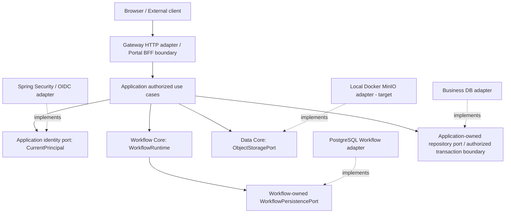

# DX-OS Open-Core — Dependency Rules & Architecture Enforcement

> **Document path:** `docs/01-architecture/dependency-rules.md`
> **Version:** Review Draft v1.0 — 2026-10-28
> **Status:** PROPOSED — REVIEW REQUIRED (architecture direction selected; implementation conformance not yet proven)
> **Source baseline:** `origin/main` at `e06fa429cfd92b032c166eb3ebf32803d13191c2`
> **Decisions:** SYS-ADR-01 B (Modular Monolith), SYS-ADR-02 B (Ports & Adapters / DIP), SYS-ADR-06 B (capability-owned data), SYS-ADR-08 B (generic state machine)
> **Audience:** TRICORE Backend / Identity / Application / Data, independent reviewer, OLP judges.

## 1. Purpose, scope, decision status

This document defines **source-code dependency rules** for DX-OS. It translates the chosen system architecture into testable constraints and a staged enforcement plan. It is not a claim that all rules currently pass. The current baseline is a Java 21 / Spring Boot 3.5.16 backend deployed as a modular monolith; a separately deployed Portal BFF is a candidate in PR #70, not a fourth/fifth backend Core or proof of integration on `main`.

**In scope:** Java production package dependencies, runtime call boundaries, ownership of ports and adapters, restricted HTTP endpoints, data ownership, Gradle/ArchUnit verification, treatment of baseline violations, exemptions, and measurable acceptance.

**Out of scope:** automatic refactor, package relocation, changes to existing public contracts, Flyway edits, new database transaction semantics, approval of candidate PRs, and final security/operational certification. All existing V1–V4 migrations and historical evidence remain unchanged during this documentation phase.

**Architecture principle:** business and capability policy code must not depend on provider-specific implementation details. The direction of source imports is distinct from the direction of runtime calls and from physical deployment topology.

## 2. Vocabulary: distinguish four different boundaries

| Term | Precise meaning | Common mistake |
|---|---|---|
| **Capability boundary** | Identity, Workflow, Data, API Gateway have separate responsibilities and contracts | Equating four capabilities with four microservices |
| **Application boundary** | Helpdesk, Facility own use cases, tenancy/resource rules and business facts | Placing Helpdesk roles/states inside generic Core |
| **Source dependency** | Java type import, field/constructor type, inheritance or method reference | Drawing runtime call arrows as source dependencies |
| **Provider adapter** | Technical implementation of a capability/application-owned interface | Moving interface ownership into Data because PostgreSQL is involved |
| **Trust boundary** | Untrusted request becomes a verified principal via validated authentication | Believing a caller-supplied `actorId` or `X-Role` is trusted |
| **Transaction boundary** | Which operations commit or rollback together | Assuming an outer `@Transactional` joins a JDBC port that commits independently |

**DIP example (valid):** `WorkflowRuntime` depends on `WorkflowPersistencePort` defined in `core.workflow`; `PostgresWorkflowPersistence` lives in `infrastructure.workflow` and implements the port. The adapter imports the Core interface, **not** the reverse. Spring's composition root connects implementation to contract.

## 3. Actual baseline source structure and target boundaries

Source paths checked at the pinned baseline:

```text
backend/src/main/java/com/tricore/dxos/
├── core/
│   ├── identity/                # AuthenticatedPrincipal, Authority, errors
│   ├── workflow/                # WorkflowRuntime, WorkflowPersistencePort, state machine
│   └── data/                    # ObjectStoragePort, metadata, errors
├── application/
│   ├── identity/                # CurrentPrincipal (verified-caller port)
│   └── authorization/           # WorkflowAccessPolicy, WorkflowAuthorization
├── gateway/workflow/            # Controller/DTO/security gate (not enabled as production Workflow HTTP)
├── infrastructure/
│   ├── identity/security/       # Spring Security JWT validation, CurrentPrincipal adapter
│   ├── workflow/                # PostgresWorkflowPersistence, migration/verification tools
│   ├── persistence/             # package boundary
│   └── storage/                 # package boundary
├── request/                     # legacy Request prototype: controller/domain/service/repository
├── common/                      # ApiError, HealthController
└── DxosApplication.java         # Spring Boot composition entry
```

**Important:** `core.gateway` does **not** exist as a pure Java package on this pinned `main`. Gateway is the fourth *logical capability* with HTTP-facing code under `gateway/` and technical integration with Spring. Creating `core.gateway` is optional and must be justified by actual provider-neutral contracts; it is not required to preserve the four-capability architecture.

**Status categories:** `EXISTING` = confirmed source at pinned baseline; `TARGET` = rule for new/refactored code; `EXCEPTION` = historical code maintained temporarily; `BLOCKER` = must be resolved before candidate production exposure. Candidate PRs are not automatically present on main.

## 4. Dependency direction: runtime interactions versus source imports



The diagram is **logical/target architecture**, not an assertion that every connection exists on main. An external HTTP request ordinarily arrives through Gateway and invokes an Application use case; an internal call inside the monolith need not traverse HTTP. Workflow Core need not import Identity Core, and `CurrentPrincipal` resides in `application.identity` today. Real transaction orchestration requires a separate decision (SYS-ADR-05).

## 5. Rules matrix (normative target)

**Legend:** YES = allowed through published API; NO = forbidden; CONDITIONAL = only as scoped below; BOOTSTRAP = composition root only.

| Importing module → imported module | Core Identity | Core Workflow | Core Data | Application | Gateway | Infrastructure | `request` prototype |
|---|---|---|---|---|---|---|---|
| `core.identity` | YES (self) | NO | NO | NO | NO | NO | NO |
| `core.workflow` | NO | YES (self) | NO | NO | NO | NO | NO |
| `core.data` | NO | NO | YES (self) | NO | NO | NO | NO |
| `application.*` | YES (contracts) | YES (public domain/runtime API) | YES (published ports) | YES (published app APIs) | NO | NO | NO except explicit migration seam |
| `gateway.*` | CONDITIONAL (facts) | CONDITIONAL (DTO mapping only during migration) | CONDITIONAL | YES (published use cases) | YES (self) | NO | EXCEPTION: legacy controllers only |
| `infrastructure.*` | YES (implementation) | YES (implementation) | YES (implementation) | YES (ports) | NO except dedicated HTTP wiring | YES (self) | CONDITIONAL (own adapter boundary) |
| `request.*` | CONDITIONAL (migration only) | CONDITIONAL | CONDITIONAL | CONDITIONAL | NO unless its controllers | CONDITIONAL: legacy JPA | YES (legacy scope) |
| `DxosApplication` / `bootstrap` | BOOTSTRAP | BOOTSTRAP | BOOTSTRAP | BOOTSTRAP | BOOTSTRAP | BOOTSTRAP | BOOTSTRAP |

**This is not a license for every same-layer import.** Cross-capability Core dependencies are forbidden by default. Application-to-Application use is through explicit published services/ports, not private models. A direct Gateway→Workflow domain call may exist in the historical unregistered controller, but must be replaced by Gateway→Authorized Use Case for production exposure.

## 6. Enforceable dependency rules (DR-01 … DR-16)

| ID | Rule | Severity | Verification |
|---|---|---|---|
| **DR-01** | `core.identity` imports neither Spring/Security/Keycloak, infrastructure, gateway nor application | P0 | ArchUnit and classpath scan |
| **DR-02** | `core.workflow` imports only JDK + its owned Core types; no Identity, Data, Helpdesk, JPA/JDBC/Spring | P0 | ArchUnit |
| **DR-03** | `core.data` owns `ObjectStoragePort`; no Workflow, business entities, JDBC, AWS/MinIO SDK | P0 | ArchUnit |
| **DR-04** | `WorkflowPersistencePort` remains owned by Workflow; adapters implement it, never redefine its semantics | P0 | Source review + contract tests |
| **DR-05** | `application.*` does not import controller/DTO/http framework or concrete infrastructure implementation | P0 target | ArchUnit with explicit legacy treatment |
| **DR-06** | Production business HTTP endpoints call authorized Application use cases rather than unguarded `WorkflowRuntime` | P0 release gate | Controller review + HTTP integration tests |
| **DR-07** | Gateway does not own business resource policy; Application validates tenant, ACL, assignment, eligibility | P0 | Security tests |
| **DR-08** | Gateway never reads a DB repository/SQL directly for business mutations | P0 target | ArchUnit + grep + review |
| **DR-09** | `CurrentPrincipal` implementation derives identity from Spring Security verified context, not client-controlled actor/header | P0 | Negative auth tests |
| **DR-10** | Infrastructure implements capability/application-owned ports; Core does not depend on infrastructure | P0 | ArchUnit |
| **DR-11** | Helpdesk and Facility business states, roles and rules stay out of Core types | P0 | Source review + reuse proof |
| **DR-12** | Core domain exceptions do not leak HTTP status, SQL, credential or SDK objects | P1 | Dependency + error mapping tests |
| **DR-13** | Object Storage adapters respect streaming, `CREATE_ONLY`, `OVERWRITE`, metadata, close and normalized errors | P1 | Same contract suite per provider |
| **DR-14** | Workflow adapter preserves full-snapshot checks, atomic state/history, durable success and unknown-commit semantics | P0 | PostgreSQL real integration/concurrency tests |
| **DR-15** | Architecture exceptions are explicit, bounded and owned; no blanket exclusions for `application` or `gateway` | P0 process | Exception register and CI |
| **DR-16** | No production endpoint becomes active solely because an Architecture document/ADR was accepted | P0 | Route registration/feature-flag tests |

**Dependency rules alone cannot establish semantic properties** (ACL, atomicity, revocation races, correctness of claims); targeted runtime and real-provider tests are mandatory.

## 7. Four capability-specific boundaries

### Identity

- **Allowed:** `application.identity.CurrentPrincipal` references `core.identity.AuthenticatedPrincipal`; `infrastructure.identity.security.SpringSecurityCurrentPrincipal` implements `CurrentPrincipal` and uses Spring Security.
- **Forbidden:** Identity Core reading `SecurityContextHolder`, parsing raw JWT, importing Keycloak; Workflow Core depending directly on `CurrentPrincipal`.
- **Design consequence:** canonical OIDC `issuer+sub` mapping occurs in adapter. Switching issuer may alter canonical IDs; changing providers can require explicit identity linking/migration.

### Workflow

- **Allowed:** `core.workflow.WorkflowRuntime` depends on `WorkflowPersistencePort`; `infrastructure.workflow.PostgresWorkflowPersistence` implements that port.
- **Forbidden:** `WorkflowRuntime` importing `HelpdeskService`, RequestStatus, JWT verification, SQL functions or Spring repositories.
- **Hard gate:** adapter transaction contract guarantees state/history atomicity and `COMMIT_OUTCOME_UNKNOWN`; an outer business transaction cannot assume it encloses an independently committed JDBC port.

### Data Management

- **Allowed:** `core.data.ObjectStoragePort` and provider-neutral objects; adapters under `infrastructure.storage` or equivalent implement it.
- **Forbidden:** Data taking over all application repositories or redefining Workflow transition semantics.
- **Hard gate:** database and object store writes are not a single ACID transaction; recovery, reconciliation and orphan cleanup must be designed at Application level.

### API Gateway

- **Allowed:** HTTP controllers, routing, validation, request/response mapping, authentication enforcement, error translation, route flags; use Application ports for business execution.
- **Forbidden:** implementing Helpdesk authorization in a generic Gateway check, accepting caller-provided actor identity, or exposing generic Workflow routes without guarded application orchestration.
- **Current nuance:** `gateway/workflow/WorkflowController` is deliberately not Spring-registered for production Workflow HTTP on the baseline; tests of a controller class are not evidence a route is safe/live.

## 8. Concrete correct and incorrect Java examples

**Valid: provider implementation depends on port**

```java
// core.workflow — owns the abstraction
public interface WorkflowPersistencePort {
    WorkflowInstance loadInstance(String instanceId);
}

// infrastructure.workflow — implements the abstraction
final class PostgresWorkflowPersistence implements WorkflowPersistencePort {
    // Implement complete real interface; this is only an illustrative excerpt.
}
```

**Invalid: core imports its infrastructure adapter**

```java
// WRONG: Core depends on provider and loses substitutability
import com.tricore.dxos.infrastructure.workflow.PostgresWorkflowPersistence;
public final class WorkflowRuntime { /* provider-coupled */ }
```

**Invalid: generic domain makes a business decision**

```java
// WRONG: generic Workflow Core cannot know specific applications
if (resourceType.equals("IT_HELPDESK") && role.equals("TECHNICIAN")) {
    // business eligibility belongs to Helpdesk Application
}
```

**Valid orchestration intent (pseudo-code, not a current published Java API):**

```java
// Verified identity from CurrentPrincipal
// -> Application tenant/resource/operation policy
// -> authoritative entity and Workflow loading
// -> authorized transition plus business facts under a reviewed transaction design
// -> response only after confirmed successful commit.
```

## 9. ArchUnit strategy: incremental, non-deceptive CI enforcement

The pinned `backend/build.gradle` includes Spring Boot/JUnit dependencies but **does not include ArchUnit**. Therefore the following is a **proposed test**, not a claim of an existing passing suite. Add a reviewed `testImplementation` ArchUnit dependency before compiling any test code; select a tested compatible release at implementation time and pin the version through the project's dependency practice. No dependency change is authorized by this document.

**Example Java test (proposed, compile once ArchUnit is configured):**

```java
package com.tricore.dxos.architecture;

import com.tngtech.archunit.core.importer.ClassFileImporter;
import com.tngtech.archunit.core.domain.JavaClasses;
import org.junit.jupiter.api.Test;

import static com.tngtech.archunit.lang.syntax.ArchRuleDefinition.noClasses;

class CoreDependencyRulesTest {
    private final JavaClasses classes = new ClassFileImporter()
            .importPackages("com.tricore.dxos");

    @Test
    void workflowCoreMustNotDependOnOtherLayers() {
        noClasses().that().resideInAPackage("..core.workflow..")
            .should().dependOnClassesThat().resideInAnyPackage(
                "..gateway..", "..application..", "..infrastructure..",
                "..request..", "..core.identity..", "..core.data..",
                "org.springframework..", "jakarta.persistence..", "java.sql..")
            .check(classes);
    }

    @Test
    void identityAndDataCoresMustNotDependOnFrameworkOrApplications() {
        noClasses().that().resideInAnyPackage("..core.identity..", "..core.data..")
            .should().dependOnClassesThat().resideInAnyPackage(
                "..gateway..", "..application..", "..infrastructure..", "..request..",
                "org.springframework..", "jakarta.persistence..", "java.sql..")
            .check(classes);
    }
}
```

**Caution on scope:** package wildcards and nested classes must be reviewed against actual imports. This example does **not** cover runtime reflection, dynamically loaded beans, SQL calls, resource files, Spring configuration, or project-specific aliases. It also does not test HTTP route safety. Dedicated rules for Application and Gateway should be added **after** baseline failures are classified; do not weaken them silently to achieve a green build.

**Recommended CI rollout:**

| Stage | Gate | Required evidence |
|---|---|---|
| A0 — Inventory | Export dependency edges and known baseline breaches at exact SHA | Inventory report + reviewer owner |
| A1 — Core hard rules | DR-01, DR-02, DR-03, DR-10 Core→Infra part | Test run, JUnit XML, zero violations |
| A2 — New code policy | No new cross-module violations; allowlisted historical seams only | PR diff inspection + bounded suppression list |
| A3 — HTTP/Application | DR-05, DR-06, DR-07, DR-08, DR-09 | End-to-end policy/negative tests; route mapping |
| A4 — Provider contracts | DR-13 and DR-14 | Provider-specific tests, real PostgreSQL evidence |
| A5 — Reuse | DR-11: Facility vertical slice without generic Core changes | Diff, two golden paths, shared Core coverage |

No broad `ignoreDependency` suppression; every waiver specifies file/class, rule ID, reason, issue, reviewer and expiry or removal trigger.

## 10. Baseline findings and candidate PR impact

| Area / source | On pinned `main` | Rule assessment | Action |
|---|---|---|---|
| `core.workflow.WorkflowRuntime` | Depends on `WorkflowPersistencePort`, `Clock` | Complies in principle with DR-02/04 | Keep contract stable |
| `infrastructure.workflow.PostgresWorkflowPersistence` | Implements Workflow-owned port using JDBC | Intended adapter shape; semantics require integration evidence | Provider contract suite |
| `core.identity` | Provider-neutral value objects | Complies in principle with DR-01 | ArchUnit formalization |
| `application.identity.CurrentPrincipal` | Verified principal port | Valid application-owned seam | Enforce trusted origin |
| `infrastructure.identity.security.SpringSecurityCurrentPrincipal` | Spring Security adapter for port | Valid DIP inversion | JWT adversarial tests |
| `core.data.ObjectStoragePort` | Provider-neutral contract | Complies in principle with DR-03 | Verify real adapters separately |
| `gateway.workflow.controller.WorkflowController` | Workflow HTTP candidate code, not registered as production controller | Not production-ready by existence alone | Route policy & authorized use case |
| `request.*` | Legacy JPA/HTTP application prototype | Deliberate debt/exception | Isolate behind profile/route gates; plan migration |
| `backend/build.gradle` | No ArchUnit test dependency | Enforcement not implemented | Propose dependency + tests |
| PR #47 / #48 | Stacked AuthorizedWorkflowService / exact-authority regression proposals | Not merged evidence on this baseline | Verify exact head/CI/route handoff |
| PR #63 | Helpdesk candidate using SQL guarded transaction | Direct SQL/provider coupling at Application boundary | Approved transaction seam + resource-policy test |
| PR #70 / #71 | BFF and React Portal candidates | External deployment/protocol concerns, not Core imports | BFF CSRF/session/auth integration |

**Do not mark violation-free** until actual full dependency scan. Conversely, do not label whole legacy `request.*` a P0 production vulnerability solely because it is not hexagonal; evaluate exposure, routing, and resource-level authorization on the actual deployed profile.

## 11. Anti-pattern catalogue and alternatives

| Anti-pattern | Why it fails | Recommended alternative | Trade-off |
|---|---|---|---|
| Controller directly invokes unguarded `WorkflowRuntime` | Bypasses resource policies | Controller→Authorized Use Case→Workflow | Extra orchestration code |
| Generic Workflow imports `RequestStatus` | Core tied to one app | Definition supplied externally, ResourceReference opaque | Definition/version management needed |
| Data module owns every SQL table | God module, weak ownership | Capability/business-owned ports and schema | Cross-module composition needed |
| Application directly calls `wf_port_*` SQL everywhere | Provider coupling and hidden transaction semantics | Transactional application port with adapter | Design cost, potential contract reconciliation |
| Wrapping independent JDBC commit with `@Transactional` | False atomicity assurance | Explicit composite transaction seam | Must address Workflow port semantics |
| Internal REST for every Core in same JVM | Latency, unnecessary distributed failure surfaces | Java port calls inside monolith | No independent deploy per Core |
| ArchUnit blanket exclusion for `request.*` forever | Debt concealed rather than contained | Bounded legacy register + deadline/gate | Migration effort |
| Automatically sharing `request` entities with Facility | Hidden business coupling | Separate application models + shared Core contracts | Some intentional duplication |

## 12. Exception / waiver process

A temporary exception is permitted only when all fields are recorded:

| Field | Required content |
|---|---|
| Exception ID | Stable e.g. `DEP-EX-001` |
| Rule & exact source | `DR-xx`, class/file (not whole package by default) |
| Why necessary | Current dependency and cost of immediate fix |
| Risk/mitigation | Security/consistency consequence and guard |
| Owner / reviewer | One technical owner + independent reviewer |
| Lifecycle | Creation date, planned removal milestone, issue/PR link |
| CI behavior | Specific allowlist; new violations still fail |

Suggested initial waivers: legacy `request.*` isolation and the unregistered generic Workflow controller pending guarded exposure. These are **candidates** for review, not automatically granted exemptions.

## 13. Architecture acceptance criteria (DEP-AC-01 … DEP-AC-18)

| ID | Criterion / evidence |
|---|---|
| DEP-AC-01 | Exact SHA/JDK/build config pinned in report |
| DEP-AC-02 | Imported package graph generated from compiled production classes |
| DEP-AC-03 | Core Identity has no forbidden dependencies |
| DEP-AC-04 | Core Workflow has no forbidden dependencies |
| DEP-AC-05 | Core Data has no forbidden dependencies |
| DEP-AC-06 | Infrastructure implements ports; Core does not import adapter |
| DEP-AC-07 | Workflow Persistence port ownership unchanged |
| DEP-AC-08 | Verified identity cannot be forged by request headers/actor ID |
| DEP-AC-09 | Gateway/business endpoints call protected Application use case |
| DEP-AC-10 | Authority alone cannot bypass tenant/resource ACL |
| DEP-AC-11 | Rejected operation leaves business facts, state, history unchanged |
| DEP-AC-12 | Concurrent operations do not yield lost updates or partial history |
| DEP-AC-13 | Unknown commit outcome is reconciled, not blindly retried |
| DEP-AC-14 | Existing Flyway migrations not edited |
| DEP-AC-15 | Legacy route exposure gated and independently tested |
| DEP-AC-16 | Two different Application golden paths reuse same Core without Core edits |
| DEP-AC-17 | CI fails on a seeded forbidden import (negative architectural test) |
| DEP-AC-18 | Exceptions documented with owner, expiry and removal issue |

**Gate definitions:** DOCUMENT REVIEW = owner/reviewer approves statements; SOURCE PASS = dependency tests run and pass at fixed HEAD; SECURITY/DB PASS = relevant real integrations pass; RELEASE PASS = clean install + Helpdesk/Facility proof. Never collapse these into one status.

## 14. Implementation proposal (documentation phase → CI)

| Step | Deliverable | Change scope | Gate |
|---|---|---|---|
| DEP-G0 | Approved rules and explicit exception register | Docs only | Architecture review |
| DEP-G1 | Baseline production dependency graph | Test/report only | Exact SHA |
| DEP-G2 | ArchUnit dependency and JUnit test | `backend/build.gradle`, tests | Core rules PASS |
| DEP-G3 | Application/Gateway dependency tests and legacy allowlist | Tests, bounded code refactor | No new violations |
| DEP-G4 | Protected use cases and HTTP registration governance | Production only after independent approval | Security E2E |
| DEP-G5 | Provider transactional contract and real Postgres guards | Explicitly reviewed application/infra | Atomicity/NEG evidence |
| DEP-G6 | Facility reuse and CI gates | Facility app/tests, no Core forks | Two golden paths |

## 15. Review questions and sign-off

1. Is the listed `request.*` prototype allowed in the selected release profile, or must every writable legacy route be disabled?
2. Which **exact** Application port owns the composite Helpdesk + Workflow transaction, and how does it coexist with `WorkflowPersistencePort` durable-return semantics?
3. Does the Gateway team commit to **Business API by default / Generic Workflow API disabled** until guarded tests pass?
4. Who owns and time-bounds each migration exception?
5. Which ArchUnit baseline gate is mandatory in CI before release candidate?
6. How will the Facility team prove independent business logic with unchanged Core source?

**Proposed decision:** Approve the dependency direction as the architecture **target**, with incremental enforcement and evidence gates. **Do not declare current repository dependency compliance or release security acceptance without executing checks at exact HEAD.**

## 16. Primary references

- [DX-OS repository](https://github.com/lexuanbao258-collab/dxos-open-core)
- [Existing architecture baseline](https://github.com/lexuanbao258-collab/dxos-open-core/blob/e06fa429cfd92b032c166eb3ebf32803d13191c2/docs/architecture/README.md)
- [Data & persistence ownership](https://github.com/lexuanbao258-collab/dxos-open-core/blob/e06fa429cfd92b032c166eb3ebf32803d13191c2/docs/architecture/data-persistence-boundaries.md)
- [Identity contract](https://github.com/lexuanbao258-collab/dxos-open-core/blob/e06fa429cfd92b032c166eb3ebf32803d13191c2/docs/contracts/identity-core.md)
- [Workflow contract](https://github.com/lexuanbao258-collab/dxos-open-core/blob/e06fa429cfd92b032c166eb3ebf32803d13191c2/docs/contracts/workflow-core.md)
- [Data contract](https://github.com/lexuanbao258-collab/dxos-open-core/blob/e06fa429cfd92b032c166eb3ebf32803d13191c2/docs/contracts/data-core.md)
- [PR #47 AuthorizedWorkflowService](https://github.com/lexuanbao258-collab/dxos-open-core/pull/47)
- [PR #48 Exact authority tests](https://github.com/lexuanbao258-collab/dxos-open-core/pull/48)
- [PR #63 Helpdesk candidate](https://github.com/lexuanbao258-collab/dxos-open-core/pull/63)
- [PR #70 Portal BFF](https://github.com/lexuanbao258-collab/dxos-open-core/pull/70)
- [PR #71 React Portal](https://github.com/lexuanbao258-collab/dxos-open-core/pull/71)
