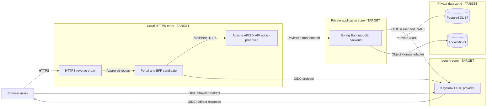

# DX-OS Open-Core — Deployment Topology

> **Document:** `docs/01-architecture/deployment-topology.md`  
> **Lifecycle:** DRAFT / NOT REVIEWED — the Document Register is authoritative for document status.  
> **Architecture status:** TARGET DESIGN; deployment and integrated runtime verification NOT ESTABLISHED.  
> **Inspected repository commit:** `0f0c3ba0c3eecda0a5c4a798a3cc14b808351bed`.  
> **Original topology blob:** `c661c2be3d7a7a9983e043f2b2d16b1c5a9d0e63`.  
> **Owner / independent reviewer / approver:** TO ASSIGN / NOT RECORDED / NOT RECORDED.

## 1. Purpose, Scope and Evidence Classification

**TO-BE / PROPOSED topology addition:** place Apache APISIX at the external API edge for routing, exposure, and edge security policies. Forward only a reviewed trust context to the Spring Boot Backend; Backend verification and resource authorization remain mandatory. Flowable BPMN, if adopted, is a Workflow adapter behind Core contracts, not an Application dependency. No APISIX or Flowable process, network route, or deployment is verified by this document.

Define the **local/demo MVP target deployment** and the security, process, host, network, data and recovery boundaries that must be verified. This is a G3 architecture specification, **not** an executable installation runbook; exact commands, credentials, operational checks and recovery instructions belong in G6 deployment documentation.

- **OBSERVED AT INSPECTED SHA:** Java 21 toolchain, Spring Boot 3.5.16 plugin, Gradle Wrapper 8.14.3 in Backend build configuration; architecture and deployment prerequisite drafts exist.
- **SELECTED TARGET:** single Spring Boot modular backend; Keycloak as OIDC identity provider; private PostgreSQL 17; local S3-compatible MinIO; HTTPS ingress and Portal/BFF boundary.
- **CANDIDATE / TO VERIFY:** Portal/BFF integration, exact ingress wiring, issuer redirect chain, storage adapter readiness, complete deployment descriptors, integrated runtime.
- **VERIFIED LIVE / E2E / CLEAN INSTALL:** NOT ESTABLISHED by this authoring pass. A previously configured single workstation or a successful component test is not equivalent to an independently reproducible full-stack deployment.

The target is a **Windows/local or Docker-assisted demo topology**. Future cloud/production tenancy, high availability, backups, certificate authority, public ingress and infrastructure orchestration require separately approved decisions. Do not interpret local assumptions as production security certification.

## 2. Logical System versus Runtime and Host Boundaries

| Level | Target meaning | Rule |
| --- | --- | --- |
| C4 Context (L1) | Browser users and related identity system interact with the DX-OS logical platform | Portal and Backend are inside the **DX-OS system-of-interest**; Keycloak is a logically distinct identity system |
| C4 Container (L2) | Portal, BFF, HTTP ingress, Spring Boot backend, IdP and storage processes | One backend **modular monolith** is not four microservices |
| Component (L3) | Identity/Workflow/Data/Gateway capability code, Application use cases and adapters | Logical ownership is not deployment/container ownership |
| Deployment | Hosts, Docker networks, ports, private loopback, volumes, trust and TLS | Implementation locations are target until exact deployment files and process evidence confirm them |

Core owns neutral contracts; Applications own business facts and resource eligibility. Infrastructure owns PostgreSQL/JDBC, OIDC and object-storage adapters. Gateway/HTTP exposure must route protected actions to an **authorized Application seam**.

## 3. Local MVP Target Topology

**Diagram status:** target-only conceptual network/container view. Boxes do not assert separate VMs, actual Docker service names, confirmed ports or deployed runtime. The precise OIDC code flow and token relay must be derived from accepted BFF/Keycloak configuration, not from arrows alone.

## 4. Component and Connectivity Catalogue

| Element | Role and target placement | Allowed connections / exposure | Verification required |
| --- | --- | --- | --- |
| Browser | Untrusted client endpoint | HTTPS ingress, OIDC redirects | TLS chain, cookie flags, CSRF/session behavior |
| HTTPS ingress | Controlled local front door | Only approved hostnames, routes and TLS termination | Listener binding, trusted certificate chain, route isolation |
| Portal / BFF | Frontend + session/CSRF boundary; candidate separate runtime | Ingress in; backend/IdP through reviewed client and outbound routes | Exact version, route allowlist, OAuth redirect URIs, CSRF and token handling |
| Spring Boot backend | One Java 21/Spring Boot 3.5.16 deployment unit | BFF or approved gateway in; private PostgreSQL/MinIO; trusted OIDC metadata/JWKS | Actual profiles, endpoints, JWKS validation, authorized use cases, error handling |
| Keycloak | Logical external IdP; may be co-hosted physically | Approved OIDC endpoints only | Issuer, audience, discovery/JWKS, PKCE/redirect, identity canonicalization |
| PostgreSQL 17 | Private relational persistence target | Only reviewed backend/adapters or controlled operations; **never browser** | Bind address, credentials, privilege grants, migrations, connection and rollback tests |
| Local MinIO | Private object-storage target | Approved backend storage adapter; no unreviewed public bucket | Adapter contract, access policy, durable volume, orphan/recovery behavior |
| Operator workstation | Trusted administration context | Controlled development/maintenance entry | Secret boundaries, audit, access restrictions |

**Configuration decisions still open:** exact hostname-to-service mapping, required inbound/outbound ports, Docker network/subnet, whether IdP and MinIO are containerized, and service account privileges. No port or hostname in this document is asserted as a universal installed value.

## 5. Trust and Security Boundaries

1. **Client → HTTPS ingress:** browsers are untrusted. TLS certificates, hostname mapping and redirect behavior must be tested; a generated certificate file alone is not evidence of working end-to-end HTTPS.
2. **Browser/Portal → BFF session:** treat cookies, CSRF, OAuth state/nonce, secure and SameSite attributes, session fixation and token exposure as security acceptance concerns. Browser JavaScript must not hold DB credentials.
3. **BFF/Gateway → Backend:** Gateway authenticates presented identity and operation authority. Backend Application enforces tenant/resource authorization and current business eligibility; hiding a UI action is not authorization.
4. **Backend → Keycloak:** validation must bind issuer, signature via trusted discovery/JWKS, intended audience and canonical subject. An arbitrary caller header does not become verified identity.
5. **Backend → PostgreSQL:** use least-privilege accounts and private binding, including safe migration/bootstrap privileges and independently tested transaction semantics. A health probe is not proof of application data integrity.
6. **Backend → MinIO:** object storage is a separate persistence system. A successful database commit cannot imply atomic MinIO persistence; use approved reconciliation, rollback/cleanup and non-false success behavior.

Never publish internal admin interfaces or data stores solely to simplify a demo. **Secrets are externally injected**, validated at startup and excluded from source, screenshots, logs and committed artifacts. Use placeholders in docs, not real values.

## 6. Runtime Startup and Failure Handling

| Dependency / failure | Required target response | Evidence gate |
| --- | --- | --- |
| Database absent or wrong schema | Fail readiness/affected operations safely; no fabricated request persistence | Boot + migration + DB integration evidence |
| IdP unreachable or invalid issuer | Reject invalid authentication, do not downgrade to unverified actor identity | OIDC negative test and service-recovery test |
| TLS/hostname mismatch | Fail/flag browser redirect or backend trust check rather than disabling validation | Browser and JVM trust chain evidence |
| BFF unavailable | No direct bypass path to unguarded Workflow mutation | Route inventory and security tests |
| MinIO unavailable | Attachment operation fails safely; no false object reference | Provider conformance + recovery test |
| Backend rollback or unknown commit | No blind duplicate retry or false success | Real PostgreSQL failure injection |
| Concurrent or revoked actor | No unauthorized state/history changes | Authorization/concurrency regression test |

Startup ordering alone does not establish readiness. Container/process health checks should be scoped to dependency readiness and authorization-safe operation; define timeouts and rollback/reconciliation policies separately.

## 7. State, Durability, Migrations and Operations

- **Relational data:** PostgreSQL 17 is the **target server version**, not a claim of a verified install in this evidence scope. Maintain reviewed Flyway migration ownership and preserve immutable historical migrations; distinguish disposable/test schemas from official environments.
- **Object data:** MinIO local deployment needs a named persistent volume or accepted equivalent, private access, backup/restore policy and cleanup of unattached objects. Do not claim S3/MinIO transaction equivalence.
- **Identity state:** Keycloak realm/client configuration, redirect URIs, keys and secrets require environment-specific controlled import/export and explicit recovery validation.
- **Logs and audit:** keep application audit events and infrastructure logs distinguishable; never log bearer tokens, credentials or unredacted sensitive business data. Define retention, correlation IDs and access policy before release.
- **Backups:** database dump or volume copies alone do not prove application-wide restore consistency. Restore tests and dependency ordering belong to G6.
- **Configuration:** environment template should specify mandatory names, validation and secure defaults without committing values. External secret tooling and port maps require independent operational review.

## 8. Technology and Version Provenance

| Technology | Pinned basis | Classification |
| --- | --- | --- |
| Java 21 | `backend/build.gradle` toolchain at inspected SHA | OBSERVED build configuration |
| Spring Boot 3.5.16 | Gradle plugin at inspected SHA | OBSERVED build configuration |
| Gradle 8.14.3 | `backend/gradle/wrapper/gradle-wrapper.properties` | OBSERVED wrapper distribution |
| PostgreSQL 17 | `docs/01-architecture/deployment-topology.md` and `docs/06-deployment/prerequisites.md` | SELECTED TARGET |
| Keycloak (version UNKNOWN) | Target architecture/prerequisites | SELECTED TARGET; version unverified |
| Local MinIO (version UNKNOWN) | Target architecture/prerequisites | SELECTED TARGET; real integration unverified |
| React and BFF versions UNKNOWN | Candidate Portal/BFF workstreams | CANDIDATE; exact manifests required |
| HTTPS ingress implementation/version UNKNOWN | Target ingress and separate local setup discussions | CANDIDATE; topology/test evidence required |

A selected technology does **not** mean a deployed service passed integration or security review. Any replacement requires compatibility, migration and owner review.

## 9. Required Verification Matrix

| ID | Claim to validate | Test/evidence | Current assessment |
| --- | --- | --- | --- |
| TOP-AC-01 | Exact source, configuration and deployment manifest are pinned | Git SHA + manifest hash + environment summary | NOT VERIFIED |
| TOP-AC-02 | Private network and allowed listener map match design | `ss`/Windows listener, Docker network and firewall review | NOT VERIFIED |
| TOP-AC-03 | HTTPS and browser/JVM trust chain work | DNS/cert, browser and Java TLS checks | NOT VERIFIED |
| TOP-AC-04 | OIDC discovery/JWKS, issuer, audience and PKCE work securely | Keycloak/BFF/backend real flow and negatives | NOT VERIFIED |
| TOP-AC-05 | BFF session/CSRF, allowlist and no bypass route | Security integration and route inventory | NOT VERIFIED |
| TOP-AC-06 | PostgreSQL connectivity, schema privileges and migrations work | Real disposable + intended clean install DB tests | NOT VERIFIED |
| TOP-AC-07 | Request/Workflow transaction and concurrency are correct | Atomicity, ACL-race and unknown-commit negative tests | NOT VERIFIED |
| TOP-AC-08 | MinIO contract, durable object and failure recovery work | Object-store provider conformance and recovery tests | NOT VERIFIED |
| TOP-AC-09 | Startup and downtime are bounded and recovery does not lie | Health/readiness and fault injection | NOT VERIFIED |
| TOP-AC-10 | Secrets and privileged services are never public/client-exposed | Secret scan, configuration review and route checks | NOT VERIFIED |
| TOP-AC-11 | Full-stack Helpdesk E2E from a clean local environment passes | Captured exact SHA, logs, HTTP evidence and independent reviewer | NOT VERIFIED |
| TOP-AC-12 | Facility reuse proof and deployment differences are documented | Distinct vertical slice and unchanged Core source diff | NOT VERIFIED |
| TOP-AC-13 | Backup, restore and migration boundaries are rehearsed | G6 restore and clean-install report | NOT VERIFIED |
| TOP-AC-14 | Gate review and accountable approvals are documented | Reviewer/approver, risks and evidence links | NOT REVIEWED |

**Review separation:** a diagram review, source configuration inspection, component-level pass and full-stack clean-install release PASS are different claims.

## 10. Risk Register and Open Decisions

| ID | Priority | Risk / open decision | Required owner role and mitigation |
| --- | --- | --- | --- |
| TOP-R01 | P0 | Incorrect issuer, redirect, TLS hostname or Java truststore breaks authentication | Identity/BFF/Deployment — verified redirect and trust flow |
| TOP-R02 | P0 | Internal DB, MinIO or admin interface exposed to clients | Backend/Operations/Security — listener/ACL audit |
| TOP-R03 | P0 | BFF route/session bypass or spoofed identity | Gateway/Identity — real security negative suite |
| TOP-R04 | P0 | PostgreSQL and Workflow transaction split/unknown commit | Workflow/Application — real failure injection |
| TOP-R05 | P1 | MinIO outage causes orphan/broken attachment state | Data/Application — repair/reconciliation plan |
| TOP-R06 | P1 | Incomplete clean installation and source/version drift | DevOps/Docs — reproducible pinned runbook |
| TOP-R07 | P1 | Missing volume, secret or backup/restore policy | Operations — backup/restore rehearsal |
| TOP-R08 | P1 | Runtime process/network mapping differs from target diagram | Deployment/Architecture — exact compose/config diff |
| TOP-R09 | P1 | Facility reuse remains only a mock/deferred demonstration | Application/Core — separate real slice and evidence |

Open architecture decisions include actual hostname/port inventory, ingress process implementation, IdP and storage containerization, BFF trust model, startup/recovery details, data/secret ownership and release evidence owner. None is silently approved here.

## 11. Architectural Interfaces and Documentation Ownership

This document owns **target topology and security boundaries**. It does not replace:
- [System Architecture](system-architecture.md) — architecture design and C4 views.
- [Core/Application Boundary](core-application-boundary.md) — logical ownership and authorized seams.
- [Dependency Rules](dependency-rules.md) — import constraints and enforceable boundaries.
- [Deployment Prerequisites](../06-deployment/prerequisites.md) — confirmed-at-inspection target prerequisites, not an accepted clean install.

G3-F02 System Context and G3-F06 Technology Stack are separately drafted workstreams, **not verified in the inspected Git baseline**. Do not insert unverified relative links until they are part of the reviewed documentation tree. Formal ADR and G6 runbook links must likewise be added only after checking their actual paths.

## 12. Evidence Provenance and Review

- Inspected immutable tree: [Git commit `0f0c3ba0c3eecda0a5c4a798a3cc14b808351bed`](https://github.com/lexuanbao258-collab/dxos-open-core/commit/0f0c3ba0c3eecda0a5c4a798a3cc14b808351bed).
- Topology source: [target topology at SHA](https://github.com/lexuanbao258-collab/dxos-open-core/blob/0f0c3ba0c3eecda0a5c4a798a3cc14b808351bed/docs/01-architecture/deployment-topology.md).
- Backend build configuration: [Gradle build at SHA](https://github.com/lexuanbao258-collab/dxos-open-core/blob/0f0c3ba0c3eecda0a5c4a798a3cc14b808351bed/backend/build.gradle).
- Gradle Wrapper: [properties at SHA](https://github.com/lexuanbao258-collab/dxos-open-core/blob/0f0c3ba0c3eecda0a5c4a798a3cc14b808351bed/backend/gradle/wrapper/gradle-wrapper.properties).
- Deployment prerequisite draft: [prerequisites at SHA](https://github.com/lexuanbao258-collab/dxos-open-core/blob/0f0c3ba0c3eecda0a5c4a798a3cc14b808351bed/docs/06-deployment/prerequisites.md).
- Portal/BFF and Backend workstreams: [PR #70](https://github.com/lexuanbao258-collab/dxos-open-core/pull/70), [PR #71](https://github.com/lexuanbao258-collab/dxos-open-core/pull/71), [PR #63](https://github.com/lexuanbao258-collab/dxos-open-core/pull/63). PR references are not automatic proofs of integrated LIVE status.

**Independent reviewer:** NOT RECORDED. **Evidence links from executed tests:** NOT RECORDED. **Architecture Gate:** NOT REVIEWED. **Release/Clean Install/E2E:** NOT VERIFIED.

**Document conclusion: PROPOSED REVISION / NOT REVIEWED.**
