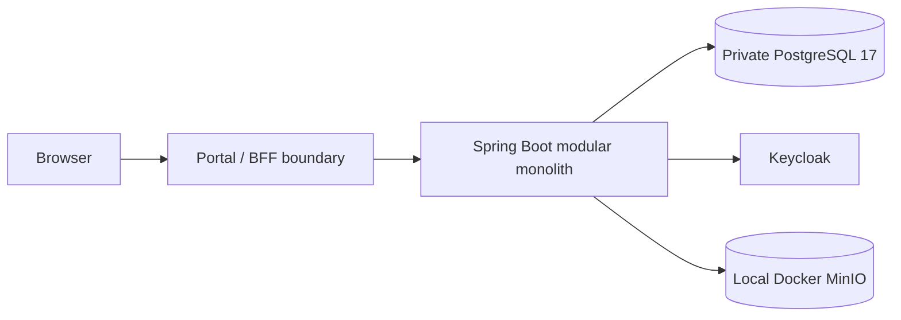

# Selected MVP deployment topology

**Status:** TARGET - not a verified deployed or integrated environment

The Java 21 / Spring Boot backend remains a modular monolith with four logical Core capabilities: Identity, Workflow, Data Management and API Gateway. Core owns domain, engine and ports; Infrastructure owns PostgreSQL, OIDC and object-storage adapters. Process boundaries do not redefine ownership.

The selected target uses private PostgreSQL 17, local Docker MinIO for object content, and Keycloak. MinIO's API is S3-compatible; AWS S3 deployment is not selected. Supabase Storage and filesystem-only storage are outside the new implementation scope. The diagram does not prove integrated runtime behavior.

See [ADR-007](../08-decisions/ADR-007-data-storage.md) and [deployment prerequisites](../06-deployment/prerequisites.md).
