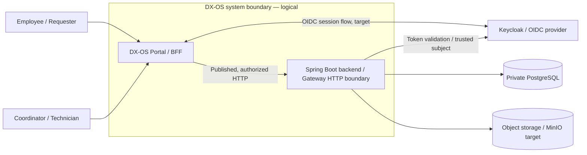
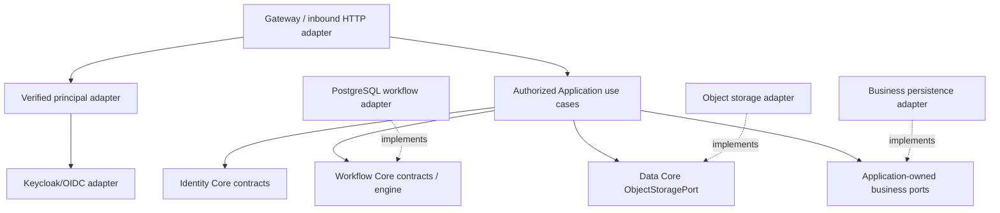

# DX-OS Open-Core — System Architecture

> **Artifact:** G3-F04, proposed consolidation of the existing System Architecture review draft.  
> **Lifecycle:** DRAFT / NOT REVIEWED; authoritative lifecycle belongs to the Document Register.  
> **Repository source snapshot:** `lexuanbao258-collab/dxos-open-core` at `0f0c3ba0c3eecda0a5c4a798a3cc14b808351bed` (read-only).  
> **Original file blob:** `28c17946fe48e7f62a2b23d80d8c4419a04d4559`.  
> **Previous document's declared historical baseline:** `e06fa429cfd92b032c166eb3ebf32803d13191c2`; this is not silently promoted to the present review snapshot.  
> **Review authority:** owner/reviewers and final Gate decision not established for this revision.

## 1. Purpose, Decision Scope and Evidence Semantics

DX-OS Open-Core is a reusable platform for internal service applications, **not a computer operating system**. It separates reusable capability contracts from IT Helpdesk and Facility-specific behavior. This document provides a system-wide design and review map; it does not replace detailed Core contracts, business specifications, formal ADRs, migration plans or executable evidence.

**Claim qualification:** `BASELINE` means directly observed in a named, pinned repository source or contract; `CANDIDATE` means proposed on a separate PR or branch, not automatically in the inspected snapshot; `PROPOSED` means a target or selected design direction; `UNVERIFIED` means the relevant executable evidence was not reviewed for this artifact. A selected design direction is not an ADR approval or release Gate PASS.

Priority: (1) security/correctness; (2) Core reuse across distinct applications; (3) bounded provider substitution; (4) reproducible local deployment/evidence; (5) maintainable capability ownership. The first IT Helpdesk golden path remains the main MVP path; full Facility Maintenance is deferred, with a narrower reuse-proof slice proposed.

## 2. Architecture Views and System Boundary

| View | Purpose | Placement / status |
| --- | --- | --- |
| C4 Level 1 — Context | People, DX-OS system of interest, external identity/trust system | G3-F02 `system-context.md` is a separately prepared draft; **not found** at pinned Git SHA |
| C4 Level 2 — Container | Browser, Portal/BFF, Spring Boot backend, Keycloak, private persistence/storage | Conceptual container diagram below; implementation/integration not inferred |
| C4 Level 3 — Component | Four logical Core capabilities, Application use cases and infrastructure adapters | Logical component diagram below; not independent deployables |
| Deployment | Host/network/runtime/ingress and credentials | [Deployment topology](deployment-topology.md) is a TARGET document, not verified running environment |

At Context level the Portal and Backend belong to one logical **DX-OS Internal Service Platform**. Keycloak is a distinct identity system/trust responsibility even if co-deployed for local development. PostgreSQL and MinIO are deployment/container dependencies, not business actors.

### 2.1 Conceptual C4 container view

This picture is a target interaction model, not proof of integrated OIDC, TLS or E2E operation. The external provider and storage placement do not imply separately deployable Java Core services.

### 2.2 Logical component and dependency view

Solid edges indicate conceptual calls/usage; dashed `implements` edges indicate dependencies **from adapters toward owner-defined ports**. Enforce package imports separately; diagrams are not executable proofs.

## 3. Architectural Decisions, Alternatives and Governance

| Reference | Direction retained from source draft | Qualification / verification gap |
| --- | --- | --- |
| SYS-ADR-01 | **B — Modular Monolith** (one modular Java backend) | Team-selected design intent; module enforcement and approved ADR not verified |
| SYS-ADR-02 | **B — Hexagonal / Ports & Adapters / DIP** | Source ports exist; provider conformance and forbidden imports need evidence |
| SYS-ADR-06 | **B — Capability/Application data ownership** | Shared physical DB does not transfer logical data ownership |
| SYS-ADR-08 | **B — Generic Workflow state machine** | Application-specific definitions and two-app reuse require proof |
| SYS-ADR-03 | Referenced in original, decision status unresolved | Formal ADR reconciliation required |
| SYS-ADR-04 | Application-side authorization enforcement direction discussed | Resource/race tests and formal approval unresolved |
| SYS-ADR-05 | Transaction model | OPEN; composite commit vs port semantics must be settled |
| SYS-ADR-07 | Object storage provider direction: local MinIO target | Implementation/storage contract acceptance unverified |
| SYS-ADR-09 | Referenced in original, decision status unresolved | Formal ADR reconciliation required |
| SYS-ADR-10 | Generic Workflow API exposure restricted/default-off direction | Verify route inventory, configuration, negative HTTP tests |
| SYS-ADR-11 | IT golden path + second-application reuse proof direction | Real Facility slice and clean verification unverified |

**Alternatives retained:** a layered monolith without enforced boundaries weakens reuse; splitting all Core modules into microservices adds network/distributed-transaction burden; hardcoding IT/Facility states in Core invalidates the generic-state-machine claim; replacing owner-defined ports with provider-specific calls makes substitution unsafe. Architectural preference does not constitute implementation evidence. The `SYS-ADR-*` namespace is retained as a source-document reference; do not equate it with a verified `docs/08-decisions/ADR-*.md` file or Accepted lifecycle.

## 4. Ownership of the Four Core Capabilities

| Capability | Owns | Explicit exclusions and conditions |
| --- | --- | --- |
| Identity | Provider-neutral principal/authority values, errors and trusted access contracts | Does not issue passwords, blindly trust constructed principals, or decide all request-level ACLs |
| Workflow | Definition, instance state/version, valid transition/history and Workflow-owned persistence semantics | Does not own ticket assignment, Facility inspection, JWT verification or arbitrary business fields |
| Data Management | Object storage port, metadata, write/error semantics and agreed reusable storage capabilities | Does not own every business table or imply DB–object-store atomicity |
| API Gateway | Controlled HTTP exposure, verified ingress handoff, shared error/routing conventions | Does not replace Application resource authorization or hold business persistence policy |

Provider-specific implementations belong behind the appropriate Core- or Application-owned ports. Core must not branch on a Helpdesk/Facility application name, and the BFF is not a fifth Core capability.

## 5. Application and Integration Ownership

**IT Helpdesk:** Application owns issue facts, assignment, technician eligibility, resolution and requester confirmation. In the documented backend candidate, `triage` is a Workflow transition while `assign` is a separate Application command/version; the candidate endpoint is `CONFIRMED`, not automatically `CLOSED`.

**Facility:** Application owns maintenance location, repair facts, assignment and acceptance business policy. The sequence `SUBMITTED → ACCEPTED → ASSIGNED → IN_REPAIR → AWAITING_ACCEPTANCE → CLOSED` is **PROPOSED / CONFLICTED**, not an accepted Workflow definition. Acceptance actor, assignment semantics, failed acceptance, rework and closure remain open; the full journey is deferred from the IT-first MVP.

**Reuse proof requires** two materially distinct Application consumers invoking stable Core contracts, versioned workflow definitions, authorized operations, real persistence and demonstrable absence of app-specific changes to generic Core algorithms at pinned revisions. Two UI mock screens or two JSON definitions alone do not prove implementation reuse.

## 6. Trust Boundary, Request Flow and Policy Enforcement

1. A user interacts with the Portal/BFF; session and CSRF decisions belong to its reviewed HTTP boundary.
2. Keycloak/OIDC provides identity; the trusted backend adapter validates issuer, signature, audience/claims and establishes the canonical principal under the approved contract.
3. Gateway/inbound HTTP exposes only approved operations and checks required authentication and coarse operation authority.
4. The **authorized Application use case** checks target tenant/resource visibility, exact operation authority, current actor eligibility, assignment/requester ownership and relevant business invariants.
5. The use case coordinates Workflow Core and its own business ports through reviewed transaction and concurrency semantics; protected state changes never bypass this seam.
6. HTTP responses do not assert success until the write outcome is known; errors do not leak hidden resource existence or provider internals.

A valid JWT is not a resource grant. The backend must reject forged identity headers, cross-tenant access, revoked assignees, stale versions and direct Generic Workflow mutation without an approved resource policy. Typical contract distinctions: `401` unauthenticated, `403` visible-but-forbidden, `404` hidden/nonexistent; verify exact transport/error mapping before release.

## 7. Persistence, Transactions, Concurrency and Provider Independence

- **Logical ownership:** Workflow state/definitions/history are Workflow-owned; Helpdesk/Facility records are Application-owned; object-storage objects use Data contracts. PostgreSQL may physically host multiple logical owners.
- **Single-database atomicity:** a composite Helpdesk+Workflow mutation is atomic only if operations actually share an appropriate PostgreSQL transaction/connection boundary and honor durable-commit semantics. A self-committing Workflow persistence port can conflict with Application-level orchestration. This issue is **OPEN** until contract and failure-injection tests reconcile it.
- **Concurrent writes:** Workflow optimistic expected version and Application assignment version are distinct where the Helpdesk candidate defines them. Verify races involving assignment revocation and authorization TOCTOU before claiming security acceptance. Do not assume Facility has the same assignment schema.
- **Unknown outcome:** after timeout/lost response, `COMMIT_OUTCOME_UNKNOWN` forbids blind retry and false success. Reconciliation/idempotency require an approved endpoint and protocol, not UI-only deduplication.
- **Cross-store:** PostgreSQL and MinIO are not one ACID transaction; stage/reconcile/cleanup object references under a reviewed recovery design.
- **Provider independence:** successful replacement requires port conformance for byte/metadata/stream/conflict semantics, source-diff checks, migration/data compatibility and negative tests. Ports do not guarantee cost-free substitution.

## 8. Source and Contract Traceability at the Pinned Snapshot

| Claim / source role | Verified file at source SHA | Scope of observation |
| --- | --- | --- |
| Architecture direction and original risk ledger | [Original System Architecture](system-architecture.md) | This file is being revised; original blob `28c17946fe48e7f62a2b23d80d8c4419a04d4559` must be retained in revision history |
| Core/Application import rules | [Dependency rules](dependency-rules.md) | Review draft, not CI enforcement proof |
| Domain and authorized seam boundaries | [Core/Application boundary](core-application-boundary.md) | Existing review draft at this source SHA; later G3-F03 package is not included in that SHA |
| Platform implementation target | [Deployment topology](deployment-topology.md) | Target, not deployed acceptance |
| Identity Core contract | [Identity contract](../contracts/identity-core.md) | Contract exists; real OIDC integration evidence separate |
| Workflow Core contract | [Workflow contract](../contracts/workflow-core.md) | Contract exists; composite Application transaction unproven |
| Data Core contract | [Data contract](../contracts/data-core.md) | Object-storage contract exists; MinIO live conformance unproven |

**Snapshot limitations:** at the pinned SHA, `docs/01-architecture/README.md` and `system-context.md` were not found, although G3-F01/F02 packages were separately prepared in conversation. G3-F03 is likewise a proposed replacement outside the pinned GitHub snapshot. References to these drafts are **plain paths without links** until integrated into one verified baseline. Legacy architecture/contracts/evidence sources remain authoritative during documentation migration. The original `source_baseline: e06fa429...` records historical review context and must not be confused with this read-only snapshot. Candidate PRs must be checked at their individual head SHAs.

## 9. Risk Register (Preserved R-01–R-10)

| ID | Priority | Risk and effect | Proposed mitigation / accountable review |
| --- | --- | --- | --- |
| R-01 | P0 | Composite Helpdesk transaction conflicts with self-committing Workflow port | Workflow + Application contract revision and DB failure injection |
| R-02 | P0 | Generic API or SQL bypasses resource authorization | Security/Gateway route and DB grant review; negative tests |
| R-03 | P0 | No independently verified integrated release path | Integrated SHA, clean install, real E2E evidence |
| R-04 | P1 | Helpdesk SQL couples business logic to DB provider | Application-owned repository/composite ports, adapter tests |
| R-05 | P1 | Identity provider issuer/subject changes strand identities | Explicit identity-linking/migration policy; no email-based merge by default |
| R-06 | P1 | BFF Helpdesk-specific allowlist blocks Facility reuse | Reviewed shared transport plus per-app route adapters |
| R-07 | P1 | Object storage and database split commit yields orphan references | Reconciliation, cleanup and failure tests |
| R-08 | P1 | Dependency boundaries have no executable proof | ArchUnit/package checks in CI |
| R-09 | P1 | Facility reuse not evidenced | Real second vertical slice, no Core algorithm edits |
| R-10 | P2 | Divergent docs/PR baselines cause false status claims | SHA manifest, document register, evidence reconciliation |

## 10. Decision Dependencies and Outstanding Architecture Work

| Concern | Owner to confirm | Required follow-up |
| --- | --- | --- |
| Composite Workflow/Application transaction (`SYS-ADR-05`, R-01) | Workflow + Application | Port semantics, connection sharing, rollback/unknown commit tests |
| Resource authorization and TOCTOU (`SYS-ADR-04`, R-02) | Identity/Security + Application | Identity handoff, exact authority, ACL race tests |
| Restricted Generic API (`SYS-ADR-10`) | Gateway + Security | Real route/configuration audit and negative HTTP proof |
| MinIO conformance and recovery (`SYS-ADR-07`, R-07) | Data + Application | Object port tests, failure recovery and privacy |
| Facility reuse (`SYS-ADR-11`, R-09) | Business owner + Application + Core | Ratified minimum slice and exact-code evidence |
| All undecided SYS-ADR entries | Architecture owner to assign | Actual ADR file inventory and formal status review |
| Documentation SHA drift (R-10) | Docs owner to assign | Reconcile G0/G1/G2 drafts and source baseline |

## 11. Claims-to-Evidence Acceptance Matrix

| Claim | Source or contract | Executable verification needed | Evidence / review outcome for this draft |
| --- | --- | --- | --- |
| Modular isolation | Architecture + dependency drafts | ArchUnit forbidden-import CI | NOT VERIFIED / NOT REVIEWED |
| Verified Identity boundary | Identity contract | Real OIDC issuer/JWKS/subject and forged-header tests | NOT VERIFIED / NOT REVIEWED |
| Resource-level permission checks | Application/Gateway boundary | Cross-tenant, revoked-assignee, `403`/`404` tests | NOT VERIFIED / NOT REVIEWED |
| Workflow version/history correctness | Workflow contract | PostgreSQL concurrency/history atomicity tests | NOT VERIFIED / NOT REVIEWED |
| Helpdesk composite write correctness | Workflow + Application | Shared transaction, rollback, lost response tests | NOT VERIFIED / NOT REVIEWED |
| Data adapter substitution | ObjectStoragePort | Provider conformance + migration and failure tests | NOT VERIFIED / NOT REVIEWED |
| Two-application reuse | Helpdesk/Facility candidate docs | Real second definition, Core-diff and E2E tests | NOT VERIFIED / NOT REVIEWED |
| Local integrated deployment | Deployment target | Clean install at integrated SHA, TLS/OIDC/API flow | NOT VERIFIED / NOT REVIEWED |
| Documentation integrity | This artifact and related docs | Markdown lint, Mermaid render, relative-link checker | NOT VERIFIED / NOT REVIEWED |

Evidence must capture exact code/docs SHA, command/environment, test logs or reports, reviewer identity and an explicit approval decision. This matrix is a **verification plan**, not a result ledger.

## 12. Review and Change Control

A documentation review verifies consistency with the System Context, Core/Application Boundary, Dependency Rules, G1 product scope and G2 use cases/business rules. Source changes to state/history ownership, trusted Identity, HTTP exposure, transaction policy or provider contracts require an impact assessment, linked ADR when appropriate and independent review. Updating documentation alone never proves implementation conformance.

**File-level outcome:** DRAFT / NOT REVIEWED.  
**Formal ADR approvals:** NOT ESTABLISHED by this source review.  
**Code integration / E2E acceptance:** NOT VERIFIED in this work.  
**G3 Gate outcome:** NOT REVIEWED.  
**Repository changes:** NONE; this package is proposed for review, not committed.

## 13. Pinned References

- [Original System Architecture at pinned Git SHA](https://github.com/lexuanbao258-collab/dxos-open-core/blob/0f0c3ba0c3eecda0a5c4a798a3cc14b808351bed/docs/01-architecture/system-architecture.md)
- [Core/Application Boundary at pinned SHA](https://github.com/lexuanbao258-collab/dxos-open-core/blob/0f0c3ba0c3eecda0a5c4a798a3cc14b808351bed/docs/01-architecture/core-application-boundary.md)
- [Dependency Rules at pinned SHA](https://github.com/lexuanbao258-collab/dxos-open-core/blob/0f0c3ba0c3eecda0a5c4a798a3cc14b808351bed/docs/01-architecture/dependency-rules.md)
- [PR #63 — Helpdesk candidate](https://github.com/lexuanbao258-collab/dxos-open-core/pull/63)
- [PR #70 — BFF candidate](https://github.com/lexuanbao258-collab/dxos-open-core/pull/70)
- [PR #71 — Portal candidate](https://github.com/lexuanbao258-collab/dxos-open-core/pull/71)
