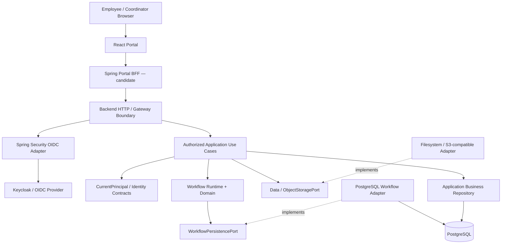
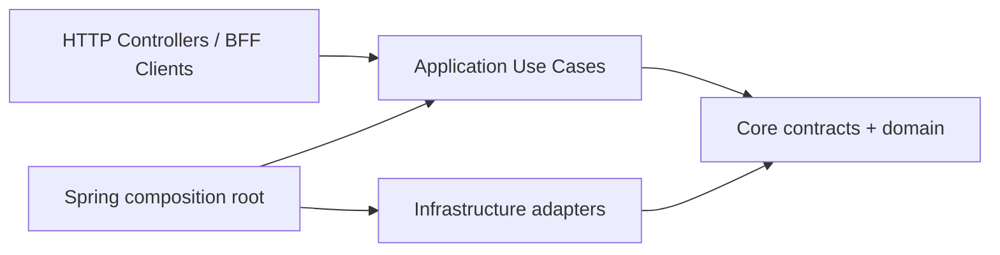
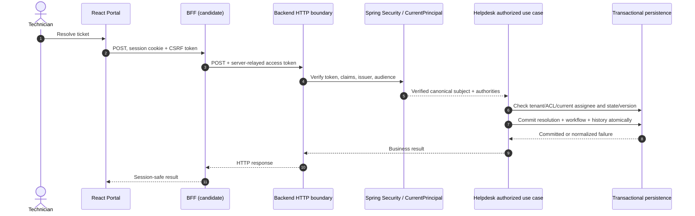

# DX-OS Open-Core — System Architecture

> **REVIEW RULE.** `ACCEPTED` below means the team selected a *design direction* for SYS-ADR-01, 02, 06 and 08 in the architecture discussion; it **does not** mean a corresponding numbered ADR file has been merged, code has been implemented, or an E2E test has passed. `BASELINE` means observed in the pinned `main` source/contracts; `CANDIDATE` means work on another branch/PR; `PROPOSED` means the target design; `UNVERIFIED` means acceptance evidence is missing. No runtime tests were executed to prepare this document.

**Document role:** system-level architecture and architecture-review record, not a substitute for capability contracts, immutable migrations, PR-specific evidence or individual ADRs. **Destination:** `docs/01-architecture/system-architecture.md`. The existing `docs/contracts/*`, `docs/evidence/*`, `docs/poc/*` remain canonical until reviewed migration.

## 1. Mục đích và phạm vi kiến trúc

### 1.1 Mục đích

DX-OS is a reusable foundation for internal digital service applications. It is **not a computer operating system**. The architectural claim is: independent applications consume stable capability contracts, while provider technologies live behind adapters. IT Helpdesk demonstrates a complete golden path; a Facility vertical slice demonstrates reuse with distinct business rules.

Architecture objectives, ranked:

1. **Security and correctness:** no unverified identity, unauthorized resource change, partial workflow/history commit, or lost version update.
2. **Real Core reuse:** Helpdesk and Facility use the same Identity, Workflow, Data and Gateway capabilities without application-specific branches in Core.
3. **Bounded provider substitution:** change an adapter when its contract can be preserved and tested; do not promise cost-free migration.
4. **Delivery and evidence:** reproducible full-stack demo, clean install, inspectable code, tests, licensing and deployment docs.
5. **Maintainability:** explicit ownership, inward dependencies, stable error semantics, versioned contracts.

### 1.2 In-scope / out-of-scope

| In scope | Out of scope for MVP |
|---|---|
| One Java 21 / Spring Boot modular backend; four logical Core capabilities; application use cases | Mandatory microservice split / independent Core services |
| Keycloak/OIDC as current identity provider; provider-neutral Identity contracts | Building a custom password database or authentication server |
| Generic Workflow state machine; state/version/history; provider-owned persistence adapter | BPMN orchestration, timer engine, distributed long-running sagas by default |
| Object Storage port and implementations with conformance evidence | Universal data platform that owns every business repository |
| Portal/BFF/API boundary, secure exposure and errors | Public generic Workflow API without verified authorization and resource guards |
| PostgreSQL baseline, clean deployment and migration strategy | Claim of seamless DB/IdP switching without migration |

### 1.3 Quy trình chấp thuận

- Design-selected decisions: **SYS-ADR-01=B Modular Monolith; 02=B Ports & Adapters/DIP; 06=B capability/application data ownership; 08=B generic state machine**. Implementation and acceptance gates remain separate.
- Other decisions in this document are **recommendations only**; reviewers must record rationale, owner, date and revised constraints in `docs/08-decisions/`.
- Traceability chain: Problem → Use Case → Architecture → ADR → Contract → Source → Test → Evidence → Review sign-off.

## 2. Bối cảnh hệ thống DX-OS

### 2.1 Business problem

Internal requests enter through messaging/email/manual channels, creating inconsistent triage, assignment, progress visibility and evidence. DX-OS supplies common mechanics while applications own different workflows and authorizations.

| Actor | IT Helpdesk example | Facility example |
|---|---|---|
| Employee | Submit device/network request, confirm resolution | Report room/air-conditioning issue, confirm repair |
| Coordinator/Manager | Triage, assign, monitor | Assess facility case, allocate staff |
| Executor | Start, resolve, record evidence | Inspect and repair |
| Administrator | Configure identity/runtime/environment | Same platform operations, not automatically business access |

**Important:** these are business-role examples, not hard-coded Identity Core authorities; exact role names and Facility scope remain application decisions.

### 2.2 Source baseline ledger

| Area | `main` evidence at pinned SHA | Interpretation / limit |
|---|---|---|
| Architecture | `docs/architecture/README.md`, `docs/architecture/data-persistence-boundaries.md` | Four capabilities; modular monolith; logical ownership != deployment topology |
| Identity | `docs/contracts/identity-core.md`, `core/identity`, `application/identity/CurrentPrincipal`, Spring Security adapter | Core principal types are facts, not authentication proof; verified context is adapter responsibility |
| Workflow | `docs/contracts/workflow-core.md`, `core/workflow/WorkflowRuntime.java`, `WorkflowPersistencePort.java` | Domain and persistence contract exist; cross-Application transaction is not automatically solved |
| Data | `docs/contracts/data-core.md`, `ObjectStoragePort` | Synchronous storage contract exists; contract alone is not live provider acceptance |
| Gateway | Backend security/controller/gateway code, `README.md` | Restricted exposure and BFF candidate require explicit integration evidence |
| Application | Request prototype on main; Helpdesk candidate PR #63 | Do not label candidate business routes integrated in main |
| BFF/Frontend | Candidate PR #70 / #71 | Separate development/review, not release-accepted simply because a PR exists |

**Source baseline SHA:** [`e06fa429`](https://github.com/lexuanbao258-collab/dxos-open-core/commit/e06fa429cfd92b032c166eb3ebf32803d13191c2). The root README contains an older source-baseline paragraph: use its conceptual descriptions but do not treat its historical test counts as tests on this SHA. This document is a source review, **not an independently executed build**.

## 3. Các quyết định Modular Monolith, Hexagonal, DIP

### 3.1 SYS-ADR-01 — B: Modular Monolith (design direction selected)

**Why:** one deployable backend reduces distributed failure modes and allows tightly controlled local persistence while permitting internal boundaries. BFF, ingress and IdP may be separately deployed; this does not turn the Java backend into microservices.

| Option | Benefit | Cost / objection | Decision |
|---|---|---|---|
| A. Layered monolith without module boundaries | Fast initial scaffolding | Cross-feature coupling; weak reuse proof | Rejected for target |
| **B. Modular Monolith** | One backend, clear capability ownership, testable boundaries | Requires ArchUnit/build-time dependency rules | **Selected** |
| C. Microservices per Core | Independent deployment/scale | Network, observability, distributed consistency, delivery risk | Deferred |

**Source impact:** keep one backend project; make Core/Application/Infrastructure/HTTP import rules executable (ArchUnit). Do not split services to match four folder names.

### 3.2 SYS-ADR-02 — B: Hexagonal Architecture + DIP (selected)

The **owner of a behavior defines the port**, implementations depend inward upon it. Example: Workflow owns `WorkflowPersistencePort`; PostgreSQL infrastructure implements it. `ObjectStoragePort` is Data-owned. An interface wrapper around SQL is insufficient if it leaks DB transaction or provider semantics.

| Option | Strength | Defect | Decision |
|---|---|---|---|
| A. Application calls concrete JDBC/SDK classes | Shortest path | Reuse and substitution locked to provider | Reject as boundary |
| **B. Stable owner-defined ports + adapters** | Provider-neutral Core, contract testing | Requires exact error/atomicity/lifecycle semantics | **Selected** |
| C. Internal REST among every capability | Network-level isolation | Artificial distribution, latency, transaction cost | Reject for monolith |

**Source impact:** review Helpdesk candidate SQL coupling before stating Application is provider-independent; separate authorized use cases from transport and database adapters.

### 3.3 SYS-ADR-06 — B: Capability/application-owned data (selected)

Physical PostgreSQL ownership is **not** logical data ownership. Workflow owns definition/instance/history semantics; Helpdesk/Facility own their business facts; Data Core owns reusable object-storage semantics. A persistence adapter may live in infrastructure or a Data implementation package **without taking over the Workflow contract**.

| A. Data owns all | **B. Each domain owns semantics** | C. Separate database per Core |
|---|---|---|
| Centralized schema, God module risk | Clear owner, shared physical DB possible | More isolation, much higher consistency/ops cost |
| Not selected | **Selected** | Deferred |

**Source impact:** avoid Core Data importing Helpdesk/Workflow business types; define allowed write paths, schema ownership, migration owner and access privileges.

### 3.4 SYS-ADR-08 — B: Generic State Machine (selected)

Workflow Core models definition versions, transitions, instance lifecycle, version checks and history. Helpdesk/Facility supply their own definitions, resource bindings, ACL and business eligibility. Core must not have `if (application == "HELPDESK")` or Facility-specific statuses.

| Option | Fit | Cost | Decision |
|---|---|---|---|
| A. Hardcoded statuses in each application | Simple single-use demo | Fails reuse claim | Reject |
| **B. Generic state machine** | Fits current contracts, explicit invariants | No built-in complex BPMN timers/parallelism | **Selected** |
| C. BPMN engine | Rich workflow modeling | High integration and migration cost | Future ADR if needed |

**Source impact:** preserve `WorkflowDefinition`, `WorkflowRuntime`, `WorkflowPersistencePort`; do not remodel existing SQL/business flows before controlled integrity review.

### 3.5 Decision statuses

| Decision | Architectural direction | Implementation status | Acceptance |
|---|---|---|---|
| SYS-ADR-01 | Selected by team | Partially reflected in main structure | Dependency CI gate pending |
| SYS-ADR-02 | Selected by team | Some ports/adapters on main | Cross-app substitution proof pending |
| SYS-ADR-06 | Selected by team | Contract ownership documented | Business SQL coupling review pending |
| SYS-ADR-08 | Selected by team | Generic workflow core exists | Two-application live reuse proof pending |

## 4. Bốn Core Capabilities và trách nhiệm

| Capability | Owns (WHY / WHAT) | Public internal contract | Does **not** own | Current caution |
|---|---|---|---|---|
| **Identity** | Verified principal representation, authority facts and boundary integration | `AuthenticatedPrincipal`, `Authority`, `CurrentPrincipal` | Password IAM; tenant/resource business authorization; workflow lifecycle | Constructing `AuthenticatedPrincipal` is not verification |
| **Workflow** | Definition, immutable instance, transition, version, history, lifecycle, persistence semantics | `WorkflowRuntime`, `WorkflowPersistencePort`, domain records | Identity/JWT verification; Helpdesk assignment; Facility-specific policy | Port's durable-commit contract must not be weakened |
| **Data Management** | Provider-neutral object storage; reusable storage policy and errors | `ObjectStoragePort`, keys/metadata/write modes/errors | Every table/repository; Workflow transition semantics | DB and object-store writes do not form one transaction |
| **API Gateway** | HTTP exposure, authentication enforcement, routing, common failures/limits and authorized handoff | REST/OpenAPI and shared HTTP boundary conventions | Business transition decisions; persistence; sole resource authorization | BFF and backend gateway are distinct trust boundaries |

**Cross-cutting invariant:** exact operation authority may be necessary, but resource authorization is decided at the Application use-case boundary; neither a valid token nor Gateway authorization alone grants access to arbitrary ticket/resource.

## 5. Application Layer: Helpdesk và Facility

### 5.1 Responsibility split

| Concern | IT Helpdesk Application | Facility Application | Shared Core |
|---|---|---|---|
| Request DTO and business metadata | Title, type, resolution, assignee, assignment version | Facility location, fault category, repair details | None of these in Workflow Domain |
| Resource/tenant eligibility | Coordinator/current assignee/requester policies | Facility coordinator/repairer/requester policies | Identity fact + Workflow operation, not business ACL |
| Lifecycle selection | e.g. triage → work → resolve → confirm | e.g. review → allocate → repair → verify | Generic definition/transition engine |
| Attachments | Ticket evidence rules | Photos/repair evidence rules | `ObjectStoragePort` mechanics |
| HTTP endpoints | Business routes and DTOs | Separate business routes and DTOs | Gateway conventions/security |

### 5.2 Implementation evidence and caution

- `main`: Request prototype and Generic Workflow are distinct; do not claim migrated Helpdesk E2E.
- [PR #63](https://github.com/lexuanbao258-collab/dxos-open-core/pull/63) (candidate) implements Helpdesk-oriented API and guarded SQL path. Its cross-table atomicity should be preserved during refactor. A direct Workflow SQL-function call in the application candidate is a portability gap, **not proof the generic Core contract is unusable**.
- Facility is a planned reuse slice, not a proven complete application on the pinned baseline. The exact Facility process and schema need business approval before coding.

### 5.3 Application use-case rule

Request controller → **authorized application use case** → validated business rule → Workflow domain and persistence / business repository. A generic Core API must not be an alternate entry bypassing application resource policy.

## 6. Component/Dependency Diagram

### 6.1 Logical flow / deployment-neutral diagram

*`candidate` and generic adapter boxes are architecture positions, not declarations that each is integrated on `main`. Logical dependency arrows and request-flow arrows are different abstractions; adapter `implements` edges deliberately point toward owned ports.*

### 6.2 Source dependency rule

**Forbidden imports:** `core → infrastructure`, `core.workflow → application.helpdesk`, `core.workflow → Spring Security`, `core.data → business DTO`, `application → concrete PostgresWorkflowPersistence`. Transport DTOs do not define Core domain invariants. Review existing source separately for compliance; the diagram is not a verified import-graph report.

### 6.3 Container distinction

A *modular monolith* describes the backend's code/runtime architecture. Browser, reverse proxy, Keycloak, BFF and PostgreSQL are external containers/services. It is acceptable for BFF to deploy separately. It is not acceptable to equate “four Core Capabilities” with “four mandatory service processes.”

## 7. Ports & Adapters

### 7.1 Port ownership

| Port / seam | Owned by | Adapter example | Contract-critical semantics |
|---|---|---|---|
| `CurrentPrincipal` | Application identity boundary | Spring Security JWT context adapter | Verified issuer/subject, fail-closed, canonical subject |
| `WorkflowPersistencePort` | Workflow Core | `PostgresWorkflowPersistence` | Durable commit, authoritative definition, history atomicity, conflicts, unknown commit |
| `ObjectStoragePort` | Data Core | Filesystem, S3-compatible/MinIO candidate | Key identity, stream lifecycle, exact length, `CREATE_ONLY` concurrency, sanitized failures |
| Business repository API | Owning Application | SQL/JPA business adapter | Business fact ownership; resource/tenant policy and transaction coupling |
| Gateway HTTP contract | Gateway / HTTP boundary | MVC controller, BFF client, Caddy ingress | No forged caller; controlled route exposure; 401/403/404 contracts |

### 7.2 What adapter substitution means

**Replace adapter, not business semantics.** Required procedure: identify owned port; implement same input/output/errors/invariants; execute shared contract suite; run new provider integration/concurrency tests; validate deployment/rollback/migration strategy. No claim of substitute compatibility exists until this evidence is supplied.

**Not automatically swappable:** IdP user mapping across issuer changes; SQL functions embedded in application candidate; transaction boundary shared by Helpdesk and Workflow; provider-specific object consistency. These require controlled migrations/refactors, not merely changing YAML properties.

### 7.3 Minimum compatibility tests

Workflow: concurrent transitions one winner, compare full snapshot, terminal rejection, no partial instance/history, `COMMIT_OUTCOME_UNKNOWN` reconciliation, exact `Instant` preservation. Data: concurrent `CREATE_ONLY`, read resource close, lazy-read errors, metadata version consistency. Identity: token issuer/audience/sub, exact role mapping, forged-header rejection, identifier continuity. Gateway: route flags, CSRF, header/body limits, allowed operations and HTTP errors.

## 8. Request Flow và Trust Boundaries

### 8.1 End-to-end resolve flow (target; candidate components noted)

### 8.2 Trust boundaries and responsibilities

| Boundary | Trusted inputs | Never implicitly trust | Required guard |
|---|---|---|---|
| Browser → BFF | Session only after validation | Client role, `actorId`, arbitrary HTTP headers | Same-origin CSRF, session cookie attributes, login/logout controls |
| BFF → Backend | Bearer validated by backend | BFF assertion alone as identity proof | JWT issuer/audience/signature/expiry verification in backend |
| Backend → Application | `CurrentPrincipal.requireVerified()` | Constructed principal from caller JSON | Exact operation authority; tenant/resource policy |
| Application → DB | Controlled repository/transaction context | Stale ACL read; forged DB principal context | Transactional guard/conditional write, least privilege |
| Application → Object Storage | Validated object key and eligibility | Filename/metadata as access grants | App authorization, upload limits, safe namespace mapping |

### 8.3 HTTP decisions needing separate review

- Business API should be default exposed; restricted Generic Workflow HTTP must stay disabled until a complete Authorized Use Case and resource policy are verified.
- 401 for missing/invalid authentication; 403 for authenticated but forbidden operation; 404 where hiding a resource is intentional. Specify precedence and leak-resistance in Gateway/Application contracts.
- Logging must avoid JWT, session cookies, DB credentials, PII and raw provider errors.

## 9. Transaction, Concurrency và Consistency

### 9.1 Write invariants

1. One successful workflow transition increments runtime version **exactly once** and appends **exactly one** matching history record.
2. No transition from completed/invalid state, stale expected version, wrong definition/resource/snapshot.
3. A successful `WorkflowPersistencePort` write returns only after confirmed durable commit.
4. `OPERATION_FAILURE` is valid only when rollback/no commit is confirmed; if commit may have occurred, return `COMMIT_OUTCOME_UNKNOWN` and reconcile via authoritative reads—**never blind automatic retry**.
5. Two independent snapshot/history reads do not guarantee a single shared snapshot.

### 9.2 The Helpdesk–Workflow atomicity issue

PR #63 proposes an atomic JDBC path joining **business facts + workflow instance + history**. Generic `WorkflowPersistencePort` has its own durable-commit boundary. Naively calling a self-committing generic port within another application transaction can produce two commits or violate the port's established return semantics.

| Design | Advantages | Risks | Recommendation |
|---|---|---|---|
| A. Separate application and workflow transactions | Simpler interfaces | Partial commit after later failure | Reject for tightly coupled Helpdesk write |
| **B. Explicit composite transaction boundary** | One atomic commit, policy and version guards share concurrency control | Refactor must preserve port semantics and DB privilege model | **PROPOSED, P0 design gate** |
| C. Saga/outbox and reconciliation | Supports distributed stores | Eventual consistency and recovery complexity | Reserve for asynchronous/cross-provider cases |

**Do not implement B by silently wrapping a `WorkflowPersistencePort` contract that promises its own confirmed commit in `@Transactional` and assuming its guarantees remain true.** Owner must decide transaction-scoped inner operations vs composite infrastructure command vs another compatible interface; capture failure/commit semantics in an explicit ADR before code changes.

### 9.3 Authorization TOCTOU

An ACL check outside the decisive transaction is not sufficient by itself. Define the authority of ACL checks and rechecks under contention, row locks/version reads, change-to-revocation races and DB role/GRANT least privilege. Negative concurrency tests must reproduce a permission revoke racing a transition and prove the agreed outcome.

### 9.4 Cross-store caveat

PostgreSQL and S3/MinIO do **not** share an ACID transaction. Attachment operations require ordering, reconciliation, idempotent cleanup and orphan/missing-object handling. Treat compensations as explicit Application policies.

## 10. Provider Independence

| Target switch | Stable contract | Hidden cost / limitation | Proof needed |
|---|---|---|---|
| Keycloak → another OIDC IdP | `CurrentPrincipal` and Identity contract | `issuer + sub` changes; claim mapping, authority semantics, identity linking/migration | Real token tests, no email auto-match, canonical-ID migration trial |
| PostgreSQL → alternative database | `WorkflowPersistencePort` | SQL functions, locking, timestamps, transaction semantics, business SQL coupling | Contract suite + concurrent provider integration + migration rehearsals |
| Filesystem → S3-compatible/MinIO | `ObjectStoragePort` | Streaming and `CREATE_ONLY` atomicity, consistency, metadata/ACL mapping | Dual-adapter contract runs + fault injection |
| MVC/BFF/ingress implementation change | OpenAPI/HTTP behavior | Cookie/session/CSRF routing, response precedence, header spoofing | Consumer contracts + full HTTP E2E |

**Policy:** “provider-neutral Core” is a falsifiable statement: the provider SDK must not appear in Core public API and at least one alternative adapter should pass the same conformance suite before calling it demonstrated substitution.

## 11. Reusability Proof

### 11.1 What counts as reuse

**Insufficient:** two screens, duplicate service code with different names, two fake workflows, or a second definition hardcoded into Helpdesk service.

**Minimum convincing proof:** one integrated Helpdesk flow + a smaller Facility flow, both using unchanged Core classes/contracts and distinct business ownership; evidence includes an import-diff showing no Core source edits required by Facility.

| Proof point | Helpdesk | Facility | Acceptance artifact |
|---|---|---|---|
| Identity | Verified Employee/Technician principal | Verified Employee/Facility staff principal | Token and role/ACL negative tests |
| Workflow | Ticket lifecycle definition/instance/history | Different state/transition definition | No Core code changes; separate definition versions |
| Data | Ticket attachment operations | Facility photo/evidence operations | Same ObjectStorage contract/adapters |
| Gateway | Business request routes, secure errors | Facility routes, same cross-cutting guards | Both exposed only via authorized handlers |
| Deployment | Real DB/Keycloak/BFF | Same running platform | Clean-install reproducible E2E proof |

### 11.2 Counterexample that fails

A code path such as `if (resourceType.equals("FACILITY")) { ... }` **inside generic WorkflowRuntime** is evidence of leaking Application behavior into Core. Adding Facility domain rules inside its Application use case is expected and acceptable.

## 12. Risks, Limitations, Open Decisions

### 12.1 Risk register

| ID | Priority | Risk / root cause | Effect | Mitigation / accountable reviewer |
|---|---|---|---|---|
| R-01 | P0 | Helpdesk composite transaction conflicts with self-committing Workflow port | Split business/state/history commit | Workflow + Application owners design and test transaction seam |
| R-02 | P0 | Authorization bypass via Generic Workflow API/direct SQL | Cross-tenant/resource changes | Authorized use cases, restricted exposure, DB grants, negative races |
| R-03 | P0 | No verified integrated release path | Demo fails despite PR-local success | Pin integrated commit, clean install and full-stack E2E |
| R-04 | P1 | SQL coupling in Helpdesk candidate | DB substitute not feasible at application layer | Isolate provider logic behind Application-owned/composite ports |
| R-05 | P1 | IdP issuer/subject migration not modeled | Duplicate/stranded identities | Explicit linking process, no email matching by default |
| R-06 | P1 | BFF Helpdesk-specific HTTP allowlist | Facility integration requires BFF changes | Shared transport + per-application route adapters |
| R-07 | P1 | Storage and DB split commit | Orphan objects or broken attachment references | Reconciliation and cleanup contract |
| R-08 | P1 | Dependency boundaries lack executable proof | Gradual coupling | ArchUnit rules and CI |
| R-09 | P1 | Facility reuse evidence missing | Weak open-core claim | Second vertical slice on real backend |
| R-10 | P2 | Docs and PRs use different baselines | False claims of implementation | SHA/status metadata, evidence links and migration manifest |

### 12.2 Open decisions (not included in the four selected ADRs)

| Decision | Options | Recommendation | Required gate |
|---|---|---|---|
| SYS-ADR-03 Browser API topology | Direct SPA JWT / BFF session / proxy-only | BFF session + secure ingress | Session/CSRF/backend JWT E2E |
| SYS-ADR-04 Enforcement | Gateway-only / Application resource policy / Core owns business rules | Application use-case policy | ACL/revoke races, 401/403/404 |
| SYS-ADR-05 Composite transaction | Separate / shared atomic / saga | Shared atomic, seam to design | Source and PostgreSQL tests |
| SYS-ADR-07 Storage integration | Direct SDK / ObjectStoragePort / DB blobs | Port + adapters | Dual-adapter conformance |
| SYS-ADR-09 Subject continuity | Raw `sub` / issuer+sub with controlled migration / email join | Controlled issuer+sub | Migration threat review |
| SYS-ADR-10 API surface | Generic open / business + restricted generic / business only | Business default + restricted generic | Route exposure and authorization tests |
| SYS-ADR-11 Reuse | Helpdesk only / Helpdesk+Facility / several mocks | Real Facility vertical slice | E2E and unchanged-Core diff |

### 12.3 Explicit limitations

The architecture is not a promise of seamless vendor substitution, not an authorization approval for candidate HTTP endpoints and not evidence that all four Cores are end-to-end deployed on `main`. The contract tests using fakes do not validate provider transaction or network failure behavior.

## 13. Architecture Acceptance Criteria

Use these as **future gates**; no PASS is implied without pinned runnable evidence.

| ID | Priority | Verification | PASS criterion | Evidence |
|---|---|---|---|---|
| ARC-01 | P0 | ArchUnit / package checks | No forbidden Core → infrastructure/Application imports | CI XML on exact SHA |
| ARC-02 | P0 | Identity negative tests | Unverified caller/forged headers never gain principal | Security suite |
| ARC-03 | P0 | JWT integration | Issuer/audience/sub/signature/expiry enforced | Real IdP test |
| ARC-04 | P0 | Authorization tests | Exact authority AND resource/tenant checks before writes | Authz tests |
| ARC-05 | P0 | Workflow transition tests | One committed version/history record; stale rejected | PostgreSQL integration |
| ARC-06 | P0 | Composite transaction tests | Business facts/state/history atomic under failure | Helpdesk DB test |
| ARC-07 | P0 | Revoke-vs-transition race | Matches written ACL/TOCTOU policy | Concurrency proof |
| ARC-08 | P0 | Commit unknown tests | No blind automatic retry or false rollback assertion | Fault-injection logs |
| ARC-09 | P1 | Storage adapter conformance | Key/stream/length/create-only/error rules conserved | Provider suites |
| ARC-10 | P1 | Gateway/BFF security | Session/CSRF/HTTPS/limits/error mapping and route flags | HTTP E2E |
| ARC-11 | P0 | IT Helpdesk golden path | Real Keycloak → Portal → Backend → PostgreSQL | Pin full-stack SHA |
| ARC-12 | P0 | Facility reuse proof | Distinct workflow/use cases on same Core, no Core edits | Diff + E2E |
| ARC-13 | P0 | Clean installation | Fresh machine/environment follows documented setup | Run log |
| ARC-14 | P1 | Documentation traceability | ADR→Contract→Source→Tests→Evidence links verified | Review checklist |

**Reviewer acceptance threshold:** ARC-01–08, 11–13 must not be waived for production-style security/integrity claims; P1 gates may be explicitly deferred only with recorded risk, owner and date. Source review and mock tests never substitute for live acceptance.

## 14. Mapping đến source và PR

### 14.1 `main` reference map at `e06fa429`

| Design element | Source / canonical docs | Status represented |
|---|---|---|
| System boundary | [`docs/architecture/README.md`](../../architecture/README.md) | Baseline architecture statement |
| Persistence boundary | [`docs/architecture/data-persistence-boundaries.md`](../../architecture/data-persistence-boundaries.md) | Baseline ownership and limits |
| Identity contract | [`docs/contracts/identity-core.md`](../../contracts/identity-core.md) | Baseline contract |
| Workflow contract | [`docs/contracts/workflow-core.md`](../../contracts/workflow-core.md) | Baseline contract |
| Workflow authorization | [`docs/contracts/workflow-authorization.md`](../../contracts/workflow-authorization.md) | Baseline semantics, not full E2E |
| Data storage contract | [`docs/contracts/data-core.md`](../../contracts/data-core.md) | Baseline contract |
| Workflow runtime | `backend/src/main/java/com/tricore/dxos/core/workflow/WorkflowRuntime.java` | Domain orchestration |
| Workflow persistence port | `backend/src/main/java/com/tricore/dxos/core/workflow/WorkflowPersistencePort.java` | Durable-commit and error semantics |
| PostgreSQL adapter | `backend/src/main/java/com/tricore/dxos/infrastructure/workflow/PostgresWorkflowPersistence.java` | Provider-specific implementation; needs integration evidence |
| Verified identity seam | `backend/src/main/java/com/tricore/dxos/application/identity/CurrentPrincipal.java` | Application-owned boundary |
| Spring Security identity adapter | `backend/src/main/java/com/tricore/dxos/infrastructure/identity/security/SpringSecurityCurrentPrincipal.java` | OIDC principal mapping |
| Root project overview | [`README.md`](../../README.md) | Conceptual reference; check historical baseline note |

### 14.2 Candidate/unmerged workstreams — do **not** promote to main baseline

| PR | Purpose / seam | Review caution |
|---|---|---|
| [#47](https://github.com/lexuanbao258-collab/dxos-open-core/pull/47) | AuthorizedWorkflowService stage 3 | Stage-only service not proof of production HTTP registration |
| [#48](https://github.com/lexuanbao258-collab/dxos-open-core/pull/48) | Exact Workflow operation authorities | Authority regression tests do not establish resource ACL |
| [#63](https://github.com/lexuanbao258-collab/dxos-open-core/pull/63) | Helpdesk Backend candidate / transaction path | Preserve atomic guarded SQL semantics; candidate E2E evidence is not independent integrated release acceptance |
| [#70](https://github.com/lexuanbao258-collab/dxos-open-core/pull/70) | Portal BFF candidate | Session/cookie/CSRF and token relay need exact-HEAD integration verification |
| [#71](https://github.com/lexuanbao258-collab/dxos-open-core/pull/71) | React Portal candidate | Mock mode ≠ verified live mode |

### 14.3 Documentation review record

| Field | Value |
|---|---|
| Architecture owner | **TO ASSIGN** |
| Backend reviewer | **PENDING** |
| Identity/security reviewer | **PENDING** |
| Application reviewer | **PENDING** |
| Approved SYS-ADR-01,02,06,08 design selections | Team discussion; formal sign-off **PENDING** |
| SYS-ADR-03,04,05,07,09,10,11 | **OPEN** |
| Verified release commit | **NOT ESTABLISHED** |
| Last source review basis | `e06fa429cfd92b032c166eb3ebf32803d13191c2` |

**Review conclusion:** The selected four architectural foundations are defensible for DX-OS. **Conditional approval only** until dependency enforcement, authorization, composite transaction correctness, real provider integration, two-application reuse and clean-install evidence close the gaps above.
