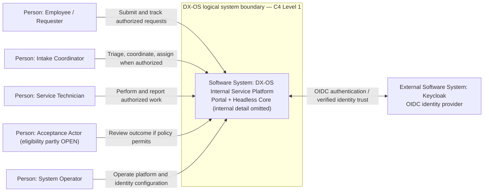

# DX-OS Open-Core — System Context

> **Document ID:** G3-F02  
> **Purpose:** Define the people, adjacent software systems, relationships, and trust assumptions surrounding DX-OS at C4 Level 1.  
> **Scope:** DX-OS Internal Service Platform, including the Internal Service Portal and reusable Headless Core as one logical system of interest.  
> **Review qualification:** Working design proposal; document status and owner are governed by the Document Register. No Gate approval or LIVE acceptance is implied.

## 1. System of Interest and Viewpoint

DX-OS Open-Core is proposed as a reusable platform for internal service applications. The **system of interest** at C4 Level 1 is the complete **DX-OS Internal Service Platform**, which encompasses both its employee-facing Internal Service Portal and its Headless Core at a logical level. Their separation is explained at C4 Level 2 and in the architecture boundary documentation; this view intentionally does **not** depict them as separate software systems.

The initial scenario is IT Helpdesk. Facility Maintenance is a candidate reuse scenario with a deferred full business journey. Neither the number of workflows nor a mock Portal establishes successful Core reuse. The purpose of this context model is to clarify external interactions and trust relationships, not to approve individual workflows or enumerate runtime components.

## 2. Business Context and Evidence Qualification

The reference organization is a **hypothetical multi-department enterprise**, not a surveyed customer. Requests arriving through messaging, email, or manual channels are illustrative possibilities, **not verified evidence of actual customer behavior, costs, demand, or measurable efficiency loss**. Those pain points and candidate needs belong to the G1 Problem Statement and require validation before being presented as factual outcomes.

Three claim classes are used here:

| Class | Meaning | Example |
| --- | --- | --- |
| **Reference scenario** | Hypothetical business interaction used to reason about actors | A requester reports an IT incident |
| **Design intent** | Proposed architecture, subject to decisions, contracts, and review | Portal and Core form one logical DX-OS system at C4 L1 |
| **Source-observed** | A document or source artifact was found at the cited exact Git commit | A target deployment-topology Markdown file exists at the pinned SHA |

**Source-observed does not mean deployed, tested, approved, or LIVE.**

## 3. People and Stakeholder Relationships

| Person / role | Interaction with DX-OS | Current qualification |
| --- | --- | --- |
| **Employee / Requester** | Submits requests, views authorized progress and history, and may confirm results | Primary IT scenario; authorization conditions still require contracts and evidence |
| **Intake Coordinator** | Reviews and routes service requests and manages eligible assignment | IT candidate operations; Facility intake policy remains proposed |
| **Service Technician** | Works on assigned IT or Facility requests and records outcomes | Rights depend on current assignment, exact authority, and resource visibility |
| **Acceptance Actor** | Reviews reported outcomes when an approved workflow permits | IT original-requester confirmation is a candidate; Facility acceptance actor remains **POLICY OPEN** |
| **System Operator** | Configures identity integrations, runs deployment and monitors platform health | Operating privileges do not implicitly confer business-resource access |

Application developers and open-source contributors are **stakeholders and consumers of documentation/contracts**, not assumed interactive business actors in the operational C4 context. A dedicated developer-facing API system may be drawn only when its direct runtime interaction and boundary are verified.

## 4. Adjacent Systems and C4 Boundary Rules

The selected identity-provider implementation is **Keycloak**, treated in this viewpoint as a **logically distinct software system** responsible for user authentication and OpenID Connect (OIDC) identity assertions. Its presence in the same local deployment environment does not make it an Application module or grant it authority to decide Helpdesk/Facility resource access.

The proposed system-to-system relationship is:

- Users authenticate through an OIDC browser/login flow involving the platform and Keycloak.
- The DX-OS trusted Backend verifies tokens/session-derived identity according to its approved security boundary.
- The Backend separately enforces operation authorities, resource/tenant visibility and eligible business actions.

**Not shown as external business systems:** PostgreSQL, MinIO, the Portal, the Gateway, and the four Core capabilities. PostgreSQL and MinIO are infrastructure dependencies; Portal, Gateway, Identity boundary, Workflow and Data Management are internal containers/components or capabilities described in lower-level architecture/deployment views. This is a **modeling choice for C4 L1**, not an assertion that infrastructure has been successfully deployed.

Potential external email, HR, ERP, collaboration, monitoring, or procurement integrations are **not in this operational context**: no verified direct interaction contract is available here. Such connections are future possibilities only and are not depicted as LIVE dependencies.

## 5. C4 Level 1 — Context Diagram

**Diagram legend:** `Person` identifies a human actor, `Software System` an externally relevant application/service, and the subgraph the single logical DX-OS system of interest. Arrows describe **intended interactions**, not completed production paths. The Keycloak arrow is a simplified trust relationship, **not** a detailed OAuth/OIDC protocol sequence; the user-agent redirect and token-verification exchanges belong to the authentication flow design. This diagram is **C4-style Mermaid**, not an official C4-DSL implementation or proof of runtime behavior.

## 6. External Interaction Catalogue

| ID | Source | Target | Information / action | Policy and evidence caveat |
| --- | --- | --- | --- | --- |
| CTX-01 | Employee | DX-OS | Request submission and authorized progress lookup | Refer to G2 Helpdesk UC; no claim of LIVE E2E |
| CTX-02 | Coordinator | DX-OS | Intake, triage and eligible assignment | Distinguish Workflow transition from Application assignment command in IT candidate |
| CTX-03 | Technician | DX-OS | Authorized work and resolution/repair facts | Current assignment and resource eligibility are mandatory guards |
| CTX-04 | Acceptance Actor | DX-OS | Confirmation/acceptance under approved rules | Facility role and closure semantics are unresolved |
| CTX-05 | System Operator | DX-OS | Runtime/identity configuration and operations | Privileged system operations do not imply user-resource permissions |
| CTX-06 | DX-OS / browser-mediated login | Keycloak | OIDC authentication and identity assertions | Verified principal required; final protocol boundary evidenced separately |

No direct external data exchange with email platforms or enterprise systems is claimed.

## 7. Trust Boundaries and Security Assumptions

| Boundary | Required invariant | Status of claim |
| --- | --- | --- |
| User/browser → DX-OS | Never trust arbitrary user/role headers or UI state for identity and authorization | Architectural/security requirement, not LIVE proof |
| DX-OS ↔ Keycloak | Establish a verified OIDC principal through reviewed configuration and cryptographic checks | Selected integration design; exact runtime acceptance elsewhere |
| Authenticated user → protected resource | Require operation authority, tenant/resource visibility and business eligibility for the actual requested action | Backend authorization requirement; implementation evidence needed |
| Internal Portal → Core-capability boundary | Portal uses published authorized HTTP/API contracts; no direct privileged DB access or Java service injection | Architecture intent and scope constraint |
| Workflow state → Application business facts | Workflow Core owns authoritative instance/state/version/history; Application owns request, assignment and repair facts | Design boundary; transaction consistency needs integration tests |

Use `401` for unauthenticated access, `403` for forbidden actions on visible resources, and `404` for hidden/nonexistent resources **where the reviewed API policy specifies that behavior**. Correctness cannot be inferred from a UI showing a denial message. Token validity does not establish resource-level authorization.

## 8. Business Domains and Scope Limits

**IT Helpdesk (initial primary candidate):** employee support request, coordinator triage, separate Application assignment, technician work, resolution, and original-requester confirmation. The currently documented integration candidate ends at `CONFIRMED`; it must **not** be silently represented as a verified production `CLOSED` state.

**Facility Maintenance (qualified reuse candidate):** location-specific repair request, coordination, technician work and outcome review. Full Facility E2E is deferred; acceptance eligibility, assignment semantics and closure/rework rules remain business-policy questions. Its earlier candidate workflow must not be presented as an accepted definition.

**Out of initial scope:** ERP, inventory/procurement, BPMN editor, broad AI automation, a speculative Core microservices rewrite, and unverified third-party integrations. The Access Request scenario is a reuse **design exercise**, not a third committed application.

## 9. Context-Level Risks and Open Questions

| ID | Question / risk | Needed decision or evidence | Cross-stage dependency |
| --- | --- | --- | --- |
| CTX-R01 | Hypothetical business pain points could be reported as survey results | Real interviews/observations or explicit assumption labels | G1 problem validation |
| CTX-R02 | Facility Acceptance Actor and closure authority unresolved | Ratified Facility business rules and transition/eligibility matrix | G2 / Issue #53 |
| CTX-R03 | Keycloak authentication could be mistaken for resource authorization | Backend security contract and negative test results at exact SHA | G4/G6/G7 |
| CTX-R04 | Mock Portal could be mistaken for integrated DX-OS | Actual secured HTTP E2E evidence from independent Portal | G6/G7 / Issues #39/#40 |
| CTX-R05 | Architecture files may refer to older baselines or incomplete ADR identifiers | Reconcile documents, Document Register and reviewed code/docs SHA pair | G0/G3 governance |

Issue registration and owner assignments belong in the canonical Open Issues Register, not in this context model. This table is an architecture-review input, not an approved issue lifecycle record.

## 10. Verified References and Traceability

**Observed code/documentation repository snapshot:** [`0f0c3ba0c3eecda0a5c4a798a3cc14b808351bed`](https://github.com/lexuanbao258-collab/dxos-open-core/commit/0f0c3ba0c3eecda0a5c4a798a3cc14b808351bed). This is an **inspection snapshot**, not the formally approved G3 baseline. Its architecture documents internally refer to an earlier baseline; do not silently equate the two.

- [System Architecture — observed at pinned commit](system-architecture.md)
- [Core / Application Boundary — observed at pinned commit](core-application-boundary.md)
- [Deployment Topology — observed at pinned commit](deployment-topology.md)
- [Issue #39 — Independent Portal / Layer 2](https://github.com/lexuanbao258-collab/dxos-open-core/issues/39)
- [Issue #40 — Reproducible MVP and demo](https://github.com/lexuanbao258-collab/dxos-open-core/issues/40)
- [Issue #53 — Business Rules / API Contract (draft)](https://github.com/lexuanbao258-collab/dxos-open-core/issues/53)

**Planned / not linked until verified in the destination docs baseline:** `docs/00-project/project-overview.md`, `problem-statement.md`, `product-vision.md`, `scope-and-mvp.md`, `glossary.md`; `docs/01-architecture/technology-stack.md`; `docs/08-decisions/README.md`; relevant G2 review records. Earlier conversation-produced drafts are not evidence that files are tracked in the destination repository.

## 11. Review and Acceptance

A future independent reviewer should confirm actor completeness, trust-boundary semantics, C4 Level 1 scope, existence of referenced files, explicit hypothetical-versus-observed claims, compatibility with G1/G2 and the baseline/ADR reconciliation. Verify Mermaid rendering and Markdown/link checks at the exact docs revision.

**Authoring disposition: DRAFT / NOT REVIEWED. G3 Gate: NOT REVIEWED.** No system-context acceptance, customer validation, production deployment, LIVE HTTP path or reuse outcome is asserted.
