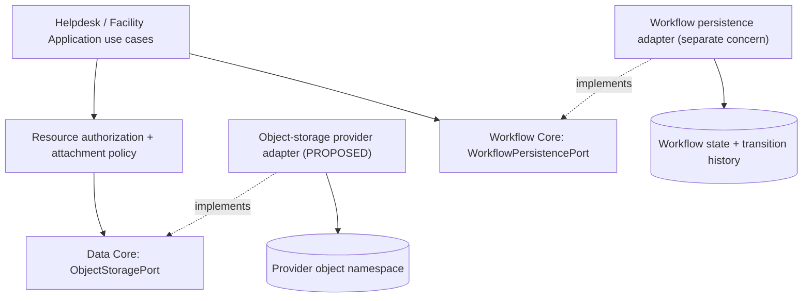

# Data Core — Architecture, Contract & Review Portal

> **Evidence labels:** **OBSERVED** = inspected exact-SHA Java or canonical contract; **SELECTED** = 18 explicitly approved G4-F17 documentation decisions; **PROPOSED** = future adapter, use case, test or policy requiring implementation/review; **VERIFIED** = executed tests with reproducible exact-SHA evidence and independent review. No test was executed for this document; no adapter or Gate is claimed to be accepted.

## 1. Why Data Core exists

DX-OS requires a reusable mechanism for binary/object content (for example, attachment bytes) without coupling Application code to MinIO, AWS S3, a filesystem provider or SQL database details. At this source baseline, the **observed Data Core capability is a provider-neutral Object Storage contract** in `com.tricore.dxos.core.data`, not a universal ORM, a generic relational repository or a database transaction manager.

**Authority:** [canonical `docs/contracts/data-core.md`](https://github.com/lexuanbao258-collab/dxos-open-core/blob/0f0c3ba0c3eecda0a5c4a798a3cc14b808351bed/docs/contracts/data-core.md) (blob `99b6ad1d67b2e8d730f13b7a082659e4c4e75b3d`), and the Java sources listed below, all pinned to `0f0c3ba0c3eecda0a5c4a798a3cc14b808351bed`. This portal supplements—does not override—the canonical contract. API/semantic changes require a separately reviewed ADR.

## 2. Responsibility and capability boundaries

| Layer | Ownership | Exclusions / trust assumptions |
| --- | --- | --- |
| Data Core | Java 21 value types, synchronous `ObjectStoragePort`, explicit write modes, normalized storage failures and stream lifecycle contract | No Spring/JPA/JDBC, provider SDK, credentials, object ACL decision or HTTP mapping |
| Application | Business attachment metadata and references, ownership, retention, eligibility, resource-level authorization and caller lifecycle | Do not infer permission from possession of an `ObjectKey` |
| Gateway / Identity | Authenticate external principal; supply trusted context through authorized use cases | Caller-supplied actor/user/role headers are not trusted proof |
| Object storage adapter | Map logical key to provider namespace, enforce per-operation semantics, wrap streams, sanitize provider errors | Do not leak bucket details, SQL/provider exceptions, tokens, signed URLs or credentials through Core |
| Workflow Core | Own `WorkflowPersistencePort`, exact-definition and state/history transaction semantics | The Workflow port **is not** `ObjectStoragePort`; implementing it in Data/infrastructure does not transfer semantic ownership |
| Database/persistence infrastructure | Capability-owned relational adapters and migrations as separately reviewed concerns | Cross-capability atomic SQL/object operations are not implicitly guaranteed |



**Status distinction:** a provider adapter rectangle marked PROPOSED in this conceptual diagram is not evidence that MinIO, S3 or PostgreSQL integration was registered or tested at the pinned commit.

## 3. Exact observed source inventory

| Java source | Blob SHA | Responsibility |
| --- | --- | --- |
| [`ObjectStoragePort.java`](https://github.com/lexuanbao258-collab/dxos-open-core/blob/0f0c3ba0c3eecda0a5c4a798a3cc14b808351bed/backend/src/main/java/com/tricore/dxos/core/data/ObjectStoragePort.java) | `0392d78bf86f828a6f21fdc6947e2c57ab93ec47` | Interface: store, read, metadata, delete |
| [`ObjectKey.java`](https://github.com/lexuanbao258-collab/dxos-open-core/blob/0f0c3ba0c3eecda0a5c4a798a3cc14b808351bed/backend/src/main/java/com/tricore/dxos/core/data/ObjectKey.java) | `679cc931d51046064fe71cd0f266bef03e1f390d` | Opaque, case-sensitive, preserved key |
| [`ObjectMetadata.java`](https://github.com/lexuanbao258-collab/dxos-open-core/blob/0f0c3ba0c3eecda0a5c4a798a3cc14b808351bed/backend/src/main/java/com/tricore/dxos/core/data/ObjectMetadata.java) | `d0d9a8656ec03fc39ce9ba2a4d08d1e7565e8e04` | Immutable metadata and exact byte length |
| [`StoreObjectCommand.java`](https://github.com/lexuanbao258-collab/dxos-open-core/blob/0f0c3ba0c3eecda0a5c4a798a3cc14b808351bed/backend/src/main/java/com/tricore/dxos/core/data/StoreObjectCommand.java) | `d5be0fc172b40efc059aa373769461de001e2edd` | Synchronous command and caller-owned input |
| [`StoreMode.java`](https://github.com/lexuanbao258-collab/dxos-open-core/blob/0f0c3ba0c3eecda0a5c4a798a3cc14b808351bed/backend/src/main/java/com/tricore/dxos/core/data/StoreMode.java) | `57d6ad1d3573c3d8a2044df34ddc7b69a073d2fd` | Mandatory CREATE_ONLY or OVERWRITE |
| [`ObjectContent.java`](https://github.com/lexuanbao258-collab/dxos-open-core/blob/0f0c3ba0c3eecda0a5c4a798a3cc14b808351bed/backend/src/main/java/com/tricore/dxos/core/data/ObjectContent.java) | `8ff5db66049d8e70cd7ef8bfa252022a7042bd27` | Caller-owned AutoCloseable single read |
| [`StorageErrorCode.java`](https://github.com/lexuanbao258-collab/dxos-open-core/blob/0f0c3ba0c3eecda0a5c4a798a3cc14b808351bed/backend/src/main/java/com/tricore/dxos/core/data/StorageErrorCode.java) | `224ee291b0787682bfb5333afa764dfef668fe95` | Five normalized error codes |
| [`StorageException.java`](https://github.com/lexuanbao258-collab/dxos-open-core/blob/0f0c3ba0c3eecda0a5c4a798a3cc14b808351bed/backend/src/main/java/com/tricore/dxos/core/data/StorageException.java) | `c14a4ccd64efdbd079327552644a6c65346f30c6` | Sanitized code-only runtime exception |

All eight listed source files were inspected at the pinned commit. A complete import graph, existing test filenames and any production provider binding require further repository inspection; this README does not silently claim they have been exhaustively audited.

## 4. Existing Object Storage contract

```java
public interface ObjectStoragePort {
    ObjectMetadata store(StoreObjectCommand command);
    ObjectContent read(ObjectKey key);
    ObjectMetadata metadata(ObjectKey key);
    void delete(ObjectKey key);
}
```

| Method | Input and successful result | Required negative/side-effect semantics |
| --- | --- | --- |
| `store(command)` | Synchronously consume provided stream from current position to EOF; declared length equals actual bytes; return stored metadata | Mismatch or caller read failure: `INVALID_INPUT`; caller retains input ownership; provider outcome may be uncertain |
| `store` + `CREATE_ONLY` | Create only if key absent, including under concurrent attempts | Existing key: `CONFLICT`, no change to existing content or metadata; not a check-then-unconditional-write |
| `store` + `OVERWRITE` | Create if absent or fully replace existing content and **entire metadata** | No expected version, CAS or guaranteed ordering among competing overwrites |
| `read(key)` | Return one `ObjectContent` whose metadata and stream represent the same object version | Missing: `NOT_FOUND`; caller must close; provider read/close errors sanitized |
| `metadata(key)` | Return metadata without opening a read resource | Missing: `NOT_FOUND` |
| `delete(key)` | Remove content and metadata | Missing and repeat delete: `NOT_FOUND`; no implicit idempotent success |

**No extra methods** such as `list`, `search`, SQL transactions or object versioned-CAS are introduced by this document. No default `StoreMode` exists.

## 5. Value objects and immutable semantics

`ObjectKey` is a record wrapping a nonblank, case-sensitive opaque string, preserved **verbatim**. Core does not trim, path-normalize, parse URLs or require UUIDs. An adapter's namespace mapping must not create collisions among distinct accepted keys.

`ObjectMetadata` contains required key, nonblank content type, exact nonnegative **byte** count (zero allowed), and defensive unmodifiable custom metadata. Metadata keys are nonblank; values are non-null and can be empty. Core does not sniff MIME types from file bytes or extensions.

`StoreObjectCommand` requires metadata, input stream and explicit mode. It does not grant stream ownership to the port. Source constructors and port validation use normalized `StorageException`, not Workflow's structural argument-exception contract.

## 6. Stream ownership and resource lifecycle

**Caller stores:** create the input stream and close it after `store()` returns **or throws**. The port consumes synchronously through EOF but never closes or retains the caller-owned input. A failed store may have advanced the stream: an attempted retry requires a fresh or explicitly rewound stream and provider-outcome reconciliation, not blind repetition.

**Caller reads:** close the `ObjectContent` even when read is partial or fails.

```java
try (var object = storage.read(key)) {
    object.content().transferTo(destination);
}
```

`ObjectContent` is single-use, exposes metadata even after close and closes underlying read resources idempotently. The returned stream must be unusable after close (`INVALID_INPUT`). Closing the stream itself also releases the read resources. `mark/reset` is not promised. Adapter-specific lazy stream read and close failures must be wrapped/sanitized as `StorageException`, never leak raw `IOException` or provider details.

## 7. Five normalized StorageErrorCodes

| Error code | Contract condition |
| --- | --- |
| `INVALID_INPUT` | Blank/null key, invalid command/metadata/length/stream use, caller-input read failure |
| `NOT_FOUND` | Missing object for `read`, `metadata`, `delete`; repeat delete remains missing |
| `CONFLICT` | Existing `CREATE_ONLY` key / violated conditional operation |
| `UNAVAILABLE` | Provider/network temporarily unavailable |
| `ACCESS_FAILURE` | Provider permission/access failure |

`StorageException` exposes `code()` and a code-name message only; no provider cause, suppression or stack trace. Errors during provider stream lifecycle also require normalized classification. No HTTP status mapping or Java provider exception is part of this Core contract.

**Do not substitute** `WorkflowErrorCode` or `IllegalArgumentException` for Data's required normalized `INVALID_INPUT` behavior.

## 8. Guarantees and non-guarantees

**Guaranteed by the port contract (OBSERVED):**
- `CREATE_ONLY` conflict preserves the existing object even under concurrent writers.
- `OVERWRITE` replaces content and the complete metadata map on a confirmed successful store; the contract does **not** independently prove atomic publication, rollback, cross-object transactions or provider-wide durability/ordering.
- Each returned read resource has metadata/content referring to the same object version.
- Correct caller/adapter stream ownership and sanitized errors.

**Not promised by the baseline contract:** rollback for every provider error, exactly-once, repeat-safe retries, cross-object atomicity, cross-storage-and-SQL transactions, CAS for overwrite, a default consistency model or durable storage proof based solely on an in-memory fake. The adapter must document actual consistency, publication visibility, error outcomes and recovery policy separately.

## 9. Two-Application reuse scenario (illustrative)

**Helpdesk (PROPOSED):** an authorized use case checks ticket ownership/eligibility and uses a logical attachment key plus content metadata. It maintains the business mapping between a ticket and its object key outside Core.

**Facility (PROPOSED):** an authorized use case checks a facility request's access policy and uses the exact same `ObjectStoragePort` without importing Facility types into Core.

The two Applications can impose different content-type allowlists, retention and access rules; those are Application policy, not generic Data Core invariants. A shared provider namespace is a deployment choice, not an authorization decision. **Two-App reuse is unverified until independently tested against the same Core SHA.**

## 10. Documentation navigation and source-to-evidence map

```text
docs/
├── 02-core/
│   └── data/
│       ├── README.md                    # G4-F17 — this architectural portal
│       ├── architecture.md             # PROPOSED future documentation
│       ├── contracts.md                # PROPOSED future documentation
│       ├── object-storage.md           # PROPOSED future documentation
│       ├── adapters.md                 # PROPOSED future documentation
│       └── acceptance-tests.md         # PROPOSED future documentation
├── 10-reviews/
│   └── g4-f17-review-checklist.md
└── ...
workbench/
└── decision-records/
    └── G4_F17_DECISION_RECORD.md
```

The tree is an **organizational proposal**, not proof the future leaf files already exist. Existing canonical sources remain in `docs/contracts/` (see linked canonical data contract) and [data-persistence boundaries](../../architecture/data-persistence-boundaries.md).

| Requirement | Source / contract | Test and evidence to collect | Reviewer | Present status |
| --- | --- | --- | --- | --- |
| DC-01 Core dependency isolation | Data Java sources and data-core canonical contract | Import audit/compile at exact SHA | Core architect | SOURCE INSPECTED; AUDIT NOT RUN |
| DC-02 Correct create-only | `ObjectStoragePort.store` / `StoreMode` | Sequential + bounded concurrent duplicate-key tests, byte/hash unchanged | Data | NOT RUN HERE |
| DC-03 Overwrite semantics | `StoreMode.OVERWRITE` | New/existing key, complete metadata replacement, concurrent ordering limits | Data | NOT RUN HERE |
| DC-04 Key identity | `ObjectKey` | Case-preserving distinct-key storage and namespace collision tests | Data | NOT RUN HERE |
| DC-05 Metadata and byte count | `ObjectMetadata`, `StoreObjectCommand` | Zero byte, invalid length, mismatch, immutable map, MIME string | Data | NOT RUN HERE |
| DC-06 Resource lifecycle | `ObjectContent` and canonical contract | Partial read, double close, close stream directly, after-close error | Data | NOT RUN HERE |
| DC-07 Sanitized errors | `StorageException`, error enum | Negative provider fail/read/close, no external cause/message | Security/Data | NOT RUN HERE |
| DC-08 Provider conformance | Object Storage port + selected adapter | Real provider consistency/publication, failure and concurrency tests | Data/Operations | NOT RUN HERE |
| DC-09 Application policy | Core/Application boundary | Unauthorized Helpdesk/Facility download/delete denied; state unchanged | Security/Application | NOT RUN HERE |
| DC-10 Two-App reuse | Same port and Core SHA | Distinct Helpdesk/Facility use cases; no Core-specific branching | Independent reviewer | NOT RUN HERE |

Canonical `data-core.md` reports that a test-only `InMemoryObjectStorage` and `ObjectStoragePortTest` exist and exercise several semantics. This is **documented historical/source evidence**, not a new execution result or proof of any real provider.

## 11. Review and approval gates

| Gate | Scope | Disposition |
| --- | --- | --- |
| G4-D — Design | 18 decisions, boundary/architecture/navigation clarity | DRAFT / NOT REVIEWED |
| G4-S — Source | Java types, canonical API and dependency review | TYPES INSPECTED; COMPLETE AUDIT PENDING |
| G4-C — Contract | Positive, negative, concurrency, lifecycle unit tests | NOT RUN HERE |
| G4-A — Adapter | Actual object provider adapter registered and conformance tested | NOT VERIFIED |
| G4-I — Integration | Real provider failure, stream and consistency behavior | NOT RUN HERE |
| G4-R — Reuse | Helpdesk + Facility separate policy integration | NOT RUN HERE |
| G4-G — Independent | Signed reviewer verdict and exact evidence | NOT APPROVED |

**Review blockers:** invented production MinIO/S3 status, silent object-key collisions, content/metadata mismatch, closing caller-owned store stream, leaking provider exceptions/secrets, treating `ObjectKey` as authorization, falsely claiming cross-SQL transactions or provider durability, and self-approving Gates.

## 12. Open decisions

| ID | Decision remaining |
| --- | --- |
| DC-OD-01 | Provider choice and actual runtime adapter registration |
| DC-OD-02 | Provider consistency/publication and post-failure recovery guarantees |
| DC-OD-03 | Logical key namespace, collision-preserving mapping and naming policy |
| DC-OD-04 | Application ownership of metadata, retention, authorization and deletion |
| DC-OD-05 | Cross-resource SQL/object lifecycle and orphan cleanup |
| DC-OD-06 | Test command, environment and current source-to-test inventory |
| DC-OD-07 | Multi-provider replacement conformance and reviewer evidence |
| DC-OD-08 | Which proposed Data documentation leaf files should be created next |

**Final status:** `G4-F17 DRAFT / NOT REVIEWED` — authoring complete; no tests executed or independent Gate approved.
