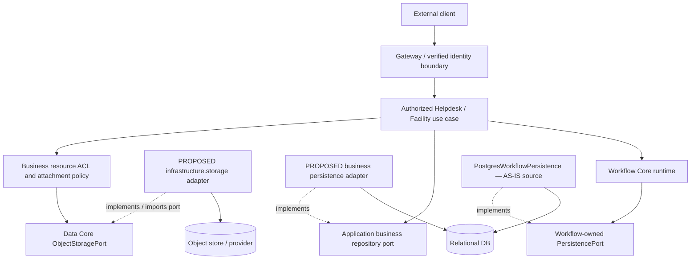
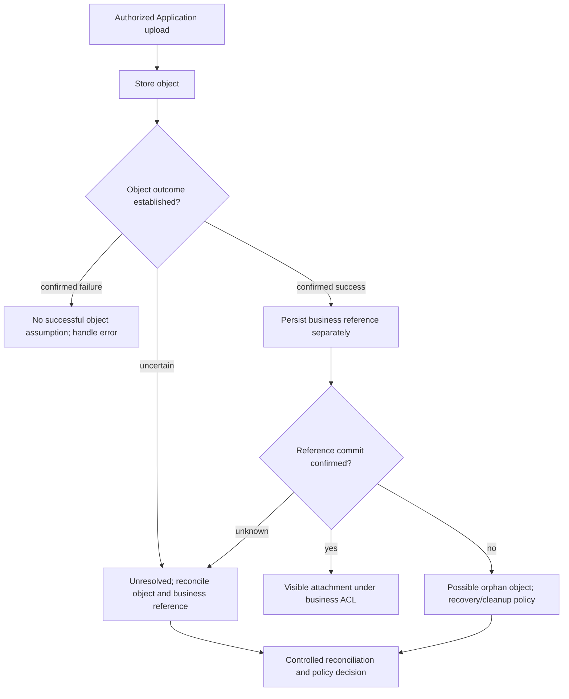

# Data Core Architecture — Boundaries, Runtime Flows and Consistency

> **Evidence semantics:** **OBSERVED** = directly inspected source/canonical document at pinned SHA; **SELECTED** = a user-approved G4-F18 design decision, not proof of implementation; **PROPOSED** = future adapter, integration mechanism or acceptance obligation; **VERIFIED** = executed and reproducible exact-SHA evidence accepted by an independent reviewer. **No tests were executed during this documentation task; no provider adapter or G4 Gate is claimed verified.**

## 1. Purpose and authoritative sources

**Proposed document role — owner/team approval pending:** this `architecture.md` is proposed as the principal Data architecture document for capability boundaries and runtime/dependency views. [Data design decisions and MVP review](data-architecture.md) remains supporting material with its historical baseline and traceability preserved. This proposal does not transfer normative contract authority or change Document IDs or Register mappings; see the [open inventory decision](../../10-reviews/open-issues.md).

**AS-IS / IMPLEMENTED:** source at `05c7e04f4e5d1e5693a6422fb301f0774155bf01` exposes provider-neutral `ObjectStoragePort` values and operations; this alone does not establish a general structured Data API or a verified MinIO adapter. **TO-BE / PROPOSED:** Data distinguishes structured records and queries (PostgreSQL default) from unstructured object content (MinIO default). Application records remain owned by their Application; Workflow state, definitions, concurrency, and history remain Workflow-owned semantics even if Data/infrastructure implements storage ports. Alternative relational and object providers require separate contract conformance, migration, access control, failure, and cross-store recovery review. PostgreSQL and MinIO are not one atomic transaction.

This document describes provider-neutral Object Storage architecture for the DX-OS Spring Boot **modular monolith**, including dependency inversion, trust boundaries, storage flows and the absence of automatic SQL/object-storage distributed atomicity. It also states where the Workflow-owned persistence contract ends and the Data/infrastructure implementation begins.

**Pinned source:** `0f0c3ba0c3eecda0a5c4a798a3cc14b808351bed`. This document supplements, and does not revise:

- [Canonical Data Core/Object Storage contract](https://github.com/lexuanbao258-collab/dxos-open-core/blob/0f0c3ba0c3eecda0a5c4a798a3cc14b808351bed/docs/contracts/data-core.md) — blob `99b6ad1d67b2e8d730f13b7a082659e4c4e75b3d` (**OBSERVED**).
- [Data and persistence boundaries](https://github.com/lexuanbao258-collab/dxos-open-core/blob/0f0c3ba0c3eecda0a5c4a798a3cc14b808351bed/docs/architecture/data-persistence-boundaries.md) — blob `10b34157faf47f6c3a2831d1965264f39e941b72` (**OBSERVED**).
- [Java `ObjectStoragePort`](https://github.com/lexuanbao258-collab/dxos-open-core/blob/0f0c3ba0c3eecda0a5c4a798a3cc14b808351bed/backend/src/main/java/com/tricore/dxos/core/data/ObjectStoragePort.java) — blob `0392d78bf86f828a6f21fdc6947e2c57ab93ec47` (**OBSERVED**).
- [Workflow-owned persistence interface](https://github.com/lexuanbao258-collab/dxos-open-core/blob/0f0c3ba0c3eecda0a5c4a798a3cc14b808351bed/backend/src/main/java/com/tricore/dxos/core/workflow/WorkflowPersistencePort.java) — blob `5009b191a3eb555ba3248eda4728ab8d3aac251b` (**OBSERVED**).
- [Core/Application boundary](https://github.com/lexuanbao258-collab/dxos-open-core/blob/0f0c3ba0c3eecda0a5c4a798a3cc14b808351bed/docs/01-architecture/core-application-boundary.md) — blob `697ccaa4818bb45829496a34b20c72a91af4125b`; this separate document remains `PROPOSED — REVIEW REQUIRED` and embeds an older source baseline (**not independent implementation evidence**).

**Selected scope:** no new public Java contract, new Core dependency, SQL repository abstraction, implicit `ObjectStoragePort` versioning/CAS, provider selection, or rewriting applied Flyway migrations. A semantic/API change requires separately reviewed ADR and owner approval.

## 2. Architecture model and dependency direction



- **Runtime invocation:** trusted, authorized Application → capability-owned port → infrastructure adapter → provider. For Workflow, a separate runtime invokes a **Workflow-owned** persistence port.
- **AS-IS source observation:** `PostgresWorkflowPersistence` already implements the Workflow port at the pinned source SHA. Its diagram label records source existence, not runtime conformance, composite Application transaction acceptance or provider-swap verification.
- **Source dependency inversion:** adapter source imports/implements the Core-owned port; Core does **not** import adapter, SDK, PostgreSQL, MinIO, S3 or Spring types.
- **Logical modules do not imply microservices.** Deployment topology, provider wiring and ingress enforcement require distinct implementation verification.
- **Diagram status:** source-grounded contract boundaries plus **PROPOSED** application/infrastructure integrations, not a diagram of verified production wiring.

### Responsibility assignment

| Boundary | Owner and responsibilities | Excluded responsibility |
| --- | --- | --- |
| `core.data` | `ObjectStoragePort`, `ObjectKey`, `ObjectMetadata`, `StoreObjectCommand`, `StoreMode`, `ObjectContent`, `StorageErrorCode`, `StorageException` | Ticket/Facility entities, access control, provider SDK, SQL migrations |
| Helpdesk and Facility Applications | Authorization, business attachment references, domain metadata/retention, lifecycle orchestration, recovery decisions | New generic Object Storage invariants |
| Gateway/Identity seam | Authentication and trusted principal propagation to authorized use cases | Interpreting an ObjectKey as a credential |
| `infrastructure.storage` (target) | Provider/client configuration, collision-free namespace mapping, sync input consumption, conditional writes, read/close wrappers, provider error mapping | Application ACL and Workflow transition semantics |
| `core.workflow` | `WorkflowPersistencePort`, definition/state/history invariants, concurrency and failure classifications | Object Storage implementation, business policy |
| `infrastructure.persistence` (target) | Implement capability-owned DB port; transactional SQL and forward-only migrations | Replacing workflow contract or treating Request prototype tables as generic Core schema |

## 3. Object Storage port semantics and architectural invariants

The canonical Java API contains **exactly four** operations:

```java
ObjectMetadata store(StoreObjectCommand command);
ObjectContent read(ObjectKey key);
ObjectMetadata metadata(ObjectKey key);
void delete(ObjectKey key);
```

| Concern | Binding invariant from canonical contract | Adapter burden |
| --- | --- | --- |
| Object identity | Opaque, nonblank, case-sensitive `ObjectKey`, preserved verbatim | No trimming, path normalization or provider namespace collisions |
| Metadata | Content type nonblank; byte length exact and nonnegative, zero allowed; immutable custom metadata | Round-trip exact content/metadata, no guessing MIME type |
| `CREATE_ONLY` | Existing key → `CONFLICT` without modifying existing content/metadata | Atomic conditional create under competing writers; check-then-write is insufficient |
| `OVERWRITE` | Creates or replaces content **and entire metadata**; no expected-version/CAS | Consistent successful replacement; document competing overwrite ordering and visibility limits |
| `read` | One `ObjectContent` read with content and metadata of same object version | Correct read-resource construction, lazy error normalization |
| `metadata` | Retrieve metadata without opening content resource | Missing key → `NOT_FOUND` |
| `delete` | Remove content plus metadata; missing and repeated delete → `NOT_FOUND` | Provider mapping and uncertain outcome documented |
| Stream ownership | Caller closes store input and returned read resource | Never close/retain store input; close provider stream on `ObjectContent.close()`, idempotently |

**Important nuance:** the contract does **not** grant object-level CAS to `OVERWRITE`, nor does it promise atomicity across different object operations. Confirmed successful replacement of content/metadata is an operation semantic; generic durable publication, rollback, global ordering and failure certainty must be proven or scoped by a real adapter.

## 4. Upload and download flows (target, not implemented evidence)

```mermaid
sequenceDiagram
  autonumber
  actor User
  participant App as Authorized Application
  participant Port as ObjectStoragePort
  participant Adapter as Storage adapter (PROPOSED)
  participant Provider as Object provider
  User->>App: Upload attachment for business resource
  App->>App: Verify principal + resource ACL + content policy
  App->>App: Build opaque key, metadata, stream and explicit mode
  App->>Port: store(command)
  Port->>Adapter: Adapter dispatch / contract boundary
  Adapter->>Provider: Conditional create or overwrite + bytes
  Provider-->>Adapter: Provider result or failure
  Adapter-->>App: Metadata or sanitized StorageException
  App->>App: Close caller-owned store input (success/failure)
  Note over App,Provider: Cross-store DB reference recording is a separate operation; no distributed atomicity
  User->>App: Download attachment
  App->>App: Verify read permission on business resource
  App->>Port: read(key)
  Port->>Adapter: Adapter dispatch / contract boundary
  Adapter->>Provider: Open read resource
  Provider-->>App: ObjectContent with matching metadata + content stream
  App->>App: Consume and close ObjectContent (including failure/partial read)
```

**Streaming responsibilities:** `store` synchronously consumes caller input from current position to EOF, requires declared length equal actual bytes, does not retain/close that input. Failed stores may consume it, so a subsequent attempt needs a new/reset stream *and* explicit recovery reasoning. The caller closes a read `ObjectContent`; its close is idempotent; directly closing its stream also releases resources; after-close stream use fails `INVALID_INPUT`; provider lazy read/close failures must be sanitized, never expose raw `IOException` or provider causes.

## 5. Errors, trust and security boundaries

| `StorageErrorCode` | Meaning / origin |
| --- | --- |
| `INVALID_INPUT` | Invalid key, metadata, length, resource use, caller input read failures |
| `NOT_FOUND` | Read/metadata/delete key missing, including repeated deletion |
| `CONFLICT` | Create-only existing key or failed conditional operation |
| `UNAVAILABLE` | Provider or network temporarily unavailable |
| `ACCESS_FAILURE` | Provider access/permission failure |

Every adapter must return sanitized `StorageException` including stream read and close failures. Provider SQL, credentials, signed URLs, tokens, connection strings, exception messages/causes/stack traces cannot cross Core. `StorageErrorCode` does **not** substitute for Workflow-specific codes.

A valid `ObjectKey` grants **no** authorization by itself: Application must verify trusted principal, business resource mapping and resource-level ACL before reads, writes or deletes. Provider credentials remain configured outside Core. No direct unguarded browser-to-provider operations are assumed in this target flow. Signed URL policies, if later introduced, require a separate design and threat review.

## 6. SQL / Object Storage consistency and failure windows

**OBSERVED canonical limit:** PostgreSQL transaction and object store operations are not a distributed atomic transaction. SQL rollback does not revert object writes; a committed reference does not guarantee object creation succeeded. The port makes no general rollback, exactly-once or retry-safety promise.



| Window / failure | What may be present | Contract-level implication | Proposed recovery owner and evidence |
| --- | --- | --- | --- |
| Object operation rejected before successful write | No successful object is established | Preserve `CREATE_ONLY` existing-object semantics; do not assume all provider errors guarantee rollback | Adapter classifies; Application records outcome and checks key where safe |
| Object stored, SQL reference insert fails | Object without business reference (orphan) | SQL rollback does not delete stored object | Application/infrastructure identifies orphan and performs policy-controlled cleanup |
| SQL reference exists, later object write/delete fails | Dangling/mismatched business reference | Reference commit cannot guarantee object operation | Application reconciles object metadata/read versus reference |
| Provider response lost after store/delete | Object may or may not have changed | Outcome uncertain; no universal retry safety | Provider-specific authoritative check, avoid blind retry, fresh stream if approved |
| Repeated delete after confirmed success | Object absent | Port returns `NOT_FOUND`, not automatic idempotent success | Application distinguishes expected cleanup from API response |
| Concurrent `CREATE_ONLY` writes | Exactly one new object permitted for a previously absent key | Conflicting writer must leave winner content and metadata intact | Real provider concurrent test and before/after hashes |
| Concurrent `OVERWRITE` writes | Final version depends on unspecified ordering | No CAS, no promised order | Do not use for business version-sensitive updates without ADR |

**SELECTED:** orchestrating Application/infrastructure owns recovery, orphan detection, retry decisions and cleanup. **OPEN:** exact ordering, key reuse, deletion lifecycle, retention, reconciliation job, cleanup authorization, transaction coordination and compensating idempotency strategy. A cleanup process cannot be declared implemented or safe without an approved design.

## 7. Workflow persistence and schema/migration separation

Workflow's `WorkflowPersistencePort` is owned by Workflow Core. A Data/infrastructure adapter may implement it but must preserve exact-version authoritative definitions, insert-only instance creation, full-snapshot activation at runtime version 0, atomic state/history transition writes and Workflow's `COMMIT_OUTCOME_UNKNOWN` classification. **None of these obligations transforms the Object Storage port into a SQL transaction manager.**

`data-persistence-boundaries.md` names `V1__create_requests.sql` and `V2__add_request_workflow.sql` as prototype migrations and says applied migrations are immutable. That statement is a **source document assertion about its recorded baseline**, not an exhaustive current migration inventory. New migration versions must be forward-only, preserve compatibility and stay within capability ownership; no migrations are changed by G4-F18.

## 8. Helpdesk / Facility reuse proof target

| Application | Illustrative object lifecycle | Business-specific policy | Reuse claim status |
| --- | --- | --- | --- |
| IT Helpdesk | Store/read/delete a support-ticket attachment via `ObjectStoragePort` | Ticket membership, assignee access, content and retention | PROPOSED; real E2E not verified |
| Facility | Store/read/delete a facility request attachment through same port | Request ownership, approver visibility, facility-specific retention | PROPOSED; real E2E not verified |

Independent reuse acceptance requires the **same Core source SHA** and unchanged Object Storage types, independent Application policy fixtures, access-denial cases, stream cleanup and real-provider persistence proof. Two UI screens using one implementation do not alone prove contract portability.

## 9. Source → control → test → evidence → reviewer matrix

| ID | Contract/control | Verification obligation | Evidence artifact required | Reviewer | Current status |
| --- | --- | --- | --- | --- | --- |
| DA-01 | Core/adapter dependency inversion | Static import audit at pinned SHA | Source import graph + compile output | Core architect | NOT RUN HERE |
| DA-02 | Opaque key identity | Distinct case and mapping collision checks | Provider test output + fetched key results | Data | NOT RUN HERE |
| DA-03 | `CREATE_ONLY` concurrency | Bounded two-writer race, winner retained | Logs + content/metadata before/after | Data | NOT RUN HERE |
| DA-04 | `OVERWRITE` replacement | Replace full metadata and bytes, no CAS assumption | Round-trip test results | Data | NOT RUN HERE |
| DA-05 | Stream lifecycle | EOF length, partial read, double close and lazy failures | Test output + resource metrics | Data | NOT RUN HERE |
| DA-06 | Error normalization | Five codes, provider read/close error sanitization | Failure injection + redacted exceptions | Security/Data | NOT RUN HERE |
| DA-07 | SQL/object boundaries | Failure-window injection and orphan/reference reconciliation | Separate SQL/object snapshots + timeline | Application/Data | DESIGN OPEN |
| DA-08 | Authorization | IDOR, forged principal, denied read/store/delete | Real ingress negative tests + provider state | Security/Application | NOT RUN HERE |
| DA-09 | Adapter substitution | Same suite on two provider adapters | Configuration + commands + results per provider | Data/Independent | NOT RUN HERE |
| DA-10 | Two-App reuse | Helpdesk and Facility business ACL distinction | Two E2E traces, unchanged Core SHA | Application/Independent | NOT RUN HERE |
| DA-11 | Workflow persistence separation | No import/semantic ownership inversion | Static mapping review; Workflow contract evidence | Workflow/Core | NOT RUN HERE |
| DA-12 | Documentation contract alignment | Links, diagrams, 18 choices, unknown limits | Review checklist and cross-file trace | Independent reviewer | DRAFT |

Evidence must include exact commit, provider/version/configuration, test selector, clock/run ID, exit status, redacted JUnit/CI logs, before/after object hash and metadata, SQL/reference rows if relevant, cleanup results and reviewer verdict. A test definition or historic fake-test claim is **not** `VERIFIED` evidence for a real provider.

## 10. Review gates, P0 blockers and open design decisions

| Gate | Required proof | Current disposition |
| --- | --- | --- |
| G4-D Design | Decision record, boundary/flow diagrams, failure-window coverage | DRAFT / NOT REVIEWED |
| G4-S Source | Exact Java/canonical reconciliation; actual import and wiring audit | PARTIAL SOURCE INSPECTION ONLY |
| G4-C Contract | Current positive/negative/concurrent API suite | NOT RUN HERE |
| G4-A Adapter | Real provider implementation and conformance evidence | NOT VERIFIED |
| G4-I Integration | Failure injection, stream errors, SQL/object recovery strategy | NOT RUN HERE; OPEN DESIGN |
| G4-R Reuse | Helpdesk + Facility separate ACL and lifecycle proof | NOT RUN HERE |
| G4-G Independent | Named reviewer, pinned evidence and explicit Gate verdict | NOT APPROVED |

**P0 blockers:** unguarded object access, case-changing/colliding key mapping, `CREATE_ONLY` check-then-overwrite race, leaked credentials/provider exceptions, premature input stream closing, fake provider conformance claims, assumed SQL/object distributed atomicity or unsafe orphan cleanup, or self-approved Gate.

**OPEN:** provider/wiring selection; namespace implementation; durable publication/consistency; exact SQL/object operation order; reconciliation/outbox/cleanup strategy; permissions/retention; expected outcomes under provider loss; alternate-provider test evidence; independent sign-off.

**Final disposition: `G4-F18 DRAFT / NOT REVIEWED`.** These selected architecture constraints are not executed proof, and no new source code, SQL migrations or provider implementation are produced by this documentation package.
