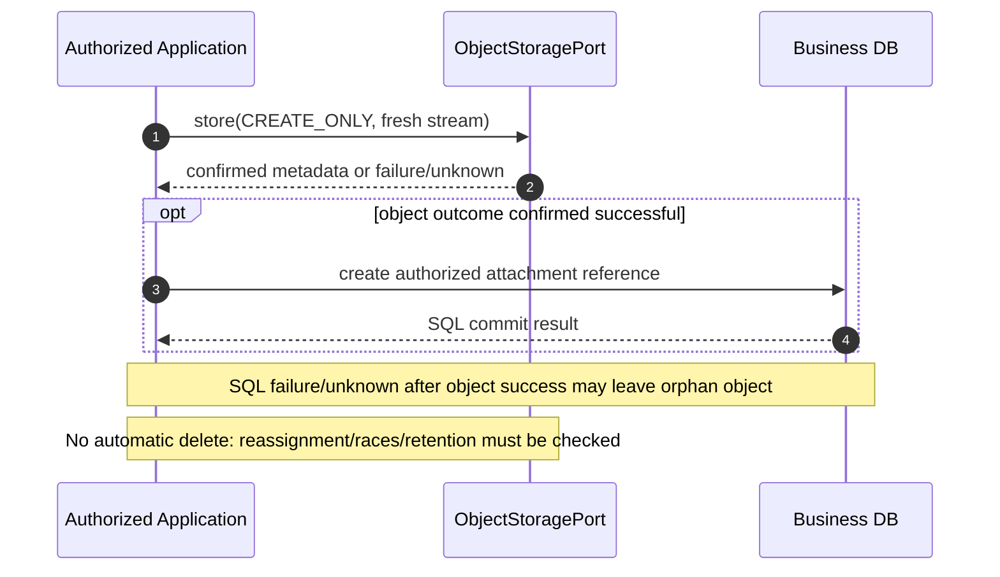
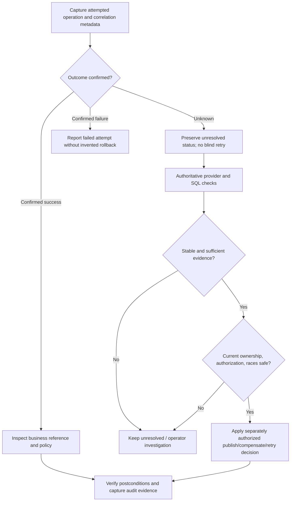

# Data Core — Consistency, Failure Windows and Recovery

> **Evidence vocabulary:** **OBSERVED** = inspected exact-SHA source/canonical contract; **SELECTED** = user's approved documentation directions; **PROPOSED** = future policy/implementation or acceptance requirement; **VERIFIED** = executed evidence, reproducible at a named revision and reviewed. **No tests have been run for G4-F22. No Gate has been approved.** A documented fake or an architecture proposal is not real-provider proof.

## 1. Scope, authority and non-goals

**SELECTED:** Describe the consistency guarantees and omissions, cross-store failure windows, safe recovery boundaries, ownership and evidence necessary for Object Storage plus Application-owned PostgreSQL references. This is a design-and-review artifact, **not an implementation of a Saga, recovery queue, new Core enum or HTTP API**.

**Source pin:** `0f0c3ba0c3eecda0a5c4a798a3cc14b808351bed`.

| Source | Blob SHA | Evidence-supported rule |
| --- | --- | --- |
| [Data Core contract](https://github.com/lexuanbao258-collab/dxos-open-core/blob/0f0c3ba0c3eecda0a5c4a798a3cc14b808351bed/docs/contracts/data-core.md) | `99b6ad1d67b2e8d730f13b7a082659e4c4e75b3d` | Four synchronous object operations; per-operation semantics; uncertain failures; no exactly-once / blanket rollback |
| [Data/persistence boundaries](https://github.com/lexuanbao258-collab/dxos-open-core/blob/0f0c3ba0c3eecda0a5c4a798a3cc14b808351bed/docs/architecture/data-persistence-boundaries.md) | `10b34157faf47f6c3a2831d1965264f39e941b72` | No PostgreSQL/Object Storage atomic transaction; orphan/dangling risk; forward-only migration rules |
| [Workflow Core contract](https://github.com/lexuanbao258-collab/dxos-open-core/blob/0f0c3ba0c3eecda0a5c4a798a3cc14b808351bed/docs/contracts/workflow-core.md) | `11c5aaca1e7e08394710a6d0c5fe8e187d549d83` | Workflow-specific four write outcomes, atomic state/history, reconciliation rules |
| [`StorageErrorCode.java`](https://github.com/lexuanbao258-collab/dxos-open-core/blob/0f0c3ba0c3eecda0a5c4a798a3cc14b808351bed/backend/src/main/java/com/tricore/dxos/core/data/StorageErrorCode.java) | `224ee291b0787682bfb5333afa764dfef668fe95` | Exactly five Data error codes, **no** `COMMIT_OUTCOME_UNKNOWN` |

The exact Java `ObjectStoragePort` has `store`, `read`, `metadata`, `delete`, but **no** operation ID, retry receipt, transaction scope, object-version CAS, recovery or reconciliation method. Provider adapters were future work in the inspected canonical baseline. This document does not assert they are deployed.

## 2. Ownership, trust and separate contracts

| Concern | Owner | Explicit boundary |
| --- | --- | --- |
| Object content, logical key, store mode and stream API | Data Core `ObjectStoragePort` | Provider neutral; contract cannot promise multi-object or SQL-object atomicity |
| Actual object publication, conditional create and error translation | Infrastructure storage adapter (PROPOSED) | Provider SDK, credentials, visibility model, failure classification outside Core |
| Business reference/attachment mapping, authorization and retention | Helpdesk or Facility Application (PROPOSED) | References and policies not inferred from knowing an `ObjectKey` |
| SQL transaction, DB adapter and migration | Capability-owned persistence infrastructure | SQL transaction covers only DB operations it actually includes |
| Workflow instance/history writes | Workflow-owned `WorkflowPersistencePort` | **Separate** normalized Workflow error semantics; `COMMIT_OUTCOME_UNKNOWN` is not Data `StorageErrorCode` |
| Cleanup/recovery coordinator and operations | Authorized Application/infrastructure (PROPOSED) | No worker, queue or receipt assumed present |

**OBSERVED:** SQL rollback does **not** undo an object write; committing an SQL reference does not ensure an object write succeeded. **SELECTED:** a durable business success must not be claimed from an object exception, a single missing-reference query or a timeout alone.

## 3. The consistency model and its limits

| Concern | Contract guarantee | Not guaranteed / evidence needed |
| --- | --- | --- |
| `CREATE_ONLY` | Key absent condition must hold under concurrent writers; existing object not mutated on `CONFLICT` | Specific provider mechanism and visibility must be demonstrated |
| `OVERWRITE` | Successful operation replaces content and full metadata | No expectedVersion/CAS; no order guarantee for concurrent overwrites |
| `read` | Metadata and content of **one returned resource** describe same object version | No atomic snapshot across separate `read`/`metadata` calls |
| Delete | Missing and repeated delete return `NOT_FOUND` | No transactional coupling with SQL-reference deletion |
| Store input | Synchronous current-position→EOF; exact bytes; caller-owned stream | A failed attempt may have consumed stream; retry needs fresh/reset input |
| Provider failure | Normalized Data errors; outcome may remain unknown to caller | No universal rollback, durability, exactly-once, retry safety or cross-object atomicity |
| SQL + object | Each subsystem has its own defined behavior | No distributed atomic commit, no implicit compensation |

The Data error enum remains `INVALID_INPUT`, `NOT_FOUND`, `CONFLICT`, `UNAVAILABLE`, `ACCESS_FAILURE`. **There is no sixth Data error or universal precedence rule.** An uncertain outcome is a recovery classification in this design, not a new exception code. `UNAVAILABLE` alone must not be equated to "definitely rolled back".

## 4. Failure taxonomy and three-way outcome classification

**SELECTED classification for orchestration (not a Core enum):**

- **Confirmed success:** adequate authoritative provider/business evidence establishes completion for the attempted operation; this does not imply the combined SQL/object business use case succeeded.
- **Confirmed failure/no effect:** only when evidence establishes the relevant operation was not applied; a provider exception by itself is insufficient.
- **Uncertain outcome:** one or more side effects may have occurred but cannot be reliably attributed/established. Preserve unresolved status and evidence; do not infer either success or rollback.

| Failure class | Example | Risk | Initial safe treatment |
| --- | --- | --- | --- |
| Orphan object | Object stored; SQL reference insert fails | Unreferenced content retained | Track potential orphan; verify reference and concurrent work before guarded cleanup |
| Dangling reference | SQL reference published while object write fails | Broken attachment/download | Withhold/mark business availability until confirmed object; reconcile |
| Unknown object outcome | Timeout after PUT or response lost | Duplicate/overwrite on retry; wrong user-visible result | Preserve attempt and uncertainty, perform authoritative checks |
| Concurrent cleanup | Cleanup sees no reference while another transaction creates one | Destructive deletion | Use ownership/lease/generation or equivalent guard **if designed and proven** |
| Provider errors | Network, permissions, lazy stream read/close failure | Unknown publication or resource leakage | Sanitize error; collect non-secret context and reconcile |
| SQL uncertainty | Lost SQL commit acknowledgement | Object/reference ordering ambiguity | Follow DB authoritative/transaction semantics; do not infer from request timeout |

## 5. Object-first versus DB-first: compare, do not approve a default

**SELECTED:** both orderings are examined. Choosing one for each Application requires a separately reviewed **Application ADR** documenting idempotency, visibility, retention and recovery; **no ordering is selected by this document**.

### 5.1 Object-first candidate (PROPOSED)



| Window | Observable situation | Potential result | Proposed recovery decision |
| --- | --- | --- | --- |
| OF-01 | Store rejected before object creation, confirmed absent | No object and no reference | Report failure; no compensation needed for this attempt |
| OF-02 | Store returns provider/transport error, outcome uncertain | Object may or may not exist | Preserve unresolved; inspect authoritative provider state; don't reuse consumed stream blindly |
| OF-03 | Store confirmed, SQL insert/commit fails | Orphan object | Correlate key/attempt, inspect concurrent references and retention before guarded cleanup |
| OF-04 | Store confirmed, SQL commit acknowledgement lost | Reference may exist | Resolve SQL outcome before cleanup; avoid deleting object used by successful commit |
| OF-05 | Both return success | Object and reference presently evidenced | Success still subject to subsequent concurrent deletion/permission controls |

### 5.2 DB-first candidate (PROPOSED)

```mermaid
sequenceDiagram
  autonumber
  participant App as Authorized Application
  participant SQL as Business DB
  participant Obj as ObjectStoragePort
  App->>SQL: create PENDING/non-public attachment record (proposed design)
  SQL-->>App: SQL commit result
  opt DB outcome confirmed and upload authorized
    App->>Obj: store(CREATE_ONLY, fresh stream)
    Obj-->>App: confirmed metadata or failure/unknown
    App->>SQL: publish only after provider success (separate SQL operation)
  end
  Note over App,Obj: PENDING/publication model is a proposal; not a Java Data Core state
```

| Window | Observable situation | Potential result | Proposed recovery decision |
| --- | --- | --- | --- |
| DF-01 | DB prepare fails/unknown | Missing or ambiguous reference | Resolve DB outcome before upload or treating it as failed |
| DF-02 | DB placeholder succeeds; object store fails definitely | Pending record without content | Mark/resolve pending record under Application policy; do not expose attachment |
| DF-03 | DB placeholder succeeds; object outcome uncertain | Dangling or prematurely visible reference if poorly implemented | Keep non-public pending; reconcile object and exact attempt |
| DF-04 | Object confirmed; final SQL publication fails | Object plus pending record, potentially orphaned on cleanup | Retry/resume publication only after checking state, authorization and competing work |
| DF-05 | Public reference committed before object actually exists | Broken attachment | **Disallowed target design**; detect and prevent visibility until provider confirmation |

Neither approach establishes a distributed transaction. The proposed `PENDING` record is **Application-owned future schema/state** (not `ObjectStoragePort` state, current SQL schema or implemented service).

## 6. Recovery and reconciliation decision procedure (PROPOSED)



**Checks are not necessarily a common snapshot.** A single absent object or SQL reference while a transaction is unresolved cannot alone establish that it never committed. Subsequent concurrent writes can change observation. If the provider lacks an adequate authoritative read or operation identifier, the outcome may remain unresolved and require operator handling. Do not claim that existing Data API solves write attribution exactly.

Recommended evidence (future design): unique non-secret correlation identifier, logical key, attempted mode, declared bytes/content type, business resource identity, request actor authorization proof/reference, provider status category, SQL transaction/row evidence, observed bytes/hash and metadata, timestamp, outcome/confidence, concurrency guard version/generation, reviewer/operator decision and audit record. No sensitive payload or access token in logs.

## 7. Retries, idempotency and compensation

1. **No blind retries.** First establish prior outcome sufficiently to avoid duplicate or destructive behavior. A transport error or `UNAVAILABLE` does not establish rollback.
2. `CREATE_ONLY` avoids overwriting an existing key, but a subsequent `CONFLICT` does **not** prove which attempted writer created the object; compare authoritative content/metadata and provenance if available.
3. `OVERWRITE` has no expected-version conditional semantics and concurrent overwrites have no order guarantee. It is **not** a generic safe retry mechanism.
4. A failed `store` may advance the caller's `InputStream`. Explicit retry requires a fresh or reset stream and a business-approved retry policy.
5. Compensation (e.g., delete object or reverse a reference) is a **new independent operation**; it may itself fail or have uncertain outcome. Treat it as monitored, authorized work, not as atomic SQL rollback.
6. Prevent stale cleanup from deleting an object whose resource reference was added/changed concurrently. Strategy (lease, generation/version, pending-state lock, grace period, object immutability, etc.) remains **OPEN** until approved and tested. Time delay alone cannot prove safety.
7. Guard cleanup by resource ACL/retention/legal-hold rules and cross-App ownership; retain unresolved records and evidence as allowed by security/privacy policy.

## 8. Workflow Core recovery is separate

**OBSERVED:** Workflow's `createInstance`, `commitActivation` and `commitTransition` writes distinguish business rejection, confirmed rollback (`OPERATION_FAILURE`), confirmed durable commit, and uncertain durable outcome (`COMMIT_OUTCOME_UNKNOWN`), preserving atomic workflow state/history. Workflow reconciliation reads authoritative instance/history (separate reads are not one shared snapshot) and refuses blind retry.

**Boundary:** `COMMIT_OUTCOME_UNKNOWN` is a `WorkflowErrorCode` and **must not** be added to `StorageErrorCode` without a separately reviewed API change. Workflow's atomic transition/history semantics do not imply atomic SQL/Object Storage writes. An Application use case combining attachment and workflow transition needs its own independently reviewed orchestration policy.

## 9. Security, audit and operational observability

| Control | Target design (PROPOSED) | Evidence needed |
| --- | --- | --- |
| Authorized recovery | Trusted principal/service identity and resource ACL for retries, reads, deletes | Negative IDOR / cleanup-bypass tests |
| Least-privilege provider credentials | Secrets only in infrastructure secret/config store; scoped permissions | Sanitized config, access-denied tests |
| Traceability | Correlation ID across App, SQL and adapter without storing credentials | Sample redacted structured logs |
| Audit | Record recovery decision, before/after status and responsible actor | Durable audit/test evidence, not just print log |
| Data retention | App-specific retention and legal/policy constraints | Helpdesk and Facility negative cleanup scenarios |
| Operational safety | Bounded reconciliation attempts, dead-letter/escalation, alerting | Actual job config/metrics/test outputs if implemented |

This document **does not assert** a recovery service, background scheduler, outbox, job queue, operational dashboards or audit integration currently exists at pinned source.

## 10. Fault-injection and provider acceptance matrix

| ID | Scenario and expected safety property | Evidence needed | Reviewer | Current status |
| --- | --- | --- | --- | --- |
| CR-01 | Object-first store success then SQL rollback: orphan tracked, not auto-deleted | Exact provider bytes/metadata + SQL row absence + correlation | App/Data | NOT RUN |
| CR-02 | Object-first SQL COMMIT response lost: do not delete referenced object based on timeout | Inject lost ACK; authoritative DB/provider follow-up | App/DB | NOT RUN |
| CR-03 | DB-first placeholder committed, object store fails: no public broken attachment | DB state + denied/hidden read + object check | App/Data | NOT RUN |
| CR-04 | DB-first object succeeds, publication fails: preserve/reconcile pending case | DB/reference and provider checks | App/DB | NOT RUN |
| CR-05 | Provider timeout after put: outcome unknown, no blind replay | Fault injection, before/after object hashes, attempt logs | Data/Infra | NOT RUN |
| CR-06 | Fresh/reset input required for authorized retry | Instrumented partially consumed stream, bytes count | Data | NOT RUN |
| CR-07 | `CREATE_ONLY` concurrent contenders: one winner, loser conflict, existing content unchanged | Bounded race; full before/after provider proof | Data/Infra | NOT RUN |
| CR-08 | `OVERWRITE` collision: no unsupported CAS/winner ordering claims | Concurrent overwrite outcomes and documented limits | Data/Infra | NOT RUN |
| CR-09 | Stale cleanup versus new reference: do not delete live attachment | Deterministic interleaving; SQL/object before/after | App/DB | NOT RUN |
| CR-10 | Compensation delete fails: unresolved state retained and alerted | Inject delete failure, follow-up evidence | Operations | NOT RUN |
| CR-11 | Read-after-write and delete visibility measured on actual provider | Provider-specific version/config, timings, output | Data/Infra | NOT RUN |
| CR-12 | Lazy read/close provider failures sanitized, no secret leakage | Fault stream wrappers and exception inspection | Security/Data | NOT RUN |
| CR-13 | Workflow uncertainty distinct from Data errors | Actual Workflow state/history and error boundary checks | Workflow/Data | NOT RUN |
| CR-14 | Helpdesk vs Facility retention/ACL independent under shared recovery principles | Two use-case negative/E2E runs, same Core SHA | App/Security | NOT RUN |
| CR-15 | Migration/change compatibility when recovery schema introduced | New forward-only migration tests; applied migration checksums unchanged | DB/Release | BLOCKED — SCHEMA DESIGN OPEN |

**Evidence standard:** exact pinned/source-under-test SHA, branch, runtime/Gradle/JDK, PostgreSQL/provider version and non-secret config, deterministic fault trigger and interleaving, raw command + exit status, logs/JUnit XML, before/after DB rows and object bytes/hash/metadata, recovery decision and identified independent reviewer. A test **name** or fake implementation is not a current PASS; report `NOT RUN`, `BLOCKED`, `INCONCLUSIVE`, `FAIL`, or `PASS` only with authentic executed evidence. Historical test claims remain HISTORICAL.

## 11. Gates and P0 blockers

| Gate | Independent review evidence | Status |
| --- | --- | --- |
| G4-D Design | Contract fidelity, business ordering ADR and safety rules | DRAFT / NOT REVIEWED |
| G4-S Source | Pinned contracts/API and complete owner/adapter inventory | CANONICAL SOURCES INSPECTED; COMPLETE INVENTORY PENDING |
| G4-P Provider | Visibility, failure, conditional writes, stream tests on real provider | NOT RUN |
| G4-F Failure | Deterministic fault windows and outcome uncertainty handling | NOT RUN |
| G4-R Recovery | Guarded reconciliation, compensation failure and race proof | NOT RUN |
| G4-A Security | Authenticated recovery, least privilege, secret redaction, ACL | NOT RUN |
| G4-U Reuse | Separate Helpdesk/Facility ownership/retention proof | NOT RUN |
| G4-I Independent | External reviewer signs exact evidence and blockers | NOT APPROVED |

**P0 blockers:** asserting distributed SQL-object atomicity; treating timeout as rollback; blind retry of mutable input; unguarded cleanup; publishing unconfirmed object reference; exposing secrets; promoting historical/mock evidence to real provider PASS; replacing Workflow's error contract; selecting object-first or DB-first without an approved Application ADR; self-approving a Gate.

## 12. Open decisions / next implementation evidence

| Open ID | Owner to confirm | Unresolved question |
| --- | --- | --- |
| CR-OD-01 | Application | Object-first/DB-first ordering by Helpdesk/Facility scenario; visibility and ADR |
| CR-OD-02 | Data/Infra | Provider selection, publication/visibility guarantees and real adapter availability |
| CR-OD-03 | Application/DB | Durable unresolved attempt record design and recovery status without Core API change |
| CR-OD-04 | App/Ops | Cleanup retention/authorization, concurrency guard and escalation policy |
| CR-OD-05 | Data/Infra | Provider-specific authoritative read, key namespace, causal attribution and safe retry |
| CR-OD-06 | Security | Redacted audit/correlation scheme and privileged recovery permissions |
| CR-OD-07 | DB/Release | Forward-only migration needs and compatibility evidence (if recovery tables added) |
| CR-OD-08 | Independent reviewer | Exact fault injection suite, acceptance thresholds and Gate ownership |

**Disposition:** `G4-F22 DRAFT / NOT REVIEWED`. Source observations and user-selected principles are not a delivered recovery mechanism, a test PASS or independent Gate approval.
