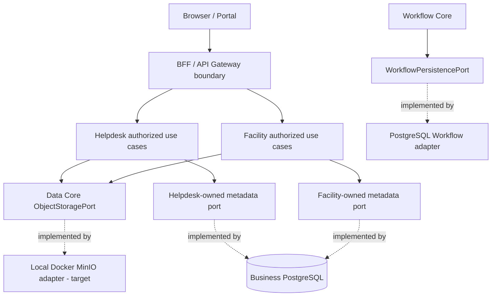

# DX-OS Data Core v2 — Architecture Design & Decision Review

> **Target path:** `docs/02-core/data/data-architecture.md`
> **Status:** PROPOSED — REVIEW REQUIRED (not approved or implemented by this document)
> **Date:** 2026-10-28
> **Source baseline:** `origin/main` at `e06fa429cfd92b032c166eb3ebf32803d13191c2`
> **Architecture:** Modular Monolith + Hexagonal Architecture + Dependency Inversion Principle (DIP)
> **Related decisions:** SYS-ADR-01=B, 02=B, 06=B, 08=B (selected by TRICORE); DATA-ADR-02 is selected by ADR-007; remaining DATA-ADR options are recommendations pending sign-off.
> **Scope note:** Open PRs and candidate branches are not treated as merged, production-ready functionality.

## 1. Purpose, scope, and non-goals

This document answers four questions: (1) what data belongs to Data Core; (2) who owns business data; (3) how stable contracts support replaceable storage providers; and (4) which tests constitute evidence of real reuse and portability.

Infrastructure adapters realize the selected target through local Docker MinIO. Its protocol is S3-compatible; AWS S3 deployment is not selected.

**Out of scope:** an all-purpose CRUD service; ownership of Workflow tables, Helpdesk tickets or Facility records; an identity database; a general-purpose ORM abstraction; distributed XA transaction guarantees; automatic object migration merely by changing configuration; a new storage REST endpoint without application authorization. Future shared data capabilities require independent contracts and ADRs, not a silent expansion of this Core.

## 2. Business context and data ownership

An employee reports a broken printer and attaches a photo. The Helpdesk Application owns the ticket, requester, assignee, ACL and attachment-to-ticket relationship. Workflow Core owns the state machine, version and transition history. Identity supplies the verified caller through the trusted application boundary. Data Core is responsible for storing and reading the **object content**, not interpreting which ticket owns it.

| Data category | Examples | Semantic owner | Physical mechanism |
|---|---|---|---|
| Identity | Accounts, authentication sessions, password credentials | Identity Provider; trusted identity contracts in DX-OS | Keycloak/other OIDC provider, outside Data Core |
| Workflow | Definition/version, instance, state, history | Workflow Core | Workflow-owned persistence port implemented by PostgreSQL adapter |
| Helpdesk | Request title, assignee, resolution, attachment binding, ACL | Helpdesk Application | Business repository/adapters |
| Facility | Facility request, location, work order, attachment binding, ACL | Facility Application | Business repository/adapters |
| Binary objects | Images, PDFs, evidence files and provider-neutral object metadata | Data Core defines storage semantics; Application owns use-case meaning/access | Selected local Docker MinIO target; adapter integration pending |

**Owner ≠ physical database host.** Different owners may store data in one PostgreSQL instance; ownership is governed by contracts, code dependencies, permissions, schema and migrations, not by requiring separate database servers.

## 3. Decisions inherited from system architecture

- **SYS-ADR-01:** a Spring Boot modular monolith, not four compulsory microservices.
- **SYS-ADR-02:** ports and adapters with dependency inversion; provider details stay in infrastructure.
- **SYS-ADR-06:** capability/application-owned data semantics; Data Core does **not** own every table or repository.
- **SYS-ADR-08:** Workflow is a generic state machine. Data Core does not redefine Workflow transitions or persistence invariants.

These foundations are selected architecture directions, not proof that every existing module satisfies them. Existing prototype and candidate integrations require review before declaring compliance.

## 4. Responsibilities and boundaries (12-criteria review: Responsibility)

**Data Core MUST:** specify `ObjectStoragePort`, `ObjectKey`, `ObjectMetadata`, `StoreObjectCommand`, `StoreMode`, `ObjectContent`, `StorageErrorCode` and `StorageException` semantics; reject invalid inputs consistently; define observable behavior that all adapters must reproduce; avoid SDK, credentials, SQL and provider-dependent exceptions.

**Data Core MUST NOT:** inspect Helpdesk/Facility resources, resolve the current user, grant ticket access, expose arbitrary raw object keys through an unauthorized HTTP endpoint, own unrelated workflow/business tables, or claim PostgreSQL and object-storage writes are one transaction.

**Application MUST:** enforce verified identity, resource/tenant authorization, attachment linkage and retention; choose safe object key allocation; orchestrate business metadata writes and recovery.

**Infrastructure MUST:** implement port semantics, protect credentials and private MinIO namespaces, normalize lazy stream errors, and provide real-provider conformance evidence.

## 5. Contracts and invariants (Contract)

The **existing** `backend/src/main/java/com/tricore/dxos/core/data/ObjectStoragePort.java` provides:

```java
public interface ObjectStoragePort {
    ObjectMetadata store(StoreObjectCommand command);
    ObjectContent read(ObjectKey key);
    ObjectMetadata metadata(ObjectKey key);
    void delete(ObjectKey key);
}
```

The current contract must be preserved unless a separate versioned decision approves a change:

| Operation | Required semantics | Common failure |
|---|---|---|
| `store(..., CREATE_ONLY)` | Create only if absent, including against concurrent writers; preserve existing object on conflict | `CONFLICT` |
| `store(..., OVERWRITE)` | Create or replace content **and entire metadata**; **no CAS** promise | Provider failure or invalid input |
| `read(key)` | Return one read resource whose metadata/content describe the same object version | `NOT_FOUND`, `UNAVAILABLE` |
| `metadata(key)` | Return metadata without opening an object-content resource | `NOT_FOUND` |
| `delete(key)` | Remove object; missing key **including repeated delete** is `NOT_FOUND` | `NOT_FOUND` |

Object keys are opaque, case-sensitive and preserved verbatim by Core. Provider mapping must avoid collisions, traversal and escape from configured namespace. Declared content length must equal bytes consumed; caller owns and closes store input even on failure. The caller closes `ObjectContent` returned from read; lazy read and close failures must be normalized to `StorageException`. No raw provider exception, credential or token crosses the port.

Current error codes: `INVALID_INPUT`, `NOT_FOUND`, `CONFLICT`, `UNAVAILABLE`, `ACCESS_FAILURE`. Unknown write outcomes cannot automatically be treated as rolled back or blindly retried; the exact reconciliation policy belongs to the consuming use case and provider capabilities.

## 6. Public API versus internal API (Public API)

**Internal API:** `ObjectStoragePort` is the Java-facing contract. It does not require a standalone HTTP service.

**Business HTTP API:** the Helpdesk/Facility Application exposes authenticated attachment operations through Gateway/BFF as required by its user cases. Proposed examples such as `POST /api/v1/helpdesk/requests/{id}/attachments` and `GET .../{attachmentId}` are **illustrative, not existing verified routes**. The Application authenticates and authorizes **before** deriving or accessing an object key; it does not accept arbitrary object-key access from the browser.

A restricted generic file API is a separate security decision and must default unavailable until resource-scoped policy, input validation and tests pass.

## 7. Processing logic and attachment lifecycle (Logic & Lifecycle)

**Illustrative upload sequence:** (1) verify principal and ticket permissions; (2) allocate a collision-resistant immutable object key; (3) validate file type/byte-size/resource limits; (4) stream object using `CREATE_ONLY`; (5) persist application-owned attachment binding and state; (6) return success only at the point the use case guarantees; (7) compensate/reconcile failures. A DB transaction by itself cannot roll back an object already written.

**Illustrative download sequence:** (1) verify principal; (2) check ticket/attachment ACL and status; (3) resolve application-owned object key; (4) read through Data port; (5) stream response and close resources; (6) avoid disclosing provider URLs/credentials.

**Lifecycle states** such as `PENDING`, `AVAILABLE`, `DELETE_PENDING` and `FAILED` are **proposed Application metadata states**, not additions to the current Core contract. Retention and deletion must be controlled by each Application's policy. Reconciliation identifies orphan objects and missing references, records actions and avoids destructive cleanup while outcomes are uncertain.

## 8. Component view and dependency rules (Dependencies)



Diagram arrows represent **logical invocation/implementation**, not Java import arrows: adapters import contracts; Core never imports adapters. Application may depend on Core contracts and application-owned repository ports, not direct `MinioClient`, `S3Client` or JDBC implementation classes. Configuration selects exactly one active provider binding per runtime environment, failing clearly on missing/ambiguous binding.

`WorkflowPersistencePort` is **Workflow-owned** even when implemented in a Data/infrastructure package. `PostgresWorkflowPersistence` is not an extension of `ObjectStoragePort`.

## 9. Provider adapter analysis and technology choice (Provider Adapter)

**Selected architecture target:** private PostgreSQL 17 for relational state, local Docker MinIO for object storage, and Keycloak for identity. MinIO uses an S3-compatible protocol; this is not AWS S3 deployment. Supabase Storage and filesystem-only object storage are excluded from the new implementation scope. Core remains provider-neutral, but no provider substitution has been demonstrated.

**Source baseline:** at e06fa429cfd92b032c166eb3ebf32803d13191c2, the Core contract and in-memory fake exist; no production object-storage adapter exists in infrastructure.storage. [PR #34](https://github.com/lexuanbao258-collab/dxos-open-core/pull/34) is an unmerged Draft MinIO candidate; its description reports real MinIO integration tests NOT VERIFIED. [PR #35](https://github.com/lexuanbao258-collab/dxos-open-core/pull/35) and [PR #43](https://github.com/lexuanbao258-collab/dxos-open-core/pull/43) are closed without merge and remain historical context, not alternate MVP targets.

The selected adapter must be bound explicitly and fail closed if absent or ambiguous. Keep bucket access private and credentials outside Git. Do not invent a configuration key or infer that changing one property migrates stored objects. Any future provider transition needs a separate decision, data inventory, integrity check, cutover and rollback evidence.

## 10. Security and trust boundary (Security)

- Application authenticates through trusted `CurrentPrincipal` and enforces tenant/resource/attachment ACL; existence and error visibility must respect authorization policy.
- Adapter uses least-privilege credentials, protected namespaces and non-public MinIO buckets. Object-key mapping must prevent namespace escape and collisions.
- Gateway/BFF validates content length, MIME strategy, streaming timeouts and HTTP limits; malware scanning is a separate risk-based control, not a Core guarantee.
- Avoid direct client storage access by default; signed upload/download URLs need separate scope, expiry and revocation design.
- Provider errors and logs must not leak secrets, paths or raw SDK exceptions.
- Deleting a ticket, revoking access or logging out must not silently imply immediate physical deletion unless lifecycle policies explicitly guarantee it.

## 11. Database versus object-store consistency (Transaction & Concurrency)

**PostgreSQL and object storage do not share an atomic transaction.** If object upload succeeds and business DB write fails, the object may be orphaned. If a DB attachment reference commits but storage is missing, the record is dangling. Network timeouts can leave uncertain outcomes.

**Recommended strategy (pending DATA-ADR-04):** Application-level orchestration, immutable object keys, reconciliation and bounded cleanup. Publish an attachment as available only when the contractually required storage and binding steps have been verified. Define idempotency keys, retry policy and safe compensation per use case. Do not claim general 2PC, transactional rollback of MinIO objects or exactly-once behavior.

Concurrency must be tested at **the real provider**: `CREATE_ONLY` has one winner on same key; repeated or parallel upload requests do not overwrite successful prior content; access changes are checked at a suitably safe boundary. `OVERWRITE` has no CAS under existing port and should not be used for mutable attachment revisions if lost updates matter.

Workflow state/history atomicity is governed separately by `WorkflowPersistencePort`; for Helpdesk business facts + Workflow mutation a **single confirmed transaction** is a cross-capability design problem requiring its own ADR/implementation tests, not something Object Storage Port solves.

## 12. Reusability proof (Reusability)

Proof requires two distinct Application use cases using the unchanged Core contract, not two demos calling a fake:

| Proof | Helpdesk | Facility | Pass condition |
|---|---|---|---|
| Same Core API | Photo/PDF evidence | Repair photo/report | Both call unchanged ObjectStoragePort |
| Separate business metadata | Ticket owner/ACL | Facility request/site/ACL | No Application rules in Data Core |
| Selected provider | Local Docker MinIO | Same reviewed MinIO adapter | Real-provider evidence pinned to a commit |
| Security | Ticket authorizations | Facility authorizations | Cross-tenant/unauthorized access rejected |

In-memory conformance does not prove real MinIO integration. Provider portability remains a design property until a future independently selected adapter passes equivalent tests.

## 13. Weaknesses, alternatives, and trade-offs (Weaknesses & Ideas)

### DATA-ADR option register - **DATA-ADR-02 selected; other rows remain proposals**

| ADR | A | B | C | Reviewer recommendation |
|---|---|---|---|---|
| DATA-ADR-01 Scope | Central CRUD owner | Shared storage contracts + per-capability ownership | Data microservice | **B** |
| DATA-ADR-02 Default | Filesystem (historical) | MinIO | Supabase (historical) | **B selected for new MVP architecture; integration pending** |
| DATA-ADR-03 Attachment ownership | Data owns ACL/attachment business | Application owns binding/ACL; Data owns bytes | Direct browser-provider operations | **B** |
| DATA-ADR-04 Cross-store | Unreconciled best effort | Orchestration + recovery | 2PC/XA | **B** |
| DATA-ADR-05 Transfer | Full `byte[]` | Streaming | Chunked protocol | **B** |
| DATA-ADR-06 Overwrite/version | Keep mutable overwrite only | Add CAS/ETag | Immutable attachment keys, current port unchanged | **C** at Application level |
| DATA-ADR-07 Security | ACL in Data Core | Application ACL + adapter guards | Provider bucket policy alone | **B** |
| DATA-ADR-08 Proof | Interface only | Fake tests only | Real-provider conformance | **C** |

**Architectural risks (not resolved by writing this document):** security bypass via raw object-key API (P0), cross-store inconsistent publication (P0), object-key namespace escape/collision (P0), provider semantic differences for conditional writes and lazy streams (P1), missing data migration plan (P1), incomplete attachment lifecycle/cleanup (P1), broadening Data into a God module (P1), false release acceptance based solely on mocks (P1).

## 14. Test strategy and acceptance matrix (Tests)

| ID | Requirement | Evidence / test |
|---|---|---|
| DATA-AC-01 | Core has no provider SDK/Spring/JDBC imports | Compile/ArchUnit on pinned SHA |
| DATA-AC-02 | All adapters implement identical port methods/semantics | Shared conformance suite |
| DATA-AC-03 | CREATE_ONLY concurrent create has exactly one winner | Real local Docker MinIO race tests |
| DATA-AC-04 | `OVERWRITE` replaces full content and metadata | Provider integration tests |
| DATA-AC-05 | `read()` metadata and content match one object version | Concurrent update/read test per provider |
| DATA-AC-06 | Exact byte length; invalid input mapped consistently | Contract/integration tests |
| DATA-AC-07 | Caller-owned write stream not closed by adapter | Contract tests with instrumented stream |
| DATA-AC-08 | Read resource closes deterministically; lazy errors sanitized | Fault injection / provider integration |
| DATA-AC-09 | `delete` missing/repeated delete returns `NOT_FOUND` | Provider tests |
| DATA-AC-10 | Object keys cannot escape the private bucket namespace or collide in mapping | Key/alias/collision tests on MinIO |
| DATA-AC-11 | Unauthorized attachment reads/writes fail before storage access | Application security integration test |
| DATA-AC-12 | Upload/DB failover leaves no permanently invisible orphan without recovery path | Reconciliation fault injection |
| DATA-AC-13 | Provider selection is explicit and unambiguous | Configuration tests; missing/dual bean failures |
| DATA-AC-14 | MinIO adapter does not change Application source or Core contract | Commit/diff and real integration review |
| DATA-AC-15 | Restart and recovery preserve object integrity | MinIO restart, uncertain outcome and reconciliation tests |
| DATA-AC-16 | Helpdesk and Facility reuse same unchanged Data Core | Real E2E on same pinned baseline |
| DATA-AC-17 | No SQL/provider secrets leaked in errors/logs | Security error-path tests |
| DATA-AC-18 | Scope changes and ADR decisions trace to tests | Review matrix and signed-off ADRs |

Passing unit tests does not substitute for restart, concurrent writer, failure/recovery or external-provider tests. Capture the exact commit SHA, provider version, configuration (without secrets), command, JUnit XML, failure injection and reviewer conclusion.

## 15. Source and PR traceability

| Evidence | Path / reference | Baseline meaning |
|---|---|---|
| Object Storage contract | `backend/src/main/java/com/tricore/dxos/core/data/ObjectStoragePort.java` | Verified source contract |
| Domain values/errors | `backend/src/main/java/com/tricore/dxos/core/data/` | Verified provider-neutral model |
| Contract text | [`docs/contracts/data-core.md`](../../contracts/data-core.md) | Existing canonical contract; not overwritten by this proposal |
| Data ownership baseline | [`docs/architecture/data-persistence-boundaries.md`](../../architecture/data-persistence-boundaries.md) | Current architecture boundary |
| Workflow persistence contract | [`docs/contracts/workflow-core.md`](../../contracts/workflow-core.md) | Separate owner and atomicity guarantees |
| In-memory fake and tests | `backend/src/test/java/com/tricore/dxos/core/data/` | Contract-level test coverage, not real-provider proof |
| MinIO candidate | [PR #34](https://github.com/lexuanbao258-collab/dxos-open-core/pull/34) | Unmerged Draft; real MinIO integration NOT VERIFIED |
| Supabase candidate | [PR #35](https://github.com/lexuanbao258-collab/dxos-open-core/pull/35) | Closed without merge; historical, excluded from new scope |
| Filesystem candidate | [PR #43](https://github.com/lexuanbao258-collab/dxos-open-core/pull/43) | Closed without merge; historical, excluded from new scope |

## 16. Decision and review sign-off

ADR-007 records local Docker MinIO as the selected architecture target, with private PostgreSQL 17 and Keycloak. DATA-ADR-02 is therefore no longer an open recommendation. The other DATA-ADR options and Application attachment/recovery policy still require their own review; selecting a provider does not verify them.

**Implementation gates:** preserve Core port semantics; independently review PR #34; prove real local MinIO conformance, concurrency, failure/restart and security; integrate authorized Application attachment flows and cross-store recovery; then review clean-install and end-to-end evidence on a pinned commit. PR #35 and PR #43 are not implementation gates.

**Reviewer conclusion:** architecture provider selected; production adapter integration and release acceptance PENDING. Core portability is a contract property, not an untested configuration flip or a claim of AWS S3 deployment.
