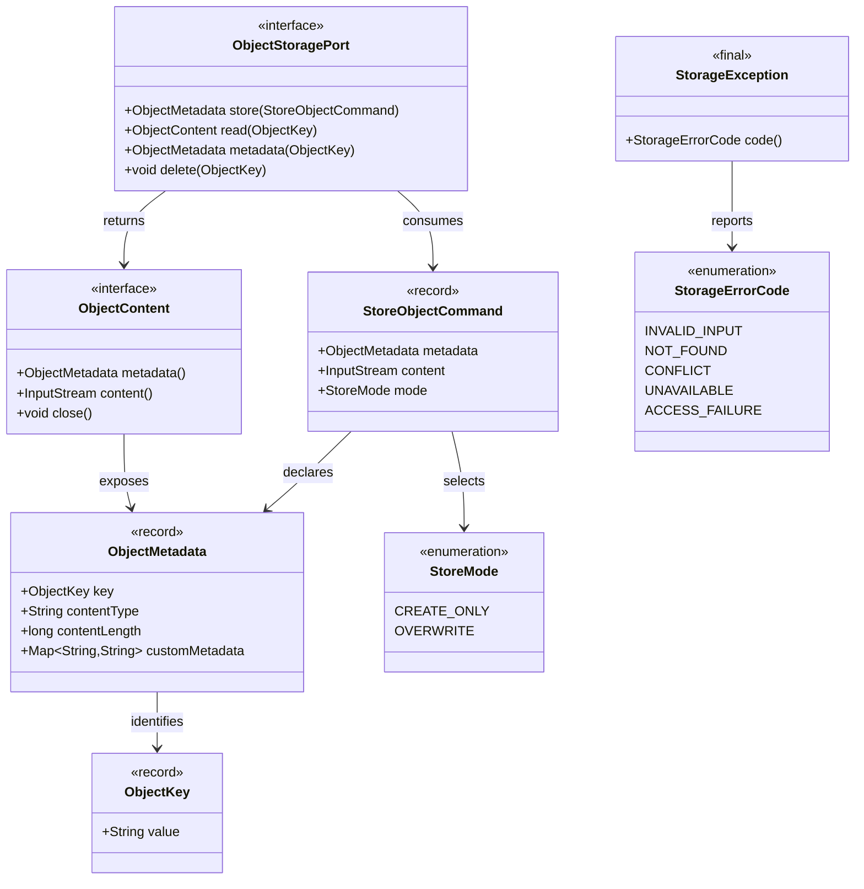
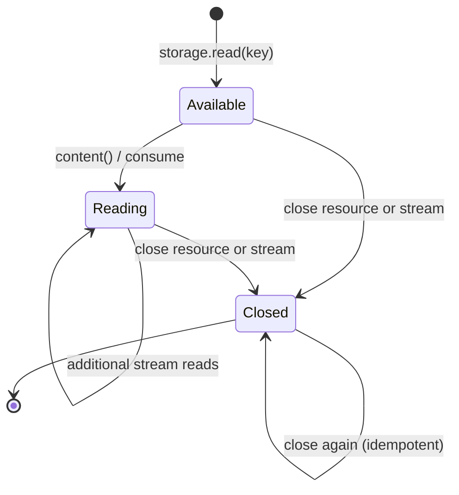
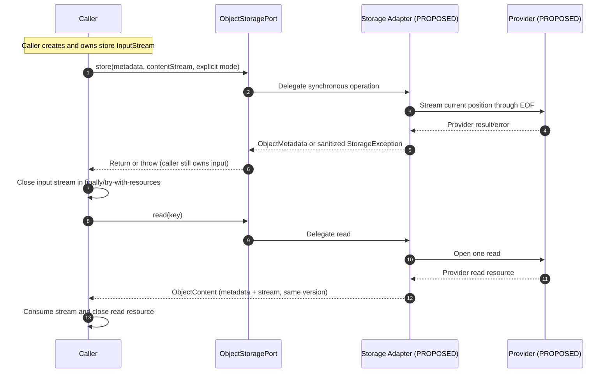

# Data Core — Object Storage Domain Model

> **Evidence vocabulary:** **OBSERVED** means inspected Java or canonical contract content at the pinned SHA; **SELECTED** means user-approved G4-F19 design/documentation direction; **PROPOSED** means a future implementation, policy or test; **VERIFIED** requires reproduced execution logs at an exact revision and reviewer acceptance. This document reports **no newly executed tests** and grants **no Gate approval**.

## 1. Purpose and bounded context

**SELECTED:** Define the data shape, relationships, invariants, validation rules, resource lifecycles and boundary of the existing provider-neutral Object Storage capability. Domain models here are **Java records/interfaces**, **not a relational schema or JPA entities**. This document supplements, without rewriting, the [canonical Data Core contract](https://github.com/lexuanbao258-collab/dxos-open-core/blob/0f0c3ba0c3eecda0a5c4a798a3cc14b808351bed/docs/contracts/data-core.md) (blob `99b6ad1d67b2e8d730f13b7a082659e4c4e75b3d`).

**OBSERVED:** `com.tricore.dxos.core.data` provides `ObjectStoragePort`, object-key and metadata values, store command and write mode, an owned read resource, and normalized storage errors. It does not define a Core `Attachment`, `Bucket`, `StorageUser`, workflow record, persistence entity, authorization system, JPA mapping or MinIO/S3 implementation. No additional entity is introduced here.

**Pinned repository:** `0f0c3ba0c3eecda0a5c4a798a3cc14b808351bed`. Reference boundary: [data-persistence-boundaries.md](https://github.com/lexuanbao258-collab/dxos-open-core/blob/0f0c3ba0c3eecda0a5c4a798a3cc14b808351bed/docs/architecture/data-persistence-boundaries.md). Workflow persistence remains a separate Workflow-owned contract.

## 2. Source traceability inventory

| Exact Java file | Blob SHA | Inspected responsibility |
| --- | --- | --- |
| [`ObjectStoragePort.java`](https://github.com/lexuanbao258-collab/dxos-open-core/blob/0f0c3ba0c3eecda0a5c4a798a3cc14b808351bed/backend/src/main/java/com/tricore/dxos/core/data/ObjectStoragePort.java) | `0392d78bf86f828a6f21fdc6947e2c57ab93ec47` | Synchronous provider-neutral storage interface |
| [`ObjectKey.java`](https://github.com/lexuanbao258-collab/dxos-open-core/blob/0f0c3ba0c3eecda0a5c4a798a3cc14b808351bed/backend/src/main/java/com/tricore/dxos/core/data/ObjectKey.java) | `679cc931d51046064fe71cd0f266bef03e1f390d` | Opaque immutable key record |
| [`ObjectMetadata.java`](https://github.com/lexuanbao258-collab/dxos-open-core/blob/0f0c3ba0c3eecda0a5c4a798a3cc14b808351bed/backend/src/main/java/com/tricore/dxos/core/data/ObjectMetadata.java) | `d0d9a8656ec03fc39ce9ba2a4d08d1e7565e8e04` | Immutable metadata record |
| [`StoreObjectCommand.java`](https://github.com/lexuanbao258-collab/dxos-open-core/blob/0f0c3ba0c3eecda0a5c4a798a3cc14b808351bed/backend/src/main/java/com/tricore/dxos/core/data/StoreObjectCommand.java) | `d5be0fc172b40efc059aa373769461de001e2edd` | Record carrying a mutable caller-owned input stream |
| [`StoreMode.java`](https://github.com/lexuanbao258-collab/dxos-open-core/blob/0f0c3ba0c3eecda0a5c4a798a3cc14b808351bed/backend/src/main/java/com/tricore/dxos/core/data/StoreMode.java) | `57d6ad1d3573c3d8a2044df34ddc7b69a073d2fd` | Explicit CREATE_ONLY and OVERWRITE enum |
| [`ObjectContent.java`](https://github.com/lexuanbao258-collab/dxos-open-core/blob/0f0c3ba0c3eecda0a5c4a798a3cc14b808351bed/backend/src/main/java/com/tricore/dxos/core/data/ObjectContent.java) | `8ff5db66049d8e70cd7ef8bfa252022a7042bd27` | AutoCloseable read resource interface |
| [`StorageErrorCode.java`](https://github.com/lexuanbao258-collab/dxos-open-core/blob/0f0c3ba0c3eecda0a5c4a798a3cc14b808351bed/backend/src/main/java/com/tricore/dxos/core/data/StorageErrorCode.java) | `224ee291b0787682bfb5333afa764dfef668fe95` | Five normalized capability errors |
| [`StorageException.java`](https://github.com/lexuanbao258-collab/dxos-open-core/blob/0f0c3ba0c3eecda0a5c4a798a3cc14b808351bed/backend/src/main/java/com/tricore/dxos/core/data/StorageException.java) | `c14a4ccd64efdbd079327552644a6c65346f30c6` | Sanitized code-only failure |
| [`StorageValues.java`](https://github.com/lexuanbao258-collab/dxos-open-core/blob/0f0c3ba0c3eecda0a5c4a798a3cc14b808351bed/backend/src/main/java/com/tricore/dxos/core/data/StorageValues.java) | `72394ee03f0467706f2ac3ecef1c563ae20d0dec` | Package-private normalized input validator |

A Java type being present is **not** proof that a real storage provider or deployment is working.

## 3. Domain relationships (Java types, not an ERD)

The domain **description** of a stored object is not itself a persistent entity in this model. `ObjectContent` is a single-use read resource, not a persisted aggregate root. The object namespace and bucket/provider mapping exist **outside** this model.

## 4. Value identity, equality, immutability and validation

### 4.1 `ObjectKey`

**OBSERVED:** a Java record with one required nonblank `String value`; validation via `StorageValues.text`. Key values are retained **verbatim** and are case-sensitive. A key with leading or trailing whitespace is not automatically trimmed; a whitespace-only key is rejected. No canonical UUID, URI or filesystem-path interpretation is imposed. Distinct accepted logical keys must not collide during adapter mapping.

**Record equality:** ordinary Java record value equality applies to the wrapped string; the contract does not compare keys after case conversion, trimming or path normalization. `ObjectKey("A")` and `ObjectKey("a")` must remain distinguishable in a conforming storage namespace.

### 4.2 `ObjectMetadata`

**OBSERVED:** Java record `(ObjectKey key, String contentType, long contentLength, Map<String,String> customMetadata)`.
- `key` must not be null.
- `contentType` must be non-null/nonblank; no MIME sniffing or file-extension inference.
- `contentLength` is exact **byte** length; `0` is legal, negative values are `INVALID_INPUT`, unknown length is not supported by the existing declaration.
- The map is required, may be empty, has nonblank keys and non-null values (empty string values allowed).
- `Map.copyOf` produces a defensive immutable map. Mutating the caller's map after construction cannot update the record metadata. Map iteration order is **not** a promised ordering contract.
- Records have value equality over their components; metadata equality is about values, not a provider object version or business-resource ownership.

No bucket, credentials, ACL, owner, SQL row identifier or attachment-specific metadata field is invented as a Core property.

### 4.3 `StoreObjectCommand`

**OBSERVED:** record `(ObjectMetadata metadata, InputStream content, StoreMode mode)`; all three fields are required. Its record components are final references, **not** an immutable byte stream. Java records do not freeze or clone the mutable `InputStream`, nor establish replayability. A failed store can consume the stream.

**SELECTED:** distinguish a stable command *shape* from the **single-use mutable stream resource** carried by that command. Future tests must check ownership and current-position-to-EOF semantics; do not implement a mandatory in-Core `byte[]` buffer.

### 4.4 `StoreMode`

**OBSERVED:** exactly `CREATE_ONLY` and `OVERWRITE`; explicit mode required and no default. These are operation policies, not persisted object lifecycle states.

### 4.5 `ObjectContent`

**OBSERVED:** interface extending `AutoCloseable`, exposing `metadata()`, `content()` and `close()`. The resource represents one read of metadata and bytes of the **same object version**. Its stream is single-use; post-close stream access is invalid (`INVALID_INPUT`); metadata remains accessible; closing resource is idempotent. Closing the stream directly must also free underlying resources.

`ObjectContent` is neither a JPA entity nor evidence of a globally consistent snapshot across calls.

## 5. Invariant / negative-error decision matrix

| ID | Contract input or behavior | Required invariant | Negative scenario and expected code | Evidence state |
| --- | --- | --- | --- | --- |
| DM-01 | `ObjectKey` | Nonblank preserved exact case | Null / blank → `INVALID_INPUT`; `A` vs `a` must remain distinct | NOT RUN HERE |
| DM-02 | `ObjectMetadata.contentType` | Nonblank exact supplied value | Null / blank → `INVALID_INPUT` | NOT RUN HERE |
| DM-03 | `contentLength` | Exact nonnegative bytes, zero allowed | Negative or store consumed-byte mismatch → `INVALID_INPUT` | NOT RUN HERE |
| DM-04 | `customMetadata` | Defensive immutable map; keys nonblank, values nonnull | Null map/key/value or blank key → `INVALID_INPUT` | NOT RUN HERE |
| DM-05 | `StoreObjectCommand` | Metadata, stream and explicit mode required | Any missing component → `INVALID_INPUT` | NOT RUN HERE |
| DM-06 | `CREATE_ONLY` | Absent-key conditional create, concurrency-safe | Existing key → `CONFLICT`; existing bytes/metadata unchanged | NOT RUN HERE |
| DM-07 | `OVERWRITE` | Replace content **and full metadata** | No expected-version/CAS promise; no concurrent ordering assumption | NOT RUN HERE |
| DM-08 | `read()` | One version-consistent metadata/stream resource | Missing key → `NOT_FOUND`; no multi-call snapshot guarantee | NOT RUN HERE |
| DM-09 | `metadata()`, `delete()` | Missing is an error | Missing/repeated delete → `NOT_FOUND` | NOT RUN HERE |
| DM-10 | Store input stream | Caller-owned, never closed or retained by port | Failed read / wrong bytes → `INVALID_INPUT`; caller closes on all outcomes | NOT RUN HERE |
| DM-11 | Read resource lifecycle | Idempotent close, after-close stream invalid | Use after close → `INVALID_INPUT`; lazy provider failures sanitized | NOT RUN HERE |
| DM-12 | Storage errors | Five codes only; sanitized exception | Provider temporary outage → `UNAVAILABLE`; permission failure → `ACCESS_FAILURE` | NOT RUN HERE |
| DM-13 | Object identity & resource ACL | Key is a locator, not proof of authorization | Unauthorized cross-resource read denied by Application boundary | PROPOSED / NOT RUN |
| DM-14 | Provider mapping | Distinct accepted keys do not collide | Namespace/case/path collisions rejected/prevented by adapter | PROPOSED / NOT RUN |

Structural invalid inputs in Data are **normalized `StorageException(INVALID_INPUT)`**; do not import Workflow's `IllegalArgumentException`/`NullPointerException` structural-error convention into this capability. `StorageException` uses `code().name()` for message, no external cause, suppression or stack trace.

## 6. Stream resource lifecycle and ownership

**OBSERVED contract:** `ObjectContent` metadata can still be inspected after close; the stream cannot be used after close, even if the caller held an earlier reference. The diagram describes **resource use**, not persisted object statuses (`UPLOADING`, `ARCHIVED`, etc. are not Core states).

**Caller obligation:** close the store input on **success and failure**. The adapter **must not** close or retain that input; a failed request can consume bytes so retry requires a **fresh or explicitly reset** stream and appropriate outcome handling. The caller also closes returned `ObjectContent` even after partial consumption or failure. Provider lazy-read/close failures must be converted to sanitized storage errors; no raw provider `IOException` or cause may escape.

## 7. Shape versus behavior: no invented persisted lifecycle

| Concern | Java data shape | Behavior belongs to |
| --- | --- | --- |
| Object identity | `ObjectKey` | Collision-free mapping in storage adapter |
| Object description | `ObjectMetadata` | Declared bytes/content type and consistent read version |
| Store request | `StoreObjectCommand` | `ObjectStoragePort.store` and caller-owned stream |
| Write policy | `StoreMode` enum | `CREATE_ONLY` conflict / `OVERWRITE` replacement semantics |
| Read ownership | `ObjectContent` interface | Adapter stream wrapper plus caller close |
| Error outcome | `StorageErrorCode` / `StorageException` | Capability-normalized error handling at adapter boundary |
| Business attachment | **Not defined as a Data Core entity** | Helpdesk or Facility Application business model |

**No fictional Core lifecycle** (`UPLOADING`, `PUBLISHED`, `ARCHIVED`) or provider-specific bucket state is added. The contract does not supply object version CAS, ordering for competing overwrites, cross-object atomic transactions, exactly-once, provider durability, or universal rollback. Other failures can have uncertain provider outcomes; provider integration must document its own consistency and recovery semantics.

## 8. Application boundary and two-use-case illustration

**SELECTED:** an opaque key does not confer permission. A verified actor and Application resource-level ACL are required before exposing upload/download/delete functionality. Storage Core does not know tickets, work orders, facility requests, assignees or approvers.

| Application (illustrative) | Application-owned mapping / policy | Reused unchanged Data types | Unverified obligation |
| --- | --- | --- | --- |
| IT Helpdesk | Ticket attachment relationship, permitted uploader/downloader, retention/size/type policy | `ObjectKey`, `ObjectMetadata`, `StoreObjectCommand`, `ObjectContent` | Evidence that unauthorized user cannot access another ticket's object |
| Facility | Facility request attachment relationship, author/approver eligibility, retention policy | Same four types and `ObjectStoragePort` | Separate policy tests and no new Core business branch |

These examples do not claim two production applications have been demonstrated. Cross-store SQL attachment-row changes and object writes do **not** gain distributed atomicity from this Data model; orphan cleanup/reconciliation is an Application/infrastructure design decision.

## 9. Source → test → evidence → reviewer traceability

| Design requirement | Source type | Expected test/evidence | Reviewer | Status |
| --- | --- | --- | --- | --- |
| DM-01/02/03/04: values | `ObjectKey`, `ObjectMetadata`, `StorageValues` | JUnit data validation + defensive copy assertions; exact commit/test XML | Data owner | SOURCE OBSERVED; TEST NOT RUN HERE |
| DM-05/10: command and store stream | `StoreObjectCommand`, `ObjectStoragePort` | Exact-length, current-position, caller-close ownership tests | Data owner | SOURCE OBSERVED; TEST NOT RUN HERE |
| DM-06/07: write modes | `StoreMode`, `ObjectStoragePort` | Concurrent create-only test and full metadata replacement | Data / Adapter | CONTRACT OBSERVED; REAL PROVIDER NOT VERIFIED |
| DM-08/09/11: read resource | `ObjectContent`, `ObjectStoragePort` | Tied metadata/content, partial read, double-close, after-close | Data / Adapter | CONTRACT OBSERVED; REAL PROVIDER NOT VERIFIED |
| DM-12: errors | `StorageException`, `StorageErrorCode` | Invalid inputs + provider fault injection, redaction | Security / Data | SOURCE OBSERVED; PROVIDER NOT VERIFIED |
| DM-13/14: app ACL, key mapping | Data contract / architecture boundary | Helpdesk and Facility E2E authorization; namespace collision suite | Application / Independent | PROPOSED, NOT RUN |

The canonical contract **documents** a test-source `ObjectStoragePortTest` and `InMemoryObjectStorage`. Their reported contract coverage is **HISTORICAL / SOURCE-DOCUMENTED**, not a test run in this authoring session. A fake does not verify production object persistence, isolation or provider behavior.

**Required evidence package (future):** exact repository SHA and branch; JDK/Gradle command; relevant test selectors; exit code; JUnit XML path; input fixtures; provider version/config without secrets; sanitized logs; before/after object metadata and content/hash checks where appropriate; reviewer identity and verdict. Do not fabricate log files or label an unexecuted test PASS.

## 10. Review Gates, blockers and open questions

| Gate | Evidence needed | Current state |
| --- | --- | --- |
| G4-D Design | Approved object domain boundary and selected decisions | DRAFT / NOT REVIEWED |
| G4-S Source | Pinned Java interfaces/records and dependency audit | TYPES INSPECTED; COMPLETE AUDIT PENDING |
| G4-C Contract | Actual unit/negative/lifecycle test logs | NOT RUN HERE |
| G4-P Provider | Real adapter conformance, concurrency/stream/error tests | NOT VERIFIED |
| G4-R Reuse | Helpdesk + Facility with same Core types, independent ACL | NOT RUN HERE |
| G4-I Independent | Named reviewer signs exact SHA/evidence | NOT APPROVED |

**P0 review blockers:** fabricated Data entities, treating `ObjectKey` as authorization, mutable metadata leakage, incorrect stream ownership, missing provider close/error sanitization, create-only race, key normalization collisions, SQL/object atomicity claims, historical test results relabeled CURRENT PASS.

**Open items:** provider adapter choice/registration; namespace mapping; actual concurrent create-only mechanism; object publication/failure outcome policy; business mapping/retention; cross-store orphan reconciliation; exact executable test inventory; two-App reuse review.

**Final disposition:** `G4-F19 DRAFT / NOT REVIEWED`. The 18 decisions are selected authoring constraints, not evidence of a deployed adapter, passing suite or G4 acceptance.
