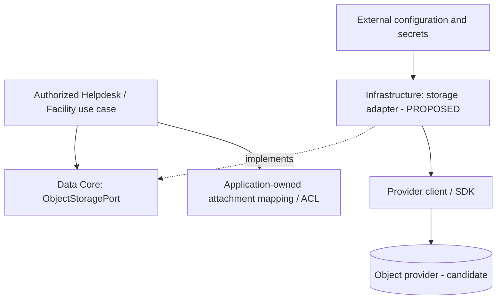
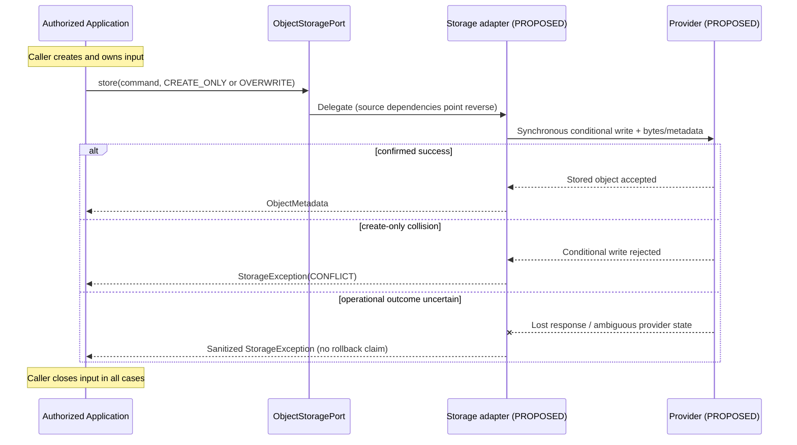
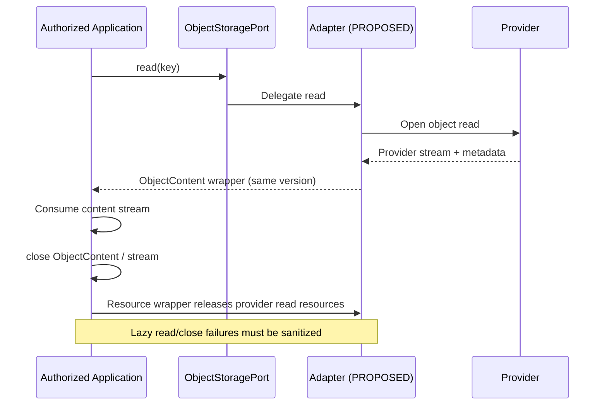

# Data Core — Storage Adapter Architecture and Conformance

> **Evidence labels.** **OBSERVED** = checked at pinned source SHA; **SELECTED** = user-approved G4-F21 documentation/design decisions; **PROPOSED** = target adapter or test requirement; **VERIFIED** = backed by exact-SHA execution logs and reviewer disposition. **No tests were run for this document. No storage provider is certified and no independent Gate is approved.**

## 1. Purpose, baseline and non-goals

**SELECTED:** Document infrastructure adapter boundaries and required semantics for a provider-neutral Java 21 `ObjectStoragePort`. Cover provider configuration, logical key and metadata mapping, concurrent conditional writes, stream management, sanitized failures, uncertain provider outcomes, provider substitution, security and evidence collection.

**OBSERVED sources (all at `0f0c3ba0c3eecda0a5c4a798a3cc14b808351bed`):**

| Authority | Blob SHA | Role |
| --- | --- | --- |
| [Canonical Data Core contract](https://github.com/lexuanbao258-collab/dxos-open-core/blob/0f0c3ba0c3eecda0a5c4a798a3cc14b808351bed/docs/contracts/data-core.md) | `99b6ad1d67b2e8d730f13b7a082659e4c4e75b3d` | Object Storage API and required semantics |
| [Data/persistence boundaries](https://github.com/lexuanbao258-collab/dxos-open-core/blob/0f0c3ba0c3eecda0a5c4a798a3cc14b808351bed/docs/architecture/data-persistence-boundaries.md) | `10b34157faf47f6c3a2831d1965264f39e941b72` | Capability ownership and SQL/object isolation |
| [`ObjectStoragePort.java`](https://github.com/lexuanbao258-collab/dxos-open-core/blob/0f0c3ba0c3eecda0a5c4a798a3cc14b808351bed/backend/src/main/java/com/tricore/dxos/core/data/ObjectStoragePort.java) | `0392d78bf86f828a6f21fdc6947e2c57ab93ec47` | Four method declarations and runtime expectations |
| [`ObjectContent.java`](https://github.com/lexuanbao258-collab/dxos-open-core/blob/0f0c3ba0c3eecda0a5c4a798a3cc14b808351bed/backend/src/main/java/com/tricore/dxos/core/data/ObjectContent.java) | `8ff5db66049d8e70cd7ef8bfa252022a7042bd27` | Read resource lifecycle |
| [`StorageErrorCode.java`](https://github.com/lexuanbao258-collab/dxos-open-core/blob/0f0c3ba0c3eecda0a5c4a798a3cc14b808351bed/backend/src/main/java/com/tricore/dxos/core/data/StorageErrorCode.java) | `224ee291b0787682bfb5333afa764dfef668fe95` | Exact five error codes |

The canonical contract describes future provider adapters and a fake-only `InMemoryObjectStorage` test fixture. It does **not** establish that a MinIO/S3 production implementation is registered, deployed, or passing current tests. This file does not change Java, register Spring beans, amend Flyway SQL, or supersede the canonical contract.

## 2. Placement, dependency inversion and ownership



**Runtime invocation** goes from an authorized Application use case through the Data port and its configured adapter to the provider. **Source dependencies** run from infrastructure implementation **toward** the capability-owned port; Core must not import Spring, JDBC, MinIO, AWS classes, credentials, bucket names or provider endpoints. One modular monolith can contain several logical adapters; this does not imply microservices.

| Component | Owns | Must not own |
| --- | --- | --- |
| `core.data` | `ObjectStoragePort`, `ObjectKey`, `ObjectMetadata`, `StoreObjectCommand`, `StoreMode`, `ObjectContent`, normalized storage errors | SDK, buckets, HTTP, business attachment ACL, SQL entities |
| `infrastructure.storage` (target location) | Provider client/configuration, collision-safe key mapping, conditional writes, metadata translation, read wrappers and error classification | Core business model changes or application authorization |
| Helpdesk/Facility Application | Authenticated use case, business attachment relationship, owner/assignee/approver ACL, retention and compensation rules | Provider SDK coupled to generic Core |
| `infrastructure.persistence` | Separate database adapters implementing their capability-owned ports | Redefinition of Workflow's transition/history contract |

**MinIO** is an illustrative **CANDIDATE**, not a fixed Core dependency or an accepted runtime provider. Choice, SDK capabilities, conditional-write support, versions and configuration must be verified against an implementation and its real deployment.

## 3. Fixed Java-facing API

```java
public interface ObjectStoragePort {
    ObjectMetadata store(StoreObjectCommand command);
    ObjectContent read(ObjectKey key);
    ObjectMetadata metadata(ObjectKey key);
    void delete(ObjectKey key);
}
```

No `list`, `search`, `expectedVersion`, object CAS or custom provider operation is added. A provider adapter must preserve the existing API and its behavior, or request a separately reviewed ADR/contract revision.

## 4. Provider configuration and logical object identity

**SELECTED adapter mapping requirements:**

1. Configure endpoint, credentials, TLS trust, bucket/namespace and deployment options outside the Core Java types; keep credentials out of documentation, logs and exception messages.
2. Treat `ObjectKey.value()` as opaque, case-sensitive, nonblank and **verbatim**. Never silently lowercase, trim, path-normalize or interpret it as URI/bucket identifier.
3. Adapter-level namespace encoding must be **injective over accepted keys**. Two distinct logical keys, including `A` vs `a` or keys containing separators, must not map to one provider object. If a backend cannot represent the contract keyspace faithfully, document and resolve the incompatibility; do not silently change Core key semantics.
4. Keep business attachment ownership and authorization in the Application, not in a provider object key. Namespace layout is a storage concern; it is not an access-control decision.
5. Provider configuration, bucket creation, startup checks and credential rotation are **PROPOSED operational design obligations**, not baseline verified runtime features.

## 5. Content and metadata mapping

`ObjectMetadata` preserves an exact nonnegative **byte** count (zero allowed), supplied nonblank content type, and immutable full `Map<String,String>` of custom metadata. Metadata names must be nonblank; values nonnull (empty allowed). An adapter must prove exact round-trip of content length/type and custom metadata, including replacing **the entire map** on overwrite. Do not substitute filename inference, lossy provider metadata transformations, case-folding or provider-only metadata for the Core contract. If provider metadata restrictions threaten lossless round-trip, record the incompatibility and choose an explicit separately reviewed mapping strategy.

## 6. `store`: conditional create, overwrite and stream handling

| Mode | Required successful behavior | Required concurrency/failure behavior |
| --- | --- | --- |
| `CREATE_ONLY` | Store only when logical key absent | Enforce condition **at the provider/atomic write boundary**; of competing writes for same absent key, only a valid winner may create, losers get `CONFLICT`, existing bytes and metadata remain unchanged |
| `OVERWRITE` | Create if absent; otherwise replace complete bytes **and all metadata** | No expected version, metadata merge, ordering among concurrent overwrites or CAS promise |

A `HEAD`/`exists` read followed by unconditional `PUT` is **not** a valid implementation of atomic `CREATE_ONLY`. A conditional provider request is a **candidate mechanism** only if actual SDK/provider semantics are proven; the source does not guarantee any particular provider implements it. Provider faults may leave uncertain outcomes; `StorageException` alone does not prove rollback.

Store input belongs to the caller. `store` consumes **synchronously from the input's current position through EOF**, compares consumed bytes to declared length, and returns metadata only after success. A mismatch or caller-input read failure maps to `INVALID_INPUT`. The adapter must **not close or retain caller input** and may not defer its consumption after the method returns. The caller closes the input in both success and failure paths. Retrying after any consumed data requires a fresh or explicitly reset stream and a separate provider-outcome decision; do not blindly retry.



This diagram is an **illustrative interaction**, not a verified current call trace or an exact SDK exception mapping.

## 7. `read`, `metadata`, `delete` and resource ownership

- `read(key)`: returns `ObjectContent` whose metadata and content describe **the same object version**. The caller closes the resource after full, partial or failed consumption. `ObjectContent.close()` is idempotent; closing its stream directly also releases all underlying read resources. Metadata remains accessible after close; stream use after close is invalid (`INVALID_INPUT`). No `mark/reset` promise.
- `metadata(key)`: retrieves metadata **without opening a content resource**.
- `delete(key)`: removes content and metadata; absent keys and repeated deletes return `NOT_FOUND` (not unconditional success).
- Each read is its own resource; separate port calls are not a common snapshot. The adapter must wrap provider lazy-read and close paths so no raw provider `IOException`, message, or cause escapes.



The second diagram depicts ownership, not a guarantee of physical adapter internals or successful provider registration.

## 8. Provider failure translation and leakage prevention

| Contract code | Required classification | Negative proof |
| --- | --- | --- |
| `INVALID_INPUT` | Null/blank key, invalid command/metadata/byte count, unreadable caller input, read after close | Reject invalid input and inspect sanitized exception |
| `NOT_FOUND` | Missing `read`, `metadata`, `delete`, repeated delete | Verify no fabricated success |
| `CONFLICT` | Existing `CREATE_ONLY` key / failed conditional operation | Concurrent losers return conflict and leave winner unchanged |
| `UNAVAILABLE` | Temporary provider or network outage | Inject timeout/outage; no provider credentials/messages/cause leak |
| `ACCESS_FAILURE` | Provider permission/access denial | Inject denied permission; redact provider details |

`StorageException` exposes the code name as its message and has no cause, suppression or stack trace. **All provider failures—including lazy read and close—must be translated to the five codes.** The canonical contract does not establish a universal precedence order when multiple error conditions coexist; do not invent one. The exact provider exception taxonomy and ambiguous timeout mapping require adapter-specific review.

## 9. Unknown outcomes, retry and SQL/object consistency

**OBSERVED non-guarantees:** the object API does not promise automatic rollback, exactly-once delivery, multi-object atomicity, safe blind retry, cross-SQL/object transactions or global provider publication/consistency behavior. Object writes may have reached the provider even when the caller receives an exception; the five-code enum has **no** Workflow-style `COMMIT_OUTCOME_UNKNOWN` member. Avoid importing Workflow error codes into Data.

**PROPOSED case-by-case reconciliation design:** on ambiguous writes/deletes, preserve request correlation and the intended key/metadata; determine whether the intended object state is authoritatively established under the provider's documented consistency model before any deliberate retry or compensation. An immediately absent/old read may be insufficient to decide if a provider transaction is still unresolved. Document bounded retry timing and idempotency policy separately. A consumed input must be recreated/reset before another store attempt.

| Failure window | Possible durable situation | Required response / owner | Status |
| --- | --- | --- | --- |
| Object create confirmed; SQL reference insert fails | Orphan object | Application-owned recovery/cleanup design and evidence | OPEN |
| SQL reference commits; object create fails | Dangling/missing bytes | Application use-case design must avoid or reconcile | OPEN |
| Provider write commits; response lost | Object present despite caller exception | Determine authoritative provider outcome, no blind retry | OPEN |
| Provider delete succeeds; response lost | Object gone; retry could yield `NOT_FOUND` | Reconcile intended deletion versus ambiguous response | OPEN |
| Concurrent `CREATE_ONLY` same logical key | One stored result or incompatible implementation | Atomic conditional enforcement, loser `CONFLICT`, no mutation | NOT RUN |
| Overwrite overlaps read | Version-consistent returned read required | Adapter conformance under concurrent read/overwrite | NOT RUN |
| Provider lazy-read/close fails | Resource cleanup / leak risk | Sanitize failure and demonstrate bounded cleanup | NOT RUN |

**SELECTED:** reconciliation/orphan cleanup belongs to Application and infrastructure, with exact strategy **OPEN**. No distributed transaction framework or object lifecycle state is invented by this document.

## 10. Security and two-Application reuse

A logical `ObjectKey` is an identifier, not authorization evidence. The trusted Application use case verifies the authenticated actor and enforces resource ACL before storage operations; direct provider access and exposure of credentials/signed URLs require a separate security review. Helpdesk may own ticket attachment rules; Facility may own request/approver attachment rules. The **same Data Core port** should support both with **different Application policies** and no app-specific conditionals in Core. These are proposed acceptance scenarios, **not verified E2E deployments**.

## 11. Behavioral provider substitution and acceptance evidence

| ID | Required contract | Proposed real-provider test / durable evidence | Reviewer | Current evidence state |
| --- | --- | --- | --- | --- |
| SA-01 | Pure Core/adapters boundary | Compile/import audit and dependency graph at pinned SHA | Core/Data | SOURCE CONTRACT INSPECTED; FULL AUDIT NOT RUN |
| SA-02 | External provider configuration | Startup/config binding review, secrets redaction proof | Infra/Security | NOT VERIFIED |
| SA-03 | Key identity | `A` vs `a`, accepted keys with separators; collision-free mapping | Data | NOT RUN |
| SA-04 | Metadata round-trip | 0 bytes, content type, exact length, full custom metadata | Data | NOT RUN |
| SA-05 | Atomic `CREATE_ONLY` | Bounded simultaneous writers; winner, loser `CONFLICT`, before/after content hash + metadata | Data/Infra | NOT RUN |
| SA-06 | `OVERWRITE` | Create and full replacement, no implicit CAS/order assertion | Data | NOT RUN |
| SA-07 | Caller-owned store stream | Spy input stream, partial consume/errors and no adapter close/retain | Data | NOT RUN |
| SA-08 | Read resource lifecycle | Version matched, partial read, double close, direct stream close and after-close error | Data/Infra | NOT RUN |
| SA-09 | Failure sanitization | Fault injection for outage, access failure, lazy read and close; inspect exception redaction | Security | NOT RUN |
| SA-10 | Uncertain writes/reconciliation | Loss of response after provider commit; evidence of outcome decision and safe retry policy | Infra | DESIGN OPEN |
| SA-11 | SQL/object failure windows | Orphan/dangling reference scenarios and cleanup/reconciliation proof | Application/Infra | DESIGN OPEN |
| SA-12 | Provider substitution | Run **same test suite** on each real provider with unchanged Core and Application business code | Independent/Data | NOT RUN |
| SA-13 | Helpdesk/Facility reuse | Distinct ACL/attachment flows using identical SPI; deny-no-access evidence | Application/Security | NOT RUN |

The canonical contract documents `ObjectStoragePortTest` with test-only `InMemoryObjectStorage`. This is **historical/source-documented scope**, not a current execution claim and not proof of a provider adapter. No real-provider SDK feature, conditional-`PUT` mechanism, MinIO release, S3 equivalence or deployment status is assumed.

**Evidence manifest (for future execution):** exact commit and branch, dependency/provider versions, JDK/Gradle, provider configuration without secrets, test command, fixture key/namespace, fault-injection setup, exit status, JUnit XML/logs, before/after bytes and metadata, cleanup results, reviewer and Gate verdict. A claimed PASS must link to such actual evidence; otherwise use `NOT RUN`, `BLOCKED`, `INCONCLUSIVE` or `DESIGN OPEN` as appropriate.

## 12. Review Gates and P0 blockers

| Gate | Evidence needed | Disposition |
| --- | --- | --- |
| G4-D Design | Selected decisions, component/sequence/failure diagrams | DRAFT / NOT REVIEWED |
| G4-S Source | Exact Java/contract and full dependency audit | KEY FILES INSPECTED; FULL AUDIT PENDING |
| G4-C Contract | Actual unit/negative coverage with logs | NOT RUN HERE |
| G4-P Provider | Registered provider and actual SDK semantics | NOT VERIFIED |
| G4-X Concurrency | Real-provider create-only race and metadata integrity | NOT RUN |
| G4-A Security | ACL and credential/error leak negatives | NOT RUN |
| G4-R Reuse | Helpdesk + Facility with unchanged Core | NOT RUN |
| G4-I Independent | Reviewer-signed source/test/adapter acceptance | NOT APPROVED |

**P0 blockers:** falsely claiming provider runtime readiness; a check-then-unconditional-write create path; logical key collisions; closing caller-owned store streams; metadata loss; raw provider exceptions/credentials; content/metadata mismatches; blind retries after unknown outcomes; object-key-as-ACL; fabricated SQL/object atomicity; insufficient real-provider test evidence; self-approved Gates.

**Open design decisions:** provider choice, SDK-level conditional-create behavior, key encoding, metadata fidelity if provider restrictions exist, visibility/consistency semantics, partial-failure reconciliation, cleanup ownership/scheduling, multi-provider evidence and distinct Application access-policy proof.

**Final disposition:** `G4-F21 DRAFT / NOT REVIEWED`. Documentation delivered; no production provider or Gate acceptance is established.
