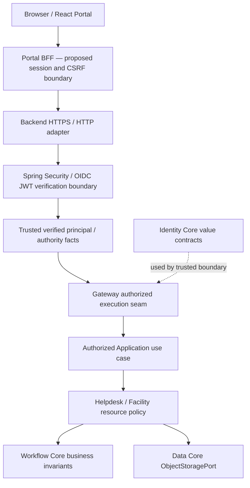
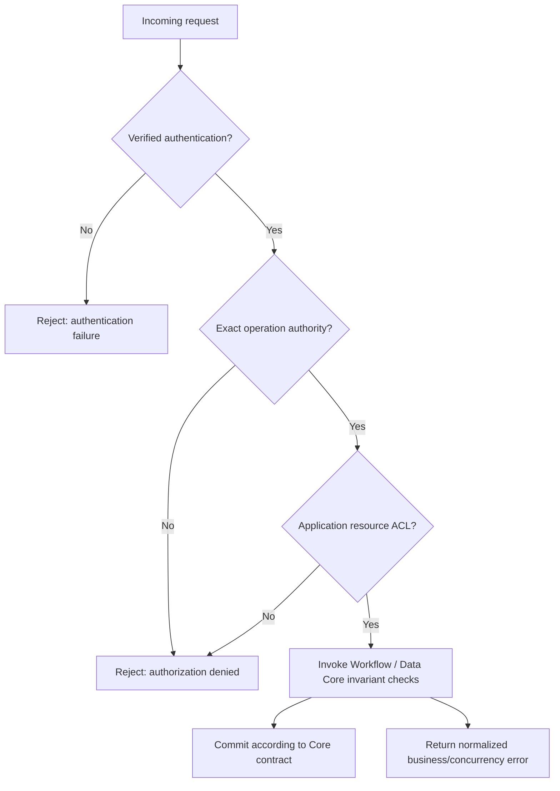

# Gateway — Boundary, Trust & Authorization Overview

**Current-branch navigation:** [Gateway architecture](architecture.md), [contracts](contracts.md), and [security model](security-model.md) are tracked on `docs/core-architecture-alignment`. These documents describe a proposed APISIX edge boundary; their presence is not implementation or verification evidence.

> **Evidence taxonomy:** **OBSERVED** = inspected exact-SHA source or canonical contract; **SELECTED** = user-approved G4-F24 documentation direction; **PROPOSED** = target architecture, threat control, test or runtime design requiring verification; **VERIFIED** = evidence from an actual executed test at an exact SHA, with logs and review. **No tests were executed for this artifact. Nothing here approves a Gate.**

## 1. Purpose, scope and evidence hierarchy

**SELECTED:** This gateway documentation portal explains the authentication-to-authorization trust chain, HTTP and browser boundaries, routing/delegation constraints, business-policy separation, threat analysis, and the evidence required to demonstrate a safe reusable Gateway seam for Helpdesk and Facility. It is **not** a new gateway-specific public Java contract or a deployment implementation guide.

**Pinned baseline:** `0f0c3ba0c3eecda0a5c4a798a3cc14b808351bed`.

| Source | Blob | Status / authority |
| --- | --- | --- |
| [Identity Core canonical contract](https://github.com/lexuanbao258-collab/dxos-open-core/blob/0f0c3ba0c3eecda0a5c4a798a3cc14b808351bed/docs/contracts/identity-core.md) | `8b6a6f412cf405709e85839f2bbe9021149ba33e` | OBSERVED: provider-neutral Identity representation, trust caveats, anti-spoofing and authorization facts |
| [Core/Application boundary](https://github.com/lexuanbao258-collab/dxos-open-core/blob/0f0c3ba0c3eecda0a5c4a798a3cc14b808351bed/docs/01-architecture/core-application-boundary.md) | `697ccaa4818bb45829496a34b20c72a91af4125b` | OBSERVED document at pinned SHA, **internally PROPOSED — REVIEW REQUIRED**; its architecture diagrams are targets, not evidence of acceptance |
| `docs/contracts/gateway-core.md` | Not found at this path at pinned SHA | **NOT ESTABLISHED** as an independent canonical gateway contract; do not invent it |
| Gateway runtime implementation / exact operation-authority mapping | Not established by the specific source inspection for this README | **SOURCE INVENTORY OPEN**; source/tests must be inspected before asserting exact implementation or a passing outcome |

The Identity contract describes Gateway as the **primary future runtime consumer** of Identity, and draws logical dependencies `External/Application → Gateway → Identity` with Gateway also calling Workflow. That design direction does **not** prove an integrated end-to-end token-to-authorized-action chain at the pinned SHA.

## 2. Gateway boundary within the modular monolith

A **logical Gateway seam is not necessarily a separate microservice**. Backend HTTP/Spring Security integration and a separately deployed Portal/BFF can coexist with the Spring Boot modular monolith; deployment topology must be grounded in actual environment and code, not inferred from the word “Gateway”.



**Diagram status:** conceptual **PROPOSED / partially source-informed**. The browser/BFF and all runtime arrows require implementation evidence. HTTP/BFF adapters and Identity Core are **not** interchangeable, and Workflow/Data Core must not rely on caller-originated identity headers.

## 3. Accountability matrix: who owns each decision?

| Layer | Responsibility | Must not be inferred |
| --- | --- | --- |
| Browser / BFF (PROPOSED) | Interactive OAuth session, secure browser cookie/session boundaries and CSRF protection where cookies apply; controlled backend token handling | No browser-held server secrets, no user-defined role headers as proof |
| HTTP security / provider adapter | Validate JWT/OIDC evidence against configured trust requirements (signature/JWKS, issuer, intended audience where applicable, validity times, accepted algorithms) | Constructing an Identity value proves a login |
| Identity Core (OBSERVED contract) | `AuthenticationContext`, `AuthenticatedPrincipal`, `Authority`, `RequiredAuthority`, `AuthorizationDecision`, normalized Identity errors | It is not itself an OIDC verifier, controller, workflow engine or business ACL service |
| Gateway seam (SELECTED target) | Accept only trusted identity context, enforce exact operation authority at protected boundary, call authorized use cases, reject bypass | Accept arbitrary `X-Role`/`X-Authorities` as truth |
| Application | Helpdesk ticket ownership/assignee and Facility approver/resource ACL, attachment authorization, business errors | A `workflow:transition` authority automatically grants access to all tickets |
| Workflow / Data Core | Provider-independent Workflow invariants or storage contract semantics | OAuth verification, Helpdesk/Facility policy, cross-resource ACL |

**Boundary test:** Authenticated identity is necessary but may be insufficient. A verified authority grants an operation category, not permission over an arbitrary business resource. Use cases must check resource policy before mutation/read.

## 4. Identity trust and canonical subject

**OBSERVED (Identity contract):**
- `AuthenticationContext` is an opaque reference. Its construction and nonblank validation are **not** cryptographic verification.
- An `AuthenticatedPrincipal` carrying `authenticated=true` represents a fact only after a genuinely trusted boundary has established it; direct construction alone does not prove authentication.
- `subjectId` is an opaque, provider-independent subject identifier, not necessarily an email, username or database ID.
- External identity headers (`X-User`, `X-User-Id`, `X-Role`, `X-Authorities`) cannot be accepted as verified facts. The contract historically describes a filter-chain test that anonymous `X-User`/`X-Role` headers do not authenticate a request; **this is not a test rerun in this task**.
- Missing, invalid and expired authentication contexts are semantically different. The canonical Identity contract explicitly leaves a normalized *missing-context* mapping to review; do not invent a missing-context Core error code.

**PROPOSED verification requirements:** validate trust issuer, key/signature, audience/authorized client, token time fields and configuration-specific JWT requirements with appropriate failure handling. Subject/authority extraction must originate only after verification, through a known adapter policy. Exact claims, scopes and authority conversion must be inspected in source and tested rather than guessed.

## 5. Authorization: exact operation authority plus Application ACL



**SELECTED policy order:** authentication → exact operation authority → Application resource eligibility/ACL → Core invariants. Denied requests must not produce successful Workflow transitions or unauthorized object mutations. The precise location of enforcement, authority mapping, precedence of mixed errors and HTTP status mapping must be confirmed against actual routing and tests.

**Operation-authority mapping inventory — not yet independently pinned to implementation:**

| Operation category | Candidate authority string (review before publishing as exact) | Required source verification |
| --- | --- | --- |
| Workflow create | `workflow:create` | Operation enum/mapper and protected entrypoint |
| Workflow activate | `workflow:activate` | Authority extraction and use-case check |
| Workflow transition | `workflow:transition` | Reject no authority, stale version and unauthorized resource |
| Workflow read / history | `workflow:read` | Deny IDOR and unauthorized history access |

These strings are **CANDIDATE**, not a claim that every controller uses them or that a complete gateway path passed at this SHA. An authority is a stable permission fact only where the actual trusted security adapter and authorization mapping prove it. Do not convert broad role names into implicit wildcards without a reviewed contract.

## 6. HTTP, transport and browser trust separation

- **Authentication denial:** missing, malformed, invalid, expired or untrusted identity evidence. No protected use case is reached.
- **Authorization denial:** verified principal lacks exact operation authority or is disallowed by the relevant Application resource policy.
- **Business/concurrency error:** authorized operation reaches Core and encounters a genuine invariant, invalid transition, version conflict, storage conflict, etc.
- **Infrastructure/internal error:** sanitized output; provider details, secrets or internal traces must not leak.

**PROPOSED transport mapping** may use standard HTTP 401 for missing/invalid authentication and 403 for insufficient permission, while business/storage/Workflow errors receive separately reviewed mappings. **No mapping is asserted as an OBSERVED repository runtime guarantee here.**

**Browser vs API:** a cookie/session-based BFF needs a separate CSRF/session trust analysis from backend bearer-token verification. Browser protections, HTTPS ingress, redirect URI checks, OAuth Authorization Code + PKCE S256, token storage/rotation and CORS cannot be treated as automatically verified by describing JWT validation alone.

## 7. Threat model and negative acceptance index

| ID | Threat / misuse | Required control and negative assertion | Evidence | Status |
| --- | --- | --- | --- | --- |
| GW-01 | Missing/invalid/expired JWT | Fail closed; protected handler not entered | Security filter E2E + logs | NOT RUN HERE |
| GW-02 | Forged identity/role headers | Ignore/reject `X-Role`, `X-User`, `X-Authorities` from caller | Anonymous + token-conflict requests | NOT RUN HERE |
| GW-03 | Wrong issuer/audience/invalid signature | Reject despite structurally plausible principal | Token negative matrix | NOT RUN HERE |
| GW-04 | Operation privilege escalation | Exact required authority; no role-name/wildcard shortcut | Mapper + endpoint negative tests | NOT RUN HERE |
| GW-05 | Helpdesk IDOR | Other user's ticket read/transition denied; no successful history | Resource ACL + DB/history proof | NOT RUN HERE |
| GW-06 | Facility approver spoofing | Distinct policy denies unauthorized approver | Facility negative E2E | NOT RUN HERE |
| GW-07 | Direct Gateway/Core bypass | Unprotected paths/alternate invocations cannot mutate Core | Route inventory + bypass probes | NOT RUN HERE |
| GW-08 | Data object IDOR | Knowledge of `ObjectKey` cannot authorize read/delete | Protected download/delete E2E | NOT RUN HERE |
| GW-09 | Expired key/JWKS outage | Bad/uncertain trust cannot lead to fail-open acceptance | Controlled JWKS/clock/failure suite | NOT RUN HERE |
| GW-10 | Leaking tokens or PII in logs | Sanitized and correlated auth decisions; no full bearer token | Redacted logs inspection | NOT RUN HERE |
| GW-11 | CSRF/session confusion | Browser cookie boundary protected; backend bearer semantics separate | Browser/BFF tests | NOT RUN HERE |
| GW-12 | Fake “authenticated=true” object | Unverified construction cannot reach trusted protected action | Trust-origin integration tests | NOT RUN HERE |

**Result semantics:** `NOT RUN` means not executed; `BLOCKED` means prerequisites absent; `FAIL` means reproducible contradiction; `INCONCLUSIVE` means evidence insufficient; `HISTORICAL` means a source describes an earlier run; `PASS` requires actual matching evidence at exact SHA. This README claims **none** of the GW cases passed.

## 8. Failure handling, observability and audit

**SELECTED safeguards:**
- Fail closed on invalid signatures, unknown issuer, expired tokens, missing verified principal, or inability to establish required trust; do not authorize merely because Keycloak/JWKS is unavailable.
- Use bounded clock-skew tolerance only where explicitly configured and tested. A cached accepted signing key may remain valid subject to a reviewed policy; do not assume outage always entails an unconditional global outage or fail-open behavior.
- Propagate correlation IDs for request-level diagnosis without exposing raw access tokens, refresh tokens, secrets or excessive PII.
- Distinguish **authentication/authorization decision logs**, Application audit events, and **successful Workflow transition history**. A denied request should never masquerade as a committed transition.
- Ensure sensitive provider exceptions, token claims, authentication failure internals and stack traces are not returned to untrusted clients.

**OPEN:** exact JWKS caching/refresh handling, API error formats and status mapping, audit destination/retention/PII minimization, token claim-to-authority mapping, HTTP route coverage, API gateway rate limiting, and contingency plans for IdP outage. No new production behavior is claimed.

## 9. Two-Application proof, navigation and boundaries

**PROPOSED reuse:** demonstrate a common trusted Gateway/Identity seam on the **same unchanged Core SHA** while Helpdesk and Facility enforce materially different resource ACLs, business actors and authorization rules. Show at least one positive and one deny-with-no-mutation scenario for each Application. Do not infer two-App reuse from a single login screen.

The following tree is the historical F24 navigation sketch, not the current tracked-file inventory or a Document Register lifecycle assignment:

```text
docs/
├── 02-core/
│   └── gateway/
│       ├── README.md                  # G4-F24 — this gateway portal
│       ├── architecture.md           # PROPOSED, not created by F24
│       ├── contracts.md              # PROPOSED
│       ├── authentication.md         # PROPOSED
│       ├── authorization.md          # PROPOSED
│       ├── threat-model.md           # PROPOSED
│       └── acceptance-tests.md       # PROPOSED
├── 10-reviews/
│   └── g4-f24-review-checklist.md
workbench/
└── decision-records/
    └── G4_F24_DECISION_RECORD.md
```

**Current-branch inventory:** [architecture](architecture.md), [contracts](contracts.md), [security model](security-model.md), and [acceptance tests](acceptance-tests.md) are tracked. The sketch's `authentication.md`, `authorization.md`, and `threat-model.md` paths are absent on this branch. Tracked existence does not establish an Approved or Verified lifecycle or an implemented APISIX integration.

**Historical documentation links:** the [Identity contract](https://github.com/lexuanbao258-collab/dxos-open-core/blob/0f0c3ba0c3eecda0a5c4a798a3cc14b808351bed/docs/contracts/identity-core.md) and [Core/Application boundary draft](https://github.com/lexuanbao258-collab/dxos-open-core/blob/0f0c3ba0c3eecda0a5c4a798a3cc14b808351bed/docs/01-architecture/core-application-boundary.md) are pinned source references. Historical evidence in `docs/evidence/` should be indexed by concrete checked path and SHA before citing outcomes.

## 10. Traceability and evidence submission

| Requirement | Primary source/assumption | Necessary proof | Reviewer | State |
| --- | --- | --- | --- | --- |
| GW-R01 trusted auth boundary | Identity canonical contract; actual security adapter to inspect | Token validation + negative issuer/signature/expiry | Identity/Security | SOURCE CONTRACT OBSERVED; E2E NOT RUN |
| GW-R02 header anti-spoof | Identity canonical contract | Forged-header request never accepted | Security | HISTORICAL CONTRACT CLAIM; CURRENT NOT RUN |
| GW-R03 exact operation authority | Candidate mapping; Java implementation inventory OPEN | Exact authority test per operation | Backend/Security | MAPPING NOT VERIFIED |
| GW-R04 Application ACL | Proposed Core/Application boundary | IDOR and deny-no-mutation cases | Application/Security | NOT RUN |
| GW-R05 cross-Core delegation | Proposed Gateway → authorized use-case target | Route-to-use-case trace, no bypass | Architecture | NOT VERIFIED |
| GW-R06 browser/BFF boundary | Proposed architecture | CSRF/session/OIDC PKCE E2E | Frontend/Security | NOT RUN |
| GW-R07 sanitized errors/logging | Identity contract and target policy | HTTP error matrix and sanitized logs | Security | NOT RUN |
| GW-R08 two-App reuse | Design selection | Helpdesk & Facility separate ACL, common Gateway | Independent | NOT RUN |

Each result must capture exact SHA/branch, JDK/Gradle/security configuration, Keycloak/IdP environment without secrets, route and test selector, exit code, JUnit XML, sanitized logs, before/after business resource/history, reviewer and verdict. A source report of previous success is **HISTORICAL**, not current evidence.

## 11. Independent review Gates and open decisions

| Gate | Required evidence | Status |
| --- | --- | --- |
| G4-D Design | Q01–Q18 confirmed; gateway boundaries and trust diagram reviewed | DRAFT / NOT REVIEWED |
| G4-S Source | Gateway actual package/route/authority inventory pinned to SHA | OPEN |
| G4-I Identity | Trusted principal provenance verified | NOT RUN HERE |
| G4-A Authentication | JWT/OIDC/JWKS/browser boundary E2E | NOT RUN HERE |
| G4-Z Authorization | Exact authority and Application ACL denials | NOT RUN HERE |
| G4-T Security | Spoof/IDOR/bypass/JWKS-outage negative suite | NOT RUN HERE |
| G4-E E2E | Portal/BFF/HTTP/use-case/Core evidence | NOT RUN HERE |
| G4-R Reuse | Helpdesk + Facility on unchanged Core | NOT RUN HERE |
| G4-G Independent | Named reviewer signed exact evidence | NOT APPROVED |

**P0 blockers before acceptance:** fabricated canonical `gateway-core.md`, asserting exact authorities without source inspection, missing trusted-principal provenance, forged-header acceptance, unprotected mutation bypass, IDOR, conflating authority with resource ACL, token/secret leakage, fail-open security, missing independent E2E and reviewer evidence.

**Open decisions:** exact authority mapper/source paths; trusted verified-principal adapter; token-to-principal claim rules; BFF cookie/CSRF design; JWT/JWKS failure and clock-skew policies; route and test inventory; normalized missing-authentication-context error; approved review owners.

**Final disposition:** `G4-F24 DRAFT / NOT REVIEWED`. Document completion and selected design choices are not implementation verification or independent G4 acceptance.
