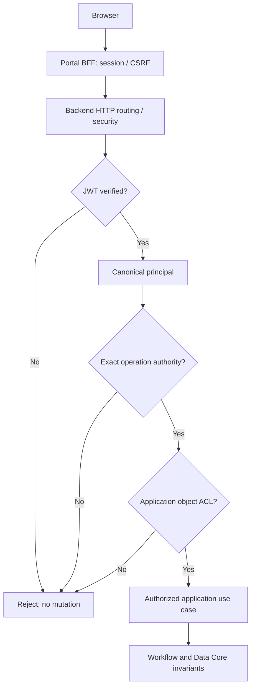

# Gateway Core — Acceptance Tests and Evidence Contract

> **No acceptance claim:** This is a source-informed **proposed** test specification, not evidence that any test in this catalogue has executed. All catalogue cases start `NOT RUN` or `BLOCKED`. No independent Gate has been approved.

## 1. Purpose, scope and non-goals

Define repeatable, adversarial acceptance criteria for Gateway routing and exposure, authenticated identity, exact operation authority, Application resource ACL, forged-header/bypass resistance, Portal BFF integration, normalized errors, failure handling and Helpdesk/Facility reuse. All source claims must remain anchored to the pinned commit. No edits to canonical Core contracts, runtime routes, Java code, or deployment configuration are authorized by this document. No new Gateway public API is invented.

**Selected decisions:** Q01=B, Q02=A, Q03=B, Q04=A, Q05=B and Q06–Q18=A. Full decision record: `workbench/decision-records/G4_F31_DECISION_RECORD.md`.

## 2. Evidence semantics (normative for this review document)

| Label | Meaning | Permitted assertion |
|---|---|---|
| `OBSERVED` | A specific statement read in a file at the pinned commit | Source content exists; **not** runtime success |
| `SELECTED` | Explicit design choice approved by requester for drafting | Decision selected; **not** implemented |
| `PROPOSED` | Target requirement, acceptance check or candidate mapping | Future verification needed |
| `VERIFIED` | Primary run artifacts independently checked against exact code/environment | Only for a **specific** test with linked evidence; **none** asserted here |
| `HISTORICAL` | Result described by an earlier contract, PR or artifact | Not re-run and not an independent Gateway E2E PASS |

Test status vocabulary: `NOT RUN` (not executed), `BLOCKED` (prerequisite missing), `INCONCLUSIVE` (executed but proof insufficient), `FAIL` (observed assertion failed), `PASS` (completed and evidence reviewed), and `HISTORICAL` (prior claim only). `VERIFIED` is an evidence classification and may be applied to a `PASS` only with actual records. Do not derive `PASS` from a green badge, a source document's wording, or a design decision.

## 3. Exact-SHA source authority and limits

| Evidence origin | Repository path | Git blob at pinned commit | Reading and limitation |
|---|---|---|---|
| Identity Core contract | [`docs/contracts/identity-core.md`](https://github.com/lexuanbao258-collab/dxos-open-core/blob/0f0c3ba0c3eecda0a5c4a798a3cc14b808351bed/docs/contracts/identity-core.md) | `8b6a6f412cf405709e85839f2bbe9021149ba33e` | `OBSERVED` source text only; review runtime separately |
| Workflow Core contract | [`docs/contracts/workflow-core.md`](https://github.com/lexuanbao258-collab/dxos-open-core/blob/0f0c3ba0c3eecda0a5c4a798a3cc14b808351bed/docs/contracts/workflow-core.md) | `11c5aaca1e7e08394710a6d0c5fe8e187d549d83` | `OBSERVED` source text only; review runtime separately |
| Data Core contract | [`docs/contracts/data-core.md`](https://github.com/lexuanbao258-collab/dxos-open-core/blob/0f0c3ba0c3eecda0a5c4a798a3cc14b808351bed/docs/contracts/data-core.md) | `99b6ad1d67b2e8d730f13b7a082659e4c4e75b3d` | `OBSERVED` source text only; review runtime separately |
| Core/Application boundary proposal | [`docs/01-architecture/core-application-boundary.md`](https://github.com/lexuanbao258-collab/dxos-open-core/blob/0f0c3ba0c3eecda0a5c4a798a3cc14b808351bed/docs/01-architecture/core-application-boundary.md) | `697ccaa4818bb45829496a34b20c72a91af4125b` | `OBSERVED` source text only; review runtime separately |


The architecture boundary document found **at** `0f0c3ba0c3eecda0a5c4a798a3cc14b808351bed` internally declares `status: PROPOSED — REVIEW REQUIRED` and an older `source_baseline: e06fa429cfd92b032c166eb3ebf32803d13191c2`; its BND gates and candidate PR references are **not** implementation proofs at this commit. Identity describes local Keycloak/filter-chain tests and Workflow describes older suite counts: retain them only as `HISTORICAL`. Identity contract says that constructing `AuthenticatedPrincipal`/`AuthenticationContext` is not authentication; the verified JWT adapter lives outside Core. `ActorReference` is not an authorization check. Identity exact authority matching does not imply Application object access. Workflow `COMMIT_OUTCOME_UNKNOWN` cannot be treated as rollback. Data Object Storage normalized failures are separate from end-user ACL decisions.

### 3.1 Source/runtime evidence still required

- Obtain exact-SHA Java controller/security matcher mapping, accepted route inventory, and enabled deployment profiles. Until captured, **real path names, authority mapper and error mappings are `UNVERIFIED`**.
- Inspect PR #63 Helpdesk, PR #70 Portal BFF and PR #71 Portal integration **at their own SHAs** if reused; they are described as `CANDIDATE` in the source proposal, not automatically merged/current.
- Pin executable revision, relevant container/image digests, active IdP issuer/audience/resource-client values (redacted as necessary) and environment before running acceptance.
- Confirm whether Facility vertical slice and its policy handlers exist before scheduling Facility E2E. Lack of implementation = `BLOCKED`, not `FAIL` or `PASS`.

## 4. Test environment and reproducibility contract

**Minimum setup (PROPOSED):** disposable test PostgreSQL with resettable data, local/test Keycloak realm, real backend verifier, Portal BFF + HTTPS ingress where applicable, test clients and two non-overlapping identities/roles for Helpdesk and Facility. Prefer disposable/fake credentials; never store real secrets in artifacts. Capture Java/Gradle/OS versions, DB version, Keycloak configuration, active profile, clock source/skew, base URLs with no tokens, clean Git state and full SHA.

**Execution order:** (1) checkout and source inventory; (2) authn & trust; (3) routing/bypass; (4) exact authority and ACL; (5) BFF/browser; (6) failure/error injection; (7) Helpdesk and Facility E2E; (8) reviewer evidence audit. Execute an independent clean install/profile to check deployment differences. Test runner names or Gradle commands are **templates to resolve to actual discovered test classes**, never a claim those classes exist.

Example verification commands, **not executed here**:

```powershell
git rev-parse HEAD
git status --short --branch
.\gradlew.bat test --rerun-tasks
```

For a proposed focused run, substitute actual class patterns found in the checked-out source; archive XML and sanitized console logs with exact SHA, runtime configurations and reviewer signatures.

## 5. Boundary and coverage model



The sequence is **PROPOSED**; inspect actual Spring filter chains, controller invocation and transaction boundaries before declaring coverage. Browser/BFF cookie-session CSRF differs from backend stateless Bearer authentication. BFF allowlisting and CORS do not independently prove backend authorization.

## 6. Acceptance catalogue — primary requirements

Each row is a **PROPOSED** executable specification. For every case collect test setup, exact steps, expected HTTP outcome **and** before/after durable effects. HTTP numeric mapping is a review candidate unless checked against implementation. Reviewer must be independent of the author when granting Gate acceptance.

| Test ID | Area | Scenario | Expected behavior / safety invariant | Trace | Initial status |
|---|---|---|---|---|---|
| `AT-GW-001` | Routes | Protected handler inventory | Every protected handler has effective authn and operation guard; unknown methods/paths are not exposed. | F27 RM-01..RM-14; BND-05/06 | `BLOCKED` if runtime prerequisite absent; otherwise `NOT RUN` |
| `AT-GW-002` | Routes | Generic Workflow API exposure | Absent/disabled or demonstrably restricted by approved boundary; no unguarded Workflow mutation. | F24 GW-01..GW-12; F27; BND-06 | `BLOCKED` if runtime prerequisite absent; otherwise `NOT RUN` |
| `AT-GW-003` | Authn | Missing bearer | Denied before business handler; no state/history/storage mutation; HTTP mapping verified, not assumed. | Identity; F26; F28 | `BLOCKED` if runtime prerequisite absent; otherwise `NOT RUN` |
| `AT-GW-004` | Authn | Tampered signature/algorithm | Never yields trusted principal or business mutation. | Identity; F28 | `BLOCKED` if runtime prerequisite absent; otherwise `NOT RUN` |
| `AT-GW-005` | Authn | Issuer/audience mismatch | Both rejected; no token or claims logged. | Identity OIDC validators; F28 | `BLOCKED` if runtime prerequisite absent; otherwise `NOT RUN` |
| `AT-GW-006` | Authn | Lifetime / temporal validation | Reject per verified validator policy; no unverified tolerance or bypass. | Identity; F28 | `BLOCKED` if runtime prerequisite absent; otherwise `NOT RUN` |
| `AT-GW-007` | Authn | JWKS/IdP/key rollover | No unverified token accepted; documented cache/fail-closed behavior, outage semantics evidenced. | Identity; F28 | `BLOCKED` if runtime prerequisite absent; otherwise `NOT RUN` |
| `AT-GW-008` | Trust | Canonical subject | Opaque subject established by verified adapter; no manual constructor as authentication evidence. | Identity; F26 | `BLOCKED` if runtime prerequisite absent; otherwise `NOT RUN` |
| `AT-GW-009` | Trust | Spoofed identity headers and actor | Headers/claims cannot elevate privileges or replace canonical identity; no unauthorized transition. | Identity; Workflow ActorReference; F28 | `BLOCKED` if runtime prerequisite absent; otherwise `NOT RUN` |
| `AT-GW-010` | Authz | Exact authority positive | Authority guard passes; Application ACL still independently evaluated. | Identity exact matching; F26 | `BLOCKED` if runtime prerequisite absent; otherwise `NOT RUN` |
| `AT-GW-011` | Authz | Exact authority negatives | No implicit wildcard, role hierarchy or prefix access; zero protected side effects. | Identity; F28 | `BLOCKED` if runtime prerequisite absent; otherwise `NOT RUN` |
| `AT-GW-012` | ACL | Helpdesk IDOR | Denied unauthorized user with policy-consistent concealment; no update/history. | Boundary BND-05/09; F28 | `BLOCKED` if runtime prerequisite absent; otherwise `NOT RUN` |
| `AT-GW-013` | ACL | Facility IDOR and approver | Facility-only policy enforced, no reused Helpdesk role assumptions or writes on denial. | F28; BND-13 | `BLOCKED` if runtime prerequisite absent; otherwise `NOT RUN` |
| `AT-GW-014` | ACL | ACL revoke/concurrency race | No unauthorized final commit; evidence for transaction guard/race; otherwise BLOCKED. | BND-09; Workflow | `BLOCKED` if runtime prerequisite absent; otherwise `NOT RUN` |
| `AT-GW-015` | Bypass | Path canonicalization and alternate routes | No alternate path reaches privileged handler without same effective guards. | F27 routing | `BLOCKED` if runtime prerequisite absent; otherwise `NOT RUN` |
| `AT-GW-016` | Bypass | HTTP methods/CORS/OPTIONS | No method override or preflight trick grants business access; method policy deterministic. | F27 routing | `BLOCKED` if runtime prerequisite absent; otherwise `NOT RUN` |
| `AT-GW-017` | BFF | OIDC Code + PKCE S256 | No callback accepted with wrong/missing/replayed state; code exchange server-side; no browser token leakage. | F29 BFF-01..BFF-14 | `BLOCKED` if runtime prerequisite absent; otherwise `NOT RUN` |
| `AT-GW-018` | BFF | Cookie/session/CSRF | Session invalidated appropriately; CSRF rejected; backend bearer API policy kept distinct. | F29 BFF; F28 | `BLOCKED` if runtime prerequisite absent; otherwise `NOT RUN` |
| `AT-GW-019` | BFF | Relay allowlist / SSRF / proxy | No arbitrary URL relay or internal service access; backend independently validates JWT and ACL. | F29; F27 | `BLOCKED` if runtime prerequisite absent; otherwise `NOT RUN` |
| `AT-GW-020` | Errors | Authn/authz/concealment mapping | Actual 401/403/404 mapping matches reviewed implementation; resource existence not leaked. | F30 EH-01..EH-14 | `BLOCKED` if runtime prerequisite absent; otherwise `NOT RUN` |
| `AT-GW-021` | Errors | Business conflict/validation | Preserve capability error semantics, documented HTTP mapping, unchanged state on rejected writes. | Workflow; F30 | `BLOCKED` if runtime prerequisite absent; otherwise `NOT RUN` |
| `AT-GW-022` | Errors | Unknown commit outcome | Return/record unresolved outcome; reconcile against authoritative state; never blind retry. | Workflow COMMIT_OUTCOME_UNKNOWN; F30 | `BLOCKED` if runtime prerequisite absent; otherwise `NOT RUN` |
| `AT-GW-023` | Errors | Storage failure and redaction | No provider SDK/SQL/token leakage; mapping distinct from end-user ACL denial. | Data; F30 | `BLOCKED` if runtime prerequisite absent; otherwise `NOT RUN` |
| `AT-GW-024` | Operations | Outages and correlation | No fail-open, no secret/PII logs, no unverified writes; behavior documented per failure origin. | F28; F29; F30 | `BLOCKED` if runtime prerequisite absent; otherwise `NOT RUN` |
| `AT-GW-025` | E2E | Helpdesk golden path | Success and denial traces with durable state and audit checked; Keycloak real integration proven at same SHA. | BND-12; F24–F30 | `BLOCKED` if runtime prerequisite absent; otherwise `NOT RUN` |
| `AT-GW-026` | Reuse | Facility independent reuse | Same pinned shared Core SHA, independent policies and tests; show code diff. | BND-13; F24–F30 | `BLOCKED` if runtime prerequisite absent; otherwise `NOT RUN` |
| `AT-GW-027` | Evidence | Deterministic reproducibility | Each PASS backed by real artifacts at pinned SHA; historical runs not counted as current PASS. | G4-F31 Q17 | `BLOCKED` if runtime prerequisite absent; otherwise `NOT RUN` |
| `AT-GW-028` | Security | Deny-no-mutation cross-cut | Denied requests produce no unauthorized durable side effect, even on concurrent/alternate routes. | F26–F30; BND-05 | `BLOCKED` if runtime prerequisite absent; otherwise `NOT RUN` |

## 7. Executable scenario specifications

**Common case template:** Case ID; requirement/control ID; pinned source and handler; prerequisites and test identities; deployment profile; positive and negative steps; **asserted HTTP mapping only after source review**; asserted no-mutation or exact allowed mutation; evidence URI and SHA256; runner and UTC timestamp; reviewer; outcome status and defects.

### AT-GW-001 — Protected handler inventory

- **Setup / procedure (PROPOSED):** Enumerate method/path, Spring matcher, controller handler and deployed profile; compare allowed and unknown routes.
- **Assertions:** Every protected handler has effective authn and operation guard; unknown methods/paths are not exposed.
- **Trace:** F27 RM-01..RM-14; BND-05/06. **Evidence requested:** route listing + HTTP trace, exact source revision, command, environment, fixture identifiers, positive/negative results and independent reviewer.
- **Result:** `NOT RUN` (or `BLOCKED` until prerequisites are present); **no PASS evidence recorded**.

### AT-GW-002 — Generic Workflow API exposure

- **Setup / procedure (PROPOSED):** Call discovered generic Workflow routes on default profile, including alternate paths.
- **Assertions:** Absent/disabled or demonstrably restricted by approved boundary; no unguarded Workflow mutation.
- **Trace:** F24 GW-01..GW-12; F27; BND-06. **Evidence requested:** profile + route diff + DB state, exact source revision, command, environment, fixture identifiers, positive/negative results and independent reviewer.
- **Result:** `NOT RUN` (or `BLOCKED` until prerequisites are present); **no PASS evidence recorded**.

### AT-GW-003 — Missing bearer

- **Setup / procedure (PROPOSED):** Call protected business read/write without token.
- **Assertions:** Denied before business handler; no state/history/storage mutation; HTTP mapping verified, not assumed.
- **Trace:** Identity; F26; F28. **Evidence requested:** HTTP + trace + DB, exact source revision, command, environment, fixture identifiers, positive/negative results and independent reviewer.
- **Result:** `NOT RUN` (or `BLOCKED` until prerequisites are present); **no PASS evidence recorded**.

### AT-GW-004 — Tampered signature/algorithm

- **Setup / procedure (PROPOSED):** Alter JWT signature; test disallowed algorithms and malformed token.
- **Assertions:** Never yields trusted principal or business mutation.
- **Trace:** Identity; F28. **Evidence requested:** JWT fixture metadata + HTTP, exact source revision, command, environment, fixture identifiers, positive/negative results and independent reviewer.
- **Result:** `NOT RUN` (or `BLOCKED` until prerequisites are present); **no PASS evidence recorded**.

### AT-GW-005 — Issuer/audience mismatch

- **Setup / procedure (PROPOSED):** Present signed tokens for wrong issuer and audience separately.
- **Assertions:** Both rejected; no token or claims logged.
- **Trace:** Identity OIDC validators; F28. **Evidence requested:** configuration + HTTP, exact source revision, command, environment, fixture identifiers, positive/negative results and independent reviewer.
- **Result:** `NOT RUN` (or `BLOCKED` until prerequisites are present); **no PASS evidence recorded**.

### AT-GW-006 — Lifetime / temporal validation

- **Setup / procedure (PROPOSED):** Use expired and not-yet-valid tokens; test clock skew at policy boundary.
- **Assertions:** Reject per verified validator policy; no unverified tolerance or bypass.
- **Trace:** Identity; F28. **Evidence requested:** clock controls + HTTP, exact source revision, command, environment, fixture identifiers, positive/negative results and independent reviewer.
- **Result:** `NOT RUN` (or `BLOCKED` until prerequisites are present); **no PASS evidence recorded**.

### AT-GW-007 — JWKS/IdP/key rollover

- **Setup / procedure (PROPOSED):** Exercise unknown kid, rotated key, cold-cache JWKS outage and valid cached key.
- **Assertions:** No unverified token accepted; documented cache/fail-closed behavior, outage semantics evidenced.
- **Trace:** Identity; F28. **Evidence requested:** outage injection + key IDs, exact source revision, command, environment, fixture identifiers, positive/negative results and independent reviewer.
- **Result:** `NOT RUN` (or `BLOCKED` until prerequisites are present); **no PASS evidence recorded**.

### AT-GW-008 — Canonical subject

- **Setup / procedure (PROPOSED):** Compare validated issuer/subject to trusted principal; ensure caller display name/email irrelevant.
- **Assertions:** Opaque subject established by verified adapter; no manual constructor as authentication evidence.
- **Trace:** Identity; F26. **Evidence requested:** principal mapping assertions, exact source revision, command, environment, fixture identifiers, positive/negative results and independent reviewer.
- **Result:** `NOT RUN` (or `BLOCKED` until prerequisites are present); **no PASS evidence recorded**.

### AT-GW-009 — Spoofed identity headers and actor

- **Setup / procedure (PROPOSED):** Inject X-User, X-User-Id, X-Role, X-Authorities and forged actorId with/without JWT.
- **Assertions:** Headers/claims cannot elevate privileges or replace canonical identity; no unauthorized transition.
- **Trace:** Identity; Workflow ActorReference; F28. **Evidence requested:** HTTP + audit + DB, exact source revision, command, environment, fixture identifiers, positive/negative results and independent reviewer.
- **Result:** `NOT RUN` (or `BLOCKED` until prerequisites are present); **no PASS evidence recorded**.

### AT-GW-010 — Exact authority positive

- **Setup / procedure (PROPOSED):** For each protected operation, use a verified principal with exactly the expected authority.
- **Assertions:** Authority guard passes; Application ACL still independently evaluated.
- **Trace:** Identity exact matching; F26. **Evidence requested:** mapper source + HTTP, exact source revision, command, environment, fixture identifiers, positive/negative results and independent reviewer.
- **Result:** `NOT RUN` (or `BLOCKED` until prerequisites are present); **no PASS evidence recorded**.

### AT-GW-011 — Exact authority negatives

- **Setup / procedure (PROPOSED):** Use missing, near-match, wrong-case, prefix and wildcard-looking authorities.
- **Assertions:** No implicit wildcard, role hierarchy or prefix access; zero protected side effects.
- **Trace:** Identity; F28. **Evidence requested:** authority fixture + DB, exact source revision, command, environment, fixture identifiers, positive/negative results and independent reviewer.
- **Result:** `NOT RUN` (or `BLOCKED` until prerequisites are present); **no PASS evidence recorded**.

### AT-GW-012 — Helpdesk IDOR

- **Setup / procedure (PROPOSED):** Owner/assignee vs other authenticated user requests read and mutation on same ticket.
- **Assertions:** Denied unauthorized user with policy-consistent concealment; no update/history.
- **Trace:** Boundary BND-05/09; F28. **Evidence requested:** record snapshots + HTTP, exact source revision, command, environment, fixture identifiers, positive/negative results and independent reviewer.
- **Result:** `NOT RUN` (or `BLOCKED` until prerequisites are present); **no PASS evidence recorded**.

### AT-GW-013 — Facility IDOR and approver

- **Setup / procedure (PROPOSED):** Distinct Facility requester/approver/outsider accesses facility object and approval.
- **Assertions:** Facility-only policy enforced, no reused Helpdesk role assumptions or writes on denial.
- **Trace:** F28; BND-13. **Evidence requested:** facility fixture + DB, exact source revision, command, environment, fixture identifiers, positive/negative results and independent reviewer.
- **Result:** `NOT RUN` (or `BLOCKED` until prerequisites are present); **no PASS evidence recorded**.

### AT-GW-014 — ACL revoke/concurrency race

- **Setup / procedure (PROPOSED):** Synchronize ACL revocation while an authorized-looking request is in flight.
- **Assertions:** No unauthorized final commit; evidence for transaction guard/race; otherwise BLOCKED.
- **Trace:** BND-09; Workflow. **Evidence requested:** barriers + DB isolation logs, exact source revision, command, environment, fixture identifiers, positive/negative results and independent reviewer.
- **Result:** `NOT RUN` (or `BLOCKED` until prerequisites are present); **no PASS evidence recorded**.

### AT-GW-015 — Path canonicalization and alternate routes

- **Setup / procedure (PROPOSED):** Try percent-encoded segments, duplicate slashes, traversal, case, trailing slash, wildcard and alternative prefixes.
- **Assertions:** No alternate path reaches privileged handler without same effective guards.
- **Trace:** F27 routing. **Evidence requested:** route matrix + HTTP, exact source revision, command, environment, fixture identifiers, positive/negative results and independent reviewer.
- **Result:** `NOT RUN` (or `BLOCKED` until prerequisites are present); **no PASS evidence recorded**.

### AT-GW-016 — HTTP methods/CORS/OPTIONS

- **Setup / procedure (PROPOSED):** Probe GET/POST/PUT/PATCH/DELETE/HEAD/OPTIONS and CORS preflight where applicable.
- **Assertions:** No method override or preflight trick grants business access; method policy deterministic.
- **Trace:** F27 routing. **Evidence requested:** methods matrix + HTTP, exact source revision, command, environment, fixture identifiers, positive/negative results and independent reviewer.
- **Result:** `NOT RUN` (or `BLOCKED` until prerequisites are present); **no PASS evidence recorded**.

### AT-GW-017 — OIDC Code + PKCE S256

- **Setup / procedure (PROPOSED):** Exercise browser login and callback; inspect state, redirect binding and code verifier.
- **Assertions:** No callback accepted with wrong/missing/replayed state; code exchange server-side; no browser token leakage.
- **Trace:** F29 BFF-01..BFF-14. **Evidence requested:** browser HAR redacted + BFF logs, exact source revision, command, environment, fixture identifiers, positive/negative results and independent reviewer.
- **Result:** `NOT RUN` (or `BLOCKED` until prerequisites are present); **no PASS evidence recorded**.

### AT-GW-018 — Cookie/session/CSRF

- **Setup / procedure (PROPOSED):** Inspect cookie flags, fixation, idle/absolute expiry, logout and state-changing session request with missing CSRF.
- **Assertions:** Session invalidated appropriately; CSRF rejected; backend bearer API policy kept distinct.
- **Trace:** F29 BFF; F28. **Evidence requested:** cookie attributes + HTTP, exact source revision, command, environment, fixture identifiers, positive/negative results and independent reviewer.
- **Result:** `NOT RUN` (or `BLOCKED` until prerequisites are present); **no PASS evidence recorded**.

### AT-GW-019 — Relay allowlist / SSRF / proxy

- **Setup / procedure (PROPOSED):** Relay blocked host/path/method and untrusted forwarded-header variants.
- **Assertions:** No arbitrary URL relay or internal service access; backend independently validates JWT and ACL.
- **Trace:** F29; F27. **Evidence requested:** BFF configuration + traces, exact source revision, command, environment, fixture identifiers, positive/negative results and independent reviewer.
- **Result:** `NOT RUN` (or `BLOCKED` until prerequisites are present); **no PASS evidence recorded**.

### AT-GW-020 — Authn/authz/concealment mapping

- **Setup / procedure (PROPOSED):** Trigger missing token, insufficient authority, hidden resource, unknown path.
- **Assertions:** Actual 401/403/404 mapping matches reviewed implementation; resource existence not leaked.
- **Trace:** F30 EH-01..EH-14. **Evidence requested:** HTTP envelopes + handler source, exact source revision, command, environment, fixture identifiers, positive/negative results and independent reviewer.
- **Result:** `NOT RUN` (or `BLOCKED` until prerequisites are present); **no PASS evidence recorded**.

### AT-GW-021 — Business conflict/validation

- **Setup / procedure (PROPOSED):** Trigger invalid transition, stale expectedVersion and malformed request separately.
- **Assertions:** Preserve capability error semantics, documented HTTP mapping, unchanged state on rejected writes.
- **Trace:** Workflow; F30. **Evidence requested:** response + persisted history, exact source revision, command, environment, fixture identifiers, positive/negative results and independent reviewer.
- **Result:** `NOT RUN` (or `BLOCKED` until prerequisites are present); **no PASS evidence recorded**.

### AT-GW-022 — Unknown commit outcome

- **Setup / procedure (PROPOSED):** Inject ambiguous DB commit acknowledgement for Workflow operation.
- **Assertions:** Return/record unresolved outcome; reconcile against authoritative state; never blind retry.
- **Trace:** Workflow COMMIT_OUTCOME_UNKNOWN; F30. **Evidence requested:** fault injection + reconciliation, exact source revision, command, environment, fixture identifiers, positive/negative results and independent reviewer.
- **Result:** `NOT RUN` (or `BLOCKED` until prerequisites are present); **no PASS evidence recorded**.

### AT-GW-023 — Storage failure and redaction

- **Setup / procedure (PROPOSED):** Inject missing object, unavailable provider and provider ACCESS_FAILURE separately.
- **Assertions:** No provider SDK/SQL/token leakage; mapping distinct from end-user ACL denial.
- **Trace:** Data; F30. **Evidence requested:** sanitized response + logs, exact source revision, command, environment, fixture identifiers, positive/negative results and independent reviewer.
- **Result:** `NOT RUN` (or `BLOCKED` until prerequisites are present); **no PASS evidence recorded**.

### AT-GW-024 — Outages and correlation

- **Setup / procedure (PROPOSED):** Inject backend timeout, DB outage and IdP/JWKS failure; verify correlation across tiers.
- **Assertions:** No fail-open, no secret/PII logs, no unverified writes; behavior documented per failure origin.
- **Trace:** F28; F29; F30. **Evidence requested:** fault logs + redaction review, exact source revision, command, environment, fixture identifiers, positive/negative results and independent reviewer.
- **Result:** `NOT RUN` (or `BLOCKED` until prerequisites are present); **no PASS evidence recorded**.

### AT-GW-025 — Helpdesk golden path

- **Setup / procedure (PROPOSED):** Browser→BFF→Backend→authorized Helpdesk use case→Workflow/Data, plus unauthorized variant.
- **Assertions:** Success and denial traces with durable state and audit checked; Keycloak real integration proven at same SHA.
- **Trace:** BND-12; F24–F30. **Evidence requested:** E2E logs + DB + screenshots, exact source revision, command, environment, fixture identifiers, positive/negative results and independent reviewer.
- **Result:** `NOT RUN` (or `BLOCKED` until prerequisites are present); **no PASS evidence recorded**.

### AT-GW-026 — Facility independent reuse

- **Setup / procedure (PROPOSED):** Repeat equivalent authn/relay/ACL positive-negative flows for Facility without shared Core modifications.
- **Assertions:** Same pinned shared Core SHA, independent policies and tests; show code diff.
- **Trace:** BND-13; F24–F30. **Evidence requested:** two-app test runs + diff, exact source revision, command, environment, fixture identifiers, positive/negative results and independent reviewer.
- **Result:** `NOT RUN` (or `BLOCKED` until prerequisites are present); **no PASS evidence recorded**.

### AT-GW-027 — Deterministic reproducibility

- **Setup / procedure (PROPOSED):** Capture SHA, runtime versions, config redacted, commands, JUnit XML, output, environment and reviewer.
- **Assertions:** Each PASS backed by real artifacts at pinned SHA; historical runs not counted as current PASS.
- **Trace:** G4-F31 Q17. **Evidence requested:** evidence manifest + checksums, exact source revision, command, environment, fixture identifiers, positive/negative results and independent reviewer.
- **Result:** `NOT RUN` (or `BLOCKED` until prerequisites are present); **no PASS evidence recorded**.

### AT-GW-028 — Deny-no-mutation cross-cut

- **Setup / procedure (PROPOSED):** For every denial above, compare before/after business row, workflow instance/history and object state.
- **Assertions:** Denied requests produce no unauthorized durable side effect, even on concurrent/alternate routes.
- **Trace:** F26–F30; BND-05. **Evidence requested:** DB snapshots + audit distinction, exact source revision, command, environment, fixture identifiers, positive/negative results and independent reviewer.
- **Result:** `NOT RUN` (or `BLOCKED` until prerequisites are present); **no PASS evidence recorded**.

## 8. G4-F24–F30 cross-document traceability

| Design pack | Input document in Documentation Workspace | Test and Gate targets | Status / qualification |
|---|---|---|---|
| G4-F24 | `docs/02-core/gateway/README.md` | AT-GW-001, 002, 025, 026; source/route/reuse Gates | Prior draft, not approved |
| G4-F25 | `docs/02-core/gateway/architecture.md` | AT-GW-001, 009, 012, 025, 026; architecture Gate | Prior draft, no runtime proof |
| G4-F26 | `docs/02-core/gateway/contracts.md` | AT-GW-003–014, 027, 028; identity/contract Gates | Prior draft; inspect contract IDs before claim |
| G4-F27 | `docs/02-core/gateway/routing-model.md` | AT-GW-001, 002, 015, 016, 019; route/bypass Gate | Prior draft, inventory not independently accepted |
| G4-F28 | `docs/02-core/gateway/security-model.md` | AT-GW-003–016, 024, 028; security Gate | Threat/control proposals, no current PASS |
| G4-F29 | `docs/02-core/gateway/bff-integration.md` | AT-GW-017–019, 024–026; BFF/browser/E2E Gate | PR #70/#71 remain candidate pending verification |
| G4-F30 | `docs/02-core/gateway/error-handling.md` | AT-GW-020–024; failure/error Gate | HTTP mappings pending source/runtime review |

**Traceability granularity:** At execution time each `AT-GW-*` row must add an exact source path + line or code symbol, contract assertion ID as verified in the draft file, positive run, negative run, E2E/fault artifact, and reviewer. High-level pack references above do **not** substitute for case-level mapping. Do not assume every prefixed ID from drafts has accepted semantics without checking that individual draft.

### 8.1 Boundary risk crosswalk

| Boundary assertion | Minimum acceptance proof | Current review disposition |
|---|---|---|
| BND-03 verified principal | AT-GW-004–009 with real Keycloak + backend token verification | `NOT RUN` for this plan |
| BND-05 authorized mutations | AT-GW-001, 009–014, 028, route-to-use-case and DB checks | `NOT RUN` |
| BND-06 generic API default deny | AT-GW-002 with profile + route enumeration | `NOT RUN` |
| BND-09 ACL revoke race | AT-GW-014 deterministic concurrency proof | `BLOCKED` until fixture/mapping available |
| BND-12 Helpdesk full path | AT-GW-025 integrated browser/Keycloak/BFF/backend/DB | `BLOCKED` until deployed setup |
| BND-13 Facility reuse | AT-GW-013 and 026, unchanged shared Core diff | `BLOCKED` until Facility slice available |
| BND-14 no raw error leak | AT-GW-020–024 with negative and log review | `NOT RUN` |

## 9. Side-effect, ordering and negative evidence requirements

An unauthorized response alone is insufficient: for all mutation-denial cases capture business row/version, Workflow instance/current state/history, storage metadata and audit **as applicable**, before and after the request. Verify that a denial did not create a successful transition, and separately check legitimate security denial logs. Avoid assuming workflow transition history is a security audit log. For authorized writes, record exactly one permitted business outcome and expected version increment as determined by the relevant canonical/application contract. For indeterminate commits, use authoritative reconciliation rather than blind retries. If state cannot be observed, label the test `INCONCLUSIVE`.

Prevent false assurance from mocks: an in-memory decoder test cannot establish real JWKS trust; a CORS/CSRF browser result cannot prove backend business ACL; an exact-authority test cannot prove race-safe resource ACL; a pure Workflow unit test cannot establish PostgreSQL commit atomicity. Require positive and adversarial cases at boundaries with known test identities.

## 10. Evidence record template (fill after actual execution)

```yaml
case_id: AT-GW-000
status: NOT RUN # NOT RUN | BLOCKED | INCONCLUSIVE | FAIL | PASS | HISTORICAL
classification: PROPOSED # OBSERVED | SELECTED | PROPOSED | VERIFIED | HISTORICAL
source_commit: 0f0c3ba0c3eecda0a5c4a798a3cc14b808351bed
source_paths_and_symbols: []
reviewed_route_and_http_mapping: null
test_command: null
runtime: {jdk: null, gradle: null, backend_profile: null, bff_profile: null, keycloak: null, database: null}
start_time_utc: null
fixture_id: null
expected_http_and_effects: null
actual_http_and_effects: null
negative_evidence: []
artifacts: [] # redacted logs, JUnit XML, DB snapshots, hashes
artifact_sha256: []
runner: null
reviewer: null
review_decision: PENDING
blocker_or_defect: null
```

**Evidence handling:** redact Authorization, cookies, PKCE verifier, refresh tokens, credentials, PII, DB secrets and OAuth state before sharing artifacts. Preserve useful correlation IDs without leaking user secrets. A reviewer verifies artifacts and linked SHA before changing a case to `PASS` / `VERIFIED`.

## 11. Independent Gate matrix — all pending

| Gate | Required independent evidence | Initial outcome |
|---|---|---|
| G31-D design | Q01–Q18 consistency, responsibility boundaries, source classification | `PENDING REVIEW` |
| G31-S source | Four exact-SHA contracts + Java mapping/active profile inspection | `PENDING REVIEW` |
| G31-R routes | AT-GW-001, 002, 015, 016 and unknown route denial | `NOT RUN` |
| G31-N authentication | AT-GW-003–009 using real JWT/JWKS tests | `NOT RUN` |
| G31-Z authorization & ACL | AT-GW-010–014, 028 with deny-no-mutation and ACL race | `NOT RUN` |
| G31-X bypass | AT-GW-002, 009, 015, 016 | `NOT RUN` |
| G31-B BFF/browser | AT-GW-017–019, CSRF/session and HTTPS | `NOT RUN` |
| G31-E error/failure | AT-GW-020–024, safe payloads and recovery | `NOT RUN` |
| G31-I integrated E2E | AT-GW-025 with real IdP/BFF/Backend/DB | `NOT RUN` |
| G31-U reuse | AT-GW-013, 026 with Facility and unchanged shared Core | `NOT RUN` |
| G31-A independent approval | Exact evidence manifest, blockers resolved, dated reviewers/signatures | `NOT APPROVED` |

## 12. P0 blockers / open decisions

1. **P0:** exact-SHA merged Java source, Spring filter matchers, active route inventory and operation-to-authority mapper unconfirmed in this package.
2. **P0:** BFF/Helpdesk integration PR candidates need merge-SHA/environment/route verification; never elevate PR descriptions to acceptance.
3. **P0:** end-to-end real Keycloak/JWKS + BFF + backend + DB has no attached current execution evidence.
4. **P0:** direct generic Workflow API exposure, cross-tenant IDOR and ACL revocation race need independent negatives.
5. **P0:** production HTTP error envelope, 403/404 concealment and unknown-commit policy require specific handler/source review.
6. **P0:** Facility reuse proof cannot be granted without a real Facility slice and unchanged shared Core diff.
7. **P1:** key rotation, availability/cached JWKS policy, token revocation freshness, browser cookie/CSRF and ingress trust require environment-specific tests.
8. **P1:** correlation, retention, log redaction and fault-injection reproducibility require documented review.

## 13. Completion and sign-off conditions

**Documentation authored** is not **Gateway accepted**. To approve, every mandatory case must have a justified `PASS` with independently reviewed evidence, or a formally accepted exception scoped by risk; no mandatory P0 may be silently skipped. Record exact commit, reviewer identity/date, evidence links and expiry of any waiver. Any new route, matcher, policy or deployment topology change after baseline invalidates affected prior test evidence and requires targeted re-execution.

- Owner: **PENDING**
- Backend reviewer: **PENDING**
- Security reviewer: **PENDING**
- Application/reuse reviewer: **PENDING**
- Independent acceptance reviewer: **PENDING**
- Final result: **DRAFT — NOT REVIEWED; NO TEST EXECUTION; NO GATE APPROVAL**.
