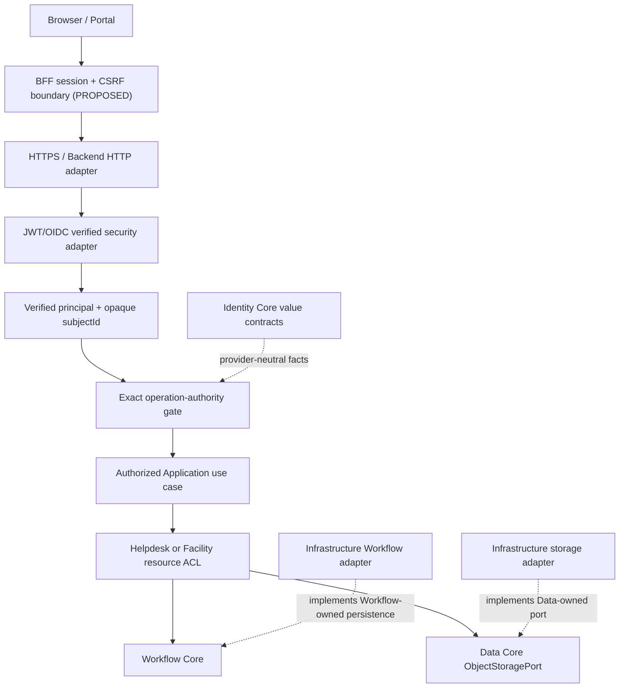
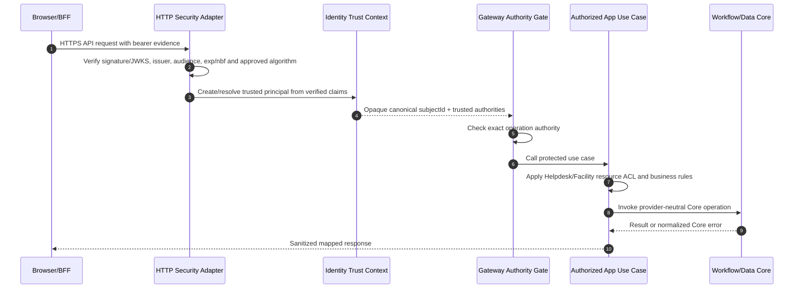

# Gateway Architecture — Trust, Dependencies and Authorized Execution

> **Evidence semantics.** **OBSERVED** means the cited file was inspected at the exact pinned SHA; **SELECTED** means the user explicitly approved a documentation design direction; **PROPOSED** marks a target component, policy, test or diagram; **VERIFIED** requires an actually executed check with exact-SHA logs and reviewer assessment. No Gateway security tests were executed for this document. No independent review or Gate approval is claimed.

## 1. Purpose and authoritative boundaries

**AS-IS / IMPLEMENTED:** the inspected source has Spring Boot HTTP-facing Gateway code and Backend security components; no APISIX integration is established. **TO-BE / PROPOSED:** Apache APISIX performs edge exposure, routing, and coarse security policy before requests reach Spring Boot. The Backend independently verifies a trusted principal and enforces exact operation authority and Application-owned resource eligibility. A different edge proxy may replace APISIX only after routing, header provenance, denial, TLS, and failure conformance checks. Neither an edge allow decision nor a JWT's presence grants Helpdesk resource access.

**SELECTED:** Define the logical Gateway seam, protected HTTP runtime path, principal provenance, exact operation authority, Application resource ACL, fail-closed trust boundary, and cross-capability handoff. This is architecture guidance, **not** a replacement canonical Gateway API or verified deployed topology.

**OBSERVED pinned contracts:**

| Reference | Blob SHA | Meaning / maturity |
| --- | --- | --- |
| [Identity Core contract](https://github.com/lexuanbao258-collab/dxos-open-core/blob/0f0c3ba0c3eecda0a5c4a798a3cc14b808351bed/docs/contracts/identity-core.md) | `8b6a6f412cf405709e85839f2bbe9021149ba33e` | Provider-neutral Identity facts; constructing a principal/context does not authenticate |
| [Workflow Core contract](https://github.com/lexuanbao258-collab/dxos-open-core/blob/0f0c3ba0c3eecda0a5c4a798a3cc14b808351bed/docs/contracts/workflow-core.md) | `11c5aaca1e7e08394710a6d0c5fe8e187d549d83` | Workflow controls state transitions; `ActorReference` does not establish trust |
| [Core/Application boundary draft](https://github.com/lexuanbao258-collab/dxos-open-core/blob/0f0c3ba0c3eecda0a5c4a798a3cc14b808351bed/docs/01-architecture/core-application-boundary.md) | `697ccaa4818bb45829496a34b20c72a91af4125b` | **PROPOSED — REVIEW REQUIRED**; browser/BFF/HTTP/use-case diagram is not proof of runtime integration |
| `docs/contracts/gateway-core.md` | Not established at checked path | **UNVERIFIED / NOT FOUND** at source pin; never invent a canonical Gateway contract |

**Source commit:** `0f0c3ba0c3eecda0a5c4a798a3cc14b808351bed`. Precise Gateway classes, route inventory, verified principal adapter and exact authority mapper were **not established by the above file inspection**. Their discovery is a P0 source-review prerequisite, not a guessed implementation claim.

## 2. Logical architecture and component diagram

The backend is a Spring Boot **modular monolith**; a Gateway *logical seam* does not require a separate Gateway microservice. The Portal/BFF may form a separate browser-facing deployment boundary. Actual topology remains evidence-dependent.



**PROPOSED diagram:** arrows express desired runtime delegation. Java source dependencies point **from adapters to capability-owned interfaces**, never from Workflow or Identity Core to Spring Security, Keycloak, HTTP, JPA, provider clients, or business-specific Helpdesk/Facility types.

## 3. Dependency and ownership matrix

| Layer | Owns | Must not own / import | Evidence requirement |
| --- | --- | --- | --- |
| Browser/Portal | UI and initiating session interactions | Trusted subject from user-editable header; server secrets | Source + CSRF/PKCE browser test |
| BFF (target) | Browser session, OAuth callback/session cookies, CSRF controls and delegated API calls | Unvalidated principal facts; bypass of backend checks | Real BFF route and cookie/CSRF proof |
| HTTP/Security adapter | Signature/JWKS, issuer, audience, expiry, algorithm and claim verification based on accepted config | Fabricated principal, permissive failure fallback | Config, negative token suite, sanitized logs |
| Identity Core | Provider-independent `AuthenticatedPrincipal`, `AuthenticationContext`, authority/decision values | OIDC SDK/client and JWT parsing | Contract pin, dependency audit |
| Gateway seam | Trusted-context propagation and exact authority enforcement at protected entrypoint | App-specific approval policy; direct unguarded Core writes | Exact Java mapper/route-to-use-case inventory |
| Application | Ticket/Facility ownership, assignee/approver, attachment ACL | Credential verification based on headers or object key possession | Positive + negative ACL E2E |
| Workflow Core | Workflow invariant checks and Workflow-owned persistence contract | JWT verification, Identity dependency, Helpdesk actor roles | Source import audit and unauthorized state checks |
| Data Core | Object storage provider-neutral contract | Business object authorization and Keycloak | Storage authorization negative E2E |

Identity Core `AuthenticationContext` and `AuthenticatedPrincipal(authenticated=true)` only represent facts after verification at a trusted security boundary; Java object construction itself does **not** establish authentication. Workflow `ActorReference` is opaque and does **not** authorize a transition.

## 4. Positive request sequence — target behavior



This is **PROPOSED**. Actual token extractor, supported JWT claims, mapped authorities, status codes, service method names and endpoint routes require exact source/test inspection. Do not claim successful E2E merely from this sequence.

## 5. Denied request sequence and zero-side-effect rule

```mermaid
sequenceDiagram
  autonumber
  participant E as Untrusted Caller
  participant H as HTTP Security Adapter
  participant G as Exact Authority Gate
  participant A as App ACL
  participant C as Workflow/Data Core
  E->>H: Invalid/forged token or X-Role/X-User header
  H-->>E: Authentication rejection; ignore untrusted identity headers
  Note over G,C: No protected application/Core mutation
  E->>H: Valid verified token, insufficient operation permission
  H->>G: Trusted principal
  G-->>E: Permission denied
  E->>H: Valid token and operation permission, forbidden resource
  H->>G: Trusted principal
  G->>A: Authorized operation category
  A-->>E: Resource ACL denied
  Note over A,C: No successful Workflow history or unauthorized object change
```

**SELECTED security policy:** every denial path must avoid successful transition/history writes, data disclosure or unauthorized object modifications. Verify negative side effects from authoritative state rather than assuming a 401/403 response proves absence of mutation.

## 6. Trust and authority provenance

**OBSERVED Identity contract:** a subject ID is an opaque provider-independent value, not automatically an email/username/Keycloak account name. `AuthenticationContext` is an opaque reference, not a raw access token or proof. User-supplied `X-User`, `X-User-Id`, `X-Role`, `X-Authorities` cannot become trusted identity facts. Missing, invalid and expired authentication contexts are distinct; normalized mapping for **missing** context remains open in the Identity contract.

**SELECTED source-verification rule:** document each **actual** operation-authority string by locating the relevant operation mapper, verified-claims converter, protected handler and enforcement tests. Do not infer implicit wildcards or privileges from broad role names.

| Candidate operation authority | Claim status | Required evidence |
| --- | --- | --- |
| `workflow:create` | CANDIDATE; runtime mapping NOT VERIFIED HERE | Exact source enum/mapper and create-route denial test |
| `workflow:activate` | CANDIDATE; runtime mapping NOT VERIFIED HERE | Exact source mapper and activation-route denial test |
| `workflow:transition` | CANDIDATE; runtime mapping NOT VERIFIED HERE | Protected transition plus resource ACL and stale-version evidence |
| `workflow:read` | CANDIDATE; runtime mapping NOT VERIFIED HERE | Read/history IDOR and operation authority check |

No candidate string is asserted to be a confirmed active endpoint mapping at this pinned SHA. Business resource ACL cannot be replaced by a generic operation authority.

## 7. Token validation, browser and deployment boundaries

**PROPOSED verification controls:** validate accepted issuer, audience, signature and JWKS key provenance, token validity times (`exp` / `nbf` as applicable), configured algorithms, and any chosen client/scopes according to the actual security configuration. Reject malformed, unsigned, expired, wrong-issuer, wrong-audience and attacker-forged tokens. **Decoding claims is not verification.** Cache/JWKS refresh and bounded clock skew need documented policy and tests, not a blanket claim that all identity-provider outages deny existing valid tokens or permit fail-open behavior.

For browser-based access, distinguish **OAuth Authorization Code + PKCE S256**, confidential BFF credentials, secure cookie flags, session fixation/callback validation, CSRF and redirect URI policy from a backend resource server's bearer-token verification. Source and deployment evidence must identify where each actually runs. If HTTPS ingress/reverse proxy is present, trust forwarded headers only from explicitly configured upstreams.

## 8. HTTP/error and failure taxonomy

| Outcome | Responsible boundary | Target response behavior | Verification |
| --- | --- | --- | --- |
| Missing/invalid/expired JWT | Authn/security adapter | Reject; 401 is a candidate standard mapping, not confirmed code | Token negative test |
| Valid token, missing exact authority | Gateway/authorized boundary | Permission denied; 403 candidate | Authority negative test |
| Valid token, forbidden resource | Application ACL | Deny without successful state/data change; 403/404 masking is policy OPEN | IDOR and no-mutation proof |
| Invalid transition/version conflict | Workflow Core + transport mapper | Preserve business/concurrency semantics | Core test + HTTP mapping |
| Missing object or storage conflict | Data Core + transport mapper | Provider-neutral failure mapping | Storage/HTTP integration |
| JWKS/IdP/HTTP unavailable | Trusted security adapter/transport | No unverified principal is admitted; safe behavior on cached valid keys policy-dependent | Failure injection |
| Unexpected internal/provider failure | Adapter/transport | Sanitize status/body/logs, no JWT/secrets/SQL leakage | Error redaction probe |

The source documents do not establish a universal status mapping or precedence for mixed errors. No such precedence is invented here.

## 9. Gateway threats and negative acceptance matrix

| ID | Threat | Trust control / expected negative result | Required evidence | Status |
| --- | --- | --- | --- | --- |
| GA-01 | Invalid or expired JWT | No authenticated principal or protected use case | HTTP security E2E, route logs | NOT RUN |
| GA-02 | Wrong signature, issuer, audience or algorithm | Reject forged/misdirected evidence | JWT matrix incl. JWKS | NOT RUN |
| GA-03 | X-Role/X-User spoof | Ignore forged headers; anonymous remains anonymous | HTTP negative suite | NOT RUN |
| GA-04 | Constructed `authenticated=true` principal | Direct construction does not bypass trusted adapter | Trust provenance test | NOT RUN |
| GA-05 | Missing exact operation authority | Deny, no successful Workflow/Data side effects | Per-operation authority probes | NOT RUN |
| GA-06 | Helpdesk ticket IDOR | Deny cross-resource read/transition; no history entry | App ACL E2E + DB | NOT RUN |
| GA-07 | Facility approver impersonation | Deny unauthorized approval/use case | Facility E2E + DB | NOT RUN |
| GA-08 | Direct unguarded Core route/bypass | No exposed unprotected alternate mutation path | Route inventory + negative bypass | NOT RUN |
| GA-09 | Data `ObjectKey` IDOR | Deny unauthorized object read/delete | Data ACL + before/after object | NOT RUN |
| GA-10 | Token/JWKS outage and clock skew | Policy-respecting fail-closed trust, no unverified admission | Controlled outage and clock tests | NOT RUN |
| GA-11 | Browser CSRF/session attack | Correct cookie and CSRF/PKCE separation | Browser/BFF E2E | NOT RUN |
| GA-12 | Secret/PII/token leakage | Sanitized errors and correlated limited logs | Redaction/observability review | NOT RUN |
| GA-13 | Replay/stale Workflow request | Valid identity still subject to Workflow version invariants | Concurrent/state/history test | NOT RUN |
| GA-14 | Misleading audit as successful history | Denial can be audited but does not create transition record | Audit/history correlation test | NOT RUN |

**P0 threats:** acceptance of client-forged identity, missing trusted-subject provenance, bypass around authorized Application seam, IDOR, role/authority wildcard escalation, and secret leakage. Tests that merely inspect frontend button visibility cannot close these blockers.

## 10. Correlation, auditing and safe observability

**SELECTED target:** propagate correlation identifiers across BFF/HTTP/Gateway/Application/Core; record minimal identity/operation/decision facts without dumping bearer tokens, refresh tokens, credentials or unnecessary PII. Authentication/authorization **decision logs**, Application audit records and Workflow's **committed successful transition history** are different artifacts. On denial, no successful Workflow transition record should exist. Logging format, retention, access controls and event pipeline are pending design/evidence.

## 11. Reusability: Helpdesk and Facility

**PROPOSED verification:** both Applications use a **shared verified-principal/operation-authority seam**, retain different resource policies, and execute on the same unchanged Core SHA. A ticket technician's permission must not magically authorize a Facility approver role, and vice versa. Collect separate positive and denied-no-mutation tests per Application. A single login demonstration does not prove two-App reuse.

## 12. Source → threat → test → evidence → reviewer

| Requirement | Source basis | Test selector/evidence needed | Reviewer | Current disposition |
| --- | --- | --- | --- | --- |
| GWA-01 Dependency isolation | Identity/Workflow contracts; proposed boundary | Import/route inventory pinned to SHA | Architecture/Backend | SOURCE DOC OBSERVED; RUNTIME NOT VERIFIED |
| GWA-02 Principal provenance | Identity contract | Verification adapter trace + forged principal test | Identity/Security | NOT RUN |
| GWA-03 JWT/OIDC trust | Source configuration to inspect | Token negative matrix + JWKS/issuer/audience | Security | NOT RUN |
| GWA-04 Authority exactness | Operation mapper to locate | Per-operation negative test | Backend/Security | SOURCE MAPPING OPEN |
| GWA-05 Business ACL | Architecture draft; Application source to inspect | Helpdesk+Facility IDOR and deny-no-mutation | Application/Security | NOT RUN |
| GWA-06 Bypass prevention | Route inventory to inspect | Direct/alternate entrypoint probes | Backend/Security | NOT RUN |
| GWA-07 HTTP/BFF/CSRF | Proposed Portal/BFF boundary | Cookie + PKCE + CSRF + HTTPS E2E | Frontend/Security | NOT RUN |
| GWA-08 Failure and logging | Identity contract and proposed security policy | IdP outage, clock skew, sanitized logs | Operations/Security | NOT RUN |
| GWA-09 Core delegation | Workflow/Data source contracts | Authorized use case call path and history proof | Backend/Application | NOT RUN |
| GWA-10 Two-App reuse | Proposed shared seam | Same Core SHA + separate Helpdesk/Facility policy results | Independent reviewer | NOT RUN |

For every execution evidence packet: record exact SHA/branch, JDK/Gradle and provider versions, HTTP route/authority, trust configuration (redacted), test command/selector, exit code, JUnit XML, logs, before/after business/Workflow state, reviewer, and verdict. No evidence count or test PASS is supplied by this architecture draft.

## 13. Open design decisions and independent Gates

| Gate | Required decision/evidence | Status |
| --- | --- | --- |
| G4-D Design | 18 authoring decisions and trust diagrams reviewed | DRAFT / NOT REVIEWED |
| G4-S Source | Exact Gateway code, authority mapper and route inventories pinned | OPEN |
| G4-A Authentication | JWT/OIDC verification negative tests | NOT RUN |
| G4-Z Authorization | Exact authorities, business ACL, deny-no-mutation | NOT RUN |
| G4-T Security | Forged headers, IDOR, bypass, JWKS outage, sanitized logs | NOT RUN |
| G4-E E2E | Actual browser/BFF/HTTPS/HTTP/use-case/Core path | NOT RUN |
| G4-R Reuse | Helpdesk and Facility policy split, unchanged Core | NOT RUN |
| G4-I Independent | Named reviewers, traceable artifacts, acceptance verdict | NOT APPROVED |

**Open items:** production-class route matrix and principal adapter path; accepted JWT token claim/authority extraction; missing-identity-context error mapping; BFF session/CSRF deployment; JWKS caching/outage policies; exact HTTP transport mapping; audit minimization; upstream proxy header trust; actual independent acceptance evidence.

**Final disposition:** `G4-F25 DRAFT / NOT REVIEWED`. SELECTED architectural design and OBSERVED canonical text do not imply deployed runtime or passing tests.
