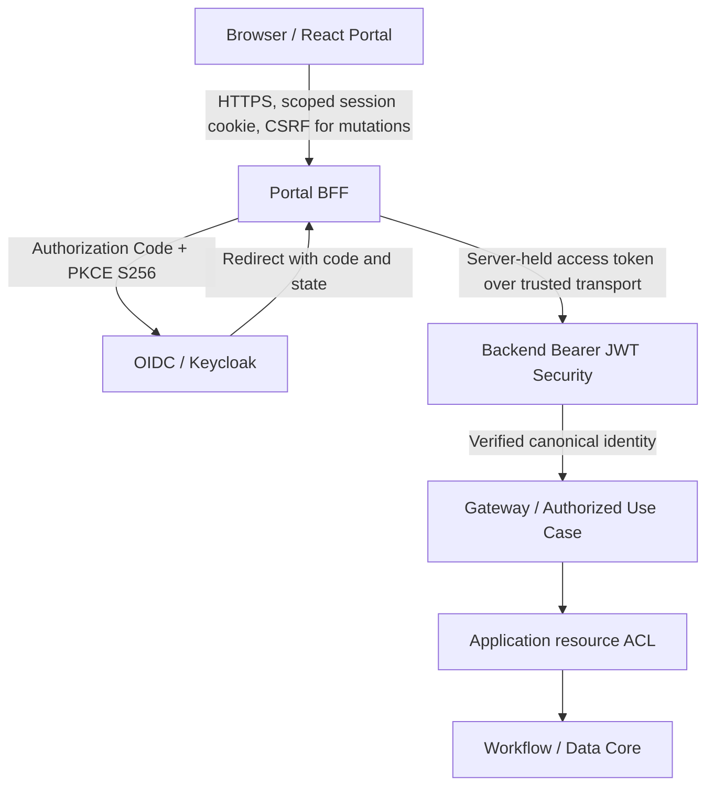
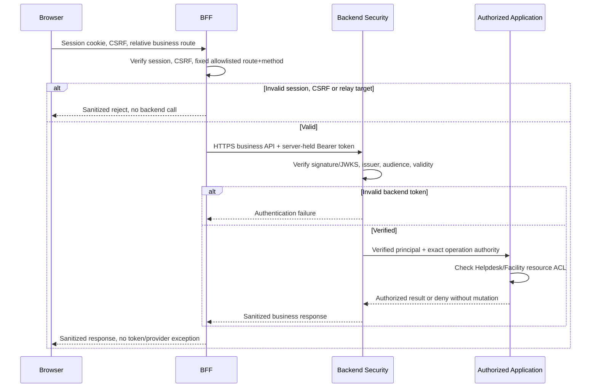

# Gateway — BFF Integration, Browser Trust and Backend Handoff

> **Evidence language:** **OBSERVED** = inspected at pinned SHA; **SELECTED** = approved design choice for documentation; **PROPOSED** = implementation, security policy or test obligation; **HISTORICAL** = test or PR mentioned by a source without rerun; **VERIFIED** = current exact-SHA test evidence with command, log and review. **No tests have been run for G4-F29; no Gate has been approved.**

## 1. Purpose and source authority

**SELECTED:** Document BFF architecture, OAuth Authorization Code + PKCE S256, session/cookie and CSRF, callback and token custody, allowlisted relay, backend verified principal, failure behavior, threat tests and evidence. This does **not** create a new Core capability, API endpoint, token/session implementation or public contract.

Pinned commit: `0f0c3ba0c3eecda0a5c4a798a3cc14b808351bed`.

| Source | Exact blob | Authoritative reading |
| --- | --- | --- |
| [Identity Core contract](https://github.com/lexuanbao258-collab/dxos-open-core/blob/0f0c3ba0c3eecda0a5c4a798a3cc14b808351bed/docs/contracts/identity-core.md) | `8b6a6f412cf405709e85839f2bbe9021149ba33e` | **OBSERVED:** provider-neutral Identity; backend bearer JWT verifier, JWT/JWKS and claim validation described in canonical source |
| [Core/Application boundary](https://github.com/lexuanbao258-collab/dxos-open-core/blob/0f0c3ba0c3eecda0a5c4a798a3cc14b808351bed/docs/01-architecture/core-application-boundary.md) | `697ccaa4818bb45829496a34b20c72a91af4125b` | **OBSERVED document, PROPOSED — REVIEW REQUIRED design:** Browser → BFF → HTTP → authorized Application use case; BFF session/CSRF and relay as target |
| [PR #70 Portal BFF](https://github.com/lexuanbao258-collab/dxos-open-core/pull/70) | Not fetched/reviewed in this task | **CANDIDATE in boundary draft**; not proof of merge or current runtime acceptance |
| [PR #71 Portal Integration](https://github.com/lexuanbao258-collab/dxos-open-core/pull/71) | Not fetched/reviewed in this task | **CANDIDATE**; mock/live behavior and deployed SHA remain unverified |

The canonical Identity contract describes a backend API using stateless Bearer JWT authentication, with JWKS, issuer and configured audience validation. A previously reported Keycloak run in the canonical source is **HISTORICAL**, not newly executed. Its filter-chain CSRF behavior does not determine the browser BFF session's CSRF policy. The Core/Application boundary draft uses a different internal baseline and is not an approved implementation statement at the pinned commit.

## 2. Scope, ownership and deployment seams

| Actor/component | Owns | Must not own or assume |
| --- | --- | --- |
| Browser / React Portal | UI navigation and browser session transport | Raw refresh tokens, confidential client secret, final resource authorization |
| Portal BFF | OIDC initiation/callback and token exchange, server-side session/token custody, CSRF, constrained API relay | Identity Core invariants, Helpdesk/Facility resource ACL, arbitrary open proxy |
| Keycloak / OIDC provider | User authentication and issuance of signed tokens | Application ticket permission decisions |
| Backend HTTP security | Independent Bearer JWT validation and trusted principal extraction | Unverified `X-User`/`X-Role` and BFF cookie as standalone API authentication |
| Gateway / authorized Application seam | Operation authority plus delegation to business policy | Unguarded Workflow/Data mutation |
| Helpdesk / Facility Application | Ownership, assignee/approver, tenant/resource ACL and business policy | Assuming BFF route allowlist grants resource access |
| Workflow / Data Core | Their own domain/storage contracts | Browser/OIDC session, public transport routing or authentication proof |

**SELECTED:** The BFF is an HTTP-facing adapter/deployment boundary, not a fifth Core capability or a required independently deployed microservice. Determine actual hostnames, paths, process layout, trust proxy config and network zones from deployment evidence.



**Diagram status:** target/SELECTED, not verification of code registration or E2E behavior.

## 3. Login, callback, session establishment — target sequence

```mermaid
sequenceDiagram
    participant U as Browser
    participant B as Portal BFF
    participant I as OIDC Provider
    U->>B: Begin login (HTTPS)
    B->>B: Create transaction state, PKCE S256 verifier/challenge, nonce if used
    B-->>U: Redirect to allowlisted OIDC authorization endpoint
    U->>I: Authorize (code challenge, state, redirect URI)
    I-->>U: Redirect with code and state
    U->>B: OAuth callback
    B->>B: Validate bound state, redirect context, replay and applicable nonce
    alt Invalid callback
      B-->>U: Reject safely, do not establish session
    else Valid callback
      B->>I: Server-side code exchange with original verifier
      I-->>B: Token result
      B->>B: Validate token/identity per reviewed OIDC policy; rotate session identifier
      B-->>U: Secure scoped HttpOnly session cookie
    end
```

**PROPOSED acceptance requirements:** PKCE S256, one-use/bound `state`, strict redirect URI and host allowlist, nonce verification for OIDC ID token flows where applicable, replay rejection and fresh session ID following authentication. A code exchange failure cannot silently authenticate the browser. Do not conflate ID token validation for the BFF with backend access-token validation; their audiences and uses can differ.

## 4. Token custody and browser session contract

- **SELECTED:** BFF keeps access and refresh tokens on the server; browser receives only a scoped session identifier, never tokens in URL, localStorage, DOM or response bodies. Implementations must verify this with browser network/storage tests.
- **PROPOSED:** cookies configured `Secure`, `HttpOnly`, an explicitly reviewed `SameSite` value compatible with login/callback, bounded idle/absolute lifetime, narrow host/path scope, and session ID regeneration at authentication; prefer host-only cookie rules when feasible.
- **PROPOSED:** session backing store must address secrecy, expiration, cleanup, multi-instance deployment, and concurrent refresh. Cookie flags alone do not make session storage secure.
- **PROPOSED:** invalidate session and locally held tokens at logout, handle provider end-session/revocation when supported, and document limits of previously issued stateless JWT revocation. Do not promise instantaneous universal revocation.
- **PROPOSED:** token refresh is serialized or otherwise race-safe, gated by session validity and bounded retry; failed refresh must not reuse expired credentials as proof of access.

## 5. CSRF and cross-origin boundary

A browser request authenticated by an ambient cookie is exposed to CSRF independent of the backend's stateless bearer API. **SELECTED:** every state-changing BFF browser endpoint requires an explicit CSRF strategy, using a server-validated token and Origin/Referer/site constraints as appropriate. `SameSite` is defense-in-depth, not a complete replacement. Consider login CSRF, OAuth state binding, logout CSRF and cross-origin fetch behavior.

The backend must validate its Bearer JWT independently. A canonical test reporting a successful Bearer POST without CSRF does **not** prove that a browser session route should be exempt. CORS restrictions are not authentication, authorization or an adequate CSRF substitute.

## 6. Protected backend relay and request integrity



**SELECTED relay constraints:** fixed backend origins, method/path allowlist; no arbitrary URL/host/scheme, client-controlled upstream `Host`, HTTP `CONNECT`, unreviewed redirects, SSRF, open proxy or accidental generic Workflow exposure. Drop or overwrite inbound identity/authority headers, hop-by-hop transport headers and unsafe forwarding fields. Only trusted ingress may supply proxy identity/TLS information, using a reviewed proxy chain. Restrict request/response size, timeouts, redirects, content types and streaming according to implementation evidence.

A BFF proxy allowlist is **not** authorization. Backend must independently verify JWT/JWKS issuer/audience/lifetime and dispatch only to authorized use cases. `X-User`, `X-User-Id`, `X-Role`, `X-Authorities`, client actor IDs, and unverified forwarding headers cannot create trusted authority.

## 7. Error classes, outage and revocation constraints

| Failure window | Safe target outcome | Evidence requirement |
| --- | --- | --- |
| Missing/expired browser session | Deny browser relay or restart interactive login by explicit UI policy | Cookie/session negative E2E |
| CSRF token missing or mismatched | Reject state-changing request before backend side effect | 403/selected mapping + no-mutation proof |
| OAuth `state` mismatch / callback replay | Deny callback; do not create or reuse authenticated session | Controlled callback replay test |
| Token endpoint unavailable | Do not establish fake session or leak provider error | Fault-injected login test |
| Backend Bearer 401 | Preserve distinction from browser session and communicate safe reauth path | Relay 401 test |
| Backend operation/resource 403 or concealed 404 | Do not auto-retry privilege escalation or reveal protected resource | ACL negative E2E |
| JWKS unavailable/invalid signature | No acceptance of unverified token; bounded cache policy remains OPEN | Key rotation/outage tests |
| Token refresh failure | Expire/degrade session safely according to documented policy | Refresh failure and concurrency tests |
| BFF relay timeout after unsafe mutation | Outcome may be uncertain; do not blindly repeat write | Before/after authoritative business-state evidence |
| Logout while request in-flight | Enforce session lifecycle/revocation limits without claiming impossible instant kill | Concurrent logout/request suite |

HTTP 401/403/404, retry-after, body formats and browser redirects are **candidate mappings**, not asserted exact-SHA route behavior. Backend resource concealment, Workflow concurrency and Data storage errors retain their owning capability contracts. Secret-bearing exception causes and tokens must never be forwarded.

## 8. Threat register (STRIDE-inspired, provisional)

| Threat ID | Surface / attack | Control | Evidence status |
| --- | --- | --- | --- |
| BI-01 | Callback `state` replay, CSRF login swap | One-use bound state, PKCE, nonce policy | NOT RUN |
| BI-02 | Open redirect via `returnUrl` | Strict URI/host allowlist | NOT RUN |
| BI-03 | Session fixation | Regenerate session on authentication | NOT RUN |
| BI-04 | Cookie theft / insecure browser storage | Scoped Secure/HttpOnly cookie; server-held token | NOT RUN |
| BI-05 | Cross-site request forgery | CSRF token/Origin checking; deny-no-mutation | NOT RUN |
| BI-06 | BFF relay SSRF or open proxy | Fixed upstream plus method/path allowlist | NOT RUN |
| BI-07 | Forged actor and proxy headers | Strip/override untrusted headers; backend bearer verification | NOT RUN |
| BI-08 | IDOR Helpdesk ticket | Exact authority plus Helpdesk ACL | NOT RUN |
| BI-09 | Facility approval impersonation | Separate Facility ACL | NOT RUN |
| BI-10 | Token leakage in URL, HTML, logs | Redaction and browser inspection | NOT RUN |
| BI-11 | Refresh/revocation race | Bounded session expiry and concurrency policy | NOT RUN |
| BI-12 | OIDC/JWKS unavailable / key rotation | Fail closed for unverified trust; reviewed cache behavior | NOT RUN |
| BI-13 | TLS/proxy header confusion | Trusted proxy chain, HTTPS and allowlisted host | NOT RUN |
| BI-14 | BFF relays hidden generic Workflow API | Explicit route exposure and bypass test | NOT RUN |
| BI-15 | Lost backend response after a write | Outcome reconciliation; no blind retry | NOT RUN |

Likelihood and impact scores are **OPEN** pending deployment-specific threat assessment; no fabricated metrics are asserted.

## 9. Two-Application reuse acceptance

**PROPOSED:** using a common BFF/Backend identity chain, demonstrate both (1) Helpdesk requester/assignee authorization and denied other-user read/transition; (2) Facility resource/approver authorization and denied cross-resource approval. Prove no unauthorized row/history/object mutation and compare unchanged Gateway/Identity Core source SHA. Policies remain independently owned by the two Applications. A shared login screen does not prove reuse.

## 10. Contract-to-evidence verification matrix

| ID | Required assertion | Source / test approach | Reviewer | State |
| --- | --- | --- | --- | --- |
| BFF-01 | Authorization Code + PKCE S256 and state-bounded callback | Inspect BFF OAuth config and callback negatives | Identity/Portal | NOT VERIFIED |
| BFF-02 | State mismatch/replay; nonce as applicable | Callback fixture + negative request trace | Security | NOT RUN |
| BFF-03 | Session ID rotation, flags and expiry | Cookie capture without secrets + clock/session tests | Portal/Security | NOT RUN |
| BFF-04 | Access/refresh tokens server-only | Browser storage/network + source scan | Security | NOT RUN |
| BFF-05 | CSRF denied with no backend mutation | Browser forged POST, DB/history comparison | Portal/Security | NOT RUN |
| BFF-06 | Fixed backend relay allowlist; no SSRF | Method/path/upstream adversarial suite | Gateway/Security | NOT RUN |
| BFF-07 | Backend independently verifies bearer JWT | Invalid signature, issuer/audience and token expiry | Identity/Backend | NOT RUN |
| BFF-08 | Forged identity/proxy headers never trusted | Negative request + trusted principal assertions | Security | NOT RUN |
| BFF-09 | Operation authority and Application ACL remain backend-owned | Positive + denied Helpdesk/Facility E2E | Application | NOT RUN |
| BFF-10 | HTTPS/TLS/proxy origin and cookie integrity | Deployment config + browser E2E | Ops/Security | NOT RUN |
| BFF-11 | Session logout, refresh and token failure bounds | Concurrent session and refresh tests | Portal | NOT RUN |
| BFF-12 | Errors sanitized, status distinctions maintained | 401/403/CSRF/timeout/IdP outage matrix | Gateway | NOT RUN |
| BFF-13 | Two-App reuse with no Core change | Combined integration SHA and separate negative ACL | Independent | NOT RUN |
| BFF-14 | No direct Core mutation or generic API escape | Route enumeration and direct bypass probes | Backend/Security | NOT RUN |

Evidence per test: **exact integrated source SHA**, PR commit where relevant, environment/profile and BFF/backend/IdP versions, command/test selector, exit code, JUnit XML or browser trace, sanitized correlation logs, cookie security attributes without session values, before/after authoritative resource state, reviewer and verdict. Treat existing canonical tests as **HISTORICAL** unless independently rerun. Suggested statuses: `NOT RUN`, `BLOCKED`, `INCONCLUSIVE`, `FAIL`, `PASS` (only actual evidence), `HISTORICAL`.

## 11. Review Gates, blockers and open decisions

| Gate | Requirement | Current status |
| --- | --- | --- |
| G4-D Design | Q01–Q18 and trust boundary reviewed | DRAFT / NOT REVIEWED |
| G4-S Source | Exact-BFF and backend code/PR inventory; merged vs candidate | OPEN |
| G4-O OIDC | Real authorization flow, PKCE and callback negatives | NOT RUN |
| G4-X Session | Secure cookie, fixation, logout, refresh | NOT RUN |
| G4-C CSRF | Browser mutations, cross-origin negative tests | NOT RUN |
| G4-L Relay | Allowlists, SSRF, headers, route exposure | NOT RUN |
| G4-T Security | Token leaks, attack surface, fail-closed tests | NOT RUN |
| G4-E E2E | Browser → BFF → backend → Application → Core proof | NOT RUN |
| G4-R Reuse | Separate Helpdesk and Facility policies | NOT RUN |
| G4-I Independent | Named reviewer decision on reproducible evidence | NOT APPROVED |

**P0 blockers:** unverified login trusted as security proof; browser refresh-token exposure; missing callback state validation; CSRF bypass; SSRF/open proxy; fake identity headers; backend accepting unverified tokens; resource IDOR; unprotected direct Core mutation; leaked secrets; undocumented fail-open policy; fabricated E2E PASS/Gate approval.

**Open choices requiring implementation review:** BFF callback URL and host allowlists; PKCE verifier/nonce policy; cookie SameSite/session store/TTL; exact CSRF implementation; token custody/refresh; trusted proxy chain; allowlisted relay patterns; error schemas; Keycloak outage/JWKS caching; logout/revocation expectations; actual PR #70/#71 status and runtime SHA.

**Final status: `G4-F29 DRAFT / NOT REVIEWED`.** This document makes no code changes and confers no test PASS or independent Gate approval.
