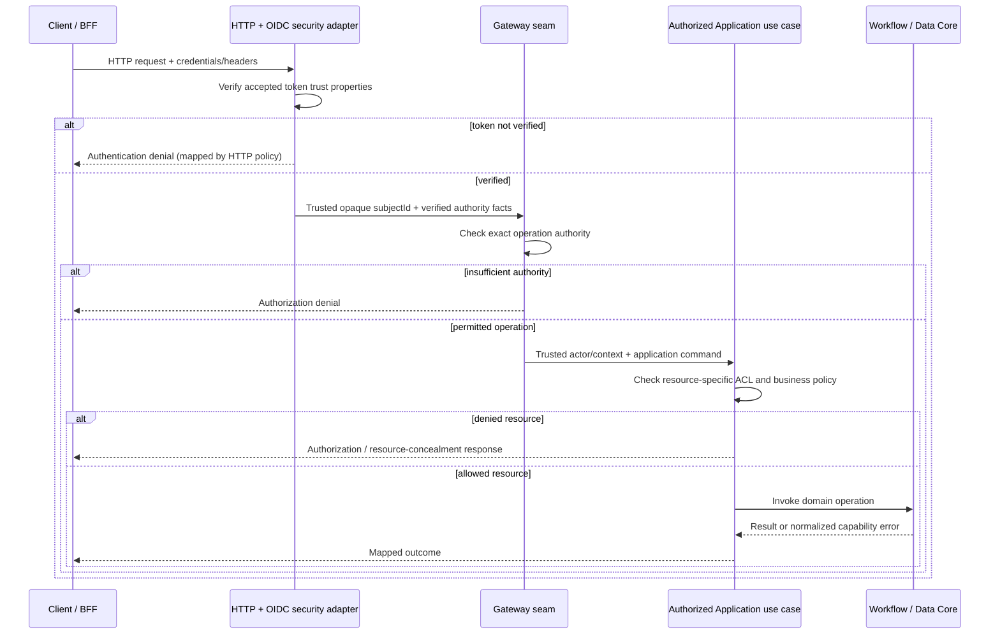

# Gateway Contracts — Trusted HTTP-to-Application Boundary

> **Evidence vocabulary.** **OBSERVED**: directly inspected canonical source at pinned commit. **SELECTED**: user's G4-F26 design decision. **PROPOSED**: required but not yet implemented/verified contract, mapping or acceptance scenario. **VERIFIED**: actual executed proof with exact-SHA commands, logs and review. No new tests were run; there are no VERIFIED test outcomes or approved Gates in this document.

## 1. Purpose, authority and scope

**SELECTED:** Define externally relevant Gateway-facing contracts for authentication provenance, principal transfer, exact operation authority, business-resource authorization, HTTP exposure, failure isolation, browser/BFF separation, security controls, acceptance traceability and independent review. This is a **design/specification document**, not an assertion that a standalone Gateway Java SPI exists, a new API or a retrofit of canonical contracts.

**Pinned commit:** `0f0c3ba0c3eecda0a5c4a798a3cc14b808351bed`.

| Authority | SHA-linked path | Blob / interpretation |
| --- | --- | --- |
| Identity canonical | [docs/contracts/identity-core.md](https://github.com/lexuanbao258-collab/dxos-open-core/blob/0f0c3ba0c3eecda0a5c4a798a3cc14b808351bed/docs/contracts/identity-core.md) | `8b6a6f412cf405709e85839f2bbe9021149ba33e`; **OBSERVED** Identity facts/trust constraints |
| Workflow canonical | [docs/contracts/workflow-core.md](https://github.com/lexuanbao258-collab/dxos-open-core/blob/0f0c3ba0c3eecda0a5c4a798a3cc14b808351bed/docs/contracts/workflow-core.md) | `11c5aaca1e7e08394710a6d0c5fe8e187d549d83`; **OBSERVED** actor and workflow invariants |
| Architecture boundary | [docs/01-architecture/core-application-boundary.md](https://github.com/lexuanbao258-collab/dxos-open-core/blob/0f0c3ba0c3eecda0a5c4a798a3cc14b808351bed/docs/01-architecture/core-application-boundary.md) | `697ccaa4818bb45829496a34b20c72a91af4125b`; file itself says **PROPOSED — REVIEW REQUIRED** |
| Standalone Gateway canonical contract | `docs/contracts/gateway-core.md` | **NOT CONFIRMED at this path**; do not claim canonical status |

**Observed:** Identity Core is a provider-neutral pure contract layer; it does not implement a verifier, routing or Application-specific ACL. Workflow `ActorReference` carries an opaque actor ID from trusted upstream but **does not authenticate or authorize**. The modular monolith's logical Gateway does not establish a separate microservice. Existing boundary documentation is a *proposal*, not acceptance proof.

## 2. Public contracts and ownership — no invented API

| Layer | Source-based/selected responsibility | Out of scope or forbidden assumption |
| --- | --- | --- |
| Inbound HTTP adapter | Route exposure, DTO validation, authentication integration, sanitized transport mapping | Inbound headers as principal proof; direct unguarded workflow mutation |
| Trusted JWT/OIDC adapter | Verify configured signature/key, issuer, audience, lifetime, allowed algorithms; construct trusted principal only after verification | Decode-only acceptance; treating value object construction as verification |
| Identity Core | `AuthenticationContext`, `AuthenticatedPrincipal`, `Authority`, `RequiredAuthority`, `AuthorizationDecision`, `IdentityErrorCode` | Keycloak SDK, Spring Security types or REST routes inside Identity Core |
| Gateway boundary | Trusted-context propagation and exact operation permission at the enforced entry path (**PROPOSED implementation verification**) | Wildcard permission or role expansion not justified by code |
| Authorized Application use case | Helpdesk/Facility ownership, assignee/approver eligibility, attachment/object ACL, actor legitimacy | Trusting `ObjectKey`, `actorId` or request body as authorization |
| Workflow Core | State/transition/persistence invariant; actor reference supplied by trusted upstream | Authentication, JWT parsing, Helpdesk policy |
| Data Core | Provider-neutral `ObjectStoragePort` behavior | Inherent permission conferred by key possession |
| Portal/BFF | Browser session, OAuth, PKCE, HTTPS/CSRF concerns in target architecture | Substitute for backend authorization or unverified production proof |

**Rule:** HTTP adapters depend on stable capability-owned contracts and authorized use cases. Workflow and Identity must not import each other through a claimed Gateway dependency. The Gateway-to-Application authorization seam is mandatory as a design rule; exhaustive route-to-code evidence is **OPEN**.

## 3. Trust origins and transfer obligations

**PROPOSED sequence, not measured runtime.** A structurally valid `AuthenticationContext` or `AuthenticatedPrincipal(authenticated=true)` does not prove real login. The opaque `subjectId` is not necessarily a username, email or DB ID. Authorities must be derived at a legitimately verified trust boundary and propagated without accepting caller-controlled substitution.

**Explicit anti-spoofing invariant:** Treat `X-User`, `X-User-Id`, `X-Role`, `X-Authorities`, and client-specified `actorId` as untrusted unless an independently protected infrastructure boundary establishes a non-spoofable provenance. A client-supplied header alone never creates or overrides a trusted actor. Evidence must show conflicts between forged headers and verified token claims cannot escalate privileges.

## 4. Authentication contract (GC-AUTHN)

| ID | Required invariant | Positive/negative acceptance | Status |
| --- | --- | --- | --- |
| GC-AUTHN-01 | Verified identity precedes creation/use of trusted principal | Valid configured token reaches protected seam; unsigned/invalid signature rejected | PROPOSED / NOT RUN |
| GC-AUTHN-02 | Configured trust policy validates appropriate issuer, audience, key/JWKS, lifetime and accepted algorithm | Wrong issuer/audience, expired, future-not-valid, alg/key mismatch denied; include clock-skew boundary | PROPOSED / NOT RUN |
| GC-AUTHN-03 | Opaque canonical subject and authorities derive from verified claims | Claimed identity cannot be overwritten by client header or request body | PROPOSED / NOT RUN |
| GC-AUTHN-04 | Missing, invalid and expired authentication are distinguishable | Mapping documented without inventing a missing-context Identity Core enum | PROPOSED / SOURCE REVIEW OPEN |
| GC-AUTHN-05 | Trust cannot be established ⇒ protected access denied | Simulate unavailable JWKS/IdP and verify fail-closed under chosen cache policy | PROPOSED / NOT RUN |

The canonical Identity contract specifically leaves **missing-context normalized mapping** to the Identity owner and Gateway consumer; do not fabricate an error code. Key caching/rotation policy, temporal leeway and JWKS outage behavior require actual configuration review. “Fail closed” means a request must not be authorized without sufficient existing valid trust; it does not preclude a deliberately validated, still-trusted cached key.

## 5. Operation authorization and Application ACL (GC-AUTHZ / GC-APP)

**SELECTED decision order** (target): **authenticated trust → exact operation authority → Application resource policy → Core invariants**. This logical order does not silently impose a universal HTTP error precedence for every mixed-failure scenario.

| Candidate workflow operation | Candidate exact authority | Implementation/evidence gate |
| --- | --- | --- |
| Create | `workflow:create` | Inspect operation mapper, claim extraction, service invocation and denied test |
| Activate | `workflow:activate` | Inspect actual protected path and exact-match assertion |
| Transition | `workflow:transition` | Inspect role-to-authority mapping and prevent wildcard/prefix matches |
| Read/history | `workflow:read` | Inspect read endpoints and resource ACL; prevent IDOR |

The strings above are **candidate source-aligned examples only, not independently confirmed runtime mapping at this SHA**. No implicit `ADMIN`, role hierarchy, case-folding, substring or wildcard equivalence is permitted without a separate approved specification and demonstrated implementation.

| ID | Invariant | Required assertion | Status |
| --- | --- | --- | --- |
| GC-AUTHZ-01 | Exact operation authority is necessary | Verified principal lacking exact authority is denied before business mutation | NOT RUN |
| GC-AUTHZ-02 | No unguarded backdoor path | Inventory all route/controller/internal entry paths and prove equivalent protection | SOURCE INVENTORY OPEN |
| GC-APP-01 | Resource authorization is Application-owned | Cross-ticket Helpdesk read/transition denied; no mutation/history | NOT RUN |
| GC-APP-02 | Facility policies differ without changing Core | Unauthorized approver denied on Facility use case | NOT RUN |
| GC-APP-03 | `ObjectKey`/`ActorReference` do not imply permission | Unauthorized object download/delete or forged actor denied | NOT RUN |

**Core semantics remain authoritative:** Workflow still enforces transition legality, expected version and persistence/history behavior; these are not substitutes for authentication or App ACL. Business-owned policy must not move into Gateway or the neutral Core solely to make an HTTP endpoint pass.

## 6. HTTP-facing contracts, errors and transport isolation (GC-HTTP)

| Failure class | Contract-level outcome | Proposed HTTP convention — requires route/source review |
| --- | --- | --- |
| Missing/invalid/expired authentication | Refuse protected operation; no trusted principal | Typically 401, not asserted as current runtime behavior |
| Verified but insufficient authority | Deny use case before mutation | Typically 403 |
| Authenticated but prohibited resource | Deny without mutation; optionally conceal existence per Application policy | 403 or 404 only after reviewed concealment rules |
| Business validation or version conflict | Preserve Core code and persistence invariants | Reviewed 400/409 family mapping as appropriate, **not universal** |
| Provider/internal failure | Sanitize messages and trace/correlate internally | Reviewed 5xx mapping; never leak secrets |

**Transport obligations:** Inventory route/method, protection mode, public exception, required operation authority, Application ACL owner, response schema, request limits, error mapping and testing. Gateway transport DTOs are not automatically the same types as Core Java models. Do not claim an endpoint or status mapping exists merely because this document specifies it.

## 7. Browser/BFF, replay resistance and security failure (GC-SEC)

**SELECTED boundaries:** The browser-facing session/OAuth Authorization Code + PKCE S256 design (where applicable), cookie flags, CSRF, redirect URI and HTTPS ingress are separate from backend bearer JWT validation. A frontend route guard cannot replace server authorization. Never put confidential client secrets into client-side source or treat cookie authentication as CSRF-free. Token replay mitigation, revocation, expiration and caching behavior must be specified in the chosen OAuth deployment model; JWT signature alone is not full replay prevention.

**Threat → required evidence:**

| ID | Threat | Negative assertion | Evidence status |
| --- | --- | --- | --- |
| GC-SEC-01 | Forged role/identity headers | Anonymous and valid-but-low-authority tokens cannot be escalated | NOT RUN |
| GC-SEC-02 | IDOR/resource swapping | Helpdesk/Facility objects of another resource denied; no successful changes | NOT RUN |
| GC-SEC-03 | Direct Controller/Core bypass | All alternate protected mutation paths reject insufficient privilege | NOT RUN |
| GC-SEC-04 | Signature/issuer/audience/expiry/algorithm misuse | Invalid tokens fail closed; decision source traceable | NOT RUN |
| GC-SEC-05 | JWKS outage, rotation, clock skew | Policy-specific outcomes tested with bounded failure injection | NOT RUN |
| GC-SEC-06 | Token replay/CSRF/session confusion | Threat-specific mitigation evidenced at BFF/backend seams | NOT RUN |
| GC-SEC-07 | Sensitive information leakage | No raw JWT, refresh token, credentials or avoidable PII in logs/errors | NOT RUN |
| GC-SEC-08 | Failed/denied action misreported as transition | No successful history on denied mutation; audit may record denial | NOT RUN |

**Telemetry:** Use sanitized request correlation and explicit authentication/authorization decisions, distinguish audit from Workflow history, and minimize personal data. Correlation identifiers are not credentials and must not themselves override identity.

## 8. Gateway contracts and cross-capability exceptions

Gateway conveys authenticated facts to authorized Application paths; it does **not** replace `IdentityErrorCode`, Workflow error contracts or Data's five storage errors. HTTP mapping happens at the transport edge, subject to separate review. Invalid/future/unavailable auth trust cannot be mapped to a successful authenticated context. Workflow `ActorReference` is a domain value, not an authorization receipt. Workflow-only failures do not prove the gateway checked a ticket-level ACL.

**No modifications** to `identity-core.md`, `workflow-core.md`, Java interfaces, authentication filter configuration, HTTP routes, migrations, or runtime deployment are authorized by G4-F26.

## 9. Contract-to-evidence acceptance matrix

| Contract | Canonical basis | Positive / negative test pair | Required evidence | Reviewer | State |
| --- | --- | --- | --- | --- | --- |
| GC-AUTHN | Identity trust + configured verifier (inspection needed) | Good token / invalid signature, iss, aud, exp, key | SHA, config (redacted), filter-test XML and requests | Identity/Security | NOT RUN |
| GC-TRUST | Identity spoofing caveat | Trusted subject / forged header conflict | Source route map; security logs | Security | NOT RUN |
| GC-AUTHZ | Exact operation authority (mapper source pending) | Matching authority / missing or near-match authority | Test method + protected action DB state | Gateway/Backend | NOT RUN |
| GC-APP | App boundary draft | Authorized assignee / IDOR & wrong Facility approver | ACL tests, before/after snapshots | Application | NOT RUN |
| GC-HTTP | Gateway/transport design | Valid DTO / malformed input, unauthorized, conflict | Route inventory and response body schema | Backend | NOT RUN |
| GC-SEC | Threat model | Expected access / spoof/JWKS/replay/secrets negative | Fault-injection logs and checked assertions | Security | NOT RUN |
| GC-EVID | G4-F26 decision process | Helpdesk and Facility use common seam / denied no-mutation | Exact code SHA, commands, JUnit XML, reviewers | Independent | NOT RUN |

**Evidence states:** `OBSERVED` for inspected source only; `SELECTED` for decisions; `PROPOSED` for unexecuted verification requirements; `HISTORICAL` for older source-reported tests; `NOT RUN`, `BLOCKED`, `FAIL`, `INCONCLUSIVE` for actual status distinctions; `VERIFIED/PASS` requires runnable, reviewable exact-SHA artifacts. Source text describing earlier security tests does not create a fresh PASS in this document.

## 10. Release gates, review blockers, and decisions left open

| Gate | Acceptance condition | Current disposition |
| --- | --- | --- |
| G4-D Design | Q01–Q18 reflected without new canonical APIs | SELECTED / NOT REVIEWED |
| G4-S Source | Complete Gateway code, route, mapper, and runtime boundary inventory pinned | INCOMPLETE |
| G4-N Authentication | Verified token-to-principal provenance incl. negative JWT/JWKS | NOT RUN |
| G4-Z Authorization | Exact authority plus resource ACL with denied no-mutation | NOT RUN |
| G4-H HTTP | Route/DTO/error mappings and public exposure reviewed | NOT RUN |
| G4-T Security | Spoof/IDOR/bypass/replay/secret leakage tested | NOT RUN |
| G4-E E2E | Browser/BFF → backend → authorized use case → Core evidence | NOT RUN |
| G4-R Reuse | Helpdesk and Facility independently demonstrate common seam | NOT RUN |
| G4-I Independent | Named reviewer signs pinned evidence and blocker resolution | NOT APPROVED |

**P0 blockers:** fabricated canonical Gateway API; accepted client identity headers; trusted principal constructed without verification; unprotected business mutation; missing exact authority or policy check; IDOR; unsafe error disclosure; token leak; fail-open acceptance without trusted security evidence; unsupported E2E/PASS claim.

**Open decisions:** exact Java gateway implementation, route/authority-map inventory, missing authentication context error mapping, issuer/audience/key-caching policy, bearer and BFF token/session design, replay mitigation, resource concealment, HTTP error schema, negative E2E fixtures, independent sign-off. Changes to existing capability contracts require separate owner approval, compatibility review and ADR.

**Final status:** **G4-F26 DRAFT / NOT REVIEWED**, with no executed test PASS and no approved Gate.
