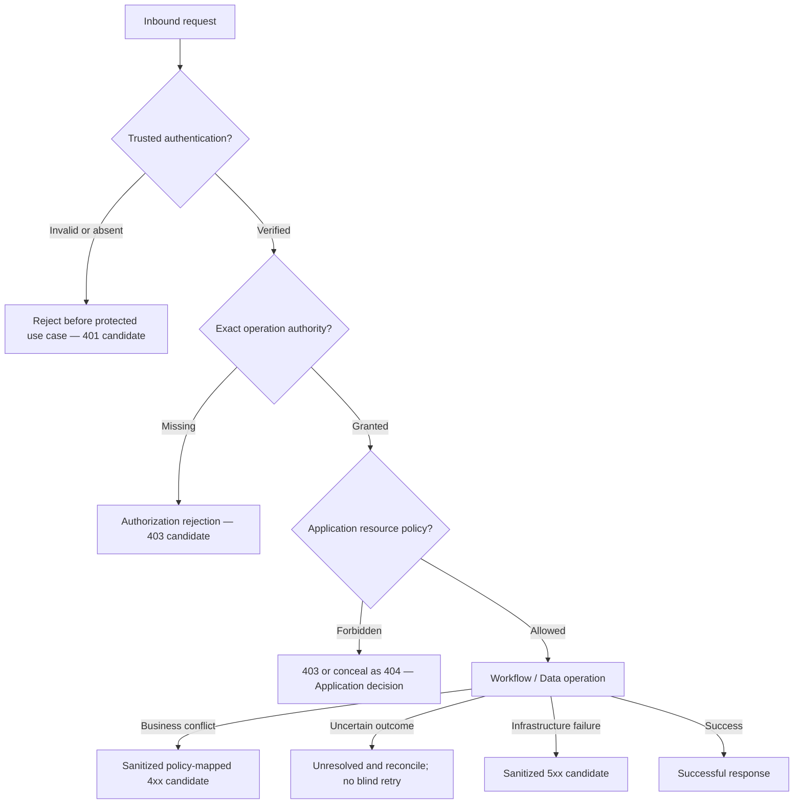

# Gateway Error Handling — Contract-to-Evidence Specification

> **Evidence taxonomy:** **OBSERVED** means inspected at the exact source SHA; **SELECTED** means the user's accepted design direction; **PROPOSED** means a target policy/implementation/test obligation; **HISTORICAL** means the canonical source describes a prior test not rerun here; **VERIFIED** requires a real exact-SHA execution record. **No tests were executed for this document. No independent Gate is approved.**

## 1. Scope, authority, and non-goals

**SELECTED:** Specify Gateway-facing error ownership, taxonomy, HTTP translation, trust and resource concealment, propagation of Core semantics, recovery, browser/BFF errors, safe response/logging, and proof requirements. This is an **architecture-level error boundary**, not an amendment to any Core enum or an assertion that every mapping is implemented.

| Exact-SHA authoritative reference | Source blob | Evidence status |
| --- | --- | --- |
| [Identity Core](https://github.com/lexuanbao258-collab/dxos-open-core/blob/0f0c3ba0c3eecda0a5c4a798a3cc14b808351bed/docs/contracts/identity-core.md) | `8b6a6f412cf405709e85839f2bbe9021149ba33e` | OBSERVED provider-neutral errors, safe Bearer-401 description; Gateway 403/404 left to consumers |
| [Workflow Core](https://github.com/lexuanbao258-collab/dxos-open-core/blob/0f0c3ba0c3eecda0a5c4a798a3cc14b808351bed/docs/contracts/workflow-core.md) | `11c5aaca1e7e08394710a6d0c5fe8e187d549d83` | OBSERVED Workflow error ownership, precedence for specified operations, unknown commit semantics |
| [Data Core](https://github.com/lexuanbao258-collab/dxos-open-core/blob/0f0c3ba0c3eecda0a5c4a798a3cc14b808351bed/docs/contracts/data-core.md) | `99b6ad1d67b2e8d730f13b7a082659e4c4e75b3d` | OBSERVED five storage codes; no universal precedence invented |
| [Core/Application Boundary](https://github.com/lexuanbao258-collab/dxos-open-core/blob/0f0c3ba0c3eecda0a5c4a798a3cc14b808351bed/docs/01-architecture/core-application-boundary.md) | `697ccaa4818bb45829496a34b20c72a91af4125b` | OBSERVED document, but **PROPOSED — REVIEW REQUIRED**; HTTP mapping is a candidate |

**Source pin:** `0f0c3ba0c3eecda0a5c4a798a3cc14b808351bed`. Exact Java handler/route inventory, runtime error JSON, and current execution logs have **not** been independently established for this document. Do not treat draft mapping as a published HTTP API. No production code, flyway migration, or canonical contracts are changed.

## 2. Error ownership and containment

| Owner | Owns | Must not do |
| --- | --- | --- |
| Identity Core | `IdentityErrorCode` / `IdentityException`, provider-neutral authentication identity failures | Introduce HTTP status or Keycloak exception types in pure Core |
| Workflow Core | `WorkflowErrorCode` / `WorkflowException`, transition and persistence outcomes, operation-specific precedence | Have Gateway replace `COMMIT_OUTCOME_UNKNOWN` with rollback/success |
| Data Core | `StorageErrorCode` / `StorageException`, object operation errors | Pass through raw SDK/IO exceptions, or adopt Workflow error codes |
| Helpdesk / Facility Application | Resource-ownership/access concealment, business rules, reconciliation decisions | Delegate ticket-level access policy to a generic error mapper |
| Gateway HTTP/security adapter | Safe response shape, authentication/authorization transport behavior, correlation and error translation | Modify Core failure semantics or reveal hidden resource existence |
| BFF | Cookie/session/CSRF/OAuth callback boundary; sanitize and relay backend errors appropriately | Treat backend 401 as unconditional re-login, or replace backend authorization |

## 3. End-to-end error flow



The **ordering above is the intended protected-business-request pipeline**, not a new universal error precedence algorithm; actual Spring filter/handler order and operation-specific Core precedence must be tested.

## 4. Proposed HTTP classification matrix — NOT verified runtime

| Boundary condition | Candidate HTTP representation | Required behavior / caveat |
| --- | --- | --- |
| Missing/invalid/expired authentication | 401 | Reject before protected resource lookup; Identity canonical source describes safe Bearer 401 for its current API boundary |
| Verified principal lacks exact operation authority | 403 | Deny without business mutation; exact matching, no wildcard assumption |
| Authenticated actor denied a specific resource | 403 **or policy-based 404** | Application decides concealment consistently; no IDOR/existence leak |
| Resource genuinely absent | 404 candidate | Separate from concealed unauthorized resources internally; do not make existence observable to denied actors |
| Malformed transport DTO / invalid request | 400 candidate | Distinguish HTTP parsing/validation from Domain structural and business errors |
| Workflow invalid transition / stale expected version | 409 or reviewed business 4xx | Do not map every Workflow error to 409; use exact owning contract and business API |
| Data `CONFLICT` | 409 candidate | `CREATE_ONLY` failure preserves existing object content and metadata |
| Data `NOT_FOUND` | 404 candidate, subject to Application ACL | Object absence is not automatic permission to disclose key/reference |
| Data `INVALID_INPUT` | 400 candidate | Data validation is distinct from Workflow structural exceptions |
| Data `UNAVAILABLE` or internal dependency failure | sanitized 5xx candidate (e.g., 503 if reviewed) | Never leak SQL, credentials, SDK exception or provider cause |
| Data `ACCESS_FAILURE` | policy-specific protected/internal error | Provider permission failure does not automatically equal *caller* 403 |
| Workflow `COMMIT_OUTCOME_UNKNOWN` | explicit reviewed non-success response; unresolved state | Never label rollback, confirmed failure or safely retryable; preserve reconciliation controls |
| Unmatched/disabled route | 404 or defined safe denial | No accidental generic Workflow or management endpoint exposure |
| BFF CSRF failure, invalid session, failed OAuth callback | browser-boundary policy-specific 4xx / redirect | Do not conflate with backend workflow/business conflicts |

**PROPOSED:** use stable sanitized error codes/messages and request correlation identifiers. The precise status/message/envelope remains **OPEN until reviewed against actual controllers, `ApiError`, BFF relay, OpenAPI and tests**. Do not invent a committed global HTTP error precedence. A gateway may map errors differently based on endpoint policy, but must not misrepresent source outcomes.

## 5. Preserve capability failure semantics

### 5.1 Identity: missing vs invalid vs expired

The Identity canonical contract differentiates absent authentication context, invalid context and expiry. It explicitly leaves normalized **missing-context** mapping to a future Identity/Gateway decision; no new Identity error enum is defined here. `AuthenticationContext` construction is not authentication evidence. Caller-supplied `X-User`, `X-Role`, `X-Authorities` or actor claims may not establish trust. Observed source describes filter-chain denial and safe `ApiError` 401 tests, but those are **HISTORICAL as reported in source, not rerun here**.

### 5.2 Workflow: errors, concurrency and uncertain commit

Workflow Core defines operation-specific precedence (including atomic activation); the Gateway must **preserve the actual code from the owning operation** and not guess a priority ordering across modules. For Workflow writes, the source distinguishes (a) rejected/no changes, (b) confirmed no commit/rollback, (c) durable success, and (d) `COMMIT_OUTCOME_UNKNOWN`, which can mean an already committed write. A provider exception is not proof of rollback. Reconcile using authoritative instance/history records and the attempted proposal, not blind retry, stale reads or a duplicate ID treated as success. Workflow's atomic instance/history guarantee remains its own contract.

### 5.3 Data: five codes and unknown provider write outcomes

Data Core codes are **exactly** `INVALID_INPUT`, `NOT_FOUND`, `CONFLICT`, `UNAVAILABLE`, `ACCESS_FAILURE`; no `COMMIT_OUTCOME_UNKNOWN` Data code exists. An object write failure may have uncertain effects, and the port does not promise rollback, exactly-once or SQL/object atomicity. Normalize provider faults including lazy reads/closes; do not leak causes. Storage provider `ACCESS_FAILURE` must not automatically disclose or impersonate end-user policy denial. Reconciliation policy belongs outside the port.

## 6. BFF and browser error boundary — PROPOSED

Separate these failure conditions:

| Flow | Negative trigger | Required target behavior |
| --- | --- | --- |
| OAuth callback | Invalid/replayed `state`, redirect mismatch, provider error | No session created; sanitized user-facing flow and correlation |
| Session | Missing/expired/invalid cookie | Deny protected BFF operation; invalidate stale session; avoid token disclosure |
| CSRF | Missing/invalid token on state-changing cookie-auth request | Reject before backend mutation |
| Backend auth relay | Backend returns 401 for rejected Bearer credential | Do not silently elevate principal, retry indefinitely or infer user business denial |
| Backend resource policy | Backend returns 403 or resource-concealing 404 | Relay without leaking resource existence through alternate BFF response |
| Network or IdP/JWKS outage | Inability to establish required trust | Fail closed for unverified requests; nuanced cached-JWKS policies must be documented/tested |

No PR #70/#71 BFF integration is represented as merged/passed solely because the boundary draft references it.

## 7. Sanitized error envelope and observability

**PROPOSED schema sketch — not an implemented `ApiError` or authoritative OpenAPI definition:**

```json
{
  "code": "SAFE_PUBLIC_ERROR_CODE",
  "message": "Safe, non-sensitive description",
  "correlationId": "opaque-request-id"
}
```

Select public codes through a reviewed gateway compatibility policy rather than directly dumping exception class names. Correlation IDs must not encode tokens/PII and must be validated or generated at a trusted boundary. Log a minimal event: request/trace ID, route or operation ID, principal pseudonymous reference if permitted, normalized failure category, policy decision and timestamp. Separate denial/security audit from successful Workflow transition history. Redact raw JWT, refresh tokens, cookies, passwords, JDBC URLs, object-storage credentials, SQL and provider stack traces. Error detail in trusted diagnostics must follow controlled access and retention.

## 8. Error scenarios and source-to-evidence traceability

| ID | Source / requirement | Positive and negative acceptance assertion | Evidence demanded | Owner/reviewer | Status |
| --- | --- | --- | --- | --- | --- |
| EH-01 | Identity trust; source safe-401 description | Valid token reaches protected seam; missing/invalid/expired token stops before use-case lookup | Security filter E2E and request trace | Identity/Security | NOT RUN HERE |
| EH-02 | Exact authority; Application seam | Authority mismatch is denied; no side effect | Route/mapper source, database/history before-after | Gateway/Security | NOT RUN HERE |
| EH-03 | Application concealment | Cross-ticket IDOR yields policy-aligned 403/404, no existence leak | Helpdesk and Facility negative HTTP proof | Application/Security | NOT RUN HERE |
| EH-04 | Workflow errors | Invalid transition and stale version preserve exact normalized errors, no unauthorized mutation | Workflow unit + HTTP adaptation evidence | Workflow/Backend | NOT RUN HERE |
| EH-05 | Workflow unknown commit | Post-commit response loss remains unresolved, no blind retry, reconciliation verified | Fault-injection SQL/history evidence | Workflow/Infra | NOT RUN HERE |
| EH-06 | Data five codes | Each distinct code maps correctly, no cause/stack/token disclosure | Mock/provider fault and HTTP snapshot | Data/Security | NOT RUN HERE |
| EH-07 | Storage uncertain write | Timeout not treated as rollback; current object state reconciled | Provider before-after + resolution log | Data/Infra | NOT RUN HERE |
| EH-08 | BFF session/CSRF | Invalid cookie/CSRF denied before backend write | Browser/BFF E2E and backend side-effect check | BFF/Security | NOT RUN HERE |
| EH-09 | OAuth callback/replay | Invalid or replayed callback cannot establish session | State/redirect/nonce negative test | BFF/Identity | NOT RUN HERE |
| EH-10 | IdP/JWKS outage | Unverified caller denied; no fail-open | Outage/clock policy test logs | Identity/Security | NOT RUN HERE |
| EH-11 | Sanitized envelope | Public response and logs contain neither provider details nor secrets | Envelope/PII scans and source mapping | Gateway/Security | NOT RUN HERE |
| EH-12 | Unknown route/exposure | Disabled/admin/generic routes unavailable to untrusted callers | Enumerated runtime route/profile HTTP tests | Gateway/Independent | NOT RUN HERE |
| EH-13 | Cross-Application reuse | Common transport error contract; Helpdesk/Facility policy decisions differ | Exact-SHA two-App tests | Application/Independent | NOT RUN HERE |
| EH-14 | Dependency failure | DB/provider outage is sanitized; authorized users do not get false success | Controlled fault-injection and logs | Backend/Infra | NOT RUN HERE |

**Verification packet per scenario:** commit SHA, branch, run timestamp, actual endpoint/method and auth setup (with secrets redacted), JDK/Gradle + environment versions, deterministic steps or test selector, exit status, JUnit XML, response body/status, protected resource/history before-after where applicable, correlation ID, reviewer verdict and links to durable evidence. Use **NOT RUN, BLOCKED, INCONCLUSIVE, FAIL, HISTORICAL, PASS** distinctly; `PASS` is reserved for actual matching evidence.

## 9. Security, invariants and P0 acceptance blockers

- **No authentication bypass:** inbound headers, malformed token, disabled route, IdP/JWKS outage or BFF relay must not manufacture trust.
- **No authorization bypass:** authority alone is not resource access; denied requests produce no unauthorized successful business mutation.
- **No unsafe retry:** Workflow uncertain commit and object-store uncertain outcomes require authoritative reconciliation.
- **No sensitive error leakage:** provider/SQL/secret/stack information remains behind infrastructure and trusted diagnostic boundaries.
- **No false universal precedence:** apply owning capability precedence only where specified; transport policy remains distinct.
- **No fake acceptance:** assertions without exact run artifacts remain proposed or unverified.

## 10. Review Gates and open decisions

| Gate | Review evidence | Current status |
| --- | --- | --- |
| G4-D Design | 18 choices and taxonomy checked | DRAFT / NOT REVIEWED |
| G4-S Source | Exact exception handlers, `ApiError`, route inventory, BFF relay inspected | INCOMPLETE |
| G4-N Authentication | JWT/JWKS failures, missing/expired context and 401 | NOT RUN HERE |
| G4-Z Authorization | Exact authority, ACL denial and concealment | NOT RUN HERE |
| G4-C Core mapping | Identity/Workflow/Data code-to-transport preservation | NOT RUN HERE |
| G4-H HTTP | Actual response envelopes/status contract and OpenAPI | NOT VERIFIED |
| G4-T Security | Secret leak, spoof, IDOR, CSRF negatives | NOT RUN HERE |
| G4-F Failure/Recovery | Commit uncertainty, provider/network outage, retry/reconcile | NOT RUN HERE |
| G4-E E2E | Browser/BFF/Backend authoritative side-effect tests | NOT RUN HERE |
| G4-R Reuse | Helpdesk and Facility policy-specific error proof | NOT RUN HERE |
| G4-I Independent | Independent reviewer signs pinned artifact/evidence | NOT APPROVED |

**OPEN**: missing-authentication-context normalization; exact `ApiError`/OpenAPI shape and HTTP mapping; concealment policy per business API; JWT/JWKS outage handling; current exception handler and route coverage; reconciliation workflow; BFF session/callback mapping; cross-App negative evidence; independent reviewer sign-offs.

**Disposition: `G4-F30 DRAFT / NOT REVIEWED`.** This artifact is a reviewed-source-informed design specification, **not** executed test evidence or Gate approval.
