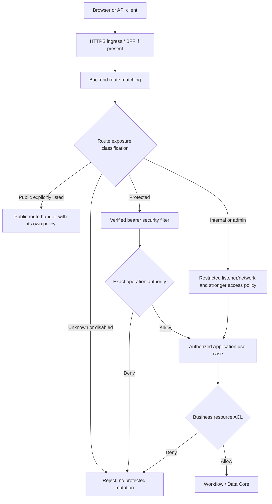
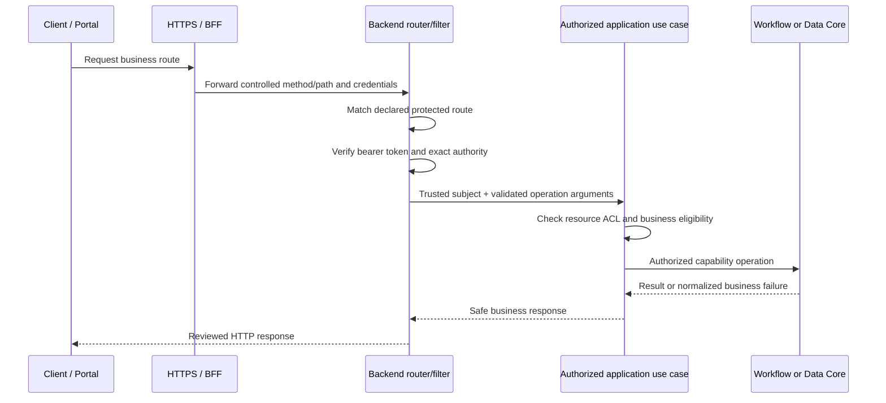
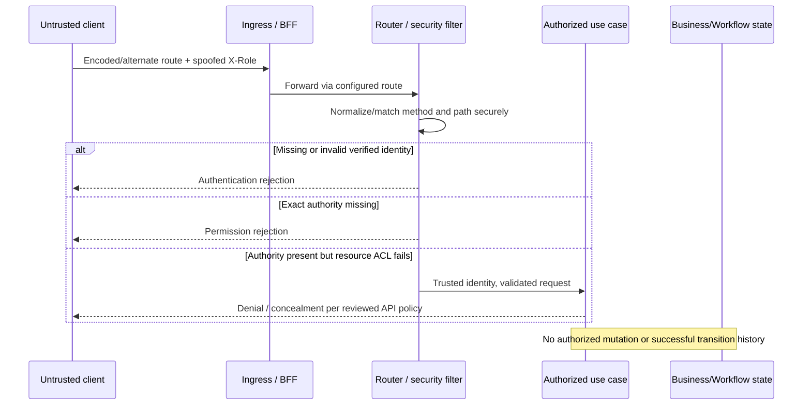

# Gateway Routing Model — Exposure, Enforcement and Evidence

> **Evidence taxonomy:** **OBSERVED** = content directly checked in exact-SHA canonical source/document; **SELECTED** = one of 18 approved documentation choices; **PROPOSED** = target architecture, test, inventory or behavior requiring verification; **VERIFIED** = actual reproducible executed evidence with exact SHA, command, logs and reviewer. **No tests were executed for G4-F27; there are no PASS verdicts or approved Gates.**

## 1. Scope, source pin and source authority

**SELECTED:** Describe ingress-to-business routing, route ownership and classification, route-inventory requirements, security enforcement, bypass threats, operational changes and test evidence. This file does **not** add, enable, or modify an HTTP route, Spring filter, proxy setting, Java API or deployment.

Pinned commit: `0f0c3ba0c3eecda0a5c4a798a3cc14b808351bed`.

| Source | Pinned blob | Source-grounded boundary |
| --- | --- | --- |
| [Core/Application Boundary](https://github.com/lexuanbao258-collab/dxos-open-core/blob/0f0c3ba0c3eecda0a5c4a798a3cc14b808351bed/docs/01-architecture/core-application-boundary.md) | `697ccaa4818bb45829496a34b20c72a91af4125b` | **OBSERVED DOCUMENT; internally PROPOSED — REVIEW REQUIRED**. Recommends business APIs, authorized use cases and restricted/default-disabled generic Workflow API. Its historical baseline field references an earlier commit; do not represent its candidate route inventory as current implementation. |
| [Identity Core canonical contract](https://github.com/lexuanbao258-collab/dxos-open-core/blob/0f0c3ba0c3eecda0a5c4a798a3cc14b808351bed/docs/contracts/identity-core.md) | `8b6a6f412cf405709e85839f2bbe9021149ba33e` | OBSERVED contract: verified identity provenance, spoofed-header rejection, bearer 401 behavior described by canonical source; complete Gateway 403/404 integration remains separate. |
| [Workflow Core canonical contract](https://github.com/lexuanbao258-collab/dxos-open-core/blob/0f0c3ba0c3eecda0a5c4a798a3cc14b808351bed/docs/contracts/workflow-core.md) | `11c5aaca1e7e08394710a6d0c5fe8e187d549d83` | OBSERVED contract: Workflow domain invariants and actor references are not upstream HTTP authentication or authorization. |

**Source evidence limitation:** No exact-SHA comprehensive live route enumeration, Spring MVC handler listing, complete SecurityFilterChain matcher audit, BFF route table or generic Workflow exposure probe has been executed for this artifact. Paths mentioned in a design draft, PR or example are **CANDIDATE / PROPOSED**, not verified active endpoints. A canonical `docs/contracts/gateway-core.md` is not established by the checked sources; this document does not invent one.

## 2. Boundary ownership and dependency direction

| Layer | Owns | Does not own |
| --- | --- | --- |
| HTTPS ingress / trusted proxy | Host routing, TLS, configured upstream routing and trusted proxy header sanitation | End-user ticket-level ACL |
| Portal BFF (if deployed) | Server-held OAuth session, CSRF, browser-facing route allowlist, controlled backend relay | Backend token verification or final resource authorization |
| Backend HTTP/Gateway adapters | Route exposure and method/path matching; verified bearer authentication; transport validation, standardized error envelopes | Workflow state rules, application assignment/retention, database writes by bypass |
| Identity Core | Provider-neutral principal/authority facts and identity errors | HTTP route declaration or JWT provider integration |
| Helpdesk / Facility Application | Business HTTP operation semantics, authenticated use-case orchestration, resource owner/assignee/approver and attachment ACL | Trusting caller-supplied roles or bypassing Core invariants |
| Workflow / Data Core | Capability-owned execution/storage invariants | Browser-facing routing, ticket ACL, OIDC sessions |

**Mandatory security sequence:** verified authentication → exact operation authority → Application resource ACL → capability invariants. Backend enforcement cannot be replaced by CORS, a BFF allowlist or hiding a frontend button.

**Status:** conceptual **PROPOSED** routing model; arrows do not prove runtime wiring or HTTP results.

## 3. Route exposure taxonomy and secure defaults

| Category | Design contract | Verification obligation |
| --- | --- | --- |
| `PUBLIC` | Deliberately minimal explicit allowlist; public does **not** mean unlimited or unsafe input | Verify each method/pattern permitted without auth; no accidental adjacent exposure |
| `PROTECTED` | JWT/OIDC verified at trusted boundary, exact operation authority and Application ACL | Method+path enumeration and negative tests for missing/invalid token, wrong authority and IDOR |
| `ADMIN_INTERNAL` | Deny external exposure; require controlled network/listener, verified administrative authorization and audited change | External ingress probe + internal least-privilege probe; do not rely on name prefix alone |
| `DISABLED` | Default OFF, including generic Workflow API until independently approved | Negative HTTP probe in every intended deployment profile; detect accidental fallback matching |
| `UNKNOWN` | No implicit promotion to protected/public; unmatched routes follow framework behavior and no sensitive operation | Verify 404/405 or intended policy without leaking handler, data or bypassing authorization |

**SELECTED default:** fail closed for unknown exposure and for generic Core mutation routes. A route returning framework 404 is not evidence that all alternate methods, encoded paths, profiles or host mappings are inaccessible.

## 4. Route inventory: required schema and evidence state

**Inventory record schema (required, not currently populated from live handlers):** `route_id`, external host, ingress path, backend method, backend path pattern, actual controller/handler method, source file/line and exact SHA, exposure category, deployed profile/flag, authentication policy, exact authority, Application ACL policy, internal dependency destination, expected 401/403/404/405/409 mapping, test IDs, actual evidence, reviewer and disposition.

| ID | Method and path | Exposure | Handler/authority | Source status | Required proof |
| --- | --- | --- | --- | --- | --- |
| RM-C01 | Business API pattern `/api/v1/mvp/requests` (illustrative Helpdesk candidate) | PROPOSED `PROTECTED` | Handler and exact authority **UNVERIFIED** | **CANDIDATE** in boundary draft; do not assert enabled | Enumerate actual method/route/handler at pinned SHA; auth + ACL negatives |
| RM-C02 | Facility business API(s): **not specified in inspected canonical contract** | PROPOSED `PROTECTED` | To be identified | OPEN / NO VERIFIED ROUTE | Independent Faculty/Facility route/use-case proof; no invented URL |
| RM-C03 | Generic Workflow API (path and methods not independently established) | PROPOSED `DISABLED` by default | No direct Core mutation permitted | PROPOSED policy, runtime unverified | Enumerate controller mappings and assert no exposed bypass across profiles |
| RM-C04 | Authentication/protocol callback or BFF forwarding routes | Policy to determine | BFF/backend handler separation | OPEN | Enumerate hosts, redirect handling, session/CSRF and backend auth |
| RM-C05 | Health/Actuator/Admin/Debug | `PUBLIC`/`ADMIN_INTERNAL`/`DISABLED` only after explicit review | Actual path/method unknown | OPEN | Enumerate and verify least exposure; no assumed Actuator endpoint |

**Do not copy CANDIDATE PR route counts into this table as OBSERVED.** Promote an entry only after checking source mapping, profile-conditioned registration, and actual HTTP exposure at the pinned integrated SHA.

## 5. Safe request routing — positive sequence

This is **PROPOSED**; individual source paths, policy codes and actual end-to-end outcomes are not yet verified.

## 6. Denied/bypass attempt sequence

**Test requirement:** independently inspect authoritative before/after state. A denial response alone is not sufficient to prove no mutation; no real denial test is claimed here.

## 7. Matching, normalization and bypass attack matrix

| ID | Attack surface | Expected negative test assertion | Status |
| --- | --- | --- | --- |
| RM-01 | Unprotected route and unauthorized verb | Unknown routes never execute a protected handler | NOT RUN |
| RM-02 | Duplicate separators, trailing slash, route case | No alternate equivalent path bypasses security matcher | NOT RUN |
| RM-03 | Percent-encoded traversal, encoded slash/dot and double encoding | Ingress, firewall, filter and MVC resolve to consistent authorization outcomes | NOT RUN |
| RM-04 | Wildcard/regex route overlaps and catch-all handlers | Most-permissive matcher never admits a protected handler accidentally | NOT RUN |
| RM-05 | Method override, HEAD, OPTIONS, CORS preflight | Method restrictions preserved; preflight is not business permission | NOT RUN |
| RM-06 | Missing/invalid/expired/forged JWT; `X-User`/`X-Role` | No verified principal or protected mutation from untrusted headers | NOT RUN |
| RM-07 | Verified user without exact authority | Deny before use-case mutation | NOT RUN |
| RM-08 | Verified authority, different Helpdesk/Facility resource | Application ACL denies and state/history remain unchanged | NOT RUN |
| RM-09 | Direct generic Workflow/Core API or alternate admin/debug route | Externally disabled/restricted in every configured profile | NOT RUN |
| RM-10 | Untrusted `X-Forwarded-*`, Host, scheme and prefix | Backend accepts proxy metadata only from configured trusted hops | NOT RUN |
| RM-11 | Oversize body, unsupported content type, malformed DTO | Bounded request handling; no unauthorized mutation | NOT RUN |
| RM-12 | BFF allowlist confusion, open redirect and CSRF | BFF cannot bypass backend auth; session and bearer policies distinct | NOT RUN |
| RM-13 | Unknown/disabled endpoint exposed by feature/profile switch | Fail-closed default; tracked change and regression evidence | NOT RUN |
| RM-14 | Resource existence concealment, 401/403/404/405 confusion | Status/body follow reviewed API and leak no forbidden metadata | NOT RUN |

**Test caution:** framework-specific path canonicalization and matcher behavior must be observed in both ingress and backend runtimes; this document does not assert a particular Spring MVC configuration or normalization algorithm.

## 8. Identity, authority, resource ACL and HTTP mapping

The **canonical Identity contract** explicitly distinguishes provider-neutral identity facts from cryptographic verification. Forged identity headers are never sufficient to authenticate. Exact Workflow authority spellings and their enforcement locations require an actual code/route inventory before they are labeled OBSERVED.

| Condition | Proposed response semantics | Evidence requirement |
| --- | --- | --- |
| No verified authentication | Deny before resource lookup; commonly HTTP 401 | SecurityFilterChain and route negative E2E |
| Verified principal, missing exact operation authority | Deny; commonly 403 | Authority mapper and route test |
| Valid authority, forbidden business resource | Deny or conceal existence according to reviewed Application API, often 403/404 | IDOR deny/no-mutation test |
| Authenticated and authorized business conflict/stale version | Application/Workflow-specific conflict/error, potentially 409 | Business API contract and state checks |
| Unknown path or unsupported method | Framework-reviewed 404/405; no information leakage | Matcher/method matrix |
| Internal/provider errors | Sanitized server response, no provider detail | Failure injection and log inspection |

These are **PROPOSED mappings**, not automatically normative from Core exception enums. No unauthorized actor reference or caller-provided object key may become a trusted access decision on its own.

## 9. BFF, ingress and operational exposure

- **HTTPS and proxy:** validate redirect scheme/host/path, trusted proxy chain, forwarded headers, path prefix rewriting and multiple deployment profiles. The existence of a local HTTPS configuration alone does not establish production routing acceptance.
- **Browser/OAuth:** server-side session and CSRF controls when cookies apply, validated redirect targets, PKCE for applicable OAuth clients; backend bearer validation remains mandatory.
- **CORS/preflight:** distinguish browser cross-origin policy from authentication/authorization. Permissive CORS does not grant Core access; restrictive CORS does not prove backend route protection.
- **Payload controls:** set and verify method-specific accepted content types, request size/body limits, error safety and streaming limits at relevant boundaries; exact thresholds require requirements and tests.
- **Change control:** a new handler, matcher, feature flag, profile, BFF allowlist, reverse-proxy rewrite or Actuator exposure needs a source diff review, classification update and security regression test. Route inventory must be regenerated for the deployed profile.

## 10. Two-Application reuse and ownership

The common Gateway routing/authentication machinery should be reusable across Helpdesk and Facility without embedding Helpdesk-specific role or ticket assumptions. **Application** owns assignment, ownership, approver eligibility, retention and attachment resource access. Demonstrate this with distinct protected business routes, verified principals, exact authority checks, positive and denied cases, and resource state/history evidence for both Applications at the **same integrated Core SHA**. **Status: PROPOSED / NOT TESTED**.

## 11. Route-to-source-to-evidence traceability

| Contract | Source/decision | Required positive and negative proof | Reviewer | State |
| --- | --- | --- | --- | --- |
| RT-01 route inventory accuracy | Source handler list, matcher config, deployed profile | Every external route mapped to method, handler and exposure | Backend/Gateway | OPEN |
| RT-02 protected route enforcement | Identity canonical contract; actual filter config | Authorized request + missing/invalid token negatives | Security | NOT RUN |
| RT-03 exact authority | Application contract + actual mapper to inspect | Allowed/denied operation tests, no implicit wildcard | Identity/Security | OPEN |
| RT-04 business ACL | Core/Application boundary draft | Helpdesk/Facility IDOR deny and no mutation | Application | NOT RUN |
| RT-05 default-disabled generic API | Boundary draft target | Profile/feature flag route enumeration and external probe | Security/Backend | NOT RUN |
| RT-06 path/method bypass resistance | G4-F27 selected requirement | RM-01–RM-05 controlled probes | Security | NOT RUN |
| RT-07 BFF/ingress trust | Proposed deployment boundary | Proxy-header, CSRF, forwarding/host/HTTPS tests | BFF/Infra | NOT RUN |
| RT-08 change control | Operations design direction | Before/after source-diff and route-matcher regression | Backend/Independent | OPEN |
| RT-09 error separation | Identity contract + proposed API semantics | 401/403/404/405/409 and sanitized body matrix | Backend/Security | NOT RUN |
| RT-10 reuse | Selected two-Application obligation | Positive/denied Helpdesk and Facility E2E on common Core SHA | Independent | NOT RUN |

**Evidence package per test:** exact commit and branch; HTTP route inventory and deployed profile; Spring/JDK and ingress/BFF versions; test command, exit code, captured sanitized request/response, test report/JUnit XML, backend before/after resource state and Workflow history where relevant, correlation ID, reviewer, verdict. Never populate PASS from static documentation or old test descriptions.

## 12. Review Gates, blockers and open decisions

| Gate | Required independent acceptance | Current status |
| --- | --- | --- |
| G4-D Design | Choices Q01–Q18 and routing/ownership policy | DRAFT / NOT REVIEWED |
| G4-S Source | Exact-SHA controller, filter, matcher, ingress route inventories | NOT COMPLETED |
| G4-R Routes | Explicit public/protected/internal/disabled classification | NOT VERIFIED |
| G4-N Authentication | JWT/OIDC and forged-header negatives per route | NOT RUN |
| G4-Z Authorization | Exact authority + resource ACL and no-mutation | NOT RUN |
| G4-B Bypass | Encoded paths, verbs, wildcard/profile, direct Core exposure | NOT RUN |
| G4-F BFF/Ingress | HTTPS, forwarding, cookie/CSRF and trust chain | NOT RUN |
| G4-E E2E | Portal/API → backend → authorized use case evidence | NOT RUN |
| G4-U Reuse | Helpdesk/Facility differing policies on unchanged Core | NOT RUN |
| G4-I Independent | Named reviewers and independently checked artifacts | NOT APPROVED |

**P0 blockers:** an externally reachable unguarded mutation route; a generic Workflow API inadvertently enabled; trust in forged headers; any matcher/proxy ambiguity permitting bypass; access to another user's resource; missing current route inventory; fabricated response statuses/evidence; unreviewed exposure change; unresolved security-test failures.

**Open decisions:** live route enumeration at pinned SHA; BFF and ingress deployment inventory; generic Workflow feature flag location and actual default; exact method/authority mapping; unknown route handling, HTTP error contract, proxy forwarding/host validation, content-size limits, two-App endpoint names and real E2E evidence.

**Disposition: `G4-F27 DRAFT / NOT REVIEWED`.** No code, config, endpoints, test outcomes or independent Gate decisions were created by this documentation task.
