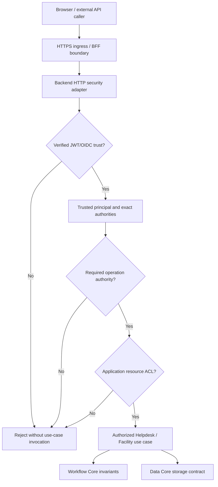
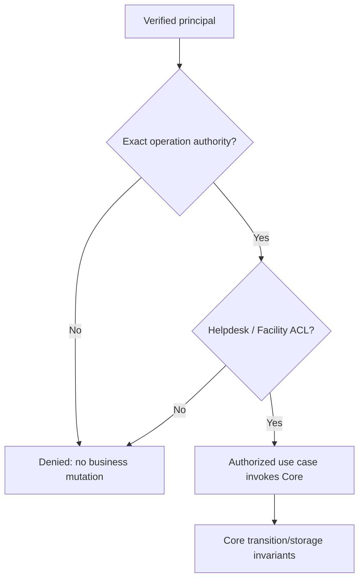

# Gateway Security Model — Trust, Threats, Controls and Evidence

> **Evidence classes:** **OBSERVED** denotes assertions actually inspected in pinned canonical sources; **SELECTED** denotes user-approved documentation choices; **PROPOSED** denotes implementation or testing expectations, not runtime facts; **VERIFIED** requires a real run with exact SHA, command, logs and reviewer. **No tests were run for this artifact; no acceptance Gate is approved.**

## 1. Scope and source authority

**TO-BE / PROPOSED split of controls:** APISIX can terminate TLS and apply edge routing, rate limits, and coarse credential policy, subject to reviewed configuration. Spring Boot remains the trusted-principal and resource-authorization boundary; IT Helpdesk supplies its resource policy. A proxy-supplied identity assertion is accepted only through an explicitly protected, tested trust channel, never from an ordinary client header. Test direct-to-Backend bypass, forged forwarding headers, invalid tokens, route mismatch, and upstream failure before claiming the APISIX deployment secure. These controls are target requirements, not verified integration evidence.

**SELECTED:** Define the security boundaries and threat-driven acceptance obligations for the DX-OS Gateway logical seam, without changing Identity, Workflow or any public Core API. This is a security design document, **not** a claim that all security controls have been deployed.

Pinned commit: `0f0c3ba0c3eecda0a5c4a798a3cc14b808351bed`.

| Source | Pinned blob | Evidentiary meaning |
| --- | --- | --- |
| [Identity Core contract](https://github.com/lexuanbao258-collab/dxos-open-core/blob/0f0c3ba0c3eecda0a5c4a798a3cc14b808351bed/docs/contracts/identity-core.md) | `8b6a6f412cf405709e85839f2bbe9021149ba33e` | OBSERVED: provider-neutral identity types, exact authority semantics, trust warning, header anti-spoofing; also describes historical OIDC/security checks |
| [Workflow Core contract](https://github.com/lexuanbao258-collab/dxos-open-core/blob/0f0c3ba0c3eecda0a5c4a798a3cc14b808351bed/docs/contracts/workflow-core.md) | `11c5aaca1e7e08394710a6d0c5fe8e187d549d83` | OBSERVED: `ActorReference` is not authentication or authorization; Workflow maintains its own invariants |
| [Core/Application boundary](https://github.com/lexuanbao258-collab/dxos-open-core/blob/0f0c3ba0c3eecda0a5c4a798a3cc14b808351bed/docs/01-architecture/core-application-boundary.md) | `697ccaa4818bb45829496a34b20c72a91af4125b` | Document exists but is **PROPOSED — REVIEW REQUIRED**, not an accepted runtime architecture |
| Dedicated `docs/contracts/gateway-core.md` | Not established at this pinned path in earlier inspection | Cannot be treated as a canonical existing Gateway contract |

The Identity contract records a Spring Security filter-chain test and local Keycloak/JWKS observations. These are **HISTORICAL SOURCE REPORTS**; they do not establish current full Gateway → Application authorization, revocation policy or E2E security PASS in this documentation run.

## 2. Trust and dependency boundaries

**Diagram status: PROPOSED target**, informed by canonical contracts. Logical Gateway does not imply its own microservice; HTTP/BFF and identity provider remain distinct trust/deployment concerns. Infrastructure adapters may depend on capability contracts; Workflow Core must not import Identity or Spring Security to authenticate a caller.

| Layer | Owner | Security obligation | Forbidden inference |
| --- | --- | --- | --- |
| Browser / Portal BFF | Frontend/BFF | Session cookie, redirect/PKCE, CSRF, secure HTTPS forwarding and proxy trust as applicable | BFF allowlist/CORS replaces backend authorization |
| HTTP security adapter | Security/Infrastructure | Verify token/JWKS/issuer/audience/time/algorithm as configured, map claims only after verification | Decoding a token or constructing a principal proves authentication |
| Identity Core | Identity | Provider-neutral principal/authority facts and exact matching | Owns Helpdesk ACL, Keycloak SDK, or protected HTTP routing |
| Gateway authorized seam | Gateway / Application boundary | Prevent direct bypass, enforce operation-specific authority | Permission to call an operation grants every resource |
| Helpdesk / Facility | Application owners | Ownership, assignee, approver, attachment/resource ACL; deny without mutation | Core state legality authenticates an actor |
| Workflow / Data Core | Core owners | Domain/persistence/storage invariants per canonical contracts | `ActorReference` or `ObjectKey` grants permissions |

## 3. Authentication proof and principal integrity

**OBSERVED:** `AuthenticationContext` contains an opaque authentication reference; successful construction is structural only. An `AuthenticatedPrincipal(authenticated=true)` is not cryptographic proof. `subjectId` is a provider-neutral opaque subject, not implicitly an email, username or DB primary key. `X-User`, `X-User-Id`, `X-Role`, and `X-Authorities` from callers cannot be trusted as verified identity.

**SELECTED controls / PROPOSED evidence requirements:**

1. Check JWT cryptographic signature via a trusted JWKS/configured key and approved algorithms. Reject `none`, algorithm/key confusion and untrusted issuers; inspect actual security adapter and allowlists before asserting implementation.
2. Validate issuer, intended audience or client claims where required by the configured API contract, expiration and not-before, with bounded reviewed clock skew.
3. Bind canonical subject and granted authority set only to a verified authentication result. Prove a caller header cannot override them.
4. Expired, malformed, forged, wrong-issuer/audience, missing, or otherwise untrusted credentials cannot reach protected use cases.
5. Transport 401 for missing/invalid bearer identity is source-described for an Identity filter chain; exact endpoint coverage, 403/404 policy, and Gateway error formats are **not** generalized from that observation.

## 4. Exact operation authority and business resource authorization

**OBSERVED Identity contract:** `Authority.satisfies(RequiredAuthority)` uses exact authority identifier equality; it does not imply role hierarchy, wildcard, prefix, or case-folding. Workflow `ActorReference` does not authenticate or authorize its actor. **SELECTED:** authorization is layered:

Candidate authority labels such as `workflow:create`, `workflow:activate`, `workflow:transition`, `workflow:read` are **not asserted as independently verified mapping at this SHA**; the actual mapper, operations and routing guards require separate source inventory and negative tests. A role name (including `ADMIN`) is not an automatic wildcard. A valid operation authority does not authorize another user's ticket, unrelated Facility request or object key.

**PROPOSED denial postcondition:** no successful transaction, transition history, object read disclosure or object mutation from a denied request; collect authoritative before/after state. Error precedence and concealment (403 vs 404) require reviewed Application/HTTP contracts.

## 5. Browser, BFF, proxy and token lifecycle

- Browser BFF session cookie security and CSRF protection must be reviewed separately from backend bearer-token validation. A browser cookie may require CSRF defense even when backend JWT bearer requests are not cookie-authenticated.
- OAuth Authorization Code + PKCE S256, redirect allowlists, HTTPS, secure cookie attributes, session expiration/logout and server-side token handling are **PROPOSED verification topics**; this document does not assert exact BFF deployment state.
- Reverse-proxy forwarded host/protocol/identity headers must be accepted only from configured trusted hops; untrusted client-supplied forwarding headers must not alter the security decision.
- Review token expiration, refresh/rotation, claim freshness, revocation requirements, re-authentication and limits of bearer replay protection. A valid JWT does not automatically prove immediate global revocation or proof-of-possession.
- JWKS cache/refresh, key rotation, clock skew, network faults and IdP outage require an explicit fail-closed trust policy. Using already cached, still-valid trusted keys is a separate reviewed choice: unavailability must not cause acceptance of unverified tokens.

## 6. Threat model (STRIDE-inspired)

**Threat likelihood and impact are preliminary qualitative hypotheses**, not measured production risk. Owners must recalibrate from actual route/infrastructure exposure.

| ID | STRIDE category / attack surface | Preliminary likelihood / impact | Required control (PROPOSED) | Negative acceptance assertion | Evidence owner |
| --- | --- | --- | --- | --- | --- |
| SEC-01 | Spoofing: forged bearer signature/issuer | Medium / Critical | Trusted JWT/JWKS and claim validators | Forgery rejected before protected lookup | Identity/Security |
| SEC-02 | Spoofing: `X-Role`, `X-User`, caller actorId | High / High | Only verified principal may supply identity/actor | Spoofed caller cannot gain privilege | Security |
| SEC-03 | Tampering: authority claim escalation | Medium / Critical | Exact verified authority mapper | Missing exact authority denied | Security/Gateway |
| SEC-04 | Information disclosure: Helpdesk IDOR | High / High | Application resource ACL | Other user's ticket cannot be read/changed | Helpdesk/Security |
| SEC-05 | Information disclosure: Facility IDOR | Medium / High | Separate Facility approver/resource policy | Wrong approver denied with no mutation | Facility/Security |
| SEC-06 | Elevation: direct generic Workflow API | Medium / Critical | Secure default OFF/restricted and route audit | No unguarded Core mutation route | Gateway |
| SEC-07 | Elevation: alternate path/method/encoded route | Medium / Critical | Route enumeration and matcher tests | Security cannot be bypassed by path variants | Gateway |
| SEC-08 | Replay: stolen bearer/session | Medium / High | TLS, token/session lifetime and explicit replay policy | Replayed revoked/expired credential denied per reviewed policy | Identity/BFF |
| SEC-09 | Denial: JWKS/IdP outage or key rotation | Medium / High | Trusted cached key policy and fail closed | Unknown/unverified token never accepted | Infra/Security |
| SEC-10 | Information disclosure: JWT/PII in logs | Medium / High | Structured sanitized events, log review | No secrets/tokens in logs or errors | Security/Ops |
| SEC-11 | Tampering: CSRF at BFF cookie endpoints | Medium / High | Session-bound CSRF, SameSite, Origin controls | Cross-site state-changing request denied | BFF/Security |
| SEC-12 | Spoofing: untrusted forwarded headers | Medium / High | Trusted proxy CIDRs and header sanitation | External proxy claims cannot redirect trust | Infra/Security |
| SEC-13 | Repudiation: denied action unaudited | Medium / Medium | Correlation IDs and separate security decision audit | Trace denial without fake Workflow history | Security/Ops |
| SEC-14 | Elevation: ObjectKey used as capability | Medium / High | Application ACL before `ObjectStoragePort` | Object key possession cannot read/delete | Application/Security |
| SEC-15 | Tampering: stale ACL / assignment race | Medium / High | Guarded mutation/transaction policy | Access revoked before write is not bypassed | Application/DB |

Do not interpret this register as proof that all controls exist, or as a substitute for deployed configuration review.

## 7. Testable control invariants and sanitized errors

| Control | Contract/design assertion | Relevant attack IDs | Evidence request | Status |
| --- | --- | --- | --- | --- |
| SM-01 | Only verified token evidence constructs trusted identity facts | SEC-01/02 | JWT negatives, trusted-principal provenance trace | NOT RUN HERE |
| SM-02 | Exactly matching required authority at protected operation boundary | SEC-03 | Mapping inspection and denied operations | NOT RUN HERE |
| SM-03 | App resource ACL remains separate from operation authority | SEC-04/05/14 | Helpdesk/Facility IDOR and object ACL E2E | NOT RUN HERE |
| SM-04 | All mutable routes reach authorized use-case boundary | SEC-06/07 | Actual route inventory, bypass attempts, before/after state | NOT RUN HERE |
| SM-05 | Invalid or uncertain token trust fails closed | SEC-08/09 | Time/JWKS outage/rotation replay matrix | NOT RUN HERE |
| SM-06 | BFF cookie-session and backend bearer security independently protected | SEC-11/12 | PKCE/HTTPS/CSRF/proxy-header checks | NOT RUN HERE |
| SM-07 | Sanitized authn/authz/business/system errors | SEC-10 | 401/403/404 proposal vs observed status, redaction tests | NOT RUN HERE |
| SM-08 | Audit/decision correlation without token leakage or fake history | SEC-10/13 | Logs, redacted trace IDs, Workflow history query | NOT RUN HERE |
| SM-09 | Authorization state checked against stale/concurrent policies | SEC-15 | Assignee/ACL race and deny-no-commit test | NOT RUN HERE |
| SM-10 | Same shared trust boundary for two distinct Applications | SEC-04/05 | Independent Helpdesk and Facility runs on unchanged Core SHA | NOT RUN HERE |

Distinguish no-authentication (proposed HTTP 401), no-operation-authority (proposed 403), resource-concealment (reviewed 403/404), business version/transition conflict (reviewed business-specific mapping) and infrastructure faults (sanitized 5xx). The canonical Identity contract documents specific historical 401 behavior but does not make all HTTP response mappings normative at this Gateway boundary. No new IdentityErrorCode or Gateway public API is introduced.

## 8. Evidence chain, acceptance and blockers

Each `SM-xx` must carry **source location and blob/SHA → configuration fingerprint → positive/negative test selector → exact execution SHA → exit code/JUnit XML → sanitized logs and authoritative before/after state → reviewer sign-off**. Tests must not use only mocked controller responses as proof of denied persistence mutation. For BFF/Keycloak E2E, record runtime topology, issuer/JWKS URLs, token audience/config (not secrets), HTTPS and cookie/CSRF settings.

**P0 blockers:** accepting forged identities; source-less authority mapping asserted as complete; token decode without validation; unprotected alternate route; IDOR and data leak; direct unguarded Workflow mutations; fail-open on unknown identity; a Core actor/value used as an authentication credential; logging access tokens or passwords; false PASS or independent approvals.

**Known OPEN decisions:** runtime route/source inventory, exact authority mapper; BFF/session and Caddy ingress evidence; issuer/audience/algorithm configuration; JWKS caching/expiry/rotation; revocation/freshness policy; logout/session termination; proxy trust; HTTP error/concealment mapping; audit retention/privacy; two-App E2E and independent review.

## 9. Independent Gate register

| Gate | Acceptance requirement | Current state |
| --- | --- | --- |
| G4-D Design | Q01–Q18 and boundary/threat design reviewed | DRAFT / NOT REVIEWED |
| G4-S Source | Exact Gateway implementation, security config, routes, roles and PR/merge status pinned | OPEN |
| G4-N Authentication | Real signature/issuer/audience/expiry/JWKS negatives | NOT RUN HERE |
| G4-Z Authorization | Exact authority and Application ACL/IDOR negatives | NOT RUN HERE |
| G4-B Bypass | Every runtime route/method, direct Core entry, header spoof defenses | NOT RUN HERE |
| G4-W Browser/BFF | OAuth/PKCE/HTTPS/cookie/CSRF/trusted-proxy tests | NOT RUN HERE |
| G4-T Threat | SEC-01–SEC-15 controls and mitigations assessed | NOT REVIEWED |
| G4-E Security E2E | Full protected runtime path plus no-mutation evidence | NOT RUN HERE |
| G4-R Reuse | Helpdesk + Facility independent policy evidence | NOT RUN HERE |
| G4-I Independent | Named reviewer signs exact evidence; P0 blockers closed | NOT APPROVED |

**Final status:** **G4-F28 DRAFT / NOT REVIEWED**. Source-aligned requirements and selected security architecture do not imply execution success, production readiness or G4 approval.
