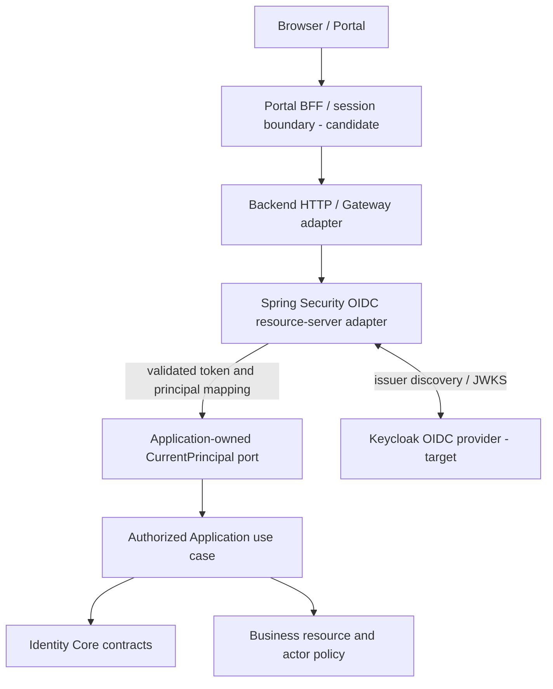

# DX-OS Open-Core — Identity Core Documentation Portal

> **Path:** `docs/02-core/identity/README.md`  
> **Status:** DRAFT / NOT REVIEWED  
> **Version:** 0.1-review-draft  
> **Source inspection SHA:** `0f0c3ba0c3eecda0a5c4a798a3cc14b808351bed`  
> **Owner:** TO ASSIGN · **Independent reviewer:** NOT ASSIGNED  
> **Evidence status:** Source-document inspection only; no new build, OIDC flow, security or CI test executed.

## 1. Purpose and Reader Routes

This README is the entry point for the **Identity Core** capability within the DX-OS Spring Boot modular monolith. It explains the contract boundary, the verification chain, application reuse, current source-reference status and the documents needed to audit Identity safely. It is a navigation and review map, **not** a replacement for normative source contracts or executable security evidence.

| Reader | Begin here | Then verify |
| --- | --- | --- |
| New contributor | Sections 2–4: vocabulary and trust responsibilities | Identity contract, architecture rules and provider adapter |
| Backend/Identity developer | Sections 4–6: interfaces and integration seam | Actual Java classes, negative tests, exact SHA |
| Application developer | Sections 3–5: principal versus resource policy | Authorized application operations, business ACL and workflow permission checks |
| Independent reviewer / OLP judge | Sections 6–9: claims, evidence, risks | Pinned files, CI/test logs, integrated OIDC scenario and Gate record |

## 2. Core Responsibility and Explicit Non-Responsibilities

**Identity Core owns** provider-neutral identity representations and normalization: principal, authority and required-authority values, authentication-context representation, authorization decision representation and normalized identity failures. Its public contract must not require direct Keycloak, Spring Security, JDBC, HTTP or Helpdesk/Facility domain imports.

**Identity Core does not own:** credentials/password IAM, Keycloak realm administration, browser login screens, JWT signature parsing, Workflow lifecycle, ticket assignment, tenant/resource business ACL, or the final authorization decision about a particular Helpdesk/Facility resource.

**One important distinction:** a well-formed `AuthenticatedPrincipal` value is **not evidence of authentication**. A trusted runtime adapter must obtain it from a verified security context. A valid token or operation authority is **not** a substitute for Application-side resource eligibility.

## 3. Vocabulary and Trust Model

| Concept | Meaning | Common false assumption |
| --- | --- | --- |
| IdP / Keycloak | External identity responsibility; OIDC provider target | Keycloak must be a Core Java package |
| Authentication | Verify caller, issuer/signature and intended token context at a trusted boundary | Any `subjectId` from request JSON is trusted |
| Principal | Provider-neutral identity/authority facts passed into trusted use cases | Manually creating a principal verifies caller |
| Authority | An operation-level permission fact | It grants access to any business resource |
| Authorization | Enforce operation authority **and** current Application resource/actor policy | Gateway-only check protects all business writes |
| Canonical subject | Stable internal reference derived under an explicit issuer/subject mapping policy | Email alone is a safe migration/linking key |
| Trust boundary | Place where untrusted input is verified before entering application use cases | Frontend role or forged HTTP header provides identity |

## 4. Logical Boundaries and Request Journey

**Diagram classification:** conceptual trust/invocation model. The BFF, ingress, client integration and Keycloak runtime are not declared integrated or release-ready by this diagram. Java dependency direction is different from runtime arrows: the trusted adapter implements the `CurrentPrincipal` seam defined by the Application, while Core identity types remain provider-neutral.

Suggested review journey:
1. Inspect HTTP registration and access profile for actual protected endpoints.
2. Confirm verified token parsing, accepted issuer, key validation, intended audience and canonical subject at the trusted adapter.
3. Confirm no request header, arbitrary actor ID or UI role can substitute for the trusted principal.
4. Confirm exact operation authority and **separate** tenant/resource/eligibility checks before a mutable business operation.
5. Confirm rejections preserve business facts, Workflow state/version and history.
6. Verify evidence at the exact deployment and code SHA, not only unit-level test names.

## 5. Contract and Application Ownership Map

| Owner | Contract / responsibility | Explicit limit |
| --- | --- | --- |
| `core.identity` | `AuthenticatedPrincipal`, `Authority`, `RequiredAuthority`, `AuthenticationContext`, provider-neutral decision/error types | May describe facts; does not prove a bearer token was verified |
| `application.identity` | `CurrentPrincipal` access seam for trusted callers | Does not independently parse arbitrary JWT strings |
| `infrastructure.identity.security` | Spring Security-backed verified principal adapter | Provider-specific code stays outside pure Core |
| Gateway/HTTP | HTTP authentication enforcement, request translation and controlled exposure | Does not decide application-specific ACL or ticket eligibility |
| Helpdesk/Facility Application | Current resource policy, operation eligibility, tenant/assignment conditions | Should not introduce application names or roles into generic Identity Core |
| Keycloak | External identity and OIDC endpoints | Not evidence that all Backend business authorizations are correct |

**Two-application reuse test:** the same neutral principal/authority contracts should support IT Helpdesk and Facility, each retaining its own resource rules. Facility remains a candidate/deferred scenario; no LIVE reuse PASS is claimed.

## 6. Source and Documentation Map

The following architecture paths existed at historical inspection SHA `0f0c3ba0c3eecda0a5c4a798a3cc14b808351bed`:

- [Core/Application architectural boundary](../../01-architecture/core-application-boundary.md).
- [Architecture dependency rules](../../01-architecture/dependency-rules.md).
- [System architecture](../../01-architecture/system-architecture.md).

**Current-branch navigation:** [Identity architecture](architecture.md), [domain model](domain-model.md), and [contracts](contracts.md) are tracked on `docs/core-architecture-alignment`. The historical [Identity Core contract](https://github.com/lexuanbao258-collab/dxos-open-core/blob/0f0c3ba0c3eecda0a5c4a798a3cc14b808351bed/docs/contracts/identity-core.md) existed at the inspection SHA; the current-branch files did not.

Source inspection anchor: [commit `0f0c3ba0...`](https://github.com/lexuanbao258-collab/dxos-open-core/commit/0f0c3ba0c3eecda0a5c4a798a3cc14b808351bed). The source contract explicitly defines provider-neutral Identity and names the `CurrentPrincipal` verified-context seam. The present README does **not** claim a complete Java import scan or executed test results.

### Identity documentation inventory on the current branch

The paths below originated in the historical documentation plan. All seven files are tracked on `docs/core-architecture-alignment`; tracked existence does not assign a formal Document Register lifecycle status or establish approval or runtime verification.

| Current tracked file (in `docs/02-core/identity/`) | Scope |
| --- | --- |
| [architecture.md](architecture.md) | Internal contracts, adapters, sequence/trust boundaries |
| [domain-model.md](domain-model.md) | Principal/authority/context/error invariants |
| [contracts.md](contracts.md) | Published contract signatures and semantics |
| [authentication-flow.md](authentication-flow.md) | OIDC/PKCE, token verification and failure flow |
| [authorization-model.md](authorization-model.md) | Exact authority and business policy separation |
| [security-boundaries.md](security-boundaries.md) | Threats, forged context and negative cases |
| [acceptance-tests.md](acceptance-tests.md) | Test matrix, real OIDC and adversarial evidence |

Recheck these paths at the **merge target SHA**. Historical `docs/contracts/` remains source evidence for its pinned revision; [tracked contracts](contracts.md) are the current documentation location. Any semantic supersession requires review.

## 7. Review Claims, Tests and Evidence

| Claim ID | Claim requiring proof | Evidence request | Current disposition |
| --- | --- | --- | --- |
| ID-REV-01 | Pure Identity Core does not depend on Keycloak/Spring/provider | Production class graph, ArchUnit report | NOT VERIFIED |
| ID-REV-02 | JWT principal is issued only from verified adapter context | Exact OIDC integration, wrong issuer/signature/audience tests | NOT VERIFIED |
| ID-REV-03 | Forged `actorId`, role and request headers are rejected | HTTP negative security suite | NOT VERIFIED |
| ID-REV-04 | Exact operation authority does not bypass resource ACL | Helpdesk/Facility unauthorized resource tests | NOT VERIFIED |
| ID-REV-05 | Provider subject mapping remains correct under issuer changes | Canonical subject policy and migration tests | NOT VERIFIED |
| ID-REV-06 | Authorization rejection causes no forbidden mutation | Application + Workflow state/history tests | NOT VERIFIED |
| ID-REV-07 | Identity contracts are reused without Core forks | Two-application source diff and integrated test | NOT VERIFIED |
| ID-REV-08 | Real Browser/BFF/Keycloak/Backend handoff works | Fixed-SHA deployment, session, CSRF and OIDC evidence | NOT VERIFIED |

A successful isolated POC or PR-local test does not establish integrated acceptance. A test claim must include exact SHA, configuration/environment, command, logs/test artifact, result and independent review.

## 8. Risks, Open Decisions and Non-Goals

| ID | Open issue | Required follow-up |
| --- | --- | --- |
| ID-OD-01 | Canonical subject and IdP issuer migration/linking | Identity + security owner to document policy and tests |
| ID-OD-02 | Trust chain across BFF/Gateway/backend profiles | Verify actual routing, JWT audience/issuer and session/CSRF |
| ID-OD-03 | Generic Workflow HTTP exposure and authority handoff | Review endpoint registration and authorized Application seam |
| ID-OD-04 | Resource ACL revocation race | Deterministic race test under real persistence transactions |
| ID-OD-05 | Facility-specific acceptance actor and permissions | Application owner must ratify business contract |
| ID-OD-06 | G3 source/baseline and ADR approval drift | Reconcile documentation register and actual merge SHA |

No password-store implementation, new identity provider choice, user-directory schema, production login endpoint or formal ADR approval is authorized by this README.

## 9. Review and Gate Record

| Field | Value |
| --- | --- |
| Authoring completion | DRAFT created |
| Source inspection | Canonical docs checked at pinned SHA |
| Runtime/CI/security test execution for this file | NOT RUN |
| Identity security reviewer | NOT ASSIGNED |
| Application reviewer | NOT ASSIGNED |
| Document review result | NOT REVIEWED |
| G4 Gate result | NOT REVIEWED |

**Ready for document-level independent review only; no runtime, CI, OIDC or G4 acceptance is implied.**
