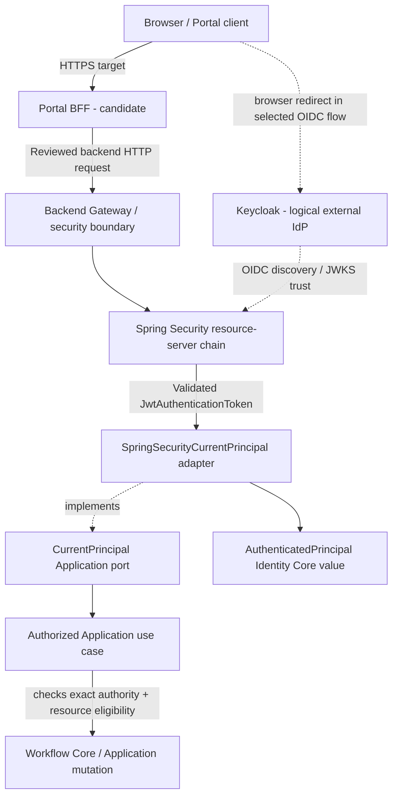
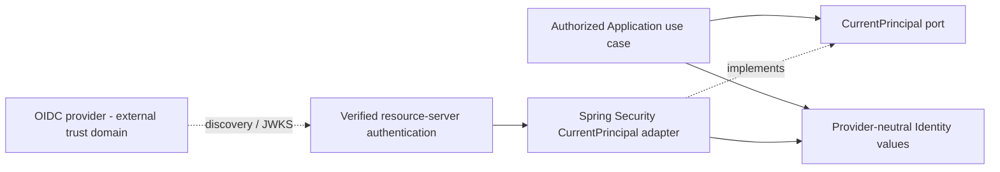

# Identity Core — Architecture and Trust Boundaries

> **Evidence rule:** **OBSERVED** describes source or contract text inspected at the immutable SHA above; **SELECTED/TARGET** describes intended architecture; **CANDIDATE** describes non-baseline work; **UNVERIFIED** means an executable result or approval has not been established. This document is a design draft, not an accepted ADR, completed security audit, or evidence of live Portal-to-Keycloak integration. No build, browser, OIDC or CI tests were run for this authoring pass.

## 1. Purpose and Architecture Context

DX-OS is an internal service platform that aims to reuse Identity, Workflow, Data and Gateway capabilities across Helpdesk and Facility Applications. Identity Core defines **provider-neutral identity facts and authorization primitives**; it does **not** operate Keycloak, parse tokens, manage usernames/passwords, own application-specific eligibility or perform a Workflow transition. This distinction permits a modular monolith with adapter substitution without turning the Core into the identity provider.

The inspected source baseline uses Java 21 and Spring Boot 3.5.16. The four Core capabilities are **logical responsibilities**, not necessarily separate `core.*` Java packages or deployable processes. G3 documents remain review drafts until an independent Gate review establishes their status.

## 2. Architectural Ownership and Exclusions

| Owner / layer | Owns | Explicitly does not own |
| --- | --- | --- |
| **Identity Core** `core.identity` | Immutable principal, opaque authentication-context and authority facts; normalization and domain-level decisions/errors | JWT validation, password IAM, Keycloak client/realm administration, tenant/Helpdesk/Facility ACL, Workflow state |
| **Application seam** `application.identity.CurrentPrincipal` | Port that requires the currently **verified** caller; authorized Application use cases apply resource eligibility | Trusting arbitrary HTTP headers or granting resource access on authority alone |
| **Spring Security adapter** `infrastructure.identity.security` | Runtime extraction of a validated `JwtAuthenticationToken`, canonical OIDC subject conversion, workflow authority extraction | Policy ownership for every business resource; creating independent JWT parser in Core |
| **Gateway / HTTP boundary** | Authentication enforcement, safe request admission, route exposure and handoff to authorized Application use cases | Ticket-level ACL or direct unguarded Workflow mutations |
| **Keycloak / IdP** (logical external system) | OIDC identity provider, issuer, signed tokens, client/role administration per accepted configuration | DX-OS Application-specific ownership and resource access grants |
| **Helpdesk / Facility Applications** | Business roles, assignment/eligibility and ACL, resource tenant context | Altering generic Identity/Core to encode application-specific staff rules |

A **trusted principal object** is not in itself a cryptographic proof: creating `AuthenticatedPrincipal(..., true)` or `AuthenticationContext` only satisfies structural contracts. The verified trust boundary belongs to the authenticated runtime adapter/security filter chain.

## 3. Component View and Dependencies

**Classification:** logical trust and call flow; not a verified end-to-end runtime topology or a precise call order. Java compile-time dependency points **inward from adapter to `CurrentPrincipal` and Identity types**. The adapter implements the Application-owned port; Workflow Core should not import `CurrentPrincipal`, Spring Security or Keycloak classes.

### 3.1 Observed Java seams

- `application.identity.CurrentPrincipal` declares `AuthenticatedPrincipal requireVerified()` and specifies a trusted verified origin.
- `infrastructure.identity.security.SpringSecurityCurrentPrincipal` is a package-private `@Component` implementation. It reads `SecurityContextHolder`, requires an authenticated `JwtAuthenticationToken`, and rejects missing subject or issuer claims.
- It builds the canonical ID in the form `oidc:<base64url(UTF8(issuer))>.<base64url(UTF8(subject))>` using strict UTF-8 encoding and URL-safe base64 without padding. This avoids relying on display names or mutable email addresses as canonical identifiers. **Changing issuer may change the canonical ID; linking/migration policy is an open business/security decision.**
- The adapter extracts role strings from JWT `resource_access[resourceClientId].roles` and keeps only four exact workflow authorities: `workflow:create`, `workflow:activate`, `workflow:transition`, `workflow:read`. A verified token does not automatically grant those authorities.
- `core.identity.AuthenticatedPrincipal` is a record with `subjectId`, `displayName`, immutable-copy authorities and `authenticated` validated true; this validation **does not** verify JWT authenticity.

These facts were inspected at the pinned Git SHA. They do not imply that every Gateway route uses this seam, that every resource-policy path is secure or that a browser session is fully integrated.

## 3.2. Contract-first architecture and substitution boundaries

**The stable consumer-facing seam is `application.identity.CurrentPrincipal.requireVerified()` returning a `core.identity.AuthenticatedPrincipal`.** This Application-owned port is not an instruction to copy it into Core. Identity Core types define the provider-neutral data and authority vocabulary, while the Spring Security adapter is responsible for deriving a principal from a **trusted, already validated** authentication context. Authentication correctness also depends on the configured Spring Security filter chain; the adapter's `instanceof JwtAuthenticationToken` check alone does not verify the token's signature.

**Source dependency:** `application.identity` imports the Core value; `infrastructure.identity.security` imports the Application-owned port and Core types. **Runtime behavior:** the use case requests the currently verified principal, and the configured adapter resolves it from the security context. Neither the Core nor the Application should import provider SDKs. A change of BFF, identity provider, or ingress cannot change the semantics of `requireVerified()` or skip resource authorization.

| Change scenario | Intended unchanged artifact | Permitted change | Non-transparent risk / required gate |
| --- | --- | --- | --- |
| Keycloak → another compatible OIDC IdP | Core types and `CurrentPrincipal` contract; business use cases | Provider configuration, trusted adapter/claim mapper, tests; identity-linking migration if needed | Issuer/subject changes can change canonical IDs; audience, claims, role mappings and lifecycle require verification |
| Change Keycloak realm/client | Public contract and Workflow rights vocabulary | OIDC configuration plus controlled authority mapping | Canonical issuer change, existing resource ownership and user linkage must be reconciled |
| Spring Security adapter implementation replacement | Core and Application source | Infrastructure implementation / composition | New adapter must prove signed token validation, verified origin, exact authority mapping and fail-closed behavior |
| Replace Portal/BFF framework | Identity domain values, backend authorization semantics | HTTP/session integration and routing | PKCE, CSRF, cookies, token relay, route/default-off and authorization regressions |
| Change Workflow application type (Helpdesk → Facility) | Identity Core and trusted principal port | Facility business ACL and actor-eligibility rules | Never add Facility-specific statuses/roles to Core Identity to make reuse appear to work |

**Compatibility promise is bounded:** not every identity system implements the same OIDC semantics. A non-OIDC IAM replacement may require a new trusted adapter or a reviewed change to the authentication architecture. Replacing a provider is **not** equivalent to arbitrarily exchanging public Java/REST APIs.

## 3.3. Java SPI versus HTTP contracts

| Contract layer | Owned by | Compatibility obligation |
| --- | --- | --- |
| Identity values: `AuthenticatedPrincipal`, `Authority`, normalized errors | Core Identity | Preserve field validation, opaque identity semantics and exact authority interpretation |
| `CurrentPrincipal.requireVerified()` | Application identity seam | Require trust provenance, fail closed, no user-controlled actor argument |
| Authentication/token decoding adapter | Infrastructure | Satisfy the port and identity value semantics without leaked provider classes |
| HTTP security/transport | Gateway / BFF | Maintain required authentication, error mapping and route policy; version separately from Java APIs |
| Business resource authorization | Helpdesk/Facility Application | Tenant/resource/assignment/eligibility check remains enforced even after a valid JWT |

A Java SPI compatibility claim is **not** an OpenAPI/REST compatibility claim. Both need their own versioning and conformance evidence.

## 4. Identity and Authorization Model

| Concept | Meaning / boundary | Security constraint |
| --- | --- | --- |
| Authentication | Establishes who made a request via the configured validated OIDC/Spring Security chain | Wrong signature, issuer, expiry or expected audience must be rejected by the configured authentication layer; verify configuration and negative tests |
| Canonical identity | Stable opaque `issuer + subject` representation for the configured issuer | Do not substitute email, display name or caller-supplied ID |
| Exact operation authority | An explicit operation-level permission such as `workflow:transition` | Do not interpret substring/prefix/case variants as equivalent; source adapter filters exact listed authorities |
| Resource authorization | Whether this verified actor may touch *this* tenant, ticket, assignment or workflow instance | Application must enforce; mere valid JWT/operation authority is insufficient |
| Workflow transition legality | Whether the transition exists and can commit safely with version/history | Workflow Core owns lifecycle semantics; Application orchestrates policy and transaction boundary |

For example, an IT technician holding `workflow:transition` still must not transition another team's ticket solely because the token is valid. Facility actors may use shared Identity contracts but their own eligibility policy. UI hiding, BFF route filtering and Gateway checks are defenses, **not substitutes** for backend Application resource checks.

## 5. Authentication Flow — Target versus Source

1. **TARGET / CANDIDATE:** browser begins an approved Portal/BFF OIDC flow; issuer, redirect URI, PKCE, cookie, CSRF and token relay require exact-HEAD validation. Do not assert these as integrated solely from PRs or diagrams.
2. **TARGET:** backend receives a protected HTTP request with an access token under a configured Spring Security resource-server chain; configured issuer/audience/signature/expiry validations require security tests.
3. **OBSERVED adapter behavior:** `requireVerified()` accepts only an already authenticated `JwtAuthenticationToken` in trusted Spring Security context, requires `iss` and `sub`, and builds canonical subject plus allowlisted workflow authorities.
4. **TARGET protected use-case behavior:** authorized Application use case checks exact authority and tenant/resource/actor eligibility before business mutation or Workflow transition.
5. **TARGET consistency requirement:** rejected/expired/untrusted/unauthorized actions make no business or Workflow state/history changes; concurrency and rollback must be verified with real database tests.

**Do not** infer successful OIDC/JWKS configuration, BFF session hardening or full-stack authorization from existence of these classes.

## 6. Trust Boundary Threats and Failure Modes

| Threat / failure | Expected safeguard | Verification needed |
| --- | --- | --- |
| Forged `X-User`, `X-Role`, `X-Authorities` or caller-provided actor ID | Ignore client identity headers; accept verified security context only | Anonymous and forged-header negative HTTP tests |
| Expired, wrong issuer, wrong audience or invalid signature | Spring Security JWT validation and configured issuer/audience | Real invalid-token matrix at exact configuration |
| Missing `iss` or `sub` in a token authentication object | Adapter fails closed | Adapter negative test |
| Wrong resource client, malformed `resource_access` or unsupported role | Empty/no unsupported authorities, not a fallback grant | Exact authority tests |
| Authenticated user with insufficient ticket/tenant eligibility | Authorized Application seam rejects | Cross-resource/cross-tenant negative suite |
| Direct generic Workflow route bypasses use-case authorization | Restricted registration/default-off exposure and reviewed route inventory | Gateway route and security integration tests |
| Revocation/assignment change racing against an update | Recheck authoritative state under reviewed transaction/locking policy | Deterministic concurrency/race test |
| IdP issuer migration or subject relinking | Explicit identity migration/ownership decision | Migration design and reconciliation tests |
| Error responses reveal tokens, claims or internal SDK details | Sanitized Identity errors and transport mapping | Error/log redaction tests |

## 7. Contracts and Architectural Invariants

The legacy [`Identity Core contract`](../../contracts/identity-core.md) defines `Authority`, `RequiredAuthority`, `AuthenticatedPrincipal`, `AuthenticationContext`, `AuthorizationDecision`, `AuthorizationReason`, `IdentityErrorCode` and `IdentityException`. It distinguishes a structurally valid context from a validated authentication and leaves **missing-context error mapping unresolved**; do not invent a new code without an owner decision.

**Design invariants to review:**

- **ID-ARCH-01:** Core Identity contains no dependency on Keycloak, Spring Security, JWT or persistence-provider SDKs.
- **ID-ARCH-02:** Verified identity is established at a trusted authentication boundary and exposed through `CurrentPrincipal.requireVerified()`.
- **ID-ARCH-03:** Canonical identity derives from issuer and subject, not caller-supplied display fields.
- **ID-ARCH-04:** Operation authority uses exact allowlist semantics; resource/tenant eligibility is separate.
- **ID-ARCH-05:** Protected writes cannot bypass authorized Application use cases.
- **ID-ARCH-06:** Invalid/unverified identity and authorization rejection result in no persistent business/state/history changes.
- **ID-ARCH-07:** Provider/OIDC configuration differences and migration preserve or explicitly reconcile identity semantics.
- **ID-ARCH-08:** No source or documentation approval alone declares working E2E/CI/release.

## 8. Traceability and Acceptance Evidence

| Claim | Source or target | Required test / evidence | Current status |
| --- | --- | --- | --- |
| Neutral Identity contracts and immutable principal | Identity contract and `AuthenticatedPrincipal.java` at pinned SHA | Source dependency scan, contract tests | SOURCE OBSERVED; EXECUTION UNVERIFIED |
| Verified-principal port and Spring Security adapter | `CurrentPrincipal.java`, `SpringSecurityCurrentPrincipal.java` at pinned SHA | Mock and real OIDC identity tests, forged headers | SOURCE OBSERVED; EXECUTION UNVERIFIED |
| Canonical subject and four exact workflow authorities | Inspected adapter | Exact-claim/Unicode/role regression tests | SOURCE OBSERVED; EXECUTION UNVERIFIED |
| Correct configured JWT validation | Spring Security Resource Server target | Invalid issuer, expiry, signature, audience tests | UNVERIFIED |
| Safe protected use-case handoff | G3 Core/Application Boundary target | API route audit, negative authorization suite | UNVERIFIED |
| Concurrent revocation and transaction isolation | Application/Workflow target | Real PostgreSQL race and rollback evidence | UNVERIFIED |
| Keycloak/BFF/Browser integration | Portal/BFF candidate | Exact integration SHA, TLS, CSRF, PKCE and browser evidence | UNVERIFIED |
| Reusable Identity with Facility | Cross-Application target | Distinct Facility slice + unchanged generic Core diff | UNVERIFIED |

No tests were run to create this draft. Evidence promotion requires test command, code/config SHA, environment, output/artifact, explicit failure disposition and independent reviewer.

## 8.1. Provider-independent conformance protocol (proposal)

Use an **identical suite** against baseline and candidate adapters at pinned source/configuration SHAs, with the same consumer contract and unchanged Helpdesk/Facility authorization use cases.

| Case | Shared expected outcome | Evidence requirement |
| --- | --- | --- |
| Valid trusted issuer, `sub` and expected audience | Same normalized canonical identity and supported authorities | Captured principal assertions, configuration, sanitized logs |
| Forged `X-User`, `X-Role` or client-supplied subject | Request rejected or ignored; no trusted principal | Negative HTTP test, no mutation |
| Invalid signature / issuer / audience / expiry | Authentication fails before Application use case | Security filter integration, not just manual record creation |
| Missing/blank `iss` or `sub`; invalid Unicode | Fail closed; no fallback to email | Adapter tests at exact implementation |
| Unknown role, wrong resource-client roles, altered capitalization | No accidental authority grant | Exact set comparison |
| Legitimate operation authority, forbidden resource | Application denies and leaves state/history unchanged | Resource ACL negative test, preferably real DB |
| IdP issuer migration | Identity link/ownership continuity is explicit or change is reported incompatible | Migration fixture, orphan-account and duplicate identity review |
| Switching providers | Core and business use-case source unchanged | Git diff, same contract suite reports for both adapters |

**Proposed demo sequence:** (1) freeze Keycloak baseline and sample users; (2) run trusted JWT/ACL suite; (3) introduce a second OIDC provider or independent local OIDC fixture with an alternate adapter/configuration; (4) run the exact same suite; (5) compare canonical-subject compatibility and demonstrate a controlled identity-linking decision; (6) run at least one protected Helpdesk and a distinct Facility action; (7) capture SHA, environment, commands, JUnit/logs and independent review. A mock fixture demonstrates mapping **only**; it cannot substitute for a real-provider integration claim.

### 8.2. Change impact and version policy

A provider-only adapter refactor should not alter Core contracts or consumer business use cases. Adding an optional value may be backwards-compatible only after consumer and serialization review. Changes to `subjectId` canonicalization, required authority names, error semantics or trust provenance are **security-sensitive breaking changes** and require compatibility analysis, migration planning, regression suite and a formal decision by responsible owners. Do not relabel such changes as configuration-only swaps.

## 9. Decisions, Risks and Ownership

| ID | Open decision or risk | Proposed accountable reviewer |
| --- | --- | --- |
| ID-OD-01 | Required JWT audience/issuer configuration and error mapping across environments | Identity/Security + Gateway |
| ID-OD-02 | Missing/invalid/expired `AuthenticationContext` mapping, preserving published contracts | Identity Core owner |
| ID-OD-03 | Account linking when OIDC issuer or subject identifiers change | Identity owner + Application |
| ID-OD-04 | Whether/when generic Workflow HTTP routes may be exposed | Gateway + Application + Security |
| ID-OD-05 | Application ACL/assignment revocation concurrency transaction seam | Application + Workflow |
| ID-OD-06 | Portal/BFF exact session, CSRF, OAuth redirect, PKCE and token-relay integration status | Portal/BFF + Identity |

Roles are suggested, not confirmed assignments. Corresponding decisions require controlled review and accepted evidence; they are not formal ADR approvals by virtue of being listed here.

## 10. Related Sources and Review Status

- [Identity Core contract](../../contracts/identity-core.md) — verified path at inspected SHA, canonical during documentation migration.
- [System Architecture](../../01-architecture/system-architecture.md) — inspected design review draft.
- [Core/Application Boundary](../../01-architecture/core-application-boundary.md) — inspected design review draft.
- [Dependency Rules](../../01-architecture/dependency-rules.md) — inspected enforcement proposal.
- [Source `CurrentPrincipal.java`](https://github.com/lexuanbao258-collab/dxos-open-core/blob/0f0c3ba0c3eecda0a5c4a798a3cc14b808351bed/backend/src/main/java/com/tricore/dxos/application/identity/CurrentPrincipal.java).
- [Source `SpringSecurityCurrentPrincipal.java`](https://github.com/lexuanbao258-collab/dxos-open-core/blob/0f0c3ba0c3eecda0a5c4a798a3cc14b808351bed/backend/src/main/java/com/tricore/dxos/infrastructure/identity/security/SpringSecurityCurrentPrincipal.java).
- [Source `AuthenticatedPrincipal.java`](https://github.com/lexuanbao258-collab/dxos-open-core/blob/0f0c3ba0c3eecda0a5c4a798a3cc14b808351bed/backend/src/main/java/com/tricore/dxos/core/identity/AuthenticatedPrincipal.java).
- [Repository inspection commit](https://github.com/lexuanbao258-collab/dxos-open-core/commit/0f0c3ba0c3eecda0a5c4a798a3cc14b808351bed).

The Identity sibling files (`domain-model.md`, `contracts.md`, `authentication-flow.md`, `authorization-model.md`, `security-boundaries.md`, `acceptance-tests.md`) are **planned** and intentionally not linked as if merged. No formal independent reviewer or G4 Gate decision is recorded.

**Disposition: G4-F02 REVISED DRAFT / NOT REVIEWED.**
