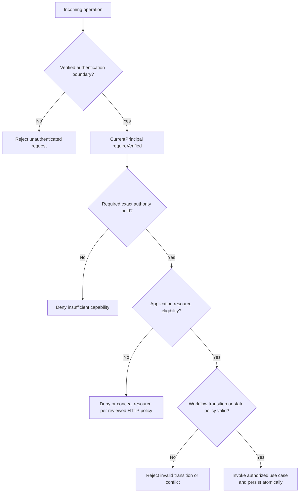

# Identity Core — Authorization Model

> **Evidence convention:** OBSERVED means located in the pinned source or canonical contract; SELECTED means a G4 design direction; PROPOSED means a future implementation or test; NOT VERIFIED means no fresh runtime evidence was produced for this document. This file does not approve an ADR or assert Gate PASS.

## 1. Purpose and authorization vocabulary

DX-OS must distinguish **authentication** (who the caller is, from a verified boundary), **capability authority** (which action category a verified caller can attempt), and **resource authorization** (whether the caller can act on a particular Helpdesk ticket or Facility request in its present state). A correct authorization decision needs all applicable checks; a valid bearer token or a single authority must not grant broad access to every resource.

The reusable Identity Core supplies *provider-neutral principal, authority requirement, authorization decision and normalized-error values*. It does not own business-specific resource ACL, ticket assignee, tenant membership, workflow policy, HTTP routing, or identity-provider token verification.

| Boundary | Owns | Must not own |
| --- | --- | --- |
| IdP / Spring Security infrastructure | Token validation, trusted security context, claim-to-authority mapping | Helpdesk resource ownership policy |
| Identity Core contract | `AuthenticatedPrincipal`, `Authority`, `RequiredAuthority`, `AuthorizationDecision`, `AuthorizationReason` | JWT parsing, Keycloak SDK, database resource ACL |
| Application-owned `CurrentPrincipal` port | Verified caller retrieval contract | Unverified caller headers as identity |
| Gateway / authorized application seam | Request boundary and invocation of authorized use cases | Circumvention of application policy through generic mutation endpoints |
| Helpdesk / Facility application | Actor eligibility, ownership, assignment, resource visibility and state-specific business policy | Reimplementation of JWT verification inside each use case |
| Workflow Core | Domain-neutral state transitions, version and history invariants | Authentication or Helpdesk/Facility-specific authorization |

## 2. Three-stage reference decision chain

This is a **SELECTED logical model**, not a claim that every branch is implemented in the pinned runtime. The Gateway and Application own how a denial is safely expressed over HTTP. Identity Core has no intrinsic `401`/`403`/`404` status mapping.

## 3. Source-grounded authority semantics

At the pinned SHA, `Authority(String value)` and `RequiredAuthority(String value)` are separate records; both reject null or blank values. `Authority.satisfies(RequiredAuthority)` performs exact `value.equals(requiredAuthority.value())`: identifiers are case-sensitive; no trimming, prefix, wildcard, hierarchy or implicit provider role expansion exists. Passing null `RequiredAuthority` to this method yields a dereference error, **not** a normalized authorization denial.

`AuthorizationDecision(boolean granted, RequiredAuthority requiredAuthority, AuthorizationReason reason)` requires non-null requirement and reason. Its only valid observed combinations are `(true, AUTHORITY_GRANTED)` and `(false, MISSING_AUTHORITY)`. It represents a **capability-authority finding only**; neither valid combination proves the principal came from a verified runtime context or grants ownership of a particular resource.

`AuthenticatedPrincipal` requires a nonblank opaque `subjectId`, a nonnull defensively copied `Set<Authority>`, and `authenticated == true`. The boolean is a value invariant, not evidence of authentication. An arbitrary caller can construct this record; never use construction as a trust anchor.

### Current workflow authorities

The observed `SpringSecurityCurrentPrincipal` adapter reads only `resource_access.<configured resourceClientId>.roles` and allows exactly:

| Exact authority | Capability-level operation category | Business/resource check still required? |
| --- | --- | --- |
| `workflow:create` | Create workflow instance | Yes — caller may not create for arbitrary application resource |
| `workflow:activate` | Activate workflow instance | Yes — ownership and definition/state policy |
| `workflow:transition` | Request state transition | Yes — actor eligibility and resource-state policy |
| `workflow:read` | Read workflow data | Yes — resource visibility and tenant boundaries |

Unknown, wrong-case, or wrong-resource-client roles must not be promoted. Missing or malformed role structure is mapped by the observed adapter to an empty set. The four allowlisted values are an **adapter's current supported authorities**, not the complete universe of possible future Core authority values.

## 4. Authorization policy ownership and reuse

**SELECTED:** An authorization layer must combine verified identity with a reusable *mechanism* for checking exact capability authorities while leaving resource *policy* with each Application. A Helpdesk rule such as “assigned technician may resolve this ticket” and a Facility rule such as “authorized facility approver may approve this request” must remain in their corresponding Application modules and use cases. Neither should be hardcoded into `core.identity` or `core.workflow`.

Example policy patterns below are **illustrative proposals, not approved business contracts**:

| Application | Proposed resource-specific predicate | Where it belongs |
| --- | --- | --- |
| Helpdesk | Ticket assigned to current technician, state is eligible, and relevant operation is allowed | Helpdesk Application / authorized workflow service |
| Helpdesk | Requester can view own ticket but cannot act as arbitrary technician | Helpdesk Application read/update policy |
| Facility | Approver belongs to applicable approval responsibility and request state allows approval | Facility Application policy |
| Both | Resource belongs to permitted tenant/organization scope, if multi-tenant tenancy is adopted | Application authorization and data access boundary |

The existence of Helpdesk roles or Facility reuse does not establish that these predicates are currently implemented. Reconcile the final business eligibility with Issue #53 / Application contracts before treating them as requirements.

## 5. No generic Workflow authorization bypass

A broad, public `workflow:transition` operation is not sufficient to mutate every workflow instance. A generic HTTP mutation route is acceptable only if it cannot evade the Application's resource-based policies. Prefer a narrowly authorized Application use-case entrypoint, backed by capability authority and resource eligibility checks; any generic administrative/mutating route requires explicit reviewed authorization policy, nonproduction restrictions if appropriate, and negative tests.

Source dependency direction remains distinct from runtime call direction. A Workflow domain type such as `ActorReference` is a trusted *representation* of actor identity provided upstream, not an authenticator or authorizer. Audit actor identity must derive from verified provenance, never untrusted caller-supplied actor IDs.

## 6. Trust model and fail-closed behaviors

The current `CurrentPrincipal.requireVerified()` port explicitly requires a trusted caller. `SpringSecurityCurrentPrincipal` accepts only authenticated `JwtAuthenticationToken` in the Spring Security context, rejects blank issuer/subject, creates canonical subject from exact issuer+subject, and maps a scoped authority allowlist. The Spring Security resource-server filter is the JWT verification boundary; Core does not parse or validate JWTs.

Required proposed negative cases: absent/expired/forged token; wrong issuer or audience; malformed token type; `X-User`/`X-Role` spoofing; missing authority; same authority but wrong ticket; wrong tenant; ineligible state; stale workflow version; direct generic-route bypass. A deny should produce safe, nonleaking messages and no unauthorized persistence or audit corruption.

**Open error semantics:** `IdentityErrorCode.ACCESS_DENIED` exists, but mapping to HTTP 403/404 must be decided by Gateway/Application; for unauthenticated requests the current runtime may use HTTP 401 with a separate `ApiError`. `CurrentPrincipal` adapter may throw `IllegalStateException` rather than `IdentityException`. Do not silently claim a normalized error translation that has not been implemented.

## 7. Identity provider substitution without authorization drift

Provider neutrality requires more than changing the issuer URL. Any alternative OIDC source/adapter must preserve:

1. Verified issuer/audience/signature/time/token-type trust semantics as relevant to the actual access token.
2. Correct canonical `issuer + subject` mapping or an explicitly reviewed account-linking/migration strategy; do not auto-link by email.
3. Exact authority identifiers from the intended resource-client scope; deny unknown roles and never widen grants on provider migration.
4. The separation of capability authority versus resource ACL and audit subject provenance.
5. Safe normalized failure behavior and independently reviewed session/revocation limitations.

**Provider-swap proof (PROPOSED):** freeze Helpdesk/Facility source hash and pinned Git SHA; run the same authority matrix and resource-ACL negative tests against baseline and candidate IdP adapters; record adapter/config-only changes, identity migration decisions, logs, exact commands and independent review. Synthetic adapter tests are not live OIDC swap evidence.

## 8. Conformance and review matrix

| ID | Scenario | Expected architectural result | Evidence required |
| --- | --- | --- | --- |
| ID-AZ-01 | Exact held authority equals required authority | Capability check may grant | Unit assertion at pinned SHA |
| ID-AZ-02 | Wrong case, prefix/wildcard or wrong resource client | No elevation | Adapter/authority test |
| ID-AZ-03 | Missing verified principal / forged identity header | Reject before application action | Security filter-chain negative test |
| ID-AZ-04 | Valid authority but resource owned by another caller | Deny or conceal resource; no mutation | Real Helpdesk policy integration test |
| ID-AZ-05 | Facility approver without resource eligibility | No approval; no mutation | Facility authorization vertical-slice test |
| ID-AZ-06 | Illegal state transition or stale version | No unauthorized transition/history commit | Workflow integration/concurrency test |
| ID-AZ-07 | Generic workflow route bypass attempt | Cannot mutate without proper application policy | HTTP negative test / route inventory |
| ID-AZ-08 | Two IdP adapters with different role claim structure | Same intended authority semantics, no escalation | Provider conformance suite + diff |
| ID-AZ-09 | Changed issuer/subject during migration | No silent identity merge or ACL expansion | Migration/reconciliation evidence |
| ID-AZ-10 | Denial and provider failure responses | No raw token, secrets, or provider stack traces | HTTP response and log redaction evidence |

**None of these tests was executed in preparing this document.** Historical test descriptions in source docs are not republished as current PASS.

## 9. Alternatives and architectural trade-offs

| Model | Benefit | Risk and review outcome |
| --- | --- | --- |
| IdP role alone determines all access | Simple to implement | Rejected direction: cannot enforce resource ownership or workflow state |
| Identity Core embeds Helpdesk/Facility ACL | Single location for checks | Rejected direction: locks Core to applications, harms reuse |
| Application-specific role strings in generic Workflow Core | Easy shortcut | Rejected direction: business policy leaks into reusable mechanism |
| **Exact capability authority + Application resource policy** | Provider-neutral and reusable | SELECTED direction; requires coordinated negative tests and trusted caller plumbing |

## 10. Risks, open decisions and Gate status

| Open ID | Decision or risk to resolve | Review owner candidate |
| --- | --- | --- |
| AZ-OD-01 | Identity authority check service location and normalized exception mapping | Identity + Gateway |
| AZ-OD-02 | 401/403/404 response policy without resource existence leaks | Gateway + Application |
| AZ-OD-03 | Confirmed Helpdesk actor/resource matrix and resolved/confirmed/closed permissions | Application + Business Contract reviewers |
| AZ-OD-04 | Facility reuse scenario and authorized resource eligibility | Facility Application owner |
| AZ-OD-05 | Generic workflow mutation API exposure and route-specific safeguards | Gateway + Workflow |
| AZ-OD-06 | Multi-tenancy boundaries if in scope, including data-query enforcement | Architecture + Application |
| AZ-OD-07 | Authority freshness/revocation and long-lived BFF sessions | Identity + Security |
| AZ-OD-08 | Cross-provider authority mapping and identity migration evidence | Identity + independent reviewer |

**Gate sequence:** design review → exact-SHA source conformance → provider-independent authority tests → real HTTP/resource/persistence negative tests → cross-Application reuse → independent review → authorized G4 Gate disposition. No step is automatically PASS. Status of this document: **DRAFT / NOT REVIEWED**.

## 11. Pinned references

- [Identity Core contract](https://github.com/lexuanbao258-collab/dxos-open-core/blob/0f0c3ba0c3eecda0a5c4a798a3cc14b808351bed/docs/contracts/identity-core.md)
- [Workflow Core contract](https://github.com/lexuanbao258-collab/dxos-open-core/blob/0f0c3ba0c3eecda0a5c4a798a3cc14b808351bed/docs/contracts/workflow-core.md)
- [Authority.java](https://github.com/lexuanbao258-collab/dxos-open-core/blob/0f0c3ba0c3eecda0a5c4a798a3cc14b808351bed/backend/src/main/java/com/tricore/dxos/core/identity/Authority.java)
- [AuthorizationDecision.java](https://github.com/lexuanbao258-collab/dxos-open-core/blob/0f0c3ba0c3eecda0a5c4a798a3cc14b808351bed/backend/src/main/java/com/tricore/dxos/core/identity/AuthorizationDecision.java)
- [SpringSecurityCurrentPrincipal.java](https://github.com/lexuanbao258-collab/dxos-open-core/blob/0f0c3ba0c3eecda0a5c4a798a3cc14b808351bed/backend/src/main/java/com/tricore/dxos/infrastructure/identity/security/SpringSecurityCurrentPrincipal.java)
