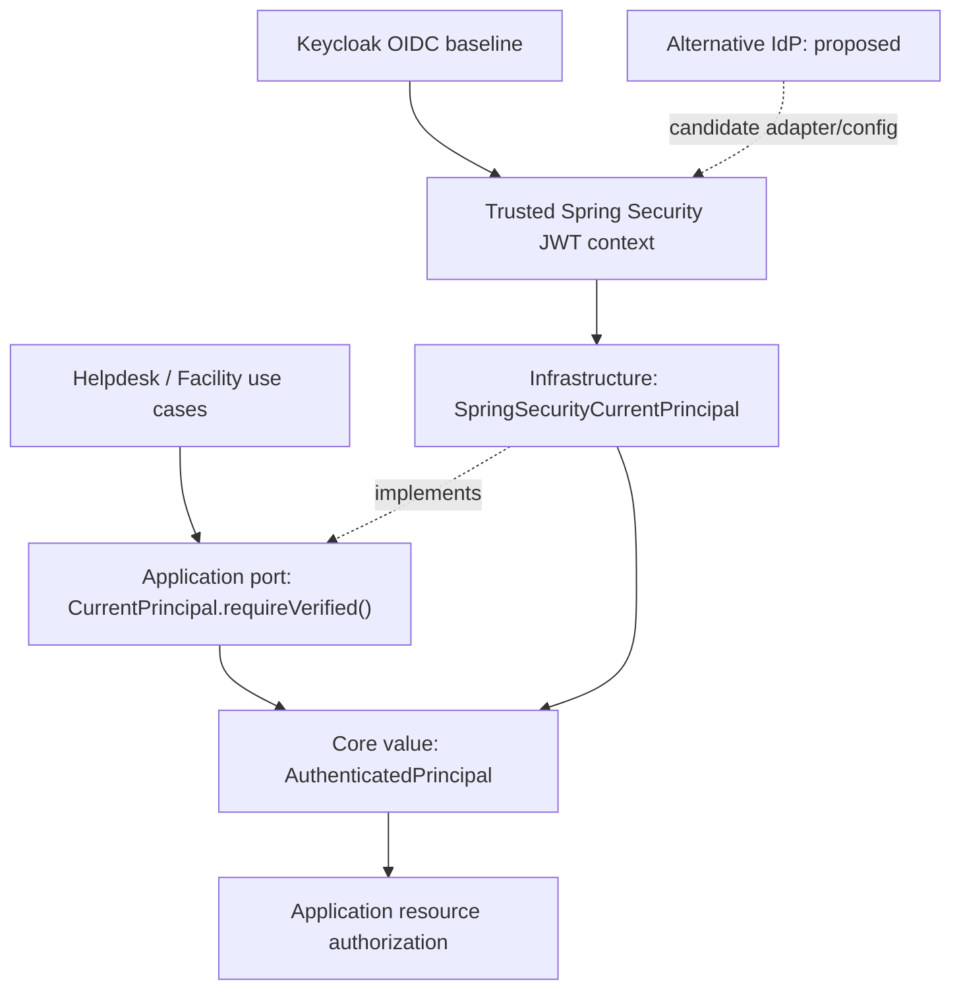

# Identity Core — Contracts, Compatibility and Conformance

> **Source classification:** OBSERVED = checked against pinned repository source; SELECTED = G4 foundation architecture choice; PROPOSED = compatibility/testing recommendation; UNVERIFIED = no current run evidence established by this document. These decisions are not accepted ADRs and this document does not supersede `docs/contracts/identity-core.md` without review.

## 1. Contract scope and boundaries

**Compatibility and failure requirement (TO-BE):** a replacement identity adapter must produce the same Core principal and authority meaning from a cryptographically verified issuer, reject absent/invalid/expired or wrong-audience credentials, and never treat a caller header as identity. Keycloak is the default OIDC target; another OIDC issuer is possible only after subject-linking and authority migration review. Conformance must cover valid/invalid tokens, issuer/audience, keys and rotation, claim mapping, error translation, and authorization negatives. Identity facts do not grant Application resource access. These checks are requirements, not a claim of a passing provider-swap suite.

The Identity Core (`com.tricore.dxos.core.identity`) supplies provider-independent value objects, authority matching, authorization-decision representation, and normalized error vocabulary. It is not itself a JWT parser, OIDC client, user database, authorization engine for Helpdesk/Facility resources, provider SDK wrapper, or login endpoint. `CurrentPrincipal` belongs to `com.tricore.dxos.application.identity`; its runtime implementation belongs to infrastructure. This is a **modular monolith** contract topology, not a four-service topology.

**Contract layers:** (1) Core Java API/value semantics, (2) Application port (`CurrentPrincipal`), (3) adapter/provider API (Spring Security, Keycloak/OIDC), (4) public HTTP API owned by Gateway/Application. Java method contracts and external HTTP endpoints have **separate lifecycle and compatibility**. Do not infer any `/identity/login`, `/verify`, or `/refresh` route from these Java types.

## 2. Exact Java API / SPI inventory at pinned source

| Owner | Type | Declared public contract / constructor semantics | State |
| --- | --- | --- | --- |
| Core | `AuthenticatedPrincipal` record | `(String subjectId, String displayName, Set<Authority> authorities, boolean authenticated)` | OBSERVED |
| Core | `Authority` record | `(String value)` and `boolean satisfies(RequiredAuthority)` | OBSERVED |
| Core | `RequiredAuthority` record | `(String value)` | OBSERVED |
| Core | `AuthenticationContext` record | `(String authenticationReference)` | OBSERVED |
| Core | `AuthorizationDecision` record | `(boolean granted, RequiredAuthority requiredAuthority, AuthorizationReason reason)` | OBSERVED |
| Core | `AuthorizationReason` enum | `AUTHORITY_GRANTED`, `MISSING_AUTHORITY` | OBSERVED |
| Core | `IdentityErrorCode` enum | six values in §5 | OBSERVED |
| Core | `IdentityException` | `IdentityException(IdentityErrorCode code)` and `IdentityErrorCode code()` | OBSERVED |
| Application | `CurrentPrincipal` interface | `AuthenticatedPrincipal requireVerified()` | OBSERVED |
| Infrastructure | `SpringSecurityCurrentPrincipal` | package-private `CurrentPrincipal` implementation; reads verified Spring Security JWT context | OBSERVED |

A record's autogenerated component accessors, equality/hash and `toString` follow Java record semantics; **record construction does not prove authentication**. A proposed `IdentityVerifier`, `IdentityProviderPort`, token refresh, or account-linking interface would require its own source change/ADR and cannot be presented as existing.

## 3. Operation contract: CurrentPrincipal.requireVerified()

**Owner:** Application port. **Purpose:** supply the verified current caller identity to authorized use cases.

| Aspect | Required meaning and provenance |
| --- | --- |
| Signature | `AuthenticatedPrincipal requireVerified()` — no input parameters |
| Preconditions | Trusted authentication middleware has established the caller; external identity headers and manually constructed values are not valid evidence |
| Postcondition on success | A nonnull `AuthenticatedPrincipal` representing a trusted authentication, with canonical opaque `subjectId`, known authorities and `authenticated=true` |
| Current adapter | `SpringSecurityCurrentPrincipal` requires authenticated `JwtAuthenticationToken`, nonblank issuer and subject; maps canonical subject and allowlisted authorities |
| Observed failure | Adapter throws `IllegalStateException` for missing/unverified `JwtAuthenticationToken` and missing issuer/subject; this is **not** proof of normalized `IdentityException` from this method |
| Transaction and side effects | This interface declares none; do not assert a DB write or login-session creation |
| Security invariant | Caller-supplied `X-User`, `X-Role`, `X-Authorities`, or arbitrary `AuthenticatedPrincipal` must not grant access |
| Application responsibility | Check operation authority and ticket/facility resource eligibility separately; a verified principal alone is insufficient |

**Open contract gap:** `CurrentPrincipal.requireVerified()` lacks a published adapter-independent failure type. Do not silently change it to throw an invented normalized error in docs. Propose a reviewed error translation policy, preserving safe 401/403 boundaries and the exact existing Java API until accepted.

## 4. Core value contracts: preconditions, postconditions and failure behavior

| Contract | Preconditions / allowed values | Guaranteed behavior | Invalid input |
| --- | --- | --- | --- |
| `AuthenticatedPrincipal` | `subjectId` nonblank, authorities nonnull, authenticated `true`; displayName optional | defensive `Set.copyOf`; immutable component set; equality by fields | blank subject/null set/false flag: `IllegalArgumentException`; null authority member: `NullPointerException` |
| `Authority` | nonblank exact string | `satisfies(required)` iff `value.equals(required.value())` | blank/null value: `IllegalArgumentException`; null requirement dereference: `NullPointerException` |
| `RequiredAuthority` | nonblank exact string | preserves string exactly | blank/null: `IllegalArgumentException` |
| `AuthenticationContext` | nonblank opaque reference | retains reference; **no verification** | blank/null: `IllegalArgumentException` |
| `AuthorizationDecision` | requiredAuthority and reason nonnull; `granted` aligns with reason | accepts only `(true, AUTHORITY_GRANTED)` or `(false, MISSING_AUTHORITY)` | null values: `NullPointerException`; inconsistent pair: `IllegalArgumentException` |
| `IdentityException` | nonnull `IdentityErrorCode` | message is code enum name; no cause/stack/suppression | null code: `NullPointerException` |

**Important limits:** exact matching is case-sensitive, preserves spaces and has no hierarchy/wildcard semantics. An `Authority` match is not a resource-level approval. `AuthenticationContext` is not an access token by contract and not a proof of a login. `AuthenticatedPrincipal.authenticated=true` is structural and does not confer trust without provenance.

## 5. Identity normalized error vocabulary

| Existing `IdentityErrorCode` | Capability-level meaning |
| --- | --- |
| `AUTHENTICATION_FAILED` | Authentication not established |
| `INVALID_AUTHENTICATION_CONTEXT` | Context cannot be accepted |
| `AUTHENTICATION_EXPIRED` | Previously valid context expired |
| `ACCESS_DENIED` | Access denied |
| `IDENTITY_NOT_FOUND` | Identity not found |
| `IDENTITY_PROVIDER_UNAVAILABLE` | Provider unavailable |

Provider exceptions should be mapped to a stable sanitized vocabulary where the consuming contract calls for it. The observed `CurrentPrincipal` adapter currently uses `IllegalStateException` for several failures; resolving the mismatch is **PROPOSED** and requires a consumer-impact decision. No dedicated missing-context code exists. **ID-CT-OD-01:** decide how missing context is represented without inventing enum members. HTTP status, structured `ApiError`, safe headers and route behavior belong to their HTTP boundary, not Identity Core.

## 6. Trust and provider-specific adapter normalization

The observed JWT adapter reads issuer and subject from authenticated `JwtAuthenticationToken`; its canonical identifier uses `oidc:<base64url-no-padding(UTF8(issuer))>.<base64url-no-padding(UTF8(subject))>` with strict UTF-8 and no trimming, lowercasing or Unicode normalization. The canonical subject is opaque in Core; **different issuer/subject normally produces a different identity**. Account-linking migration needs explicit policy, verified evidence, and rollback. Never infer equivalence from email or display name.

Current adapter workflow authority allowlist is exactly `workflow:create`, `workflow:activate`, `workflow:transition`, `workflow:read` from `resource_access.<resourceClientId>.roles`; other role values are ignored. Invalid/malformed role structures should not cause privilege escalation. This is current adapter-specific claim mapping, not a Core hardcoded Keycloak or Workflow dependency.

A provider swap must preserve signature/issuer/audience/lifetime/token-type verification at the trusted resource-server boundary, canonical identity semantics or explicit migration, authority meaning, safe failure and resource authorization. Differences in OIDC claims may require adapter changes and a separately reviewed migration. **Provider replacement is not necessarily configuration-only.**

## 7. Java API vs external HTTP API: change management

**Java API/SPI compatibility:** signatures and record components, exception types where consumed, set immutability, normalized error codes, authority comparison, canonical identity expectations, and trust provenance. Consumer compilation and automated behavioral compatibility tests are required for any breaking changes. Do not add new enum members as though they already exist.

**External HTTP API:** paths/methods, authentication schemes, header handling, JSON error schemas, status codes, CORS/CSRF/session behavior, and route exposure are owned/reviewed separately by Gateway/Application. This file does not assign new HTTP paths or declare any endpoint LIVE. A Java-compatible provider swap may still violate HTTP security and requires negative HTTP regression testing.

**Version proposal (not ratified):** classify every change as `adapter-only compatible`, `backward-compatible Java/HTTP contract`, `breaking Java/HTTP contract`, or `security/identity semantic change`. Breaking changes need a migration plan, owner approval, impact map and new independent Gate evidence. Exact package/JAR and endpoint versioning policy remains an open architecture decision.

## 8. Contract conformance suite: test specifications, not executions

| ID | Contract assertion | Unit / integration fixture | Acceptance evidence |
| --- | --- | --- | --- |
| ID-CT-01 | Valid/invalid principal, nullable name, immutable authorities and record equality | Pure Core JUnit: null/blank/false/null-element/copy | exact-SHA JUnit report |
| ID-CT-02 | Exact Authority vs RequiredAuthority | case, whitespace, wildcard, null required | test log and assertions |
| ID-CT-03 | Opaque AuthenticationContext is not proof | valid reference plus untrusted request negative | domain + filter-chain tests |
| ID-CT-04 | Decision pair invariant and error taxonomy | mismatched reason and nulls; all six enums | unit report and source review |
| ID-CT-05 | Verified principal provenance | anonymous, forged headers, bad signature, wrong issuer/audience/expired token | decoder/security integration report |
| ID-CT-06 | Canonical identity continuity | same issuer/sub; different issuer/sub; Unicode/UTF-8; migration | adapter tests and approved account-link map |
| ID-CT-07 | Exact workflow authority allowlist | wrong client, unknown/case-mismatched role, malformed claim | adapter tests and anti-escalation review |
| ID-CT-08 | Application resource ACL remains effective | valid authority but wrong ticket owner / forbidden transition | Helpdesk/Facility E2E negative evidence |
| ID-CT-09 | Provider substitution with no consumer edit | baseline and candidate OIDC adapter; freeze Application source diff | two-provider conformance report and migration log |
| ID-CT-10 | Error redaction and HTTP compatibility | provider outage, malformed token, missing context; no sensitive data | security review and response snapshots |

**Execution status for this authoring pass: NOT RUN.** Existing `docs/contracts/identity-core.md` describes historical test evidence, including local Keycloak tests; it does not establish a fresh second-provider test or G4-F04 PASS. Distinguish real provider integration from synthetic JWT test objects or mock decoders.

## 9. Proposed provider-swap demonstration for OLP review

1. Pin repository SHA, compiled contract and consumers, baseline provider versions, test fixtures and test commands; capture hashes and logs.
2. Show current Keycloak verified login / access token through backend resource server; test canonical subject, exact roles and forbidden headers. Record real evidence, not a mocked success claim.
3. Introduce a second independent OIDC provider or controlled compatible implementation using adapter/configuration changes; do not modify Helpdesk/Facility business logic or Core value types.
4. Run identical contract, token-security and resource-authorization negative cases against both providers. If issuer/sub changes, stop and demonstrate reviewed explicit account linking; do not falsely claim subject continuity.
5. Diff source to prove no Core/consumer logic change; record exceptions, provider-specific configuration, migration effort, test results and independent reviewer decision.

**Pass condition proposal:** all mandatory security, principal, authority and HTTP compatibility cases pass with exact SHA evidence, no unauthorized business-source changes, and documented identity migration. A simulated provider or partial negative suite earns only limited conformance evidence, not a production interchangeability claim.

## 10. Alternatives, trade-offs and risks

| Design | Advantage | Rejected/conditional concern |
| --- | --- | --- |
| Put Keycloak SDK/JWT types in Core | Fast provider-specific access | Breaks portability and stable Java contracts |
| Implement generic `login()/refresh()/verifyToken()` API now | Appears comprehensive | No such contract in pinned source; high scope and semantics risk |
| **Stable values + `CurrentPrincipal` port + trusted adapter (selected)** | Protects consumers, localizes OIDC specifics | Must test provider trust, claim semantics, identity continuity, role migration |
| Entirely new authentication service abstraction | Future capabilities | Separate proposal and ADR, not implied by current source |

Principal risk register: `ID-CT-R01` subject fragmentation after IdP migration; `R02` authority escalation from claim mapping; `R03` manually constructed principal accepted as trusted; `R04` mismatch between Java error contract and filter/HTTP failures; `R05` stale/revoked authority; `R06` incompatible HTTP/BFF behavior; `R07` tests passing only with mocks; `R08` new enum/record changes breaking consumers. All remain review items, not resolved findings.

## 11. Review gates and open decisions

| Gate | Requirement | Status |
| --- | --- | --- |
| G4-D | Identity contract design reviewed | NOT REVIEWED |
| G4-S | Exact-SHA source interface/import and consumer conformance | NOT VERIFIED |
| G4-C | Same executable contract suite for baseline/candidate | NOT VERIFIED |
| G4-I | Live OIDC/negative integration + resource ACL | NOT VERIFIED |
| G4-R | Helpdesk/Facility reuse and independent review | NOT VERIFIED |
| Formal G4 Gate | Authorized reviewer acceptance | NOT REVIEWED |

Open decisions: `ID-CT-OD-01` missing-context mapping; `OD-02` whether `authenticated` redundant; `OD-03` port failure contract; `OD-04` account-linking/migration and rollback; `OD-05` authority freshness/revocation; `OD-06` API compatibility/version policy; `OD-07` second IdP conformance evidence plan; `OD-08` HTTP vs Java error mapping ownership.

**Document disposition:** DRAFT / NOT REVIEWED. The G4 foundation choices set design intent, not a formal ADR acceptance or any executed CI/E2E PASS.

## 12. Pinned source references

- [Canonical Identity contract](https://github.com/lexuanbao258-collab/dxos-open-core/blob/0f0c3ba0c3eecda0a5c4a798a3cc14b808351bed/docs/contracts/identity-core.md)
- [Identity Core Java types](https://github.com/lexuanbao258-collab/dxos-open-core/tree/0f0c3ba0c3eecda0a5c4a798a3cc14b808351bed/backend/src/main/java/com/tricore/dxos/core/identity)
- [Application CurrentPrincipal port](https://github.com/lexuanbao258-collab/dxos-open-core/blob/0f0c3ba0c3eecda0a5c4a798a3cc14b808351bed/backend/src/main/java/com/tricore/dxos/application/identity/CurrentPrincipal.java)
- [Infrastructure CurrentPrincipal adapter](https://github.com/lexuanbao258-collab/dxos-open-core/blob/0f0c3ba0c3eecda0a5c4a798a3cc14b808351bed/backend/src/main/java/com/tricore/dxos/infrastructure/identity/security/SpringSecurityCurrentPrincipal.java)
- G4 Core Contract Standards and G4 Foundation Decision Record (user-selected draft; review pending).
