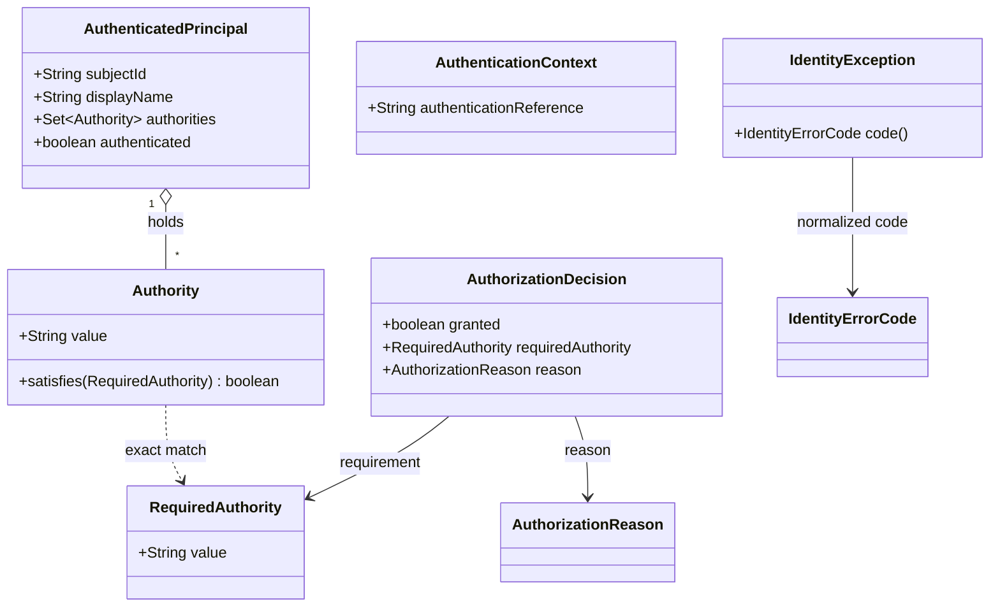
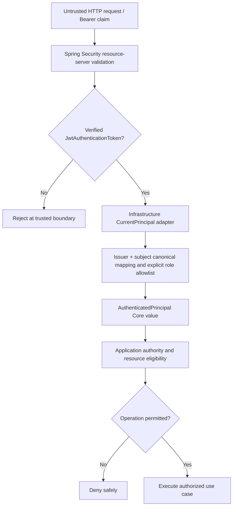

# Identity Core — Contract-First Domain Model

> **Evidence discipline:** `OBSERVED` = source at pinned SHA; `SELECTED` = architecture direction chosen for documentation; `PROPOSED` = follow-up work; `NOT VERIFIED` = no test executed for this document. The fifteen G4-F03 design choices do not constitute independent approval or runtime evidence.

## 1. Purpose, scope, ownership

Identity Core provides **provider-neutral value types** for subjects, authorities, authentication references, decisions, and normalized errors. It is not a Keycloak wrapper, JWT verifier, principal repository, session manager, authorization policy engine for ticket ownership, or HTTP gateway. `com.tricore.dxos.core.identity` has no provider SDK or Spring Security dependency in the eight inspected type files.

**Selected G4 foundation:** stable contracts, modular monolith, distinct Java API and external HTTP API, provider substitutions via trusted adapters, exact-source evidence and independent review. `docs/contracts/identity-core.md` remains the existing canonical contract source until reviewed migration or explicit supersession. This design document does not change the eight Java types.

## 2. Domain vocabulary and exact observed Java API

| Type / source | Observed members | Purpose and boundary |
| --- | --- | --- |
| `AuthenticatedPrincipal` | `String subjectId`, nullable `String displayName`, `Set<Authority> authorities`, `boolean authenticated` | Immutable value record, not proof of provider authentication |
| `Authority` | `String value`; `boolean satisfies(RequiredAuthority)` | Held authority identifier; exact string match |
| `RequiredAuthority` | `String value` | Required authority identifier |
| `AuthenticationContext` | `String authenticationReference` | Opaque reference, not raw token or proof |
| `AuthorizationDecision` | `boolean granted`, `RequiredAuthority requiredAuthority`, `AuthorizationReason reason` | Capability-level authority outcome, not resource ACL |
| `AuthorizationReason` | `AUTHORITY_GRANTED`, `MISSING_AUTHORITY` | Exactly two currently declared outcomes |
| `IdentityErrorCode` | Six enum members listed below | Stable capability error vocabulary |
| `IdentityException` | `IdentityException(IdentityErrorCode)`; `IdentityErrorCode code()` | Sanitized runtime failure |

`CurrentPrincipal` is an **Application-owned port**, not one of the eight Core types; its `requireVerified()` method returns `AuthenticatedPrincipal`. The current Spring Security implementation is an infrastructure adapter.

## 3. Relationship diagram (logical model, not authentication proof)



**Interpretation:** The types are value/decision carriers. None represents a verified network authentication event or an entitlement to a particular ticket. Relationships do not imply persistence ownership.

## 4. Constructor invariants and observable edge cases

| Type | Accepted / guaranteed | Rejected / observable exception | Do not infer |
| --- | --- | --- | --- |
| `AuthenticatedPrincipal` | nonblank opaque `subjectId`; `displayName` may be null; nonnull immutable copied authority set; `authenticated=true` | null/blank subject → `IllegalArgumentException`; null authorities → `IllegalArgumentException`; null element → `NullPointerException` from `Set.copyOf`; false flag → `IllegalArgumentException` | boolean true authenticates caller |
| `Authority` | nonnull nonblank string; exact preserved value | null/empty/blank → `IllegalArgumentException` | wildcard, case folding, normalization |
| `RequiredAuthority` | same structural string check | null/empty/blank → `IllegalArgumentException` | hierarchy or permission delegation |
| `AuthenticationContext` | opaque nonblank reference, preserved as supplied | null/empty/blank → `IllegalArgumentException` | verification, expiry check, token decoding |
| `AuthorizationDecision` | `(true, AUTHORITY_GRANTED)` or `(false, MISSING_AUTHORITY)` with nonnull requirement | mismatched bool/reason → `IllegalArgumentException`; null requirement or reason → `NullPointerException` | provider verification or resource ACL decision |
| `IdentityException` | nonnull code, message is enum name; no cause, stacktrace or suppression | null code → `NullPointerException` | HTTP status mapping, raw provider error passthrough |

Java records have value-based equality/hash semantics, including equality of their component values. `Set.copyOf` prevents mutation through the principal's exposed authority set, but does not establish authentication provenance. Whitespace outside the prohibited all-blank case is **not** trimmed; avoid silently rewriting source semantics.

### Exact authority matching

`Authority.satisfies(required)` calls `value.equals(required.value())`. Thus `"workflow:read"` matches itself and does **not** match `"Workflow:read"`, `"workflow:*"`, `" workflow:read"` or `"workflow:read "`. `null` `required` is not guarded by this method and dereferencing it causes `NullPointerException`; do not claim this is a normalized authorization denial. A held authority matching a requirement is still insufficient to authorize an Application resource.

## 5. Trust provenance — strictly separate from the domain model



This diagram is the **intended trust responsibility flow**, not an assertion that every Portal/BFF/Gateway hop is integrated or tested. `new AuthenticatedPrincipal(..., true)` and `new AuthenticationContext("...")` are constructible values only. Never promote `X-User`, `X-Role`, client-supplied claims or manual objects into trusted principals.

The observed `application.identity.CurrentPrincipal.requireVerified()` port expressly requires a verified caller. Observed `SpringSecurityCurrentPrincipal` rejects missing/non-`JwtAuthenticationToken` authentication, blank `sub`/`iss`, and maps a checked JWT token to the immutable Core principal. Signature, issuer, audience, time and `typ` verification belong to the security filter/decoder boundary; not to the Core record.

## 6. OIDC canonical identifier and migration implications

**Observed infrastructure algorithm**, not a Core dependency:

```text
oidc:<base64url_no_padding(UTF8(issuer))>.<base64url_no_padding(UTF8(subject))>
```

It uses strict UTF-8 and preserves exact issuer/subject values (no trim, lowercasing or Unicode normalization). Different issuer or subject values lead to different canonical identities. `subjectId` remains opaque to the Core and must not be treated as email, username, raw JWT subject, display name or internal database ID.

**Selected design:** an IdP replacement is conditional on preserving identity meaning. If identifiers change, explicitly design account linking, historical ownership mapping, authorization migration and rollback. An automatic email-based merge is **not approved**. A swap without such proof cannot claim identical identity continuity.

## 7. Authority mapping versus business authorization

Observed adapter reads `resource_access.<resourceClientId>.roles` and accepts **exactly**:
- `workflow:create`
- `workflow:activate`
- `workflow:transition`
- `workflow:read`

Other values are ignored; missing/malformed roles produce an empty authority set according to observed adapter behavior. The value objects themselves contain no assumption that these four are the only authority names possible.

**Boundary contract:** Identity/Core-level authority checks determine whether the required capability string is held. The Application must separately decide ticket visibility, assignment, ownership, facility approval, workflow-state eligibility and other resource-specific policies. No Core type embeds Helpdesk or Facility roles.

## 8. Normalized errors: current vocabulary, no invented codes

| Enum member | Meaning from canonical contract |
| --- | --- |
| `AUTHENTICATION_FAILED` | Authentication could not be established |
| `INVALID_AUTHENTICATION_CONTEXT` | Supplied context is invalid |
| `AUTHENTICATION_EXPIRED` | Previously valid context expired |
| `ACCESS_DENIED` | Access was denied |
| `IDENTITY_NOT_FOUND` | Requested identity was not found |
| `IDENTITY_PROVIDER_UNAVAILABLE` | Identity provider unavailable |

`IdentityException` exposes the code without raw tokens, provider exception internals or stack trace. Provider-specific errors must be mapped at a trusted adapter boundary. **Open decision ID-OD-01:** there is no dedicated `MISSING_AUTHENTICATION_CONTEXT` enum constant; do not invent one or assert its mapping. HTTP status/`ApiError` translation belongs outside Identity Core.

## 9. Provider substitution: compatibility is conditional

| Contract facet | Baseline observation | Candidate-provider conformance test |
| --- | --- | --- |
| Trusted provenance | `CurrentPrincipal.requireVerified()` backed by Spring Security JWT context | Synthetic/untrusted principal cannot enter protected action; real OIDC decoder verifies trust |
| Canonical subject | `issuer` + `sub` encoded with strict UTF-8 Base64URL | Same pair yields same ID; changed issuer or sub triggers reviewed migration, not silent merge |
| Authorities | Exact four workflow authorities in current adapter allowlist | Unknown, wrong-case and wrong-client roles do not escalate privileges |
| Core independence | Eight domain types have no Keycloak/Spring imports | Source dependency check and no consumer/Application edits in swap |
| Error semantics | Six codes + sanitized `IdentityException` | Equivalent failure categories, safe outputs; missing-context policy remains open |
| Resource access | Core authority check only | Application ownership/assignment/eligibility denial still enforced |

**Demonstration proposal:** pin baseline SHA, freeze Application source hash, run the same positive and negative test fixtures for original and alternative OIDC adapter, capture configuration/adapter-only diff and exact logs. A fixture-only adapter is useful for unit conformance but **not** proof of live IdP interchangeability. If subject continuity requires migration, record it explicitly.

## 10. Alternatives and trade-offs

| Option | Benefits | Costs / rejection reason |
| --- | --- | --- |
| Keycloak-aware Core records | Fewer short-term conversions | Locks public Core types to Keycloak; conflicts with selected contract-first direction |
| Generic `String role` without exact semantics | Simple data transfer | Opens wildcard/case/claim interpretation ambiguity |
| **Provider-neutral records + trusted adapter (selected)** | Stable consuming API, testable provider mapping | More adapter/evidence work; migration, issuer policies and auth freshness still hard |
| Entirely new principal and error model now | Could address redundant `authenticated` field | Breaking change without consumer analysis and accepted ADR; deferred |

The current `authenticated` boolean always must be true to construct the record and may be redundant. **ID-OD-02:** owner/reviewers decide whether deprecation is warranted after impact review. This file makes no code changes.

## 11. Source → invariant → test → evidence traceability

| ID | Inspected source / assertion | Required verification (not executed here) | Gate evidence needed |
| --- | --- | --- | --- |
| ID-DM-01 | `AuthenticatedPrincipal.java` immutable valid-state record | ctor/nullable name/copy/set mutation/null member | JUnit XML and exact SHA |
| ID-DM-02 | `Authority.java`, `RequiredAuthority.java` exact string match | case/whitespace/wildcard, blank, null requirement | Test names, assertions |
| ID-DM-03 | `AuthenticationContext.java` opaque ref | blanks rejected; arbitrary nonblank reference not treated as login | Core unit tests + security boundary tests |
| ID-DM-04 | `AuthorizationDecision.java`, `AuthorizationReason.java` paired invariant | four permutations, null fields | Unit result and error mapping review |
| ID-DM-05 | `IdentityErrorCode.java`, `IdentityException.java` normalization | enum compatibility, code message, no cause/stack | Unit tests + response redaction check |
| ID-DM-06 | `CurrentPrincipal.java`, `SpringSecurityCurrentPrincipal.java` trusted provenance | forged header, wrong token, missing `iss/sub` | Filter chain and IdP integration evidence |
| ID-DM-07 | adapter canonicalization and allowlist | UTF-8, multiple issuers, wrong roles/client ID | OIDC adapter tests and fixtures |
| ID-DM-08 | provider substitution requirement | same consumer, two adapters, authority/identity/error compatibility | Swap diff, test log, migration review |

Historical test descriptions appear in `docs/contracts/identity-core.md`; **this authoring session did not execute or independently revalidate them**. Do not represent them as current CI/E2E PASS.

## 12. Open decisions, risks and review disposition

- **ID-OD-01:** normalized error policy for absent authentication context.
- **ID-OD-02:** whether to retain `authenticated` flag that is always true for valid records.
- **ID-OD-03:** approved issuer/subject identity-linking and migration procedure.
- **ID-OD-04:** authority freshness, revocation and identity revalidation policy.
- **ID-OD-05:** provider conformance suite and real secondary IdP scope.
- **ID-OD-06:** reconciliation of Gateway/BFF principal propagation without spoofable headers.

Risk of unreviewed provider swap: account fragmentation, role escalation, false trust, drifted error behavior, session/revocation gaps and audit identity discontinuity.

**G4-F03 document status: DRAFT / NOT REVIEWED.** Design review, source-conformance check, runtime tests, independent acceptance and formal G4 Gate remain distinct. The selected directions do not approve breaking Java changes or provide runtime evidence.

## 13. Pinned references

- [Identity contract](https://github.com/lexuanbao258-collab/dxos-open-core/blob/0f0c3ba0c3eecda0a5c4a798a3cc14b808351bed/docs/contracts/identity-core.md)
- [Core identity Java package](https://github.com/lexuanbao258-collab/dxos-open-core/tree/0f0c3ba0c3eecda0a5c4a798a3cc14b808351bed/backend/src/main/java/com/tricore/dxos/core/identity)
- [CurrentPrincipal port](https://github.com/lexuanbao258-collab/dxos-open-core/blob/0f0c3ba0c3eecda0a5c4a798a3cc14b808351bed/backend/src/main/java/com/tricore/dxos/application/identity/CurrentPrincipal.java)
- [Spring Security adapter](https://github.com/lexuanbao258-collab/dxos-open-core/blob/0f0c3ba0c3eecda0a5c4a798a3cc14b808351bed/backend/src/main/java/com/tricore/dxos/infrastructure/identity/security/SpringSecurityCurrentPrincipal.java)

This document implements the **15 user-selected G4-F03 authoring decisions** recorded in `workbench/decision-records/G4_F03_DECISION_RECORD.md` and follows the G4 Core Contract Standards; it is not their independent approval.
