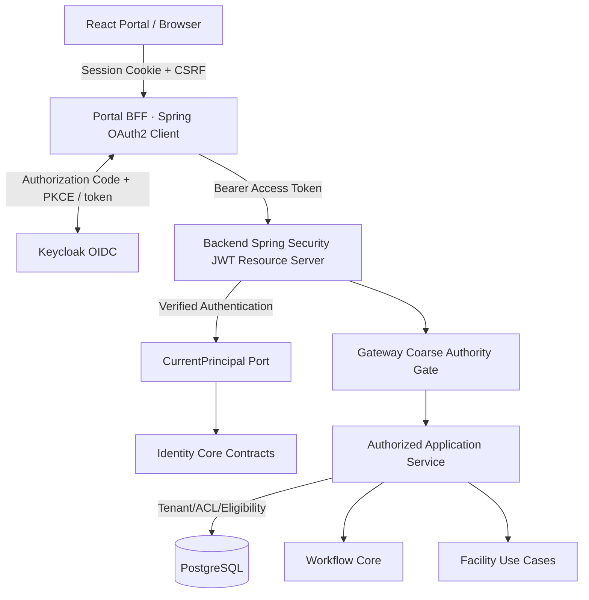
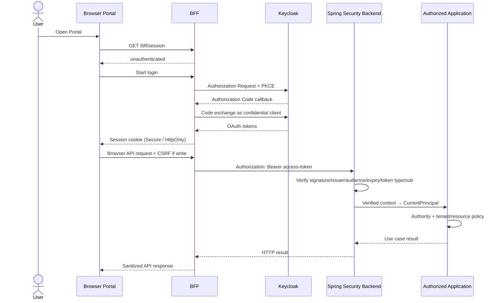

# DX-OS IDENTITY CORE v2
## Architecture Design, Implementation Roadmap & Acceptance Specification

**Nhóm:** TRICORE — DX-OS Open-Core
**Tình trạng:** PROPOSED / REVIEW REQUIRED — không phải kiến trúc đã được nghiệm thu
**Ngày đánh giá:** 28/10/2026
**Phạm vi:** Identity Core trong bốn capability Identity / Workflow / Data / API Gateway; Portal BFF và Spring Security adapter
**Giới hạn:** Tài liệu thiết kế và review; không xác nhận code đã được thay đổi, PR đã merge hay E2E đã PASS.

> **Quy tắc đọc:** [AS-IS] = đã quan sát từ source hoặc metadata PR; [TO-BE] = thiết kế đề xuất; [GATE] = điều kiện phải kiểm chứng. Một PR báo cáo test PASS không đồng nghĩa một release tích hợp đã được nghiệm thu.

## 0. Executive summary

Bốn lựa chọn được đưa vào thiết kế: **ID-ADR-01 A** Identity contracts + trusted principal boundary; **ID-ADR-02 A** Spring Security OIDC adapter + CurrentPrincipal; **ID-ADR-03 A** JWT authority + runtime Application policy; **ID-ADR-04 A** BFF server-side OAuth session. Kết luận reviewer: **chấp nhận hướng thiết kế, có điều kiện thực thi**, không xây IAM server mới. Tính provider-independent là thuộc tính của **Core API/contracts**, chưa phải khả năng migration IdP không thay đổi danh tính. Trong MVP, issuer+subject là định danh canonical, việc đổi issuer hoặc IdP có thể làm thay đổi các tham chiếu requester/assignee.

**Bốn chốt quan trọng:** (1) không coi việc dựng `AuthenticatedPrincipal` là proof of login; (2) xác minh JWT tại Backend dù BFF đã login; (3) application có trách nhiệm tenant/resource/eligibility và revocation semantics; (4) không tuyên bố BFF logout thu hồi mọi access token tức thì.

## 1. Mục tiêu, phạm vi, thuật ngữ (Responsibility)

### 1.1 Vì sao phải có Identity Core?

Nếu IT Helpdesk và Facility đều tự xác thực, parse JWT và định nghĩa `userId` riêng, nền tảng sẽ bị nhân đôi security logic, khó thêm ứng dụng và dễ dẫn đến khác biệt về chính sách. Identity Core cung cấp **biểu diễn ổn định của verified actor và authority facts** để các consumer chia sẻ. Identity Core **không** tự xử lý password, tài khoản Keycloak, user provisioning, Helpdesk roles hoặc resource ACL.

| Thuật ngữ | Định nghĩa chính xác | Ví dụ |
|---|---|---|
| Identity | Định danh chủ thể trong một namespace đáng tin | OIDC `(issuer, sub)` |
| Identity Provider (IdP) | Hệ thống xác thực và phát hành claims/token | Keycloak |
| Authentication | Kiểm chứng credential hoặc access token | JWT signature, issuer, audience, expiry |
| Authorization | Quyết định actor được làm gì đối với resource | Assignee được resolve ticket |
| Principal | Giá trị biểu diễn actor đã được trusted boundary xác lập | `AuthenticatedPrincipal` |
| Authority | Quyền operation được ánh xạ từ verified token | `workflow:read` |
| Tenant membership | Thành viên có hiệu lực trong tổ chức/phạm vi | Employee thuộc tenant A |
| Resource visibility | Quyền biết/đọc resource cụ thể | Chỉ thấy ticket được cấp quyền |
| OIDC | Lớp identity trên OAuth2 | Authorization Code + PKCE |
| BFF | Backend for Frontend, quản lý browser session và OAuth token server-side | `portal-bff/` |
| Trust boundary | Điểm chuyển dữ liệu bên ngoài thành sự kiện đã được kiểm chứng | Spring Security Resource Server |
| Provider independence | Core không cần biết SDK/token shape/provider | `CurrentPrincipal` không import JWT |

### 1.2 WHO / WHAT / NOT OWNED

| Owner | Sở hữu | Không sở hữu |
|---|---|---|
| Keycloak / IdP | Credential authentication, OIDC discovery, JWKS, token issuance, IdP user lifecycle | Helpdesk/Facility business policy |
| BFF | Authorization Code + PKCE client flow, OAuth authorized client, session cookie, CSRF, logout/session endpoint | Quyết định resource access Backend |
| Spring Security Identity Adapter | Verify JWT, extract verified claims, map canonical ID và authority allowlist | Lưu lịch sử ticket / SQL ACL |
| Identity Core | `AuthenticatedPrincipal`, `Authority`, `RequiredAuthority`, `AuthenticationContext`, error/decision value contracts | Login server, IAM administration, provider SDK |
| API Gateway | HTTP authentication enforcement, coarse-grained authority, 401/403 protocol translation | Resource ownership and assignee decisions |
| Application (Helpdesk / Facility) | Tenant/resource authorization, eligibility, use case, consistency | JWT signature verification |
| Workflow Core | Valid states, transitions, history contract | Verify OIDC token |

### 1.3 Các nguyên tắc

- Deny by default; claims/header do browser tự đặt không đáng tin.
- Source danh tính phải là `JwtAuthenticationToken` do verified filter chain tạo ra; bất kỳ object nào dựng thủ công không đủ chứng minh authentication.
- Mapping exact authority, không wildcard/prefix/suffix/case-fold.
- HTTP/app không truyền raw JWT vào Workflow domain.
- Không tạo authentication server thứ hai hoặc lưu password tại DX-OS.
- Bảo vệ multi-tenant ở Application ngay cả khi JWT đúng.
- Bất cứ thay đổi provider phải tái chạy contract/security/integration suite.

## 2. Baseline GitHub và evidence register (AS-IS)

| ID | Nguồn chính | Bằng chứng / giới hạn |
|---|---|---|
| SRC-01 | `docs/contracts/identity-core.md` | Nêu Core provider-neutral, trust-boundary và semantics, không có login verifier trong Core |
| SRC-02 | `core/identity/AuthenticatedPrincipal.java` | Record `subjectId`, `displayName`, `Set<Authority>`, `authenticated`; `false` bị cấm |
| SRC-03 | `application/identity/CurrentPrincipal.java` | `requireVerified()` lấy principal từ trusted boundary |
| SRC-04 | `infrastructure/identity/security/SpringSecurityCurrentPrincipal.java` | Đọc Spring `SecurityContextHolder`, JwtAuthenticationToken; canonical issuer+sub; Keycloak resource_access roles |
| SRC-05 | `infrastructure/identity/security/SecurityConfig.java` | Stateless Resource Server; issuer/audience/type/sub/expiration validation; raw numeric sub protection |
| SRC-06 | PR #46, `68c0fe0` | Handoff verified principal đến Gateway; HTTP probe test, không phê duyệt generic production Workflow API |
| SRC-07 | PR #56, `2ce628a` | Báo cáo real Keycloak D2-A/subject equality evidence; không thay production identity behavior |
| SRC-08 | PR #70, `d833b36` | BFF confidential OIDC, PKCE, session, CSRF, cookie, proxy; Draft LIVE_BLOCKED |
| SRC-09 | PR #63, `e12d105` | Helpdesk candidate real Keycloak harness; Draft, integrated E2E chưa được độc lập nghiệm thu |

**Source references**
- https://github.com/lexuanbao258-collab/dxos-open-core/blob/main/docs/contracts/identity-core.md
- https://github.com/lexuanbao258-collab/dxos-open-core/blob/main/backend/src/main/java/com/tricore/dxos/infrastructure/identity/security/SpringSecurityCurrentPrincipal.java
- https://github.com/lexuanbao258-collab/dxos-open-core/blob/main/backend/src/main/java/com/tricore/dxos/infrastructure/identity/security/SecurityConfig.java
- https://github.com/lexuanbao258-collab/dxos-open-core/pull/46
- https://github.com/lexuanbao258-collab/dxos-open-core/pull/56
- https://github.com/lexuanbao258-collab/dxos-open-core/pull/70

**Điểm chưa xác minh:** Không đưa ra khẳng định full-stack UI/BFF/Backend/DB PASS, provider thứ hai PASS, quyền bị revoke tức thời, hoặc IdP migration đã hoạt động.

## 3. Bốn Architecture Decision Records

### ID-ADR-01 — Core scope: Identity contracts + trusted principal boundary

**Decision:** Giữ Identity Core là lớp value/contracts thuần Java, không chứa logic giao thức hoặc IdP-specific management. Authentication verifier hoạt động ở infrastructure; Application nhận `CurrentPrincipal`.

**Alternatives:** A contracts/trust (chọn), B thêm provisioning/identity management (hoãn), C full IAM engine (loại cho MVP). **Trade-off:** A tăng tính rõ ràng/giảm rủi ro; không cung cấp centralized user administration trong DX-OS. **Condition:** user lifecycle thuộc Keycloak, lifecycle ứng dụng theo membership/ACL của Application.

**Code issue:** `AuthenticatedPrincipal.authenticated` luôn true trong object hợp lệ, nên redundant semantic; không đổi kiểu ngay trong release nếu consumer/test chưa review. `AuthenticationContext` chỉ là opaque reference, không phải authentication proof.

### ID-ADR-02 — OIDC Resource Server + CurrentPrincipal

**Decision:** Spring Security chịu trách nhiệm verify access token, `SpringSecurityCurrentPrincipal` chuyển issuer+subject thành canonical principal và mapping allowlisted workflow authorities; Core không import Keycloak/JWT/Spring.

**Alternatives:** A giữ OIDC adapter hiện tại (chọn); B `OidcClaimsMapper`/IdentityMappingPort khi có IdP khác; C full IdP SPI (hoãn). **Trade-off:** A ít code nhưng roles từ `resource_access[resourceClientId].roles` là Keycloak-shaped. Một token của provider khác có thể verify nhưng không cấp đúng authorities; fail-closed là đúng bảo mật nhưng chưa đạt portability chức năng.

**Compatibility:** thay issuer sẽ thay canonical ID. Giữ namespace `(issuer, sub)` cho MVP; không tự link theo email. Portability và identity-continuity là hai tiêu chí riêng.

### ID-ADR-03 — JWT authority + runtime Application policy

**Decision:** Kiểm operation authority coarse-grained từ token đã verify; business/resource/tenant permissions được Application quyết định với dữ liệu authoritative. Workflow Core xử lý transition validity, không xác thực JWT.

**Alternatives:** JWT-only authorization (reject), JWT + runtime policy (chọn), online introspection/revocation platform (defer). **Critical caveat:** authority trong JWT có thể stale sau khi IdP revoke role; kiểm DB membership không tự thu hồi token authority. Phải công khai giới hạn freshness hoặc thiết kế authoritative revocation cho operation authority.

### ID-ADR-04 — Browser authentication via BFF session

**Decision:** BFF confidential OAuth2 client, Authorization Code + PKCE, server-side OAuth token, Secure/HttpOnly `__Host-` cookie, CSRF on browser writes; Backend verify bearer token độc lập.

**Alternatives:** A BFF (chọn); B SPA trực tiếp PKCE (khác security/deployment model); C custom login server (reject). **Trade-off:** BFF thêm process, HTTPS/redirect/cookie/session dependencies. BFF logout không đảm bảo access token đã phát trước đó bị Backend revoke ngay. PR #70 là candidate, không được bật LIVE chỉ vì ADR chấp thuận.

## 4. Target architecture & trust boundaries (TO-BE)



Trust boundary TB-1 browser → BFF: browser cookie/session/CSRF validation. TB-2 BFF → Backend: bearer token là input chưa tin, Backend tự verify signature/issuer/audience/expiry/type/subject. TB-3 `CurrentPrincipal` → Application: ánh xạ từ verified framework authentication, không từ request parameters/headers. TB-4 Application → resource store: kiểm tenant/resource/role eligibility và concurrency trong transaction. TB-5 Core domain: actor/reference là dữ liệu, không phải authentication verifier.

### 4.1 Các hình thức gọi cần được phân biệt

- Browser không được nhận raw bearer access token trong JSON `/bff/session` hoặc được đưa vào JavaScript storage.
- Service-to-service HTTP sau này cần cơ chế service identity riêng; không tự làm giả `JwtAuthenticationToken`.
- Scheduled worker nên có trusted execution context được cấp bằng mechanism riêng, không dùng `X-User` tùy ý.
- Portal BFF không nên tự kiểm ACL của Helpdesk; logic đó thuộc Backend Application.

## 5. Core Contracts (Contract)

| Type | Ownership | Invariant / khuyến nghị |
|---|---|---|
| `AuthenticatedPrincipal` | `core.identity` | subject nonblank; immutable authorities; authenticated=true record hiện tại không chứng minh xác thực |
| `AuthenticationContext` | `core.identity` | opaque reference; structural validation only, no verifier in Core |
| `Authority` | `core.identity` | exact, case-sensitive, không trim, không wildcard |
| `RequiredAuthority` | `core.identity` | exact required identifier |
| `AuthorizationDecision` | `core.identity` | kết quả check authority, không chứng minh authentication |
| `IdentityErrorCode` | `core.identity` | lỗi chuẩn hóa; missing-context mapping còn cần quyết định |
| `CurrentPrincipal` | `application.identity` | `requireVerified()` trả principal từ trusted boundary hoặc fail closed |

`CurrentPrincipal` không được trả principal từ JSON body, `X-User`, `X-Role` hay constructor trực tiếp. Contract thuộc Java layer; HTTP error translation thuộc Gateway, không đưa `HttpStatus` vào Identity Core.

**Vấn đề cần chốt:** Thiếu normalized missing-context code trong current Identity contract; không tự bổ sung mã lỗi khi chưa review API/error precedence. Đối với unauthorized reads, 401/403/hidden404 là policy tại Gateway/Application, không phải boolean `authenticated`.

### 5.1 Authority mapping

Verified JWT `resource_access[resourceClientId].roles` → allowlist `workflow:create`, `workflow:activate`, `workflow:transition`, `workflow:read` → immutable `Set<Authority>`. Nếu claim sai cấu trúc, không cấp authority; không suy luận quyền wildcard. Nếu thêm Facility/Helpdesk-specific roles, chủ quyền identifier và scope phải được phê duyệt, không cho bất kỳ token role nào tự động thành system permission.

### 5.2 Subject mapping

```text
canonicalSubjectId = "oidc:" + base64url(UTF8(issuer)) + "." + base64url(UTF8(sub))
```

Tính chất: cùng cặp `(issuer,sub)` → cùng ID; cùng `sub` nhưng khác issuer → khác ID. Không chuẩn hóa URL/Unicode âm thầm. **Không ổn định khi issuer thay đổi.** Email/display name không phải identity key. Migration sang internal stable identity cần policy linking/phê duyệt, đánh giá tài sản dữ liệu và không được thực hiện theo email tự động.

## 6. Public API và Internal API

| API | Trạng thái | Trách nhiệm | Khuyến nghị |
|---|---|---|---|
| Keycloak `/authorize`, `/token`, OIDC discovery/JWKS | IdP service, không thuộc DX-OS API | Login và token | Không viết lại |
| BFF `/bff/session` | PR #70 candidate | Session state + CSRF metadata, không token raw | Giữ browser-facing; chuẩn hóa response |
| BFF `/bff/logout` | PR #70 candidate | Logout local + OIDC logout mechanism | Kiểm chứng callback/session end |
| Backend protected `/api/v1/...` | Có security filter | Token authentication | Không coi login là resource grant |
| `/api/v1/identity/me` | TO-BE optional | Thông tin verified principal đã giới hạn | Chỉ thêm khi có consumer thật |
| User provisioning REST | OUT of MVP | IdP administration | Không thêm |

**Internal invocation:** HTTP Adapter → Application UseCase → `CurrentPrincipal.requireVerified()` → Application authorization → Workflow/Data. `Jwt`, `ResponseEntity`, `HttpServletRequest`, `SecurityContext` không xuất hiện trong domain/core contracts.

## 7. Logic: trình tự xử lý (Flows)

### 7.1 Login / session / API request



### 7.2 Failure precedence

| Tình huống | Kỳ vọng |
|---|---|
| Không có session browser | BFF 401 hoặc cấu hình login redirect theo endpoint; không proxy write |
| CSRF fail | BFF chặn trước upstream; backend không đổi state |
| JWT invalid | Backend 401, không tạo principal |
| Valid JWT thiếu authority | 403 khi resource visible, không delegate mutation |
| Resource không visible | Hidden 404 theo policy; không tiết lộ presence |
| Workflow version conflict | 409 từ application/domain, không nhầm với 401 |
| Backend 401 đến BFF | BFF invalidate local session theo PR candidate |
| Backend 403 đến BFF | Giữ semantics 403, không coi là session expired |
| Network loss sau POST | Không tự retry; nếu commit outcome unknown thì reconcile authoritative state |

### 7.3 Logout, refresh và revocation

- Local BFF logout: invalidate browser session và OAuth authorized client state; xác minh cookie không còn usable.
- OIDC RP-initiated logout: cần test redirect/endpoint semantics thực tế; không suy ra mọi thiết bị đã logout.
- Backend access token đã phát có thể còn hiệu lực đến expiry nếu không có revocation check.
- Role bị xóa khỏi IdP: JWT role stale đến khi token hết hiệu lực theo policy; resource membership/ACL được Application kiểm theo authoritative data riêng.
- Account disabled tại IdP khác với account eligibility trong Helpdesk/Facility; cả hai phải có behavior xác định.

## 8. Dependencies & Package layout (TO-BE)

```text
backend/src/main/java/com/tricore/dxos/
├── core/
│   └── identity/
│       ├── AuthenticatedPrincipal.java
│       ├── AuthenticationContext.java
│       ├── Authority.java
│       ├── RequiredAuthority.java
│       ├── AuthorizationDecision.java
│       ├── AuthorizationReason.java
│       ├── IdentityErrorCode.java
│       └── IdentityException.java
├── application/
│   ├── identity/
│   │   └── CurrentPrincipal.java
│   └── authorization/
│       └── [operation + resource policies]
├── infrastructure/
│   └── identity/
│       ├── security/
│       │   ├── SecurityConfig.java
│       │   ├── SpringSecurityCurrentPrincipal.java
│       │   └── [JWT validators + authentication entrypoint]
│       └── oidc/
│           └── [optional future OidcAuthorityMapper]
└── gateway/
    └── [HTTP auth/error boundary, no password/JWT custom verifier]

portal-bff/src/main/java/.../portal/
├── PortalSecurity.java
├── PortalAuthorization.java
├── PortalSessionController.java
└── PortalBackendClient.java
```

Đây là **conceptual target**; không yêu cầu di chuyển package trong MVP. `SpringSecurityCurrentPrincipal` đã tồn tại ở infrastructure và implement port. Không thêm wrapper `VerifiedIdentity` hoặc mapper interface khi chưa có consumer/test về provider thứ hai.

### 8.1 Dependency laws

| Rule | Bắt buộc | Enforcement |
|---|---|---|
| ID-ARCH-01 | Core Identity không import Spring, Nimbus, Keycloak, Servlet, JDBC | ArchUnit |
| ID-ARCH-02 | Application CurrentPrincipal chỉ phụ thuộc Core contracts | ArchUnit |
| ID-ARCH-03 | Infrastructure được implement application/core ports, không đảo chiều | ArchUnit |
| ID-ARCH-04 | Workflow Core không import JWT or Identity adapter | ArchUnit |
| ID-ARCH-05 | Helpdesk/Facility không tự parse JWT | ArchUnit + review |
| ID-ARCH-06 | Không tin external actor header/body để tạo trusted principal | HTTP negative tests |
| ID-ARCH-07 | Business resource policy không ở Core Identity | package review |
| ID-ARCH-08 | Access tokens không lộ JS/cookie/log | browser + security tests |

## 9. Provider adapter & khả năng đổi công nghệ

### 9.1 So sánh ba chiến lược

| Lựa chọn | Thay OIDC provider | Stable user ID | Chi phí |
|---|---|---|---|
| A. OIDC Resource Server + `CurrentPrincipal` | Cần đổi cấu hình và claim mapper khi claims khác | Không mặc định | Thấp — **MVP** |
| B. Thêm `IdentityMappingPort` + internal stable ID | Có migration/linking chính thức | Có thể, nếu ownership được phê duyệt | Trung bình |
| C. Full IdP SPI / custom identity engine | Có thể bao quát nhiều giao thức | Tùy implementation | Rất cao, không cần MVP |

### 9.2 Kịch bản Keycloak → IdP khác

1. Xác định issuer/JWKS endpoint, accepted signing algorithms, audience, token type và resource client identity.
2. Chạy JWT verification contract suite trên IdP mới, đặc biệt `sub` type và expiry.
3. Kiểm tra claim mapping roles/groups/scopes chỉ thông qua allowlist.
4. Thử principal `(issuer,sub)` và xác minh không tự link nhầm với tài khoản cũ.
5. Nếu yêu cầu continuity, lập migration plan có verified identity linking và rollback; nếu không, công bố provider-bound identity.
6. Chạy Application regression: tenant membership/ACL, requester, assignee, history, audit.
7. Chạy Portal BFF login/logout/refresh/CSRF dưới issuer mới.
8. Không gọi bước 1–3 là 'cắm adapter là xong' nếu business records chưa bảo toàn identity.

### 9.3 Câu tuyên bố kỹ thuật có thể bảo vệ trước giám khảo

“Identity Core contracts không phụ thuộc Keycloak và Spring Security. Việc thay OIDC infrastructure adapter không đòi sửa business domain, **nhưng** issuer, authority claims, trust validation và identity continuity phải được migration và kiểm thử theo contract; MVP hiện pin một approved issuer.”

## 10. Security threat model

| Threat | Biện pháp | Test |
|---|---|---|
| Forged `X-User` / `X-Role` | Không tin headers; verified Spring authentication | ID-T08 |
| JWT tampered signature | JWKS/decoder signature verification | ID-T02 |
| Token sai issuer/audience | Validators cấu hình pin | ID-T03/04 |
| Numeric/blank subject | Raw subject verifier + validators | ID-T06/07 |
| Authority wildcard/prefix | `Authority.satisfies` strict exact comparison | ID-T09/10 |
| Keycloak-specific role injection | resource client id + allowlist | ID-T11 |
| Token replay after logout | Session invalidate, access-token lifetime/revocation caveat | ID-T22/26 |
| Stale token authority | Policy thời hạn/authoritative revocation nếu bắt buộc | ID-T26 |
| Cross-tenant / IDOR | Resource ACL trong Application | ID-T23 |
| Login CSRF/session fixation | OAuth2 state/PKCE, session cookie, CSRF config | ID-T17/19 |
| Token leak/logging | Server-side tokens, no-store, secret scans | ID-T18 |
| Unsanctioned issuer change | Config review + ID continuity gate | ID-T28 |

**Không tuyên bố đã chống mọi attack chỉ vì unit tests PASS.** JWT parser/validator, BFF proxy, TLS termination, browser cookie và tenant policy phải chạy cùng integration environment.

## 11. Lifecycle models

**Identity/IdP account:** PROVISIONED → ACTIVE → SUSPENDED/DISABLED → DEACTIVATED/DELETED. Nguồn authoritative hiện tại: IdP, không tự đồng bộ thành mọi business record.

**Browser session:** ANONYMOUS → LOGIN_PENDING → AUTHENTICATED → REFRESHED / EXPIRED → LOGGED_OUT. BFF session và IdP session là hai state khác nhau; cookie invalidation không đồng nghĩa token revocation toàn cục.

**Access token:** ISSUED → VALID → EXPIRED/INVALID; Backend kiểm tra từng request, không dùng `authenticated=true` để vượt decoder.

**Membership/authority:** GRANTED → UPDATED → REVOKED; JWT operation authority có thể stale; Application authoritative resource rules vẫn bắt buộc.

**Provider migration:** inventory identities → map candidates → verify identity ownership → approve linking → migrate references → run regressions → cutover + rollback. OUT of MVP trừ khi được phê duyệt.

## 12. Implementation roadmap (không sửa repository ở tài liệu này)

| Phase | Mục đích | Deliverables | Gate |
|---|---|---|---|
| ID-G0 | ADR freeze, owner, trust boundaries | Bốn ADR, decision log, scope/out-of-scope | Team approve |
| ID-G1 | Baseline capture | main SHA, PR HEADs, commands/tests | Reproducible evidence |
| ID-G2 | Contract hardening | subject/authority/error semantics, no new breaking API | Existing + contract tests |
| ID-G3 | Real BFF integration | HTTPS OIDC callback, cookie, CSRF, refresh/logout | Browser HTTP tests |
| ID-G4 | Application authorization | Identity principal → tenant/ACL/eligibility | NEG cases, no unauthorized writes |
| ID-G5 | Second consumer | Facility uses same `CurrentPrincipal` without JWT duplicate | Reuse regression |
| ID-G6 | Portability proof | OIDC claims mapper contract/provider test | No false grant; document identity changes |
| ID-G7 | Release evidence | clean install, secrets audit, API docs, test report | One pinned RC SHA |

**Change discipline:** mỗi giai đoạn dùng PR nhỏ, không sửa Core contract vô điều kiện. Không merge stacked draft PR chỉ vì các phương án kiến trúc đã được chọn.

### 12.1 Implementation ownership (đề xuất, không gán cá nhân)

Identity owner: contract/decoder/claim mapping. BFF owner: browser OAuth/session/CSRF. Application owner: resource/tenant policies. QA reviewer: independent JWT/HTTP/E2E and SHA pin. Release owner: bootstrap and evidence archive.

## 13. Acceptance test matrix — 30 test cases

| ID | Level | Scenario | Expected result |
|---|---|---|---|
| ID-T01 | HTTP | Anonymous protected API | 401; no write |
| ID-T02 | HTTP | Tampered JWT signature | 401 |
| ID-T03 | HTTP | Wrong issuer | 401 |
| ID-T04 | HTTP | Wrong audience | 401 |
| ID-T05 | HTTP | Expired JWT | 401 |
| ID-T06 | HTTP | Numeric `sub` | 401 |
| ID-T07 | HTTP | Missing/blank `sub` | 401 |
| ID-T08 | HTTP | Forged `X-User`/`X-Role` | No authentication bypass |
| ID-T09 | Unit | Authority case/whitespace mismatch | Deny |
| ID-T10 | Unit | Wildcard/prefix/suffix authority | Deny |
| ID-T11 | Unit | Unsupported resource roles | No privilege elevation |
| ID-T12 | Unit | Same `(issuer,sub)` | Same canonical ID |
| ID-T13 | Unit | Same `sub`, different issuer | Different canonical IDs |
| ID-T14 | Unit | Invalid Unicode input | Fail closed |
| ID-T15 | Integration | Real Keycloak verified access token | Canonical principal matches independently provided expected subject |
| ID-T16 | HTTP | Valid JWT but no operation authority | 403; no delegation |
| ID-T17 | Browser | BFF login with PKCE | Authenticated server-side session |
| ID-T18 | Browser | Cookie/JS/token checks | Secure/HttpOnly; no token in JS/response/log |
| ID-T19 | Browser | Missing CSRF on write | Rejected, no upstream mutation |
| ID-T20 | Integration | Backend 401 through BFF | Session invalidated as specified |
| ID-T21 | Integration | Backend 403 through BFF | Preserved 403, session semantics unchanged |
| ID-T22 | Browser | BFF logout | Browser session no longer usable |
| ID-T23 | DB/HTTP | Cross-tenant request with valid token | Hidden 404/403 as policy; no leak/write |
| ID-T24 | E2E | Same user opens Helpdesk & Facility | Same canonical subject; separate business policies |
| ID-T25 | Concurrency | Membership revoked during write | Required linearization/authorization ordering preserved |
| ID-T26 | Security | IdP role revoked while old JWT valid | Behavior equals published freshness policy; no false instant revocation claim |
| ID-T27 | Contract | Other OIDC provider with different role claim | Explicit mapping; unrecognized claim deny |
| ID-T28 | Migration | New issuer with same email/sub | No automatic identity linking |
| ID-T29 | Setup | Fresh clone and local identity setup | Reproducible login/test by independent tester |
| ID-T30 | E2E | Restart BFF/Backend & repeat workflow reads | Durable data and session behavior meet specification |

### 13.1 Evidence requirements

Mỗi test cần: test ID, exact Git SHA, Java/Gradle versions, run command, sanitized issuer/port/config, timestamps, report XML/log hash, người thực thi, PASS/FAIL/SKIP và lý do. Tests liên quan real Keycloak cần ghi rõ đó là thật hay mocked decoder. E2E phải dùng cùng integration candidate, không cộng test counts từ các PR base khác nhau.

### 13.2 Release acceptance gates

- **SECURITY GATE:** ID-T01..16 được xác minh, chưa có high/critical open authorization defect.
- **BROWSER GATE:** ID-T17..22 trên HTTPS browser thực tế với CSRF/session/token controls.
- **APPLICATION GATE:** ID-T23..26 giữ resource/tenant rules và revocation semantics.
- **PORTABILITY GATE:** ID-T27..28 được thực thi nếu dự án claim đổi IdP; nếu không, ghi rõ giới hạn MVP.
- **REPRO GATE:** ID-T29..30 và manifest các commit/thành phần tương thích.

## 14. Risk register và những quyết định còn mở

| Risk | Mức | Owner đề xuất | Mitigation / decision |
|---|---|---|---|
| Đổi issuer làm đứt requester/assignee references | High | Identity + Application | Pin issuer MVP; ID linking ADR sau |
| JWT operation authority bị stale | High | Identity + Security | Định nghĩa token lifetime, revoke policy, không claim instant revoke |
| BFF và Backend disagree issuer/audience | High | BFF + Backend | E2E exact token, config audit |
| Dựng principal từ caller-provided object | Critical | Backend | Use `CurrentPrincipal.requireVerified`, negative tests |
| Mở generic workflow API chỉ với authority | Critical | Application | Resource binding policy trước khi expose |
| BFF server/session outage | Medium | BFF | fail-closed, timeout, restart testing |
| PR #70 chưa tích hợp Portal #71 / Helpdesk #63 | High | Release | Integration SHA + real E2E |
| Overengineering provider SPI | Medium | Architecture | Chỉ thêm abstraction khi có provider thứ hai/test |
| Error mapping missing-context chưa thống nhất | Medium | Identity/Gateway | Chốt API precedence/contract trước khi đổi enum |

**Open Decisions:** OD-01 `authenticated` boolean lifecycle; OD-02 missing-context error mapping; OD-03 supported authority expansion for Facility; OD-04 token freshness/revocation SLA; OD-05 issuer migration / user linking; OD-06 whether `/identity/me` needed; OD-07 service identities for jobs; OD-08 retention/PII/logging policy.

## 15. Reviewer decision / sign-off template

| Gate | Trạng thái tại lúc tạo tài liệu | Sign-off evidence |
|---|---|---|
| ADR approved | PROPOSED | Team review comment / decision link |
| Core contract stable | NEEDS REVIEW | Tests + source diff |
| OIDC JWT verifier | BASELINE AVAILABLE | Independent run at pinned SHA |
| BFF integration | LIVE_BLOCKED candidate | Browser E2E |
| Resource authorization | NOT ACCEPTED BY THIS DOCUMENT | DB/HTTP negative tests |
| Facility Identity reuse | NOT VERIFIED | Same subject / no duplicate parser |
| Alternate IdP portability | NOT VERIFIED | Provider compatibility test |
| Release/clean install | NOT VERIFIED | Fresh machine / RC manifest |

**Kết luận:** Chấp nhận ID-ADR-01..04 về mặt kiến trúc, không phê duyệt production rollout chỉ dựa trên tài liệu. Thành công của Identity v2 được đo bằng một verified actor đi từ IdP → BFF → Backend → Application với đúng quyền, có thể được tái sử dụng cho hai ứng dụng, và không cần đưa Keycloak-specific types vào Core.

---

**Nguồn hiện trạng:** Repository DX-OS và PR liên quan nêu trong §2. **Các luồng, package đích, test matrix, gates và đề xuất thực thi:** thiết kế của reviewer, chưa được triển khai hoặc nghiệm thu tự động.
