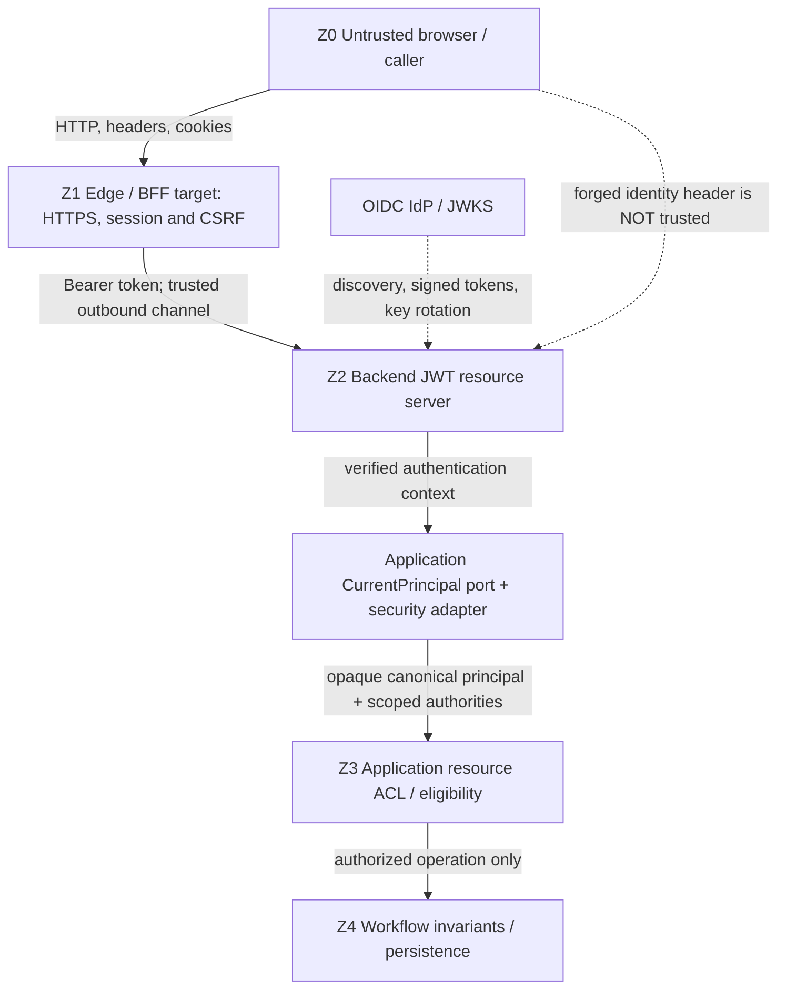

# Identity Core — Security Boundaries & Threat Model

> **Evidence discipline:** OBSERVED means a cited artifact exists at the pinned source SHA; SELECTED means an authoring direction chosen by the team; CANDIDATE means implementation outside this pinned baseline; PROPOSED means required architecture or test behavior; NOT VERIFIED means no runtime evidence was generated for this document. **This is not a pentest, CI report or approved Gate decision.**

## 1. Scope, critical assets and exclusions

This document specifies end-to-end trust boundaries from an untrusted browser through optional Portal/BFF and Gateway to authenticated backend use cases and authorized Workflow execution. Its purpose is to protect the **security semantics of stable Identity contracts** when the OIDC provider or edge/BFF adapter is replaced. It complements [Identity Core contracts](https://github.com/lexuanbao258-collab/dxos-open-core/blob/0f0c3ba0c3eecda0a5c4a798a3cc14b808351bed/docs/contracts/identity-core.md), [system dependency rules](https://github.com/lexuanbao258-collab/dxos-open-core/blob/0f0c3ba0c3eecda0a5c4a798a3cc14b808351bed/docs/01-architecture/dependency-rules.md) and the G4 Core Contract Standards.

**Assets:** opaque canonical identities; capability authorities; ticket/Facility resource permissions; access and refresh tokens; browser session credentials; Workflow state/history; audit integrity; IdP trust configuration (issuer, audience, JWKS); secrets and operational logs.

**Threat actors:** anonymous public client; authenticated user targeting a different resource; compromised browser session; attacker-controlled headers/tokens; misconfigured IdP/adapter; administrator with excess configuration access; network actor if private backend exposure fails.

**Entry points:** HTTP edge, OIDC callback, BFF session/cookie, backend Bearer token endpoint, provider discovery/JWKS, Application-owned authorized API, audit/log output. No assertion of the existence or public reachability of a particular proposed BFF callback or endpoint is made.

**Exclusions:** no custom cryptographic algorithm, no new JWT parser inside Core, no claim of production network isolation, no new business authorization policy for Helpdesk/Facility, no source changes or validation that an alternate provider is live.

## 2. Pinned source observations versus target design

| Source or contract | OBSERVED at pinned SHA | Not established by inspection |
| --- | --- | --- |
| `SecurityConfig.java` | `SessionCreationPolicy.STATELESS`, `.csrf(disable())`, `/api/v1/health` public, other requests authenticated; Spring Resource Server JWT; `NimbusJwtDecoder` with issuer discovery, issuer/time, audience, access-token type, subject and expiration validators; raw signed-JWT `sub` type check | That cookie-based BFF requests are CSRF-safe; actual network ingress isolation; current CI PASS |
| `CurrentPrincipal.java` | Application-owned `requireVerified()` port; documentation requires verified boundary | A universal verification implementation for every IdP |
| `SpringSecurityCurrentPrincipal.java` | Accepts authenticated `JwtAuthenticationToken`; rejects missing/blank issuer/subject; canonical `oidc:base64url(UTF8(iss)).base64url(UTF8(sub))`; exact role allowlist on configured resource client | Alternative IdP role mapping, complete Gateway propagation or automatic account linking |
| `docs/contracts/identity-core.md` | Provider-neutral value types; forged identity headers untrusted; canonical/error semantics; historical test descriptions | Re-run of historical tests, full Portal-to-Workflow E2E or replacement provider tests |
| `docs/01-architecture/dependency-rules.md` | Proposed modular-monolith and dependency boundary standards | All source imports/ArchUnit gates currently passing |

**Security nuance:** the observed backend disables CSRF for its stateless Bearer-token security filter chain. This is not permission to disable CSRF for any future cookie-authenticated BFF. In the contract, OAuth response `token_type=Bearer`, JOSE header `typ=JWT`, and JWT **payload** claim `typ=Bearer` are distinct values; the custom AccessTokenTypeValidator concerns the payload claim.

## 3. Zone and control ownership

| Zone | Trust level and protection | Boundary owner |
| --- | --- | --- |
| Z0 Browser/public client | Untrusted HTTP, supplied headers, content, session identifiers | Client inputs untrusted |
| Z1 Edge / Portal / BFF (CANDIDATE/PROPOSED) | TLS termination and forwarding; server-side tokens, CSRF-safe sessions, secure cookies; protected OIDC callback | Portal/Gateway owner |
| Z2 Backend authentication | Independent Bearer JWT signature/issuer/audience/time/type validation; secure filter context; safe 401 behavior | Backend Identity/Security adapter |
| Z3 Application authorization | Exact capability authority plus resource ownership/eligibility and actor policies | Helpdesk/Facility Application |
| Z4 Workflow execution and storage | Transition invariants, expected version, audit and persistence commit semantics | Workflow + persistence owner |
| Cross-cutting | Secrets, telemetry, correlation, rate limiting, incident response | Security/Operations |

The zones are **logical security trust boundaries**, not five microservices.



**Diagram status:** backend JWT context and identity port = OBSERVED; browser/BFF and private-edge topology = CANDIDATE/PROPOSED; end-to-end sequence = NOT VERIFIED.

## 4. STRIDE model and trust-boundary decisions

STRIDE: **S**poofing, **T**ampering, **R**epudiation, **I**nformation Disclosure, **D**enial of Service, **E**levation of Privilege. Threats map to prioritized controls, verification plans and evidence owners below. The severity designation P0/P1 is a **project review proposal**, not an independently validated risk score.

**Non-negotiable trust conditions:**
- Reject tokens with invalid signature, issuer, audience, timing, subject format or required payload token type. No bypass on IdP/JWKS failure.
- Never promote client-provided `X-User`, `X-Role`, `X-User-Id`, `X-Authorities`, unverified JWT claims, or `AuthenticatedPrincipal(authenticated=true)` to proof of a verified caller.
- Role translation must use the configured resource-client role location and exact allowlist. Unknown or malformed roles must not become privileges; absence of authority is not equivalent to granting access.
- Identity/Core authority matching is **not** ticket ownership, Facility approval eligibility, tenant isolation or Workflow-state permission.
- Protect backend independently of edge assumptions; unguarded generic mutation routes are a blocking architecture failure.
- Prevent cross-store audit loss and misleading 'success' evidence when authorization fails or transactions are ambiguous; verify persistence behavior in its own gate.

## 5. Threat → Control → Test → Evidence → Reviewer matrix

| Threat | STRIDE | Crossing | Required control | Test ID | Expected outcome | Proposed reviewer | Evidence status |
| --- | --- | --- | --- | --- | --- | --- | --- |
| TH-01 Spoofed X-User/X-Role | S | HTTP → backend | Ignore caller identity headers; verified token only | SEC-01 | 401 / no trusted principal | Identity/Security | NOT VERIFIED |
| TH-02 Forged signature / unsafe JWT form | S,T | Bearer → decoder | Nimbus signature/JWKS validation and algorithm policy review | SEC-02 | 401; no execution | Identity/Security | NOT VERIFIED |
| TH-03 Wrong issuer or audience | S | JWT → principal | Validate issuer and required audience | SEC-03 | 401; no principal | Identity/Security | NOT VERIFIED |
| TH-04 Expired, future, wrong typ, malformed sub | T | JWT claims → principal | Timestamp, token type, raw subject checks | SEC-04 | Reject invalid token | Identity/Security | NOT VERIFIED |
| TH-05 Valid authority, forbidden ticket | E | Principal → Application | Resource ownership/eligibility policy in Application | SEC-05 | Denied; no mutation/audit of success | Application | NOT VERIFIED |
| TH-06 CSRF against cookie-based BFF | T,E | Browser cookie → BFF | Origin/CSRF defense, safe cookie attributes | SEC-06 | State-changing request rejected | Portal/BFF | NOT VERIFIED |
| TH-07 Session/refresh-token theft | I,E | BFF session → token store | HttpOnly/Secure cookie; server-side secrets, rotation, expiry | SEC-07 | Stolen/reused session rejected | Portal/Security | NOT VERIFIED |
| TH-08 Direct mutating-route bypass | E | Edge → private backend | Private exposure + backend independently authenticates + route restrictions | SEC-08 | Denied, no state change | Gateway/Backend | NOT VERIFIED |
| TH-09 IdP swap changes identity/roles | S,E | IdP → adapter | Issuer-subject linking policy; scoped role allowlist; identical conformance tests | SEC-09 | No silent merge or extra authority | Identity/Platform | NOT VERIFIED |
| TH-10 Secrets/raw tokens in logs/errors | I,R | Adapter → audit/logging | Redaction, safe errors, correlation IDs | SEC-10 | No token, credential, provider secret in output | Security/Operations | NOT VERIFIED |
| TH-11 Logout/revocation mismatch | E | Session/IdP → backend | Session invalidation; expiry and revocation limitations disclosed | SEC-11 | Old session denied; residual JWT lifetime bounded | BFF/Identity | NOT VERIFIED |
| TH-12 IdP outage / JWKS key rotation | D,S | Decoder ↔ IdP/JWKS | Fail closed on invalid/unverifiable token; controlled refresh/timeouts | SEC-12 | No validation bypass; bounded failure | Identity/Operations | NOT VERIFIED |

**Review rule:** each row requires a real test command, exact source SHA, test report, relevant sanitized log/screenshot and reviewer disposition before status changes from NOT VERIFIED. Historic test summaries in the canonical Identity contract are not substitute evidence for this review.

## 6. Valid JWT is not sufficient authorization

Policy sequence for a state-changing use case:

1. Backend accepts only a verified authentication context established by its configured security boundary.
2. `CurrentPrincipal.requireVerified()` maps it to an opaque, provider-neutral `AuthenticatedPrincipal`.
3. Application/authorized use case evaluates **exact capability authority** and **resource-specific eligibility** (e.g., ownership/assignment/organization/state); a JWT claim alone cannot establish this.
4. Workflow executes only if its own state/transition/version invariants hold and produces auditable history subject to its persistence contract.

A valid signature with insufficient resource entitlement must be denied before mutation. Application authorization failures must not be disguised as successful Workflow mutations. 401 for unauthenticated/invalid credentials and 403 for authenticated-but-forbidden are preferred HTTP semantics, while resource-hiding 404 requires a separately reviewed API policy; do not assert every path currently follows this policy.

```mermaid
sequenceDiagram
    autonumber
    participant C as Untrusted client
    participant S as Backend security boundary
    participant P as CurrentPrincipal adapter
    participant A as Authorized Application
    participant W as Workflow
    C->>S: Request with Bearer token or forged identity header
    alt Invalid/missing token
        S-->>C: 401 safe error; no principal
    else Verified JWT
        S->>P: Verified security context
        P-->>A: Canonical principal + exact authorities
        A->>A: Authority and resource eligibility checks
        alt Missing authority or resource entitlement
            A-->>C: Deny safely; no Workflow mutation
        else Authorized
            A->>W: Controlled command with trusted actor
            W-->>A: Validated transition result
            A-->>C: Authorized response
        end
    end
```

**Status:** sequence is a security contract to review, not proof of complete implemented HTTP behavior.

## 7. JWT verification and principal provenance

The observed `SecurityConfig` configures a Spring Security `oauth2ResourceServer().jwt(...)` with a Nimbus decoder constructed from issuer discovery and a validator chain. The decoder inspects raw signed-token `sub` before normal claims handling to prevent numeric subjects from silently coercing into strings. The security adapter checks the Spring context holds an authenticated `JwtAuthenticationToken` and rejects blank `iss`/`sub`; valid pairs are encoded using strict UTF-8 Base64URL without padding, not lowercased, trimmed, or interpreted as emails.

**Provider neutrality condition:** the same domain principal and authority semantics must result from a different verified OIDC adapter; required audience, issuer binding, claim semantics and failures cannot be relaxed for convenience. Replacing Keycloak may change `iss`/`sub` and therefore canonical IDs: linking, audit continuity and migration require an explicitly approved process. No implicit email merge.

## 8. Edge, BFF session, CSRF and direct access

**Backend OBSERVED:** bearer-token resource server uses `STATELESS` sessions and disables CSRF at this backend chain. If browser credentials are cookies, those requests must be analyzed separately.

**BFF PROPOSED:** Authorization Code + PKCE S256 and validated redirect/state; `nonce` where applicable (not a blanket requirement for every OAuth-only exchange). BFF retains refresh/access tokens server-side, browser receives short-lived, rotated, `HttpOnly`, `Secure`, appropriately scoped `SameSite` session cookie. Enforce CSRF tokens or equivalently robust CSRF protection for cookie-authenticated state changes, exact origin/host/proxy trust and safe redirect handling. Define secure renewal, session fixation protection, refresh failure, logout and replay handling. This description does not certify a BFF implementation.

**Backend exposure PROPOSED:** enforce authentication/authorization independently even when traffic is routed via proxy; network policies should restrict direct access and dedicated internal routes. A valid trusted token to a direct backend route still must not evade Application ACL/Workflow invariants. Verify route allowlist and direct-call negatives in a disposable environment. CORS, hidden API docs or obscured URLs are not authorization controls.

## 9. Secrets, audit, availability and recovery

- Never log full JWT, refresh token, password, authorization header, session cookie, private keys or raw provider exceptions; retain privacy-safe request correlation and denial/audit reason where approved.
- Distinguish "request was authenticated", "actor authorized" and "Workflow committed" in audit to avoid false assertions.
- On missing/unverifiable token and JWKS/IdP outage, fail closed. Document bounded cache refresh, rotation, timeout and availability behavior; verify controlled recovery when keys rotate. "Fail closed" does not require every valid cached-key request to fail during a discovery outage, but never accept unverified credentials.
- Protect session/refresh stores at rest, in transit and operational backups. Explicitly document revocation limits of self-contained JWT access tokens and residual lifetime after logout.
- Apply bounded request sizes, connection/timeouts and rate limits at suitable layers; exact runtime settings remain NOT VERIFIED.

## 10. Security conformance under provider or BFF swap

**D0 baseline:** pin source SHA, configuration and dependency versions; snapshot consumer/domain code; collect original provider's positive/negative authentication and authorization cases.

**D1 change:** replace only provider adapter/wiring and explicitly approved identity-migration configuration. If required public contract changes, stop and seek a breaking-change decision; do not weaken tests or silently rename authorities.

**D2 same tests:** re-run the exact `SEC-01`–`SEC-12` suite against the candidate with real signature/JWKS, issuer, audience, session and resource cases as applicable. Capture before/after diff and review canonical identity continuity.

**D3 integration:** demonstrate Helpdesk and Facility resource-level refusals, generic mutation bypass denial and evidence under an actual IdP-backed runtime. Fixture-only tests are not live provider substitution proof.

**D4 recovery:** idP outage/key rotation, refresh/logout, ambiguous state changes, secret/log inspection. Exemptions must be documented as blockers, not counted PASS.

**D5 independent assessment:** archive command, version, SHA, report, sanitized logs, migration record and reviewer decision.

| Swap | Allowed change | Security invariant not allowed to change |
| --- | --- | --- |
| Keycloak → another OIDC provider | Adapter, issuer/audience configuration, claim translation, approved identity linking | Verified provenance, subject continuity policy, scoped authorities and resource ACL |
| BFF implementation replacement | Edge adapter, session store and explicit migration/wiring | Secure cookies, CSRF protection, authenticated forwarding and restricted routes |
| Gateway/proxy replacement | Ingress routing and managed certificates/network policy | Backend independent verification and no unguarded mutating paths |

## 11. Verification plan and acceptance conditions

| Group | Cases | Verification level needed |
| --- | --- | --- |
| Token authenticity | SEC-01–04 | Decoder/filter-chain unit + real signed-token IdP integration |
| Application authorization | SEC-05, SEC-08 | Real API + database mutation absence and audit evidence |
| BFF lifecycle | SEC-06, 07, 11 | Browser/session/cookie integration, origin and CSRF negatives |
| Provider and key rotation | SEC-09, 12 | Alternate OIDC fixture + real IdP swap and JWKS rotation |
| Error hygiene | SEC-10 | Safe HTTP errors and redacted audit/log inspection |

Acceptance must distinguish *design validity*, *source conformance*, *test execution*, *runtime integration*, *provider substitution* and *independent review*. No blanket E2E, CI, security-certified or OLP approval statement is permitted without actual evidence.

## 12. Risks, open decisions and Gate blockers

| ID | Status | Decision or risk |
| --- | --- | --- |
| SB-OD-01 | OPEN | Exact BFF session, token retention, CSRF origin policy and cookie configuration |
| SB-OD-02 | OPEN | Authoritative network exposure and restricted mutating routes |
| SB-OD-03 | OPEN | Resource ACL and 403/404 behavior per Helpdesk/Facility contract |
| SB-OD-04 | OPEN | Identity linking and de-provisioning when `iss`/`sub` changes |
| SB-OD-05 | OPEN | JWKS cache, key rotation, outage and recovery budgets |
| SB-OD-06 | OPEN | Logout and revocation semantics, max residual JWT lifetime |
| SB-OD-07 | OPEN | Source-SHA-bound real negative tests and independent threat review |
| SB-OD-08 | OPEN | Error normalization between `IllegalStateException`, Identity codes and HTTP `ApiError` |

**Hard blockers to security acceptance:** spoofed principal accepted; signature/issuer/audience bypass; wrong-client roles grant authority; user with valid token mutates forbidden ticket; BFF cookie-state changes lack an appropriate CSRF defense; direct route bypasses Application policy; secrets appear in error/log evidence; unsupported provider swap claims.

**Current disposition:** `DRAFT / NOT REVIEWED`. No Java tests, threat execution, live provider replacement, end-to-end demonstration or independent Gate review occurred in this document-authoring step.

## 13. Exact-SHA references

- [SecurityConfig.java](https://github.com/lexuanbao258-collab/dxos-open-core/blob/0f0c3ba0c3eecda0a5c4a798a3cc14b808351bed/backend/src/main/java/com/tricore/dxos/infrastructure/identity/security/SecurityConfig.java)
- [SpringSecurityCurrentPrincipal.java](https://github.com/lexuanbao258-collab/dxos-open-core/blob/0f0c3ba0c3eecda0a5c4a798a3cc14b808351bed/backend/src/main/java/com/tricore/dxos/infrastructure/identity/security/SpringSecurityCurrentPrincipal.java)
- [CurrentPrincipal.java](https://github.com/lexuanbao258-collab/dxos-open-core/blob/0f0c3ba0c3eecda0a5c4a798a3cc14b808351bed/backend/src/main/java/com/tricore/dxos/application/identity/CurrentPrincipal.java)
- [Identity Core contract](https://github.com/lexuanbao258-collab/dxos-open-core/blob/0f0c3ba0c3eecda0a5c4a798a3cc14b808351bed/docs/contracts/identity-core.md)
- [Dependency Rules](https://github.com/lexuanbao258-collab/dxos-open-core/blob/0f0c3ba0c3eecda0a5c4a798a3cc14b808351bed/docs/01-architecture/dependency-rules.md)
