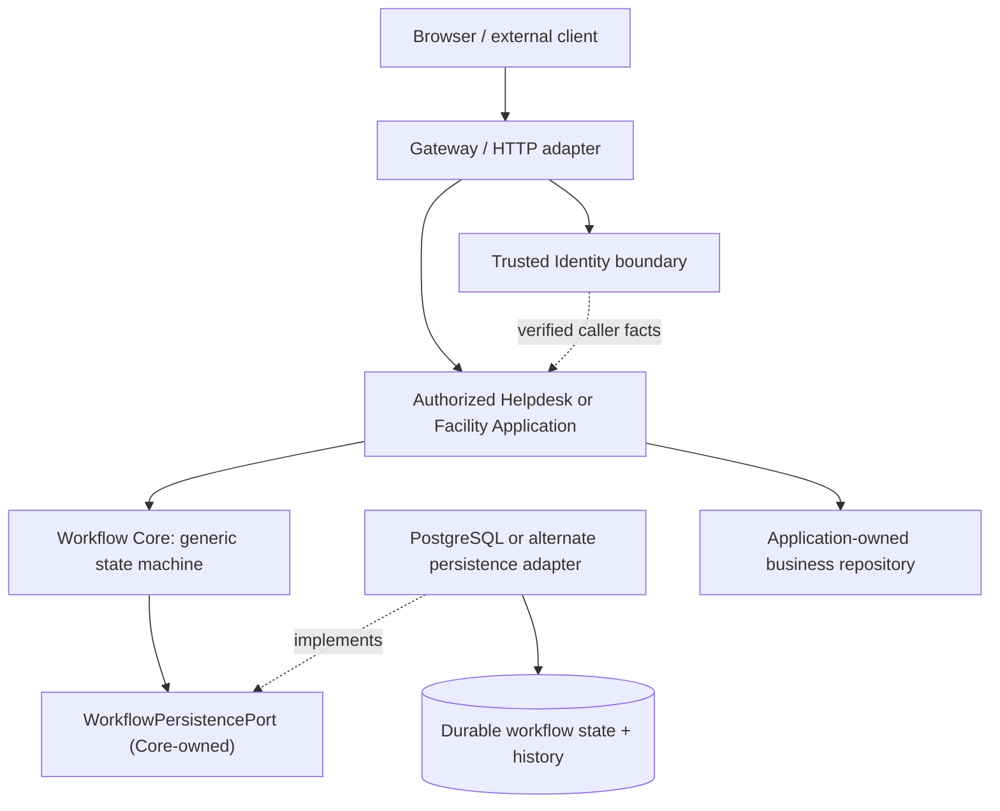

# Workflow Core — Architecture & Contract Review Portal

> **Evidence rule:** OBSERVED = a source/contract statement at the pinned SHA; SELECTED = one of the eighteen G4-F09 authoring directions; PROPOSED = intended behavior or implementation not verified at that SHA; DEFERRED = explicitly outside baseline; VERIFIED = evidence actually executed and independently checked. No tests were executed for this README. G4 review and Gate are NOT APPROVED.

## 1. Purpose and boundaries

Workflow Core is the **reusable, generic state-machine capability** of DX-OS Open-Core. It defines workflow definitions and immutable runtime snapshots, controlled state transitions, lifecycle and version invariants, durable history contracts, normalized errors, and a Workflow-owned persistence port. It is a **logical capability in a Spring Boot modular monolith**, not an independent Workflow microservice, not a ticket status handler, and not a full BPMN engine.

The baseline is [the existing Workflow Core contract](https://github.com/lexuanbao258-collab/dxos-open-core/blob/0f0c3ba0c3eecda0a5c4a798a3cc14b808351bed/docs/contracts/workflow-core.md), observed at commit `0f0c3ba0c3eecda0a5c4a798a3cc14b808351bed` (blob `11c5aaca1e7e08394710a6d0c5fe8e187d549d83`). This README navigates architecture and review evidence; it does not supersede that contract or modify Java signatures.

**Non-goals:** owning Helpdesk/Facility business policies, actor authentication, ticket/Facility entities, SLA/timers, notification delivery, autonomous business approval, external HTTP routing, arbitrary BPMN execution, or selecting an SQL provider. Definition publishing/registry policy and advanced graph/process constructs remain DEFERRED pending explicit decisions.

## 2. Core ↔ Application ↔ Adapter ownership

| Boundary | Owns | Must not assume |
| --- | --- | --- |
| Workflow Core | Definition/instance/transition/history models, lifecycle, deterministic transition semantics, `WorkflowPersistencePort`, error vocabulary | Logged-in actor, business approval, provider-specific SQL, direct HTTP exposure |
| Application: Helpdesk | Ticket/business rules, resource authorization, actor eligibility, assignments, SLA, relevant workflow definition and authorized orchestration | A Workflow authority alone grants ticket access |
| Application: Facility | Facility policies, approvers, resource eligibility, its definition and authorized orchestration | Facility-only logic can be embedded in Core |
| Identity/Gateway boundary | Verified caller and trusted context via approved Application seam; inbound routing/security | `ActorReference` or a supplied header proves login |
| Persistence/Data adapter | Implements Workflow-owned port with durable writes, concurrency, atomicity, recoverability and normalized provider errors | Provider adapter may redefine workflow transitions |
| API adapter | Independently versioned HTTP contract and DTO validation | Every public Java method automatically becomes a REST endpoint |

The direction of **Java dependencies** runs from Application/adapters toward Core-owned contracts. The intended **runtime calls** go from trusted/authorized use cases toward Workflow and its persistence port. These are different viewpoints.

**Evidence labels:** Core contract and pure-model separation = OBSERVED in canonical contract; authorized end-to-end diagram and alternative adapter = SELECTED/PROPOSED until implementation and evidence are pinned.

## 3. Contract map and model

| Public type / contract | Purpose and main invariant |
| --- | --- |
| `WorkflowDefinition` | Immutable `(definitionId, definitionVersion)` with states, initial state and unique transitions |
| `WorkflowTransition` | Stable transition ID; source/target must belong to declared states |
| `WorkflowInstance` | Immutable snapshot: instance ID, definition binding, resource, state, lifecycle, runtime version and timestamps |
| `TransitionCommand` | Instance ID, transition ID, actor reference, **mandatory `expectedVersion`**; client does not select target state |
| `TransitionResult` | Consistent proposed next snapshot + exactly one matching successful history record |
| `TransitionRecord` | Transition ID, source/target, actor, resulting version and occurrence time |
| `ResourceReference` | Opaque application resource; not an entity loaded by Core |
| `ActorReference` | Opaque trusted-upstream actor reference; does **not** authenticate or authorize |
| `WorkflowLifecycle` | `NOT_STARTED`, `ACTIVE`, `COMPLETED` |
| `WorkflowErrorCode`, `WorkflowException` | Normalized operational failures, including concurrency and unknown commit outcome |
| `WorkflowPersistencePort` | Authoritative load, insert, activation, transition and ordered history with durable semantics |

Provider-neutral Java types must not leak JDBC, JPA, Spring, Request/Helpdesk classes or SQL storage details into the Core contract. See `domain-model.md` and `contracts.md` for the full future source-to-invariant traceability.

## 4. Lifecycle, versioning and authoritative definition

An instance starts as `NOT_STARTED` at `runtimeVersion = 0`. Activation changes it to `ACTIVE` at the initial state and keeps version zero; **activation is not a transition and creates no transition history**. A transition comes from an authoritative definition and increments runtime version exactly once. Entering a state without outgoing transitions completes the instance. Completed instances cannot be reopened under the baseline model.

The exact definition pair `(definitionId, definitionVersion)` remains pinned to an instance; no "latest definition" fallback and no automatic migration. A same-key caller-supplied definition is not authoritative. Orchestration/persistence must resolve the authoritative exact definition before accepting a transition.

`WorkflowInstance.transition(exactDefinition, command, occurredAt)` uses the transition ID to derive the target; rejects wrong version, lifecycle, instance, state or transition ID. Successful results are **proposals** until the persistence port durably commits them.

## 5. Concurrency, atomicity, history and ambiguous commit

The persistence port requires optimistic concurrency **at the write boundary**, not merely a `loadInstance` read. Its principal methods are `loadDefinition`, `createInstance`, `commitActivation`, `loadInstance`, `loadHistory` and `commitTransition`.

Critical invariants from the canonical contract:

- `commitTransition(result)` compares authoritative origin and expected version; on success updates the immutable snapshot and appends **exactly one** matching history record atomically. Version mismatch/replay is `VERSION_CONFLICT`, without mutation by the rejected operation.
- Per-instance successful history versions are unique, contiguous, increasing from 1; history loads order by resulting runtime version, **not** timestamp.
- `commitActivation(expected, activated)` must compare the **full expected snapshot and lifecycle**: version alone is inadequate because NOT_STARTED→ACTIVE leaves runtime version at zero. Only one competing activation succeeds.
- `createInstance` is insert-only; duplicate instance IDs do not become idempotent success.
- A confirmed no-commit/rollback provider failure maps to `OPERATION_FAILURE`; **uncertain commit status maps to `COMMIT_OUTCOME_UNKNOWN`**. Connection loss after COMMIT does not prove rollback.
- No blind retry after unknown outcome. Reconciliation inspects authoritative snapshot and history and may remain unresolved. Separate reads are not guaranteed to share a transactionally consistent snapshot.
- Core uses `Instant` with nanosecond precision. A PostgreSQL adapter must preserve accepted timestamps or reject incompatible precision; silent rounding is not contract-conformant.

A persistence technology swap requires parity for *all* of these semantics, not just matching CRUD method names.

## 6. Trusted actor and authorization seam

`ActorReference` is an opaque reference, not authentication evidence. The **trusted Application/Gateway seam** must establish the caller independently, evaluate required capability authorities, evaluate resource/actor eligibility (ticket owner/assignee, Facility approver, etc.), then invoke the generic Workflow operation. Core must never infer authorization from caller-provided `actorId`, raw identity headers, or an object's constructor invariant.

**Helpdesk and Facility policies belong to their respective Applications**; the examples below are illustrative, not approved Business Contract transitions:

| Application example | App-specific question | Shared Core invariant |
| --- | --- | --- |
| Helpdesk ticket transition | Is this technician assigned or otherwise entitled to act? | Definition transition exists, source state matches, expected version current |
| Facility approval request | Is this approver authorized for the relevant request and stage? | Identical generic definition, actor-reference, version/history rules |

Workflow does **not** import Identity; upstream authorization controls the call. Errors in access checks and Workflow transitions are not interchangeable and need a separately reviewed HTTP/API mapping.

## 7. Provider substitution and API compatibility

**SELECTED:** retain Java Core SPI and its semantics while replacing the implementing persistence adapter. Java method contracts and external HTTP APIs have separate versioning and reviews. Core does not automatically expose CRUD or mutating HTTP endpoints.

A substitution candidate is compatible only after same-suite conformance covers exact definition binding, insert-only create, competing activation, transition version race, authoritative re-derivation, atomic state/history, ordered history, precision, normalized errors, COMMIT_OUTCOME_UNKNOWN and reconciliation. A **complete Workflow engine replacement** is a different and significantly larger migration than switching PostgreSQL persistence adapters; it requires independent semantics parity and data migration.

No claim is made that an alternate provider has passed these tests or that Helpdesk/Facility E2E is complete.

## 8. Documentation navigation — 8-file Workflow series

| File | Responsibility | Planned review focus |
| --- | --- | --- |
| **`README.md`** | Entry point, responsibilities, invariants, evidence routing | G4-F09 |
| `architecture.md` | Logical components, call/dependency diagrams, adapter and business seams | G4-F10 |
| `domain-model.md` | Exact Java value types and invariants, authoritative definitions | G4-F11 |
| `contracts.md` | Core Java SPI, port methods, pre/postconditions, normalized failures | G4-F12 |
| `state-machine.md` | Lifecycle, activation, transitions, terminal states, versions | G4-F13 |
| `persistence.md` | Transactions, full compare-and-write, history, recovery, provider swap | G4-F14 |
| `authorization.md` | Trusted actor, authority/ACL split, permitted mutation routes | G4-F15 |
| `acceptance-tests.md` | Source→test→evidence, concurrency NEG, provider conformance, Gate | G4-F16 |

**Inventory warning:** except for this newly authored README, the rows are a **planned document structure**, not a claim that these files are present in the pinned repository.

## 9. Source → contract → test → evidence → reviewer

| Requirement | Baseline source or specification | Required executable evidence | Proposed reviewer | State |
| --- | --- | --- | --- | --- |
| WF-01 Pure domain | `docs/contracts/workflow-core.md`, Workflow Core Java | Dependency/ArchUnit assertions and exact-SHA review | Backend | NOT RE-VERIFIED |
| WF-02 Exact definition binding | Domain and persistence contracts | Negative wrong-definition and same-key content mismatch | Workflow owner | NOT RUN HERE |
| WF-03 Version & activation | `WorkflowInstance`/`WorkflowPersistencePort` contracts | Competing activation and transition race under real DB | Persistence reviewer | NOT RUN HERE |
| WF-04 Atomic transition/history | Persistence contract | Commit/rollback/failure injection plus history checks | Persistence reviewer | NOT RUN HERE |
| WF-05 Unknown outcome | `COMMIT_OUTCOME_UNKNOWN` contract | Lost COMMIT response, bounded reconciliation evidence | Persistence reviewer | NOT RUN HERE |
| WF-06 Trusted actor | Identity/Application boundary contracts | Spoofing and forbidden-resource mutation negatives | Identity / Application | NOT RUN HERE |
| WF-07 Reuse | Generic Workflow model, two Application slices | Helpdesk and Facility E2E using unchanged Core | Independent reviewer | NOT RUN HERE |
| WF-08 Provider adapter swap | Workflow-owned SPI | Same contract suite with alternate persistence adapter | Independent reviewer | NOT RUN HERE |

The existing contract document may describe historical tests; the test reports, exact test runtime and source SHA for those historical runs must be audited separately. This README neither reruns nor upgrades them to VERIFIED.

## 10. G4 review layers and acceptance conditions

| Layer | Evidence required | Current disposition |
| --- | --- | --- |
| G4-D Design | Chosen architecture, complete boundaries, zero hidden business ownership | DRAFT / NOT REVIEWED |
| G4-S Source | Checked types/port/source dependencies at exact SHA | NOT FULLY VERIFIED |
| G4-C Conformance | Deterministic domain + persistence/adapter contract suite | NOT RUN HERE |
| G4-I Integration | Real DB concurrency, rollback and unknown-commit outcomes | NOT RUN HERE |
| G4-R Reuse | Helpdesk golden path + Facility reuse slice, unchanged Core business logic | NOT RUN HERE |
| Final Gate | Independent reviewer disposition based on exact evidence bundle | NOT APPROVED |

A README completion or merged PR is not a substitute for successful tests or independent Gate.

## 11. Risks and open decisions

| ID | Open question or blocking risk |
| --- | --- |
| WF-OD-01 | How authoritative definitions are provisioned, reviewed, retained and migrated |
| WF-OD-02 | Who owns App-level actor eligibility and how its decisions are audited |
| WF-OD-03 | Whether source conformance and negative test coverage match all persistence semantics |
| WF-OD-04 | How alternate persistence timestamps avoid silent precision changes |
| WF-OD-05 | Operational policy for unknown commit reconciliation and controlled retry |
| WF-OD-06 | Whether Facility reuse slice is truly independent of Helpdesk assumptions |
| WF-OD-07 | Whether Gateway routes prevent unauthorized direct Workflow mutations |
| WF-OD-08 | Evidence level needed before claiming DB adapter/engine substitution |

**Non-goals/deferred:** timers, escalations, SLAs, parallel approvals, guards, BPMN orchestration, arbitrary graph validation and Workflow engine portability are not established baseline capabilities.

## 12. Pinned references and handoff

- [Workflow Core contracts](https://github.com/lexuanbao258-collab/dxos-open-core/blob/0f0c3ba0c3eecda0a5c4a798a3cc14b808351bed/docs/contracts/workflow-core.md) — authoritative current contract.
- [Core–Application boundary](https://github.com/lexuanbao258-collab/dxos-open-core/blob/0f0c3ba0c3eecda0a5c4a798a3cc14b808351bed/docs/01-architecture/core-application-boundary.md) — proposed responsibility split.
- [Identity Core contract](https://github.com/lexuanbao258-collab/dxos-open-core/blob/0f0c3ba0c3eecda0a5c4a798a3cc14b808351bed/docs/contracts/identity-core.md) — trusted identity representation.
- [Repository source root](https://github.com/lexuanbao258-collab/dxos-open-core/tree/0f0c3ba0c3eecda0a5c4a798a3cc14b808351bed/backend/src/main/java/com/tricore/dxos/core/workflow) — source validation required for full Gate.

**Selected authoring directions:** all 18 Q01–Q18 recorded in `workbench/decision-records/G4_F09_DECISION_RECORD.md`. **Document status: DRAFT / NOT REVIEWED**; no production code, tests, PR or Gate was changed.
