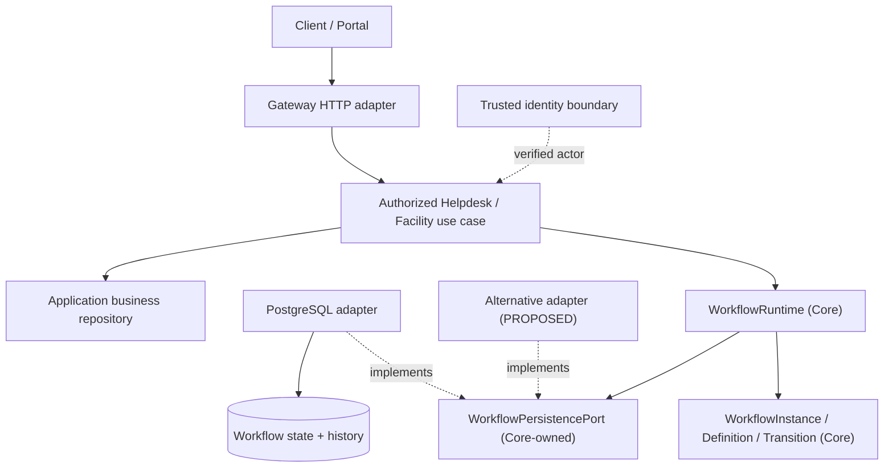
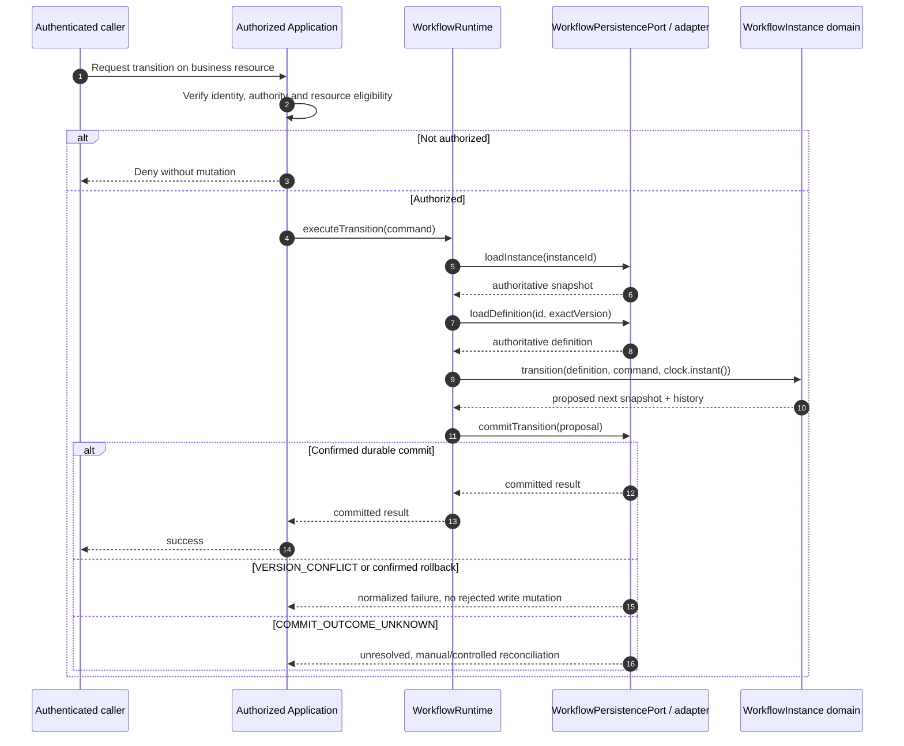

# Workflow Core — Architecture

> **Evidence convention:** OBSERVED = direct source/contract evidence at the exact SHA; SELECTED = previously chosen G4 architecture direction; PROPOSED = target work; DEFERRED = explicitly outside the current scope; NOT VERIFIED = no execution proof in this package. This document changes no Java code and does not approve any Gate.

## 1. Purpose and decision baseline

**Proposed document role — owner/team approval pending:** this `architecture.md` is proposed as the principal Workflow architecture document for capability boundaries and runtime/dependency views. [Workflow design decisions and MVP review](workflow-architecture.md) remains supporting material with its historical baseline and traceability preserved. Its finite-state MVP recommendation and this document's TO-BE Flowable assessment have different horizons; evaluation does not approve an engine cutover. This proposal does not change contract authority, Document IDs or Register mappings; see the [open inventory decision](../../10-reviews/open-issues.md).

**AS-IS / IMPLEMENTED:** the pinned Java source defines a state-machine `WorkflowRuntime`, immutable definition/instance values, and `WorkflowPersistencePort`. **TO-BE / PROPOSED:** Flowable BPMN is evaluated as a replaceable engine behind a Workflow-owned process capability. Camunda or another BPMN engine is a possible alternative only if it meets the published contract. A BPMN task, token, timer, or asynchronous job cannot be assumed equivalent to one existing transition. The adapter must map exact definition versions, activation, actor and resource binding, optimistic version conflicts, ordered history, and atomic commit outcomes; gaps require an approved contract revision or an explicitly limited adapter. Flowable implementation and conformance are not verified.

Workflow is a **generic, provider-independent state-machine capability** in the Java/Spring Boot modular monolith. It owns definition, instance, transition, lifecycle, history and normalized persistence semantics. It must be reusable by IT Helpdesk and Facility without embedding either Application's business roles, SLAs, ticket schemas or approval policies.

This architecture follows the selected G4 foundation (stable Java contracts, ports and adapters, separate HTTP API evolution, explicit provider-swap conformance and independent Gate), the 18 G4-F09 Workflow README choices, and **18 user-selected G4-F10 architecture decisions** recorded in `G4_F10_DECISION_RECORD.md`. The chosen directions govern documentation; they do not certify runtime integration or authorize public contract changes. The [historical Workflow Core contract](https://github.com/lexuanbao258-collab/dxos-open-core/blob/0f0c3ba0c3eecda0a5c4a798a3cc14b808351bed/docs/contracts/workflow-core.md) remains the authority for its pinned source revision; [tracked Workflow contracts](contracts.md) are the current documentation location, subject to review rather than silent semantic supersession.

## 1.1. Decision-to-architecture contract (G4-F10)

The following decisions are **USER SELECTED**, not independently approved source or Gate evidence.

| ID | Decision | Mandatory architecture consequence |
| --- | --- | --- |
| Q01 B | Logic, dependencies, runtime, transactions, substitution | Include both component and sequence diagrams and write outcome semantics |
| Q02 B | Modular monolith + Ports & Adapters | No invented Workflow microservice |
| Q03 B | Application owns ACL, actor eligibility and policy | No Helpdesk/Facility policy in Core |
| Q04 B | Preserve existing `WorkflowRuntime` | Describe actual five observed methods, no invented orchestration API |
| Q05 B | Authoritative exact definition | No caller-authored same-key definition or latest-version fallback |
| Q06 B | Definition-derived target | No client-selected target field |
| Q07 B | Three-state lifecycle | Activation remains runtime version zero and no history |
| Q08 B | Commit-boundary compare-and-write | `expectedVersion` is required, read-only checks insufficient |
| Q09 B | Full-snapshot activation CAS | Compare lifecycle and all original fields, not only version zero |
| Q10 B | Atomic state/history persistence | Exactly one matching record on successful transition |
| Q11 B | Three commit outcomes | Distinguish durable success, confirmed failure, unknown outcome |
| Q12 B | Authoritative reconciliation | Never blindly retry unknown commits |
| Q13 B | Exact accepted `Instant` | Reject unsupported precision rather than silently round |
| Q14 B | Semantic adapter conformance | Equivalence of operations, concurrency, errors and recovery |
| Q15 B | Separate full-engine replacement | BPMN swap needs another ADR and migration proof |
| Q16 B | Authorized Application mutations only | No exposed generic unguarded mutation endpoint |
| Q17 A | Mermaid and traceability | Source → test → evidence → reviewer matrix |
| Q18 B | Independent staged Gate | Design, source, conformance, integration and reuse are separate |

## 2. Observed source and architecture status

| Artifact | Verified at exact SHA | Architecture consequence |
| --- | --- | --- |
| `core/workflow/WorkflowInstance.java` | Immutable snapshot with `notStarted`, `restore`, `activate`, `transition` | State changes follow domain behavior; `restore` is not an authorization or write method |
| `core/workflow/WorkflowRuntime.java` | Provider-independent orchestration over `WorkflowPersistencePort` and injected `Clock`; create, activate, execute, load methods | Runtime orchestrator **already exists** at pinned SHA; it does not authenticate or authorize actor |
| `core/workflow/WorkflowPersistencePort.java` | Six operations with authoritative definition, commit and recovery semantics | Core owns the port; Data/infrastructure implements persistence |
| `docs/contracts/workflow-core.md` | Exact definition binding, optimistic concurrency, full activation comparison, atomic history, unknown outcome | Provider replacement must preserve complete behavior, not only method signatures |

This source observation is not a claim that PostgreSQL E2E, a second adapter, Facility reuse or independent review has passed. An older contract passage mentioning future orchestration should be read alongside the **observed existing** `WorkflowRuntime.java`; the README/architecture should not incorrectly claim Runtime is absent.

## 3. Logical components and responsibility ownership

| Layer / component | Owns | Forbidden dependency or assumption |
| --- | --- | --- |
| Gateway/HTTP adapter | Request validation, routing, HTTP DTO/status translation | Direct unauthorized Core mutation |
| Identity/trusted boundary | Verified caller; mapped identity facts | Caller-supplied `actorId` is trusted without verification |
| Helpdesk/Facility Application | Resource ACL, actor eligibility, definition selection, authorized orchestration, business repository | Hardcode app-specific policy in Workflow Core |
| `WorkflowRuntime` | Calls authoritative loads; builds valid proposals and delegates commit | Security context parsing, hidden retries, SQL transactions |
| `WorkflowInstance` & models | Lifecycle and transition invariants | Mutable setter, client-chosen target state |
| `WorkflowPersistencePort` | Durable operation semantics, concurrency, history and normalized errors | Tied to PostgreSQL-specific SQL API |
| Persistence adapter | Implements Core-owned port in database transaction(s) | Reinterprets definitions, skips authoritative checks |
| Application-owned business repository | Ticket/Facility state and resource ownership | Define generic Workflow transaction semantics |

**Java dependency direction:** adapters and Applications depend on Core contracts. **Runtime call direction:** authorized Application calls Workflow Runtime, which calls its persistence port. These directions are not identical.

No diagram arrow asserts separate microservice deployment. The alternative adapter is conceptual, not verified as implemented.

## 4. Contract boundary and runtime execution

The observed `WorkflowRuntime` exposes:
- `createInstance(instanceId, definitionId, definitionVersion, resourceReference)` — checks duplicate instance, loads authoritative exact definition, constructs NOT_STARTED snapshot, persists insert-only.
- `activateInstance(instanceId)` — loads authoritative instance and pinned definition, creates activation proposal, commits full-snapshot compare-and-write.
- `executeTransition(command)` — loads instance and authoritative definition, derives state/history proposal with injected clock, commits via port.
- `loadInstance(instanceId)` and `loadHistory(instanceId)` — authoritative reads; separate calls do **not** promise one shared consistent snapshot.

`WorkflowPersistencePort` exposes `loadDefinition`, `createInstance`, `commitActivation`, `loadInstance`, `loadHistory`, `commitTransition`. `WorkflowRuntime` provides **no internal caller authentication, resource ACL, retry, reconciliation scheduler or HTTP endpoint**.

### Transition call sequence

The diagram depicts intended authorized upstream orchestration and observed Core Runtime/Port semantics. It does **not** assert current endpoint behavior or a successful integrated test.

## 5. State, lifecycle and version invariants

- Definition identity is exact `(definitionId, definitionVersion)`; instances do not upgrade automatically; authoritative definition persistence must reject changed content under the same key.
- Initial snapshot is `NOT_STARTED`, initial state, `runtimeVersion=0`, equal timestamps. `activate` changes lifecycle to `ACTIVE`, keeps version zero, records no transition history.
- `executeTransition` requires mandatory `expectedVersion`, exact instance binding, ACTIVE lifecycle and valid transition/source state. Target comes from the definition, never HTTP request input.
- Successful transition increments runtime version once and adds exactly one corresponding `TransitionRecord`; terminal target means `COMPLETED`, and this baseline does not reopen completed instances.
- `ActorReference` and `ResourceReference` are opaque data, not security proofs; authorization is upstream.
- Domain timestamps are precise `Instant` values. Adapter cannot silently round or truncate, including PostgreSQL microsecond precision conversion.

## 6. Transaction architecture, concurrency and history

The **commit boundary is persistence**, not `WorkflowInstance.transition`. Domain returns a validated proposal which may still lose a database race.

| Operation | Atomicity and concurrency requirement | History result |
| --- | --- | --- |
| `createInstance` | Insert only, authoritative definition; unique instance ID, one winner | Empty |
| `commitActivation` | **Full expected snapshot + lifecycle** compare-and-write; version-only check is insufficient (version remains 0) | None |
| `commitTransition` | Compare persisted origin, expected runtime version and authoritative rederived transition at commit; atomically update instance and append exactly one record | Exactly one per successful transition |
| `loadHistory` | Ordered by resulting runtime version; contiguous success history | Independent read, not shared snapshot with `loadInstance` |

A rejected operation changes no state/history attributable to that operation. Concurrent third-party writes can progress independently. State/history may never be partially committed.

**Unknown outcome** is not equivalent to rollback:
- Confirmed durable commit → return success.
- Confirmed no commit or rollback → `OPERATION_FAILURE` and no change.
- Validation or version failure → specified normalized error and no rejected write mutation.
- Lost/unknown COMMIT response → `COMMIT_OUTCOME_UNKNOWN` even if complete write may already be durable.

Never blindly auto-retry an uncertain write. Reconcile using authoritative instance/history, accounting for concurrent progress and lack of a combined snapshot. Expose unresolved status to an approved operator/application recovery policy.

## 7. Persistence adapter substitution

Changing a database-backed persistence adapter must retain six port operations and equivalent lifecycle, definition, origin validation, version conflict, durable atomic history, timestamp fidelity and error semantics. Merely swapping JDBC driver or matching Java signatures does not establish compatibility.

| Replacement dimension | Safe change | Required unchanged behavior |
| --- | --- | --- |
| PostgreSQL → alternative persistence | SQL/schema/transaction implementation behind `WorkflowPersistencePort` | Atomic state+history, strict version checks, no unsafe retries |
| Clock/precision representation | Configure accepted clock upstream or use lossless storage | Never silently change `Instant` values |
| Definition provisioning | Data/infrastructure seed/import mechanism | Exact immutable definition identity and historical resolvability |
| Full Workflow engine replacement | Separate architectural review and migration plan | Must independently prove parity; **not** guaranteed by persistence SPI |

For a credible provider-swap demo, pin baseline SHA, hash Application logic, run the identical positive/negative conformance suite on both adapters and collect DB history and fault-injection proof.

## 8. API and security boundaries

Core Java SPI and external HTTP contracts evolve independently. `WorkflowRuntime` methods are not automatically REST API endpoints. Gateway/API adapters must expose only authorized operations through trusted Application use cases.

A valid JWT/capability authority does not guarantee access to a particular ticket or Facility request. Application policy must check actor eligibility and resource ownership, while Workflow retains source-state/version consistency. No direct unguarded Workflow mutate endpoint is acceptable.

## 9. Testing, evidence and independent Gate

| ID | Requirement | Required verification | Reviewer | Status |
| --- | --- | --- | --- | --- |
| WF-AR-01 | Core import/dependency boundary | Java source scan and ArchUnit/dependency checks | Core reviewer | NOT RUN |
| WF-AR-02 | Exact immutable definition binding | Wrong-version, same-key forged-content and missing-definition tests | Workflow owner | NOT RUN |
| WF-AR-03 | Lifecycle and expectedVersion | Domain test, stale command, conflicting concurrent activation | Core/Persistence | NOT RUN |
| WF-AR-04 | Commit atomicity | Real DB rollback, concurrency state/history snapshots | Persistence reviewer | NOT RUN |
| WF-AR-05 | Unknown commit handling | Controlled lost-response/fault injection plus reconciliation logs | Persistence/Operations | NOT RUN |
| WF-AR-06 | Trusted actor + business ACL | Forged actor and forbidden ticket tests, no mutation | Application/Security | NOT RUN |
| WF-AR-07 | Application reuse | Helpdesk + Facility golden paths without Core modifications | Independent reviewer | NOT RUN |
| WF-AR-08 | Adapter substitution | Same suite under two implementations, unchanged consumer source hash | Independent reviewer | NOT RUN |

**Source inspection is not test execution**. Historical PR/contract reports must be re-linked to exact test XML, environment, commit and reviewed outcome before they count as current evidence.

G4-D Design / G4-S Source / G4-C Contract / G4-I Integration / G4-R Reuse are separate gates; **none is approved by authoring this document**.

## 10. Known risks and deferred capabilities

| ID | Open decision or blocker |
| --- | --- |
| AR-OD-01 | Authoritative definition provisioning/immutability/version-retention policy |
| AR-OD-02 | Verified trusted actor propagation and Application ACL integration |
| AR-OD-03 | PostgreSQL adapter transaction, precision and exact source-origin checks |
| AR-OD-04 | Unknown commit reconciliation runbook and operator ownership |
| AR-OD-05 | Alternate adapter compatibility proof, including concurrency failure cases |
| AR-OD-06 | Facility reuse slice and no-Core-change evidence |
| AR-OD-07 | API/Gateway route security, 401/403/404 mapping and mutating route inventory |
| AR-OD-08 | External Workflow engine replacement scope and migration costs |

**DEFERRED:** SLA/timers, escalations, guards, parallel gateways, approval hierarchies, BPMN, automated retries and definition CRUD/publishing API unless explicitly specified elsewhere and source-evidenced.

## 11. Pinned source references

- [Workflow Core contract](https://github.com/lexuanbao258-collab/dxos-open-core/blob/0f0c3ba0c3eecda0a5c4a798a3cc14b808351bed/docs/contracts/workflow-core.md)
- [WorkflowRuntime.java](https://github.com/lexuanbao258-collab/dxos-open-core/blob/0f0c3ba0c3eecda0a5c4a798a3cc14b808351bed/backend/src/main/java/com/tricore/dxos/core/workflow/WorkflowRuntime.java)
- [WorkflowInstance.java](https://github.com/lexuanbao258-collab/dxos-open-core/blob/0f0c3ba0c3eecda0a5c4a798a3cc14b808351bed/backend/src/main/java/com/tricore/dxos/core/workflow/WorkflowInstance.java)
- [WorkflowPersistencePort.java](https://github.com/lexuanbao258-collab/dxos-open-core/blob/0f0c3ba0c3eecda0a5c4a798a3cc14b808351bed/backend/src/main/java/com/tricore/dxos/core/workflow/WorkflowPersistencePort.java)

**Status:** `G4-F10 REVISED DRAFT / NOT REVIEWED`. No tests, database writes, code changes or approvals occurred during document authoring.
