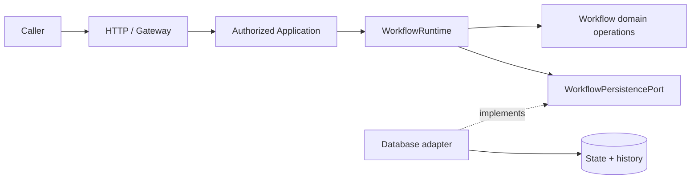

# Workflow Core — Java SPI, Behavioral Contracts & Evidence

> **Discipline:** OBSERVED means pinned Java source or canonical document content; SELECTED means a user-chosen G4-F12 direction; PROPOSED means conformance/verification yet to be executed; HISTORICAL means the canonical document narrates older results, not re-run here; VERIFIED requires exact-SHA executed evidence and independent review. This authoring step runs no Java tests and grants no acceptance Gate.

## 1. Purpose, scope and normative order

**Flowable compatibility gate (TO-BE):** preserve the existing public `WorkflowRuntime` and `WorkflowPersistencePort` behavior while assessing the engine. A successful create, activation, or transition returns only after confirmed durable commit. Rejected writes change neither authoritative snapshot nor successful history; transition history remains contiguous by resulting runtime version, and concurrent writers yield the existing conflict semantics. `OPERATION_FAILURE` means confirmed no commit or rollback; `COMMIT_OUTCOME_UNKNOWN` means commit cannot be established and forbids blind retry. Engine variables, task IDs, BPMN exceptions, and SDK classes must not escape the Core contract. Test each invariant against a real engine and persistence boundary before claiming compatibility; no such result is asserted here.

The Workflow Core exposes provider-neutral domain behavior, `WorkflowRuntime` orchestration and the **Workflow-owned `WorkflowPersistencePort`**. This tracked file is the current contract documentation location and does not silently supersede the [historical Workflow contract](https://github.com/lexuanbao258-collab/dxos-open-core/blob/0f0c3ba0c3eecda0a5c4a798a3cc14b808351bed/docs/contracts/workflow-core.md). Java source and that historical contract at `0f0c3ba0c3eecda0a5c4a798a3cc14b808351bed` control claims about that revision; code/API changes require separate ADR and review.

**In scope:** Java method signatures, pre/postconditions, read semantics, write outcomes, error precedence, exact definition binding, full compare-and-write, concurrency, history, timestamp fidelity, recovery, security boundary, provider conformance and evidence routing.

**Out of scope:** automatically turning Java SPI into REST endpoints, provisioning definition CRUD, selecting BPMN engine, app-specific ticket/Facility policies, hidden retries, changing Flyway history, claiming production-ready adapter replacement.

**Source pins:** canonical contract blob `11c5aaca1e7e08394710a6d0c5fe8e187d549d83`; `WorkflowRuntime.java` `3b7e7ac755f0021b6ef0ea5a572748bdca585ff2`; `WorkflowPersistencePort.java` `5009b191a3eb555ba3248eda4728ab8d3aac251b`; `WorkflowErrorCode.java` `a9c183ee13edb8b8efd95af2563b19eaddd36e5b`.

## 2. Scope and dependency boundary

- **Core** owns validated state machine operations, exact definitions/versions, atomic persistence semantics and nine normalized error codes.
- **Data/infrastructure** implements the port and provisions immutable definition content; it cannot decide a different transition rule.
- **Application** checks actor eligibility, capability authority and resource-level ACL before mutation; `ActorReference` is *not* authentication evidence.
- **Gateway/HTTP** transports requests, returns API errors and independently versions its API. A public Java operation is not automatically a public REST endpoint.
- Provider exceptions, SQL state and credentials are prohibited from Core-facing error messages.



## 3. Existing Java SPI: exact signatures

`com.tricore.dxos.core.workflow.WorkflowRuntime`:

```java
public WorkflowRuntime(WorkflowPersistencePort persistence, Clock clock);
public WorkflowInstance createInstance(String instanceId, String definitionId,
        long definitionVersion, ResourceReference resourceReference);
public WorkflowInstance activateInstance(String instanceId);
public TransitionResult executeTransition(TransitionCommand command);
public WorkflowInstance loadInstance(String instanceId);
public List<TransitionRecord> loadHistory(String instanceId);
```

`com.tricore.dxos.core.workflow.WorkflowPersistencePort`:

```java
WorkflowDefinition loadDefinition(String definitionId, long definitionVersion);
WorkflowInstance createInstance(WorkflowInstance initial);
WorkflowInstance commitActivation(WorkflowInstance expected, WorkflowInstance activated);
WorkflowInstance loadInstance(String instanceId);
List<TransitionRecord> loadHistory(String instanceId);
TransitionResult commitTransition(TransitionResult transition);
```

`WorkflowInstance` pure domain behavior includes `notStarted(...)`, `restore(...)`, `activate(exactDefinition, startedAt)` and `transition(exactDefinition, command, occurredAt)`. The latter constructs a **validated proposal**, not a committed database result. `WorkflowRuntime` is **already present** in source at the pinned SHA; older passages calling orchestration future work are historical milestones, not evidence the class is absent.

## 4. Runtime operations — preconditions and postconditions

| Operation | Preconditions and observable path | Successful postcondition | Relevant failure |
| --- | --- | --- | --- |
| `createInstance` | Nonblank IDs, nonnegative definition version, nonnull resource; checks existing instance first, loads authoritative exact definition, builds NOT_STARTED snapshot | Port confirms durable inserted instance at version 0, empty history | Duplicate `INSTANCE_ALREADY_EXISTS`; missing definition `DEFINITION_NOT_FOUND`; port errors per §8 |
| `activateInstance` | Existing authoritative instance, pinned definition and valid clock time; domain activation valid | Port confirms ACTIVE at initial state, runtimeVersion 0, no new history | `INSTANCE_NOT_FOUND`, `VERSION_CONFLICT`, `INSTANCE_COMPLETED`, `TRANSITION_NOT_ALLOWED`, missing definition |
| `executeTransition` | Nonnull command, exact instance and definition; correct expectedVersion, ACTIVE lifecycle and valid transition/source | Port confirms committed new snapshot plus exactly one matching record | Stale version, wrong state, terminal, transition absent, provider outcome |
| `loadInstance` | Valid nonblank instance ID | Authoritative snapshot, not a caller-provided copy | `INSTANCE_NOT_FOUND`, read failure |
| `loadHistory` | Valid nonblank instance ID | Immutable ascending successful history; empty for existing untransitioned instance | `INSTANCE_NOT_FOUND`, read failure |

`WorkflowRuntime` propagates errors, does **not** retry writes, perform identity checks or automatically reconcile `COMMIT_OUTCOME_UNKNOWN`. Its injected `Clock` must be configured upstream to produce timestamps representable by the selected adapter.

## 5. PersistencePort — per-operation behavior

| Operation | Preconditions | Success guarantee | No-change / failure guarantee |
| --- | --- | --- | --- |
| `loadDefinition(id,v)` | Required exact key; definitionVersion zero allowed | Authoritative immutable content for that exact ID/version | Missing exact key `DEFINITION_NOT_FOUND`; no latest fallback |
| `createInstance(initial)` | Insert-only NOT_STARTED snapshot, version 0, initial state/timestamps match authoritative definition | Durable complete initial instance; zero history | Duplicate ID always `INSTANCE_ALREADY_EXISTS` even identical; missing definition `DEFINITION_NOT_FOUND`; forged initial `TRANSITION_NOT_ALLOWED` |
| `commitActivation(expected,activated)` | Compare **all expected snapshot fields** and lifecycle at commit; validate activated proposal against authoritative definition | Confirmed durable ACTIVE at version zero; **no** history | Stale/replayed expected activation conflicts even if version remains zero; invalid proposal rejected without mutation |
| `loadInstance(id)` | Instance ID | Authoritative immutable snapshot | Missing `INSTANCE_NOT_FOUND` |
| `loadHistory(id)` | Existing instance | Immutable history ordered by resultingRuntimeVersion; unique contiguous versions starting at 1 | Existing no-transition instance returns empty; missing instance throws `INSTANCE_NOT_FOUND` |
| `commitTransition(result)` | Persisted expected origin/version, exact authoritative definition, rederived transition ID/actor/time, proposed snapshot and record match | Atomic durable update with runtimeVersion +1 and **one** matching history record | Rejection/version conflict changes neither; confirmed rollback changes neither; unknown outcome may have committed **both** |

**Provider-neutral enforcement:** compare snapshot fields **by value**, not Java object identity (`WorkflowInstance` is an ordinary immutable class); preserve definition binding, resource and `createdAt`. A same-key forged client definition must not be trusted. `WorkflowPersistencePort` is behavioral, not merely six method names.

## 6. Operation-specific error precedence

### 6.1 Runtime domain transition sequence (OBSERVED)

For `WorkflowInstance.transition` check, in source order: null command → exact definition match → instance ID match → expectedVersion match → completed/active lifecycle → transition lookup → source-state match → time validity → overflow → build proposal. A stale command against a completed instance therefore returns `VERSION_CONFLICT` *before* `INSTANCE_COMPLETED`, provided the definition and instance match.

### 6.2 Create precedence (OBSERVED contract and Runtime)

1. Validate structural parameters (`IllegalArgumentException`/`NullPointerException` as appropriate).
2. Check duplicate ID before definition lookup; duplicate returns `INSTANCE_ALREADY_EXISTS` (including identical replay).
3. Load authoritative exact definition; if missing, `DEFINITION_NOT_FOUND`.
4. Validate supplied initial snapshot against authoritative definition; invalid initial snapshot `TRANSITION_NOT_ALLOWED`.
5. Execute insert-only conditional write; concurrency loser reports `INSTANCE_ALREADY_EXISTS`.
6. Provider failure: `OPERATION_FAILURE` **only** on confirmed no commit/rollback; otherwise `COMMIT_OUTCOME_UNKNOWN`.

Note: step 3/4 is primarily the adapter's authoritative write validation; Runtime has constructed an initial proposal from its authoritative load.

### 6.3 Activation precedence (canonical contract; preserve exact order)

| Priority | Condition | Error |
| --- | --- | --- |
| 1 | Missing expected instance ID | `INSTANCE_NOT_FOUND` |
| 2 | Stored runtimeVersion **or lifecycle** differs from expected | `VERSION_CONFLICT` |
| 3 | Stored or expected lifecycle COMPLETED | `INSTANCE_COMPLETED` |
| 4 | Other expected source mismatch, unchanged ACTIVE reactivation or backwards time | `TRANSITION_NOT_ALLOWED` |
| 5 | Exact authoritative definition absent | `DEFINITION_NOT_FOUND` |
| 6 | Activated target differs from domain activation; terminal initial state | `TRANSITION_NOT_ALLOWED` |
| 7 | Provider write problem after business checks | `OPERATION_FAILURE` if confirmed rolled back; else `COMMIT_OUTCOME_UNKNOWN` |

Activation must compare `instanceId`, exact definition ID/version, resource, currentState, runtimeVersion, lifecycle, createdAt and updatedAt. Version-only checking is broken because competing activations both involve version 0. `commitActivation` must be **one atomic conditional write**, not a GET followed by unconditional UPDATE.

### 6.4 Transition and reads

`commitTransition` rejects absent instance with `INSTANCE_NOT_FOUND`, stale/replayed expected version with `VERSION_CONFLICT`, completed instance with `INSTANCE_COMPLETED`, missing exact definition with `DEFINITION_NOT_FOUND`, absent authoritative transition ID with `INVALID_TRANSITION`, and mismatched origin/target/history with `TRANSITION_NOT_ALLOWED`. The canonical contract specifies checks and normalized outcomes but does **not** publish one universal total precedence order for every combination of invalid transition inputs. **Do not invent one**; use the operation-specific rules in source and test particular combinations before claiming order.

Reads are individually consistent; a `loadInstance` followed by `loadHistory` does **not** guarantee one shared database snapshot. A read provider failure can use `OPERATION_FAILURE`; `COMMIT_OUTCOME_UNKNOWN` is for uncertain **writes**, not arbitrary read errors.

## 7. Definition provisioning, clock and precision

Definition provisioning is **not** a method on this runtime port. Data/infrastructure provisions immutable content, rejects different content under an existing `(definitionId, definitionVersion)` key and retains versions referenced by instances. Definition version 0 is valid. Multiple instance IDs can reference one business resource; this contract does not define unique ResourceReference.

Domain `Instant` has nanosecond precision; PostgreSQL `timestamptz(6)` is microsecond resolution. An adapter must either use appropriately aligned input clock / reject unrepresentable values before mutation or use lossless storage. It must never silently round the accepted previous/proposed record, or change timestamp equality. History is ordered by runtime version, not time.

## 8. Four write-outcome classes and reconciliation

| Outcome | Return/error | Durable change guarantee |
| --- | --- | --- |
| Structural/business/version rejection | Specific structural exception or normalized `WorkflowErrorCode` | **Rejected operation** makes no changes; other concurrent writers may still progress |
| Confirmed provider no-commit or rollback | `OPERATION_FAILURE` | This attempted write made no durable change |
| Confirmed durable write | Return committed instance/result | Entire create/activation or instance+history transition durably committed |
| Unknown commit (e.g. response lost after COMMIT) | `COMMIT_OUTCOME_UNKNOWN` | Whole write may have committed, or not; **partial transition/history is forbidden** |

```mermaid
sequenceDiagram
    participant A as Authorized Application
    participant R as WorkflowRuntime
    participant P as Persistence adapter
    participant DB as Durable DB
    A->>R: executeTransition(command)
    R->>P: load authoritative instance + definition
    P-->>R: snapshot + definition
    R->>P: commitTransition(validated proposal)
    P->>DB: Compare and atomic update + history
    alt confirmed commit
      DB-->>P: durable success
      P-->>R: committed TransitionResult
      R-->>A: success
    else confirmed failure before/at rollback
      DB-->>P: confirmed no commit
      P-->>R: OPERATION_FAILURE
      R-->>A: failure; no write from attempt
    else lost response / uncertain outcome
      DB--xP: response unavailable
      P-->>R: COMMIT_OUTCOME_UNKNOWN
      R-->>A: unresolved; do not auto-retry
    end
```

**Reconciliation protocol (not automatic success):**
- **Create:** compare instance ID, definition/version, resource, lifecycle/version and times. An identical stored snapshot is not proof which writer created it. Repeating insert remains duplicate failure.
- **Activation:** compare full snapshot and lifecycle, including an activation that might have committed at version 0; later transitions may already have advanced it.
- **Transition:** look for the exact proposed history record at its resultingRuntimeVersion, compare actor/transition/target/time plus authoritative instance; later progress does not erase the previous history.
- **Cross-read caveat:** instance and history reads are not necessarily one snapshot; if inconclusive, re-read or keep the outcome unresolved for adapter/operator reconciliation. Never infer rollback solely from stale/absent data while transaction outcome remains unsettled.
- **Controlled retry:** only after the prior attempt's outcome has been established, conditional write remains valid, and Application owner explicitly authorizes a retry. No implicit idempotency key or receipt exists in this SPI.

## 9. Exact nine error codes and ownership

| Code | Meaning |
| --- | --- |
| `DEFINITION_NOT_FOUND` | Exact authoritative definition/key absent or wrong binding |
| `INSTANCE_NOT_FOUND` | Instance absent or command addresses another instance |
| `INVALID_TRANSITION` | Transition ID absent from authoritative definition |
| `TRANSITION_NOT_ALLOWED` | Wrong source, lifecycle, activation target or inconsistent proposal |
| `INSTANCE_COMPLETED` | Terminal lifecycle blocks mutation |
| `VERSION_CONFLICT` | Stale expected version or activation lifecycle compare failure |
| `OPERATION_FAILURE` | Runtime overflow/operation failure; provider writes only with confirmed no commit/rollback |
| `INSTANCE_ALREADY_EXISTS` | Insert-only ID collision, including identical replay |
| `COMMIT_OUTCOME_UNKNOWN` | Write outcome not established; may be durable; reconcile |

Structural constructor failures are `IllegalArgumentException` or `NullPointerException`, not automatically `WorkflowException`. Provider adapters normalize technical errors without leaking SQL/credentials or provider causes. Core does not prescribe HTTP response codes. `WorkflowException` is sanitized and its code is stable.

## 10. Adapter substitution conformance standard

A candidate persistence adapter must reproduce the same observable results as the baseline for:
1. Exact immutable definition and version 0, same-key content mismatch, retained historical definition.
2. Insert-only creation, duplicate precedence, concurrent one-winner behavior.
3. Activation at version 0 with full-snapshot/lifecycle compare, one winner and no history.
4. Transition source and exact authority-bound definition re-derivation; stale/replay and forged target rejection.
5. Atomic state+matching history, unique contiguous per-instance versions and deterministic ordered `loadHistory`.
6. Exact accepted `Instant` round-trips and zero silent truncation.
7. Confirmed rollback vs uncertain COMMIT, controlled recovery and no blind retries.
8. Sanitized normalized errors and unchanged authorized Application behavior.

A mocked/in-memory port can validate part of the semantics; it **does not** prove PostgreSQL durability, transaction isolation, process crash recovery or alternate-provider compatibility. Whole engine replacement is a separate scope requiring semantics and migration review.

## 11. Operation → test → evidence → reviewer

| Case | Operation/invariant | Required positive and negative test | Evidence to collect | Proposed reviewer | State |
| --- | --- | --- | --- | --- | --- |
| CT-01 | Definition exact lookup | Version 0 valid, missing exact version and same-key altered content rejected | JUnit + store state | Workflow owner | NOT RUN HERE |
| CT-02 | Insert-only create | Valid initial; duplicate replay and concurrent creation losers | JUnit + DB unique proof | Data reviewer | NOT RUN HERE |
| CT-03 | Activation full compare | Activation success, stale lifecycle and competing activation version-0 race | JUnit + DB snapshots | Data reviewer | NOT RUN HERE |
| CT-04 | Domain transition | Valid/stale/wrong source/terminal/unknown transition | Unit JUnit XML | Core reviewer | NOT RUN HERE |
| CT-05 | Authoritative re-derivation | Same-key forged definition with invalid target/record rejected | Adapter conformance report | Data reviewer | NOT RUN HERE |
| CT-06 | Atomic history | DB rollback and concurrent transition create exactly correct matching history | PostgreSQL integration XML, before/after state | Data reviewer | NOT RUN HERE |
| CT-07 | Unknown outcome | Lost COMMIT response for create, activate, transition; no unsafe retry | Fault-injection traces & reconciliation | Operations / Data | NOT RUN HERE |
| CT-08 | Timestamp precision | Exact nanos in fixture, microsecond aligned DB or prewrite reject | Round-trip JSON/report | Data reviewer | NOT RUN HERE |
| CT-09 | Error precedence | Multi-invalid create/activation/transition cases per specified order | JUnit XML and normalized codes | Core reviewer | NOT RUN HERE |
| CT-10 | Security seam | Untrusted actor/forbidden ticket denied before mutation | HTTP / DB negative logs | Application / Security | NOT RUN HERE |
| CT-11 | Provider swap | Same suite on two adapters; Application code unchanged | Test diffs, SHA and review | Independent reviewer | NOT RUN HERE |

For each case collect: commit SHA, branch/working tree, JDK/Gradle/DB and adapter versions, command and exit code, selected and skipped test counts, sanitized logs/XML, post-failure state/history assertions, reviewer and verdict. No test result is fabricated by this document.

**Historical note:** canonical contract narrates earlier focused Workflow tests (29/43 tests at different old milestones) and full-backend results. These are HISTORICAL source claims, not current execution evidence for this exact SHA. An in-memory fake cannot certify real PostgreSQL transaction safety.

## 12. Open decisions and G4 Gate

| ID | Open question |
| --- | --- |
| CT-OD-01 | Definition provisioning authority and immutable-content reconciliation |
| CT-OD-02 | Exact current test selector inventory and real PostgreSQL disposable fixture |
| CT-OD-03 | Adapter no-commit proof vs COMMIT_OUTCOME_UNKNOWN fault-injection method |
| CT-OD-04 | Clock microsecond alignment or lossless timestamp storage selection |
| CT-OD-05 | Approval process and operator owner for controlled retry |
| CT-OD-06 | Helpdesk/Facility access guard and generic mutation route audit |
| CT-OD-07 | Actual second persistence adapter and conformance scope |
| CT-OD-08 | Separate Java SPI/HTTP version decisions and independent sign-off |

| Gate | Required evidence | Status |
| --- | --- | --- |
| G4-D Design | Precise operations, prerequisites and failure contracts | DRAFT / NOT REVIEWED |
| G4-S Source | Exact-SHA signatures, imports, compatibility | SOURCE INSPECTED / INDEPENDENT REVIEW PENDING |
| G4-C Contract | Positive/negative/unit + fake-port contract tests | NOT RUN HERE |
| G4-I Integration | Real DB transaction, concurrency and unknown outcomes | NOT RUN HERE |
| G4-P Provider swap | Same test suite on alternate persistence implementation | NOT RUN HERE |
| G4-R Reuse and independent review | Helpdesk + Facility with same Core, reviewed evidence | NOT APPROVED |

**P0 blockers:** inconsistent returned status after uncertain COMMIT, partial state/history, stale activation double-winner, duplicate creation overwrites, forged same-key transition accepted, silent timestamp changes, direct unauthorized mutation, provider substitution asserted without tests.

## 13. Pinned source links

- [Canonical Workflow contract](https://github.com/lexuanbao258-collab/dxos-open-core/blob/0f0c3ba0c3eecda0a5c4a798a3cc14b808351bed/docs/contracts/workflow-core.md)
- [WorkflowRuntime.java](https://github.com/lexuanbao258-collab/dxos-open-core/blob/0f0c3ba0c3eecda0a5c4a798a3cc14b808351bed/backend/src/main/java/com/tricore/dxos/core/workflow/WorkflowRuntime.java)
- [WorkflowPersistencePort.java](https://github.com/lexuanbao258-collab/dxos-open-core/blob/0f0c3ba0c3eecda0a5c4a798a3cc14b808351bed/backend/src/main/java/com/tricore/dxos/core/workflow/WorkflowPersistencePort.java)
- [WorkflowErrorCode.java](https://github.com/lexuanbao258-collab/dxos-open-core/blob/0f0c3ba0c3eecda0a5c4a798a3cc14b808351bed/backend/src/main/java/com/tricore/dxos/core/workflow/WorkflowErrorCode.java)

**Final status: G4-F12 DRAFT / NOT REVIEWED.** No Java tests, DB transactions, adapter swaps or independent Gate approval were performed during this document-authoring step.
