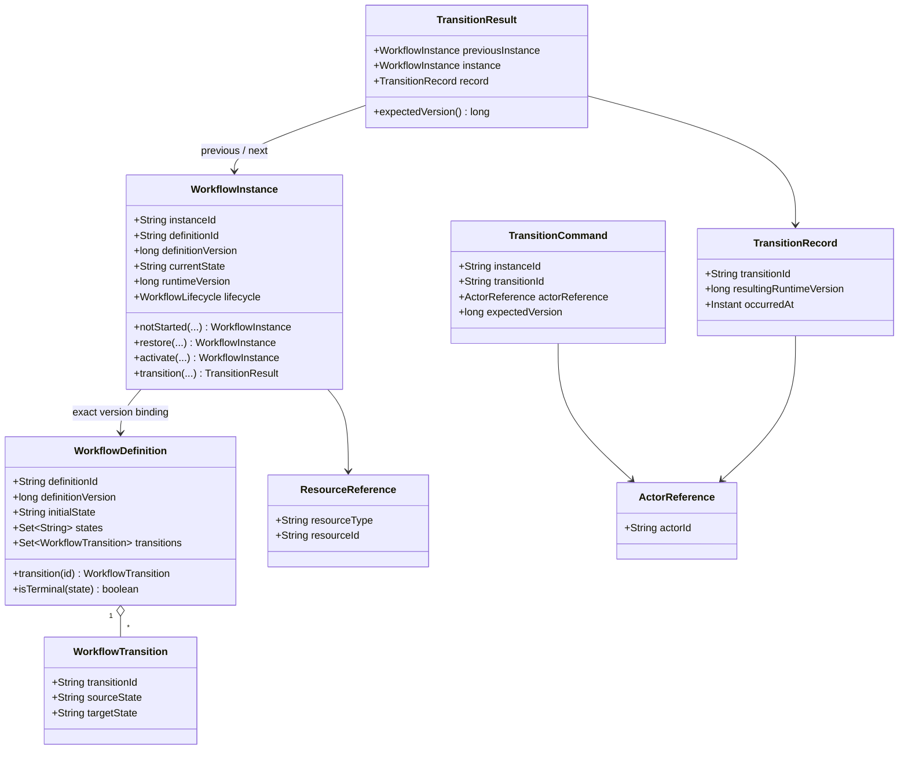
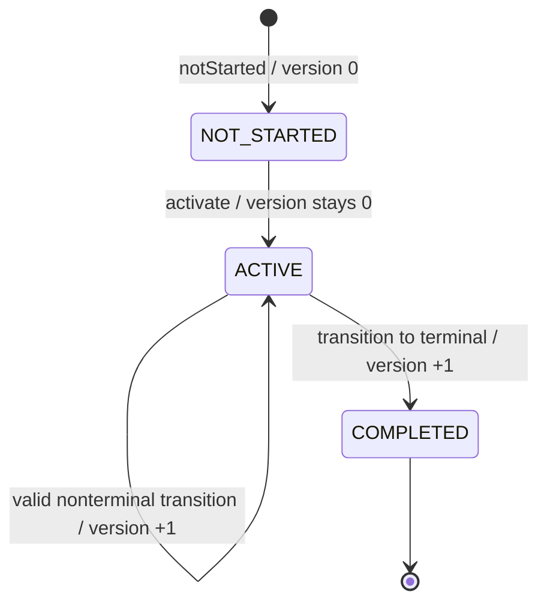

# Workflow Core — Domain Model

> **Evidence labels:** OBSERVED = read directly from source at pinned SHA; SELECTED = user-approved G4-F11 authoring choice; PROPOSED = test or architecture requirement not proven as executed; DEFERRED = explicitly outside existing contract; VERIFIED requires executed artifacts and independent review. No tests or database transactions were run to prepare this document; no Gate is approved.

## 1. Purpose, source of truth and scope

This document is the **contract-first domain model** of the reusable, provider-neutral state machine in `com.tricore.dxos.core.workflow`. It describes existing Java type signatures, valid construction, lifecycle operations, invariants, error distinctions and the boundary between a **domain proposal** and a **durable persistence commit**. It does **not** change Java interfaces or the existing [canonical Workflow contract](https://github.com/lexuanbao258-collab/dxos-open-core/blob/0f0c3ba0c3eecda0a5c4a798a3cc14b808351bed/docs/contracts/workflow-core.md). Breaking model changes require a separate ADR and conformance review.

Pinned source: `0f0c3ba0c3eecda0a5c4a798a3cc14b808351bed`. The canonical contract blob is `11c5aaca1e7e08394710a6d0c5fe8e187d549d83`.

**Out of scope:** Business-specific SLA, assignment, approval, Facility/Helpdesk roles, database schema, HTTP response mapping, BPMN, full engine replacement, automatic retries, authorization based on `ActorReference`, and proof of cross-provider interchangeability.

## 2. Public types, kinds and exact source provenance

| Type | Java kind | Pinned blob SHA | Observed contract responsibility |
| --- | --- | --- | --- |
| [`WorkflowDefinition.java`](https://github.com/lexuanbao258-collab/dxos-open-core/blob/0f0c3ba0c3eecda0a5c4a798a3cc14b808351bed/backend/src/main/java/com/tricore/dxos/core/workflow/WorkflowDefinition.java) | record | `281828d4a09f11990bf315a7492db462e95bfa7a` | Immutable definition; defensive Set.copyOf; ID/version/initial state, unique transition IDs, members valid |
| [`WorkflowTransition.java`](https://github.com/lexuanbao258-collab/dxos-open-core/blob/0f0c3ba0c3eecda0a5c4a798a3cc14b808351bed/backend/src/main/java/com/tricore/dxos/core/workflow/WorkflowTransition.java) | record | `3d8df562d91dab6f840f7ee9c7377c7c5148cc81` | Nonblank transitionId/source/target; endpoint membership enforced by definition |
| [`WorkflowInstance.java`](https://github.com/lexuanbao258-collab/dxos-open-core/blob/0f0c3ba0c3eecda0a5c4a798a3cc14b808351bed/backend/src/main/java/com/tricore/dxos/core/workflow/WorkflowInstance.java) | final class | `297315a7a9ed250c1e5a11acde3ccdbc339109a2` | Immutable snapshot; notStarted/restore/activate/transition; no value equals override |
| [`WorkflowLifecycle.java`](https://github.com/lexuanbao258-collab/dxos-open-core/blob/0f0c3ba0c3eecda0a5c4a798a3cc14b808351bed/backend/src/main/java/com/tricore/dxos/core/workflow/WorkflowLifecycle.java) | enum | `ca324b72c5035462cd51f65e62ee8b48dd2e3444` | NOT_STARTED, ACTIVE, COMPLETED only |
| [`TransitionCommand.java`](https://github.com/lexuanbao258-collab/dxos-open-core/blob/0f0c3ba0c3eecda0a5c4a798a3cc14b808351bed/backend/src/main/java/com/tricore/dxos/core/workflow/TransitionCommand.java) | record | `e57001286a176458b1d13f5869bb15ad8e46877f` | Instance, transition, nonnull actor, nonnegative expectedVersion; no target state |
| [`TransitionResult.java`](https://github.com/lexuanbao258-collab/dxos-open-core/blob/0f0c3ba0c3eecda0a5c4a798a3cc14b808351bed/backend/src/main/java/com/tricore/dxos/core/workflow/TransitionResult.java) | final class | `b6dbd53f97a40fe0d008a39c8a96e088dcf8dda4` | Package-private constructor; internally consistent previous/next snapshot and record; proposal only |
| [`TransitionRecord.java`](https://github.com/lexuanbao258-collab/dxos-open-core/blob/0f0c3ba0c3eecda0a5c4a798a3cc14b808351bed/backend/src/main/java/com/tricore/dxos/core/workflow/TransitionRecord.java) | record | `5332c0a46491ee2b00ad0b95ca235c3a5e16f6be` | Positive result version, nonnull actor/time; comparator orders by runtime version |
| [`ActorReference.java`](https://github.com/lexuanbao258-collab/dxos-open-core/blob/0f0c3ba0c3eecda0a5c4a798a3cc14b808351bed/backend/src/main/java/com/tricore/dxos/core/workflow/ActorReference.java) | record | `488057cc5c43c9595bf1918ca88da3781dc5c2ec` | Opaque actorId; not authentication evidence |
| [`ResourceReference.java`](https://github.com/lexuanbao258-collab/dxos-open-core/blob/0f0c3ba0c3eecda0a5c4a798a3cc14b808351bed/backend/src/main/java/com/tricore/dxos/core/workflow/ResourceReference.java) | record | `75e8b39ff04674910f6129806d2a4e5c0e58b143` | Opaque resourceType and resourceId; no business entity coupling |
| [`WorkflowErrorCode.java`](https://github.com/lexuanbao258-collab/dxos-open-core/blob/0f0c3ba0c3eecda0a5c4a798a3cc14b808351bed/backend/src/main/java/com/tricore/dxos/core/workflow/WorkflowErrorCode.java) | enum | `a9c183ee13edb8b8efd95af2563b19eaddd36e5b` | Nine stable normalized operational error codes |
| [`WorkflowException.java`](https://github.com/lexuanbao258-collab/dxos-open-core/blob/0f0c3ba0c3eecda0a5c4a798a3cc14b808351bed/backend/src/main/java/com/tricore/dxos/core/workflow/WorkflowException.java) | final class | `d6f83177fab349c751dcba81d84d7e094eb57ab4` | Code-only sanitized RuntimeException without provider cause/stack trace |
| [`WorkflowValues.java`](https://github.com/lexuanbao258-collab/dxos-open-core/blob/0f0c3ba0c3eecda0a5c4a798a3cc14b808351bed/backend/src/main/java/com/tricore/dxos/core/workflow/WorkflowValues.java) | package-private helper | `99fd6d0f61f8f880798e8045a18623f454f9fe16` | Nonblank string and nonnegative long structural validation |
| [`WorkflowPersistencePort.java`](https://github.com/lexuanbao258-collab/dxos-open-core/blob/0f0c3ba0c3eecda0a5c4a798a3cc14b808351bed/backend/src/main/java/com/tricore/dxos/core/workflow/WorkflowPersistencePort.java) | interface | `5009b191a3eb555ba3248eda4728ab8d3aac251b` | Durable authoritative load/commit, atomic state/history, optimistic version and ambiguous write outcome |

`WorkflowValues` is package-private and is listed for source fidelity, not as a public SPI. `WorkflowPersistencePort` is an interface owned by Workflow Core and is covered here **only at the domain/persistence boundary**; full storage guarantees belong in `persistence.md`. `WorkflowRuntime` is existing orchestration in Core and is not a stateful entity.

## 3. UML-style domain relationships



This is a conceptual diagram: a `WorkflowInstance` stores **definition ID/version**, not a persistent Java object reference to a `WorkflowDefinition`; the runtime resolves the authoritative definition at operation time. Type attributes are descriptive, not a newly proposed Java API.

## 4. Definition semantics and validation

**OBSERVED:** `WorkflowDefinition` is a Java `record`, with `definitionId`, `definitionVersion`, `initialState`, `states` and `transitions`. It checks nonblank identifiers, nonnegative definition version, `initialState ∈ states`, each transition endpoint in states and **globally unique transition IDs** within one definition. It uses `Set.copyOf` for defensive, unmodifiable collections. `transition(id)` throws `WorkflowException(INVALID_TRANSITION)` if absent; `isTerminal(state)` means the state has no outgoing transition, not that it belongs to a predefined terminal-name list.

**Exact binding:** `(definitionId, definitionVersion)` is a stable immutable content key. The domain checks identity equality, but the **authoritative definition content** must be loaded from the persistence contract. A caller-supplied same-key but altered definition is not trustworthy evidence of correct content.

**Not imposed by source:** acyclic graphs, full graph reachability, self-transition prohibition, alphabetical identifiers, GUID-only IDs, or mandatory workflow names. Do not add these as constructor invariants without ADR.

## 5. Instance: immutable snapshot and lifecycle

`WorkflowInstance` is a `final class` with private fields and no public state setter. It stores `instanceId`, exact `definitionId` and `definitionVersion`, opaque `resourceReference`, `currentState`, `runtimeVersion`, `lifecycle`, `createdAt`, `updatedAt`.

- `notStarted(...)` creates `NOT_STARTED` at the initial state, version zero, with equal timestamps.
- `restore(...)` validates a snapshot for **adapter reconstruction only**; it does not authorize or persist an overwrite. The port must verify restored origins against authoritative state.
- `activate(exactDefinition, startedAt)` creates a new ACTIVE snapshot and keeps `runtimeVersion=0`; it adds no transition record. It is rejected when not NOT_STARTED or when the initial state is terminal.
- `transition(exactDefinition, command, occurredAt)` requires exact definition key and instance ID, matching expected runtime version, ACTIVE lifecycle, present transition ID and matching source state. Target state is derived from the definition. On success it creates a new immutable instance and one corresponding history record.
- A state is terminal when it has no outgoing transitions. Entering one produces `COMPLETED`. Completed instances cannot transition or reopen in the baseline.

**Lifecycle trace** (the arrow to COMPLETED is conditional on reaching a terminal state):



An initial terminal state can be represented in a definition, but cannot be activated in this baseline. The model does not provide a direct NOT_STARTED→COMPLETED operation.

## 6. Definition version versus runtime version

| Concept | Meaning | Changes when |
| --- | --- | --- |
| `definitionVersion` | Version of immutable workflow topology/policy definition | **Never** on an existing instance |
| `runtimeVersion` | Count of successful state transitions for one instance | Increment once per successful committed transition; activation stays at 0 |
| `expectedVersion` | Command precondition to prevent stale transition | Provided for each transition and compared against current instance at domain and commit boundaries |
| `resultingRuntimeVersion` | History record version | Corresponds to incremented instance version; history is ascending and contiguous per instance |

**Important precision:** the pure domain proposes version+1 before persistence commits; the durable version is authoritative only after the port confirms the successful commit. A failed or rejected operation must not be described as a successful transition solely because an object was produced in memory.

## 7. Command, result and transition history

`TransitionCommand` is a record `(instanceId, transitionId, actorReference, expectedVersion)`: both identifiers are nonblank, the actor is nonnull and expectedVersion is nonnegative. No client-controlled target state or new version is accepted.

`TransitionResult` is an immutable `final class` with a package-private constructor. It validates the previous/next snapshots and matching record: previous lifecycle ACTIVE, resulting instance not NOT_STARTED, exactly one increment, matching identity/definition/resource/created time, nondecreasing time, matching history instance ID, source/target state, version and occurredAt. It exposes `expectedVersion()` based on the previous instance version.

`TransitionRecord` is a record for **successful** transitions, with positive resulting version, actor and timestamp. Its `BY_RUNTIME_VERSION` comparator sorts by version, not timestamp. Tied timestamps are permitted and should not reorder history. Rejected/uncommitted attempts do not add durable successful-transition records.

## 8. Opaque references, trust and business scope

`ActorReference(actorId)` is an opaque value. A user can construct it; **that construction cannot prove authentication or authorization**. The upstream verified security/Application seam is responsible for trusted identity and resource-specific permission checks before Workflow execution.

`ResourceReference(resourceType, resourceId)` describes application-owned resource identity without loading a Helpdesk ticket or Facility request into Core. Business ownership, approver eligibility, assignment, SLA, and HTTP policy stay in Applications/transport adapters.

**Examples only, not approved workflow definitions:** Helpdesk may attach an instance to a ticket ID; Facility may attach one to a service request ID. Both consume the same structural type without introducing hardcoded ticket/FAC classes into Core.

## 9. Immutability, equality and defensive-copy semantics

| Type family | Observed equality/immutability behavior | Reviewer warning |
| --- | --- | --- |
| Java records (`WorkflowDefinition`, `WorkflowTransition`, `TransitionCommand`, `TransitionRecord`, `ActorReference`, `ResourceReference`) | Record structural value equality; immutable components when constituent types are immutable; `WorkflowDefinition` defensively copies `states` and `transitions` | Do not confuse a record's equality with persisted authority |
| Ordinary `final class WorkflowInstance` | Fields private/final, domain operations return new instances; **no custom `equals/hashCode` shown** | `instanceA.equals(instanceB)` is not a reliable value comparison across separate restorations |
| Ordinary `final class TransitionResult` | Validated three-part immutable proposal; no custom `equals/hashCode` shown | Compare relevant fields/snapshots explicitly for adapter conformance |
| `WorkflowException` | Code-only normalized runtime exception; no provider cause/stack | HTTP error mapping and provider exception translation belong outside Core |
| `WorkflowValues` | Local structural helper | Not a provider-independent public service |

**Important:** record value equality depends on fields: embedded `ActorReference` and `ResourceReference` are records, whereas `WorkflowInstance` does not acquire record-like equality simply because its state is immutable.

## 10. Structural versus operational failures

Structural invalid data generally raises `IllegalArgumentException` or `NullPointerException` as the exact API path dictates; it should not silently be normalized to a Workflow business error.

The current **exact nine** normalized values are:

| `WorkflowErrorCode` | Meaning in existing domain/persistence contract |
| --- | --- |
| `DEFINITION_NOT_FOUND` | Required authoritative exact definition/key missing or mismatch |
| `INSTANCE_NOT_FOUND` | Required instance absent/mismatched |
| `INVALID_TRANSITION` | Transition identifier absent from relevant definition |
| `TRANSITION_NOT_ALLOWED` | Wrong source/lifecycle/proposal/invalid transition operation |
| `INSTANCE_COMPLETED` | Terminal completed lifecycle blocks mutation |
| `VERSION_CONFLICT` | Stale version/competing activation, including replay conflicts |
| `OPERATION_FAILURE` | General operation failure; for provider writes only after confirmed no-commit/rollback |
| `INSTANCE_ALREADY_EXISTS` | Insert-only create rejects duplicate instance ID |
| `COMMIT_OUTCOME_UNKNOWN` | Persistence write may or may not have durably committed |

Do not invent new code values inside this document. Error precedence is operation-specific and must match the canonical Workflow contract rather than inferred from enum order. `WorkflowException` does not carry a provider cause or exposed stack.

## 11. Pure domain proposal versus durable commit

The domain computes a valid `TransitionResult` but does **not** perform SQL updates:

```mermaid
sequenceDiagram
    autonumber
    participant A as Authorized Application
    participant R as WorkflowRuntime
    participant I as WorkflowInstance domain
    participant P as WorkflowPersistencePort
    A->>R: executeTransition(command)
    R->>P: loadInstance(id) / loadDefinition(exact key)
    P-->>R: authoritative snapshot / definition
    R->>I: transition(definition, command, clock.instant())
    I-->>R: TransitionResult proposal
    R->>P: commitTransition(proposal)
    alt confirmed durable commit
        P-->>R: committed result
        R-->>A: successful result
    else rejected / confirmed rollback
        P-->>R: normalized failure; rejected operation does not mutate
    else commit cannot be established
        P-->>R: COMMIT_OUTCOME_UNKNOWN
        R-->>A: unresolved / reconcile; no blind retry
    end
```

The port must validate the authoritative origin and rederive the transition from the authoritative exact definition; compare full relevant snapshot/history fields by **value**, not Java reference identity. It commits update and exactly one matching history record together, or neither, even on uncertain outcomes. A provider exception alone cannot prove rollback. Separate instance and history reads do not form a shared transactional snapshot.

**This is a contract, not an assertion that integration tests passed.**

## 12. Test traceability and evidence plan

| ID | Source contract | Positive / negative assertions to execute | Evidence and reviewer | State |
| --- | --- | --- | --- | --- |
| DM-01 | Definition | Valid graph, defensive set copy; blank fields, bad endpoint, duplicate transition ID rejected | JUnit XML, Core reviewer | NOT RUN |
| DM-02 | Transition | Valid IDs; missing/blank strings, invalid definition membership | JUnit XML, Core reviewer | NOT RUN |
| DM-03 | Initial instance | NOT_STARTED state, 0 version, exact timestamps; invalid restore rejected | JUnit XML, Core reviewer | NOT RUN |
| DM-04 | Activation | ACTIVE at 0, no history; terminal initial, reactivation and backwards time denied | JUnit XML, Core reviewer | NOT RUN |
| DM-05 | Transition | Correct target, version+1 and record; stale expectedVersion, source mismatch, completed state denied | JUnit XML, Core reviewer | NOT RUN |
| DM-06 | Result | Snapshot and history fields remain consistent; no claim of durable commit | JUnit XML/source review, Core reviewer | NOT RUN |
| DM-07 | References | Actor/Resource opaque, reject blank; forged actor grants no authority at Application boundary | JUnit and HTTP security negative, Security reviewer | NOT RUN |
| DM-08 | Equality | Record equality, class reference equality; value-origin compare by persisted fields | JUnit and persistence tests, Data reviewer | NOT RUN |
| DM-09 | Errors | All nine codes; structural/operational distinction; sanitized exception | JUnit XML, Core reviewer | NOT RUN |
| DM-10 | Persistence boundary | Atomic state+history, full compare-and-write, version conflicts, ambiguous COMMIT recovery | Real DB/fault injection reports, Data reviewer | NOT RUN |
| DM-11 | Reuse | Helpdesk and Facility share Core without business-specific Core changes | Two-App E2E and source diff, independent reviewer | NOT RUN |

Every proof must include exact SHA, environment, command, selected tests count, observed result, negative side-effect checks and independent reviewer disposition. Synthetic in-memory tests do not prove real database concurrency or provider substitution.

## 13. Review gates, risks and open decisions

| Gate | Required evidence | Current state |
| --- | --- | --- |
| G4-D Design | Type model and 18 selected decisions reviewed | NOT REVIEWED |
| G4-S Source | All Java types and contract statements traced to exact SHA | SOURCE INSPECTED; INDEPENDENT REVIEW PENDING |
| G4-U Unit/negative | Constructor, lifecycle, transition, error, equality tests executed | NOT RUN HERE |
| G4-I Integration | Real persistence/version/atomicity/unknown-outcome tests | NOT RUN HERE |
| G4-R Reuse | Helpdesk + Facility independent evidence, unchanged Core | NOT RUN HERE |
| Final Gate | Independent approval with traceable reports | NOT APPROVED |

**Open issues:** definition publication and immutable content retention; business/actor authorization evidence; precision-preserving persistence; reconciliation of `COMMIT_OUTCOME_UNKNOWN`; exact test class inventory; cross-Application reuse; provider-swapped conformance; formal responsibility for Gate approval.

**Deferred:** SLA timers, complex approval/parallel/BPMN semantics, workflow graph reachability constraints, implicit reopen, automatic retries or idempotent replay.

## 14. Pinned references

- [`WorkflowDefinition.java`](https://github.com/lexuanbao258-collab/dxos-open-core/blob/0f0c3ba0c3eecda0a5c4a798a3cc14b808351bed/backend/src/main/java/com/tricore/dxos/core/workflow/WorkflowDefinition.java) — `281828d4a09f11990bf315a7492db462e95bfa7a`
- [`WorkflowTransition.java`](https://github.com/lexuanbao258-collab/dxos-open-core/blob/0f0c3ba0c3eecda0a5c4a798a3cc14b808351bed/backend/src/main/java/com/tricore/dxos/core/workflow/WorkflowTransition.java) — `3d8df562d91dab6f840f7ee9c7377c7c5148cc81`
- [`WorkflowInstance.java`](https://github.com/lexuanbao258-collab/dxos-open-core/blob/0f0c3ba0c3eecda0a5c4a798a3cc14b808351bed/backend/src/main/java/com/tricore/dxos/core/workflow/WorkflowInstance.java) — `297315a7a9ed250c1e5a11acde3ccdbc339109a2`
- [`WorkflowLifecycle.java`](https://github.com/lexuanbao258-collab/dxos-open-core/blob/0f0c3ba0c3eecda0a5c4a798a3cc14b808351bed/backend/src/main/java/com/tricore/dxos/core/workflow/WorkflowLifecycle.java) — `ca324b72c5035462cd51f65e62ee8b48dd2e3444`
- [`TransitionCommand.java`](https://github.com/lexuanbao258-collab/dxos-open-core/blob/0f0c3ba0c3eecda0a5c4a798a3cc14b808351bed/backend/src/main/java/com/tricore/dxos/core/workflow/TransitionCommand.java) — `e57001286a176458b1d13f5869bb15ad8e46877f`
- [`TransitionResult.java`](https://github.com/lexuanbao258-collab/dxos-open-core/blob/0f0c3ba0c3eecda0a5c4a798a3cc14b808351bed/backend/src/main/java/com/tricore/dxos/core/workflow/TransitionResult.java) — `b6dbd53f97a40fe0d008a39c8a96e088dcf8dda4`
- [`TransitionRecord.java`](https://github.com/lexuanbao258-collab/dxos-open-core/blob/0f0c3ba0c3eecda0a5c4a798a3cc14b808351bed/backend/src/main/java/com/tricore/dxos/core/workflow/TransitionRecord.java) — `5332c0a46491ee2b00ad0b95ca235c3a5e16f6be`
- [`ActorReference.java`](https://github.com/lexuanbao258-collab/dxos-open-core/blob/0f0c3ba0c3eecda0a5c4a798a3cc14b808351bed/backend/src/main/java/com/tricore/dxos/core/workflow/ActorReference.java) — `488057cc5c43c9595bf1918ca88da3781dc5c2ec`
- [`ResourceReference.java`](https://github.com/lexuanbao258-collab/dxos-open-core/blob/0f0c3ba0c3eecda0a5c4a798a3cc14b808351bed/backend/src/main/java/com/tricore/dxos/core/workflow/ResourceReference.java) — `75e8b39ff04674910f6129806d2a4e5c0e58b143`
- [`WorkflowErrorCode.java`](https://github.com/lexuanbao258-collab/dxos-open-core/blob/0f0c3ba0c3eecda0a5c4a798a3cc14b808351bed/backend/src/main/java/com/tricore/dxos/core/workflow/WorkflowErrorCode.java) — `a9c183ee13edb8b8efd95af2563b19eaddd36e5b`
- [`WorkflowException.java`](https://github.com/lexuanbao258-collab/dxos-open-core/blob/0f0c3ba0c3eecda0a5c4a798a3cc14b808351bed/backend/src/main/java/com/tricore/dxos/core/workflow/WorkflowException.java) — `d6f83177fab349c751dcba81d84d7e094eb57ab4`
- [`WorkflowValues.java`](https://github.com/lexuanbao258-collab/dxos-open-core/blob/0f0c3ba0c3eecda0a5c4a798a3cc14b808351bed/backend/src/main/java/com/tricore/dxos/core/workflow/WorkflowValues.java) — `99fd6d0f61f8f880798e8045a18623f454f9fe16`
- [`WorkflowPersistencePort.java`](https://github.com/lexuanbao258-collab/dxos-open-core/blob/0f0c3ba0c3eecda0a5c4a798a3cc14b808351bed/backend/src/main/java/com/tricore/dxos/core/workflow/WorkflowPersistencePort.java) — `5009b191a3eb555ba3248eda4728ab8d3aac251b`
- [Canonical Workflow contract](https://github.com/lexuanbao258-collab/dxos-open-core/blob/0f0c3ba0c3eecda0a5c4a798a3cc14b808351bed/docs/contracts/workflow-core.md) — `11c5aaca1e7e08394710a6d0c5fe8e187d549d83`

**Final status:** G4-F11 DRAFT / NOT REVIEWED. No tests or independent Gate approval were performed during authoring.
