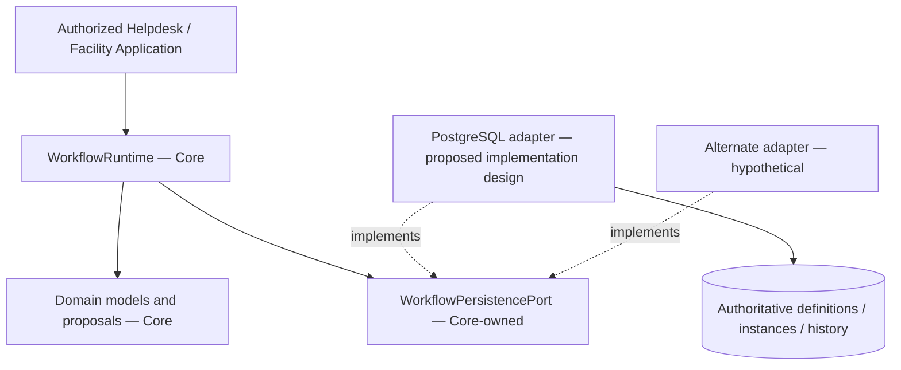

# Workflow Core — Persistence Contract & Adapter Architecture

> **Evidence vocabulary:** **OBSERVED** = content in the pinned Java sources or canonical contract; **SELECTED** = G4-F14 user decisions; **PROPOSED** = design, implementation, or test obligation not proven implemented; **VERIFIED** = reproduced execution results tied to this commit, environment, and independent reviewer. No tests were run or accepted while authoring this document; no Gate was approved. **HISTORICAL** test reports narrated by the canonical contract are not promoted to current evidence.

## 1. Purpose, scope, sources and non-goals

Specify provider-neutral persistence semantics for Workflow Core, plus a **proposed PostgreSQL adapter design and conformance plan**. The Workflow capability owns the `WorkflowPersistencePort` and its behavioral invariants. Data/infrastructure owns adapter implementation, schema/migrations, transactions, provisioning and storage operations; it may not redefine Workflow transitions. This is a logical modular-monolith boundary, not a mandate for another microservice.

**OBSERVED source pins:**
- [WorkflowPersistencePort.java](https://github.com/lexuanbao258-collab/dxos-open-core/blob/0f0c3ba0c3eecda0a5c4a798a3cc14b808351bed/backend/src/main/java/com/tricore/dxos/core/workflow/WorkflowPersistencePort.java) — blob `5009b191a3eb555ba3248eda4728ab8d3aac251b`.
- [WorkflowRuntime.java](https://github.com/lexuanbao258-collab/dxos-open-core/blob/0f0c3ba0c3eecda0a5c4a798a3cc14b808351bed/backend/src/main/java/com/tricore/dxos/core/workflow/WorkflowRuntime.java) — blob `3b7e7ac755f0021b6ef0ea5a572748bdca585ff2`.
- [Canonical Workflow Core contract](https://github.com/lexuanbao258-collab/dxos-open-core/blob/0f0c3ba0c3eecda0a5c4a798a3cc14b808351bed/docs/contracts/workflow-core.md) — blob `11c5aaca1e7e08394710a6d0c5fe8e187d549d83`.

**SELECTED:** retain exact-SHA Java SPI, canonical operation semantics and nine error codes. Changes to public contract or error precedence require a separately reviewed ADR. No automatic definition CRUD, idempotency keys, retry engine, REST endpoint, BPMN replacement, or schema migration is introduced by this document.

## 2. Dependency direction and component ownership



`WorkflowRuntime` already exists in source: it loads authoritative state/definition and calls the port. It does not authenticate the actor, implement business ACL, retry, reconcile or expose HTTP. Application must verify identity, authority, and resource eligibility before invoking mutation. A constructed `ActorReference` is not authentication evidence.

## 3. Exact Java port signatures and contracts

```java
WorkflowDefinition loadDefinition(String definitionId, long definitionVersion);
WorkflowInstance createInstance(WorkflowInstance initial);
WorkflowInstance commitActivation(WorkflowInstance expected, WorkflowInstance activated);
WorkflowInstance loadInstance(String instanceId);
List<TransitionRecord> loadHistory(String instanceId);
TransitionResult commitTransition(TransitionResult transition);
```

| Operation | Required valid input / authoritative comparison | Success contract | Rejection / error contract |
| --- | --- | --- | --- |
| `loadDefinition` | Exact `(definitionId, definitionVersion)`; zero valid | Immutable, authoritative stored definition; no latest fallback | Missing exact key → `DEFINITION_NOT_FOUND` |
| `createInstance` | Initial NOT_STARTED snapshot equals authoritative `notStarted(...)` *by fields*; version 0; initial state and equal timestamps | Insert exactly one durable initial instance, with empty transition history | Duplicate ID always `INSTANCE_ALREADY_EXISTS`, including identical replay; missing definition `DEFINITION_NOT_FOUND`; invalid initial proposal `TRANSITION_NOT_ALLOWED` |
| `commitActivation` | Full expected snapshot/lifecycle equality against persisted data; proposed value equals domain `activate()` under authoritative definition | Atomic NOT_STARTED→ACTIVE; runtimeVersion remains 0; history unchanged | Version **or lifecycle** changed → `VERSION_CONFLICT`; invalid origin/proposal → operation-specific error; no rejected mutation |
| `loadInstance` | Existing instance ID | Authoritative immutable snapshot | Missing → `INSTANCE_NOT_FOUND` |
| `loadHistory` | Existing instance ID | Immutable, ascending `resultingRuntimeVersion`; empty when no transitions | Missing → `INSTANCE_NOT_FOUND`; separate instance/history loads are not one shared snapshot |
| `commitTransition` | Expected version, full source origin, authoritative exact definition and rederived target; matching result/record | Atomic update of state/lifecycle/time/version **and exactly one matching history record** | Version replay → `VERSION_CONFLICT`, forged origin/target/history rejected; no partial writes |

All writes return success **only after confirmed durable commit**. Domain `TransitionResult` is a validated proposal until then. No automatic retries or upserts are permitted by this SPI.

## 4. Definition persistence and provisioning

**OBSERVED contract:** `(definitionId, definitionVersion)` identifies immutable content. Provision the complete initial state, state set and transition set through controlled Data/infrastructure seed/import, **outside** runtime port. Identical re-import may be accepted, but changed content under an existing key is rejected; use an explicit new version instead. Referenced versions must remain resolvable. The same `ResourceReference` may be attached to multiple instances; only instance ID uniqueness is part of this contract.

**PROPOSED storage checks:** unique `(definition_id, definition_version)` and `instance_id`; validate content immutability at provisioning; do not alter historical definition rows referenced by instances; test version zero and concurrent provisioning. Actual schema names/types and migration plan are **not approved or verified** here. Do not modify old Flyway V1/V2 as an implied consequence.

## 5. Proposed transaction design (not an implementation claim)

**SELECTED:** PostgreSQL may use a conditional write, row locking and a local database transaction, subject to evidence. The port's semantics are authoritative; SQL below is **illustrative pseudocode**, not source taken from the repository.

```text
BEGIN TRANSACTION
  Read/lock authoritative instance and exact immutable definition
  Check expected origin fields and version/lifecycle at write boundary
  Reconstruct authoritative transition and compare proposal by value
  Conditionally update instance, preserving definition/resource/createdAt
  Insert exactly one matching history record at next runtime version
COMMIT
Return success ONLY when the adapter confirms durable COMMIT
```

For creation, replace update/history with an insert-only initial snapshot and empty history. For activation, update only the validated full snapshot lifecycle/time, **without history**. Atomicity covers both state and history, including a commit whose result cannot be determined by the caller.

### Commit-time compare-and-write matrix

| Write | Compare at commit | Permitted changes | History |
| --- | --- | --- | --- |
| `createInstance` | Duplicate ID, exact definition, initial-state fields and timestamps | Insert NOT_STARTED, version 0 | Empty |
| `commitActivation` | `instanceId`, definition ID/version, resource, state, runtimeVersion, lifecycle, createdAt, updatedAt **by value** | lifecycle→ACTIVE; updatedAt can advance or stay equal; version remains 0 | **No new record** |
| `commitTransition` | expected runtime version **and** previous definition binding, resource, source state, lifecycle, timestamps; authoritative definition re-derivation | state/lifecycle/updatedAt; version +1; identity/binding/resource/createdAt fixed | Exactly one corresponding successful record |

### Why version-only activation is unsafe

Two competing activations can both see `runtimeVersion = 0` because activation does not increment it. An atomic predicate must include the lifecycle and all expected source fields. Exactly one competing activation wins; replay of an earlier NOT_STARTED proposal after a successful activation returns `VERSION_CONFLICT`, even when version remains zero. A read-before-write without commit-time validation is insufficient.

### Why read-time version checking is unsafe

Two transition requests can read `runtimeVersion=3` and independently construct proposals with resulting version 4. The adapter must compare and mutate atomically. At most one can commit against source version 3; the loser receives `VERSION_CONFLICT` and **does not append history**. This is required behavior, **not a test result from this session**.

## 6. Ordered history and authoritative re-derivation

**OBSERVED contract:** each committed transition appends exactly one record with a unique, contiguous `resultingRuntimeVersion` starting at 1. `loadHistory` orders by version, not timestamp; equal timestamps are permitted. Rejected/confirmed uncommitted operations write no successful-transition history. Instance snapshot and history may be read separately, without a shared snapshot.

Do not trust a same-ID/version *caller-supplied* definition. After checking origin, load authoritative definition and rederive transition from persisted source state, transition ID, actor, occurrence time and expected version. Compare proposed next snapshot and record by field value. An absent authoritative transition is `INVALID_TRANSITION`; incorrect target/lifecycle/history is `TRANSITION_NOT_ALLOWED`. An immutable Java class does not imply value-based `equals()`; compare persisted fields explicitly.

## 7. Operation-specific error precedence

The port must retain the canonical normalized error semantics. **No single invented global order** is imposed for all operations.

### Creation

1. Duplicate `instanceId` before definition lookup → `INSTANCE_ALREADY_EXISTS`, including identical replay.
2. No exact authoritative definition → `DEFINITION_NOT_FOUND`.
3. A structurally valid but noninitial/forged snapshot → `TRANSITION_NOT_ALLOWED`.
4. Provider error: `OPERATION_FAILURE` **only if no commit/rollback confirmed**; otherwise `COMMIT_OUTCOME_UNKNOWN` when unresolved. Concurrent insert losers cannot overwrite the winner.

### Activation (canonical contract's exact precedence)

| Priority | Condition | Code |
| --- | --- | --- |
| 1 | Missing expected instance | `INSTANCE_NOT_FOUND` |
| 2 | Persisted runtime version **or lifecycle** differs from expected | `VERSION_CONFLICT` |
| 3 | Stored/expected lifecycle COMPLETED | `INSTANCE_COMPLETED` |
| 4 | Other source differences, unchanged ACTIVE reactivation, backward time | `TRANSITION_NOT_ALLOWED` |
| 5 | Exact authoritative definition missing | `DEFINITION_NOT_FOUND` |
| 6 | Target differs from authoritative domain activation, or terminal initial state | `TRANSITION_NOT_ALLOWED` |
| 7 | Provider write problem after validation | `OPERATION_FAILURE` if confirmed no commit; `COMMIT_OUTCOME_UNKNOWN` if unknown |

### Transition

Reject missing instance (`INSTANCE_NOT_FOUND`), stale/replayed expectedVersion (`VERSION_CONFLICT`), completed lifecycle (`INSTANCE_COMPLETED`), absent definition (`DEFINITION_NOT_FOUND`), absent authoritative transition (`INVALID_TRANSITION`) and inconsistent origin/target/record (`TRANSITION_NOT_ALLOWED`) according to domain and canonical-port checks. The source specifies **certain required checks but not one universal total precedence for every simultaneous invalid condition**. Preserve actual source/order and add negative tests rather than inventing a universal hierarchy. Provider technical causes must never leak.

## 8. Four write outcomes and normalized error handling

| Outcome | Error or result | Guarantee |
| --- | --- | --- |
| Rejection due to validation/business/concurrency | Specific structural exception or normalized code | **Rejected attempted write** changes no persisted state/history; other writers may still progress |
| Confirmed failed write, rollback or no commit | `OPERATION_FAILURE` | This attempted write made no durable change |
| Confirmed successful durable commit | Return committed instance or `TransitionResult` | The full operation committed; activation has no history, transition has matching record |
| Commit status cannot be established | `COMMIT_OUTCOME_UNKNOWN` | Whole write may or may not already be durable; no **partial** transition/history state permitted |

The exact nine codes are `DEFINITION_NOT_FOUND`, `INSTANCE_NOT_FOUND`, `INVALID_TRANSITION`, `TRANSITION_NOT_ALLOWED`, `INSTANCE_COMPLETED`, `VERSION_CONFLICT`, `OPERATION_FAILURE`, `INSTANCE_ALREADY_EXISTS`, and `COMMIT_OUTCOME_UNKNOWN`. Structural constructor failures use `IllegalArgumentException`/`NullPointerException` as appropriate; adapters translate provider failures to sanitized `WorkflowException` without SQL, credentials, provider causes or stack details. No new HTTP code policy is added here.

## 9. Commit-unknown reconciliation and fault-injection plan

```mermaid
sequenceDiagram
    autonumber
    participant App as Authorized Application
    participant Run as WorkflowRuntime
    participant Port as Persistence adapter
    participant DB as PostgreSQL
    App->>Run: executeTransition(command)
    Run->>Port: loadInstance / loadDefinition
    Port-->>Run: authoritative values
    Run->>Port: commitTransition(proposal)
    Port->>DB: BEGIN + compare-and-write + history + COMMIT
    alt Commit confirmed
      DB-->>Port: confirmed durable success
      Port-->>Run: committed result
      Run-->>App: success
    else Rollback confirmed
      DB-->>Port: confirmed no durable write
      Port-->>Run: OPERATION_FAILURE
      Run-->>App: failure
    else Commit response lost / ambiguous
      DB--xPort: no conclusive response
      Port-->>Run: COMMIT_OUTCOME_UNKNOWN
      Run-->>App: unresolved; no auto-retry
    end
```

**Recovery is an external, explicitly controlled procedure, not automatic inference from a thrown exception:**

| Write | Authoritative reconciliation | Do **not** infer |
| --- | --- | --- |
| Create | Inspect ID, exact definition binding, resource, lifecycle/version and timestamps | Identical stored snapshot proves the same writer; duplicate replay is idempotent success |
| Activation | Inspect full snapshot/lifecycle, including a possible version-zero activation and subsequent transitions | Version zero means it never activated |
| Transition | Look for exact proposed record at resulting runtime version; compare content and instance's potentially later state | A later instance version means the earlier record did not commit |

Separate `loadInstance` and `loadHistory` calls do not promise one shared transactionally consistent snapshot; if ambiguous, re-read or keep unresolved with adapter-owned/operator recovery. A stale/missing read while a transaction is unresolved is not rollback proof. Explicit retry requires settling the original attempt, re-checking authoritative concurrency and an **Application recovery decision**. This port has no operation receipts, idempotent replay or automated retry.

**PROPOSED negative fault injection:** inject failure before write, before COMMIT, after confirmed ROLLBACK, immediately after successful COMMIT but before the response, and during authoritative reconciliation. Verify full before/after instance/history state and normalized result, bounded under concurrent writers. No such failures were injected in this authoring step.

## 10. Timestamp fidelity and PostgreSQL representation

Core uses exact `Instant` with possible nanoseconds; PostgreSQL `timestamptz(6)` stores microseconds. The **SELECTED** options are: (a) configure the input/clock boundary to accepted microsecond-aligned values and reject unrepresentable values/ranges before mutation with `OPERATION_FAILURE`; or (b) choose a lossless seconds/nanos representation. These are alternative adapter choices, **not** an assertion that either storage scheme already exists. Do not silently round expected/proposed instances or history; retain `updatedAt == TransitionRecord.occurredAt` after round trip and preserve history order by version. Time zone changes must not change reconstructed `Instant`.

## 11. Provider substitution: behavioral parity and unchanged Application code

**SELECTED contract:** a new adapter is substitutable only after the same suite demonstrates exact immutable definitions, insert-only creation, full activation compare, atomic optimistic transition/history, normalized error precedence, unknown-commit recovery, timestamp fidelity, and ordered history. The Workflow-owned port stays stable and **Application business logic remains unchanged** for the demonstration. Full workflow engine/BPMN replacement is not proven by this persistence-port contract and needs separate architecture/migration review.

| Proof area | Same-suite conformance requirement | Evidence |
| --- | --- | --- |
| Definition | Version 0, exact version lookup, immutable same-key content, retained referenced version | Source + provisioning test + readback |
| Creation | One concurrent winner; duplicate replay rejected; no overwrite or partial create | Database before/after + logs |
| Activation | Two concurrent callers at version zero; one winner; no history | Real DB concurrency result |
| Transition | Equal-version race, stale/replay, source/target tamper, authoritative re-derivation | Actual DB state/history, negative codes |
| History | One matching record, no gaps, ascending version, ties in timestamp allowed | Query + deterministic assertion |
| Failure/recovery | Rollback proven vs lost COMMIT response ambiguous, controlled reconciliation | Fault-injection report |
| Precision | Microsecond-aligned or lossless roundtrip, invalid precision/range rejection | Timestamp roundtrip trace |
| Reuse | Helpdesk and Facility slices run using unchanged Core/Application business logic | Git diff hashes + E2E report |

An in-memory fake can test some contracts but cannot establish physical PostgreSQL durability, locking/isolation, or crash recovery. Likewise, a real PostgreSQL demonstration does not prove an unimplemented alternate adapter is compatible.

## 12. Source → test → evidence → independent reviewer

| ID | Contract obligation | Required positive and negative verification | Required evidence | Proposed reviewer | Status |
| --- | --- | --- | --- | --- | --- |
| PS-01 | Authoritative definitions | Exact-version read, immutable same-key reimport rejection, old versions retained | Test XML + store snapshot | Core/Data | NOT RUN HERE |
| PS-02 | Insert-only creation | Initial state/v0, duplicate and concurrent create one-winner | DB state, XML, exit code | Data | NOT RUN HERE |
| PS-03 | Full activation compare | Race two activations v0, lifecycle mismatch and replay | DB state/history, XML | Data | NOT RUN HERE |
| PS-04 | Atomic transition | Two clients expected v3, only one state+record v4 | DB history/snapshot, XML | Data | NOT RUN HERE |
| PS-05 | Forged origin | Wrong resource, definition, source time, same-key altered definition | Negative error matrix + DB side-effect audit | Core/Data | NOT RUN HERE |
| PS-06 | History order | Tied timestamps, gap/duplicate refusal, immutable result | DB query + assertions | Data | NOT RUN HERE |
| PS-07 | Failed commit | Confirmed rollback, injection on state/history insert | Transaction trace + before/after proof | Data | NOT RUN HERE |
| PS-08 | Unknown commit | Lost success response for create/activate/transition and reconciliation | Fault traces + outcome notes | Data/Operations | NOT RUN HERE |
| PS-09 | Timestamp encoding | Accepted exact Instants, unrepresentable precision, zone differences | Roundtrip evidence | Data | NOT RUN HERE |
| PS-10 | Sanitized errors | Nine Workflow codes, create/activation error precedence, no provider leak | Exception logs + tests | Security/Core | NOT RUN HERE |
| PS-11 | Adapter substitution | Identical suite on two adapters, unchanged Application logic | Paired results + source diff | Independent | NOT RUN HERE |
| PS-12 | Reuse and authorization | Helpdesk and Facility, verified ACL and no direct mutation | HTTP E2E + DB negative evidence | Application/Security | NOT RUN HERE |

For every test collect exact SHA, environment (JDK/Gradle/PostgreSQL version and port), fixture and transaction boundaries, test command and exit status, selected/skipped count, logs/SQL evidence (sanitized), before/after values, race-winner PID where useful, reviewer and verdict. Historical test summaries in the contract refer to earlier SHAs and **are not current test PASS evidence**.

## 13. Review layers, open questions and blockers

| Gate | Acceptance material | This document's status |
| --- | --- | --- |
| G4-D Design | Reviewed schema/transaction plan and ownership boundaries | DRAFT / NOT REVIEWED |
| G4-S Source | Exact SHA Core contract + adapter source inventory | CORE SOURCE OBSERVED; ADAPTER NOT CERTIFIED |
| G4-C Contract | Fake/real semantic conformance suites | NOT EXECUTED HERE |
| G4-I Real DB | Real transaction, activation/transition races, rollback and lost COMMIT evidence | NOT EXECUTED HERE |
| G4-P Provider Swap | Alternative adapter same-suite parity | NOT EXECUTED HERE |
| G4-R Reuse | Helpdesk + Facility with stable business code | NOT EXECUTED HERE |
| Independent Gate | Named reviewer verifies evidence and grants disposition | NOT APPROVED |

**Open decisions:** PS-OD-01 definition provisioning authority and migration ownership; PS-OD-02 PostgreSQL schema/row-lock-vs-conditional-UPDATE; PS-OD-03 timestamp representation; PS-OD-04 fault-injection/proof of unknown COMMIT; PS-OD-05 rollback and reconciliation operating runbook; PS-OD-06 exact error precedence tests at adapter boundary; PS-OD-07 alternate adapter selection; PS-OD-08 Application unchanged-code reuse evidence; PS-OD-09 actual adapter source inventory by fixed SHA.

**P0 blockers for any compatibility claim:** partial state/history mutation; double activation; stale transition accepted; wrong definition accepted; silent time rounding; provider SQL/cause leakage; `COMMIT_OUTCOME_UNKNOWN` hidden as rollback; automatic retry; missing actual adapter or missing independent review.

**Final status:** G4-F14 **DRAFT / NOT REVIEWED**. No production code changed, no tests run, no provider swap and no independent Gate approval in this authoring step.
