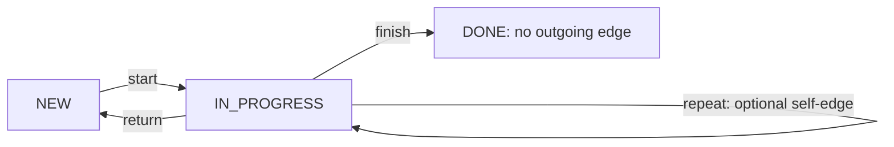
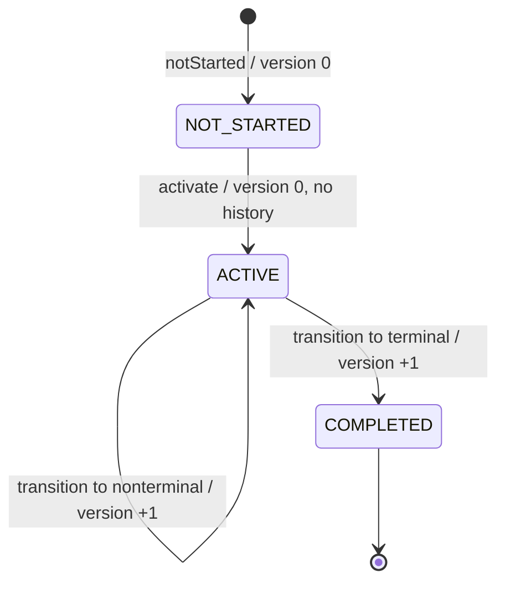

# Workflow Core — State Machine Semantics

> **Evidence classification:** OBSERVED = verified source/contract at pinned SHA; SELECTED = user-chosen G4-F13 design direction; PROPOSED = future verification, not execution; DEFERRED = outside current model; VERIFIED requires recorded execution evidence. No tests, database transactions or independent Gate approval occurred during this authoring step.

## 1. Purpose and normative boundary

This document specifies **the generic lifecycle, definition graph, transition rules, error precedence, state/history versioning, concurrent updates and failure outcomes** for DX-OS Workflow Core. It complements, and does not supersede, the [canonical Workflow contract](https://github.com/lexuanbao258-collab/dxos-open-core/blob/0f0c3ba0c3eecda0a5c4a798a3cc14b808351bed/docs/contracts/workflow-core.md). The existing Java APIs are preserved; contract-breaking changes require a separately reviewed ADR.

A Workflow **state** is a string in an application-provisioned `WorkflowDefinition`. A Workflow **lifecycle** is a Core-owned enum (`NOT_STARTED`, `ACTIVE`, `COMPLETED`). For example, `RESOLVED` and `CLOSED` may be business states, but they are not new lifecycle values. Neither a string's name nor a caller-supplied flag marks a state terminal.

**Non-goals:** business-specific state names or approved Helpdesk/Facility transition matrix; SLA/timers; guard DSL; role authorization; BPMN; parallel gateways; universal acyclicity/reachability constraints; automatic reopening/retries; provider-specific SQL.

## 2. Source observations and exact-SHA provenance

| Source | Blob SHA | Relevant observed behavior |
| --- | --- | --- |
| [`WorkflowDefinition.java`](https://github.com/lexuanbao258-collab/dxos-open-core/blob/0f0c3ba0c3eecda0a5c4a798a3cc14b808351bed/backend/src/main/java/com/tricore/dxos/core/workflow/WorkflowDefinition.java) | `281828d4a09f11990bf315a7492db462e95bfa7a` | Immutable states/transitions; unique transitionId; endpoint membership; terminal iff no outgoing transition |
| [`WorkflowInstance.java`](https://github.com/lexuanbao258-collab/dxos-open-core/blob/0f0c3ba0c3eecda0a5c4a798a3cc14b808351bed/backend/src/main/java/com/tricore/dxos/core/workflow/WorkflowInstance.java) | `297315a7a9ed250c1e5a11acde3ccdbc339109a2` | Immutable snapshot; source-order validation; version-zero activation; proposal-generation transition |
| [`WorkflowPersistencePort.java`](https://github.com/lexuanbao258-collab/dxos-open-core/blob/0f0c3ba0c3eecda0a5c4a798a3cc14b808351bed/backend/src/main/java/com/tricore/dxos/core/workflow/WorkflowPersistencePort.java) | `5009b191a3eb555ba3248eda4728ab8d3aac251b` | Authoritative definition, full activation compare, atomic history and unknown outcome semantics |
| [Canonical Workflow contract](https://github.com/lexuanbao258-collab/dxos-open-core/blob/0f0c3ba0c3eecda0a5c4a798a3cc14b808351bed/docs/contracts/workflow-core.md) | `11c5aaca1e7e08394710a6d0c5fe8e187d549d83` | Operational invariants and persistence failure contracts |

Source inspection does not constitute test execution. Historical test results recorded in the canonical contract remain historical.

## 3. Definition graph: states, transitions and terminal states

`WorkflowDefinition(definitionId, definitionVersion, initialState, states, transitions)` enforces nonblank identifiers, nonnegative definitionVersion, initial-state membership, unique transition IDs and declared endpoints. A definition is immutable; an active instance remains pinned to its exact `(definitionId, definitionVersion)`. Persisted authoritative content is resolved by port, not accepted because a caller provides a same-key copy.

`WorkflowTransition(transitionId, sourceState, targetState)` names an edge. Its **transition ID**, not a caller-provided destination, selects the target. `isTerminal(state)` returns true precisely when no transition has that source state. This holds even if a state is named `DONE`, `CLOSED` or `REOPENED`.

Cycles, unreachable states and self-transitions are not globally forbidden by the baseline constructor, provided structural invariants hold. Advanced graph policies are **DEFERRED**; the model does not promise every graph can reach a terminal state.



**Illustrative definition only:** not an accepted Helpdesk or Facility business contract. `DONE` is terminal here because it has no outgoing transition, *not* because of its label.

## 4. Lifecycle versus current state



| Lifecycle | Domain condition | Permitted operation | Version/history |
| --- | --- | --- | --- |
| `NOT_STARTED` | Created at definition.initialState with createdAt = updatedAt | Valid nonterminal-initial `activate` | Version 0, empty history |
| `ACTIVE` | Current state has outgoing transition | Valid transition from current state | One increment per successful transition; matching history |
| `COMPLETED` | Current state terminal, reached by transition | Read only for this baseline; no reopen | Version/history preserved |

**Important edge case:** a definition with terminal initial state is structurally representable, but `activate` rejects it. A not-started snapshot does not jump directly to COMPLETED.

## 5. Activation contract and version-zero race

`WorkflowInstance.activate(exactDefinition, startedAt)` checks exact definition, nondecreasing time, `NOT_STARTED` lifecycle and nonterminal initial state; returns a new `ACTIVE` snapshot with the same initial state, definition binding, resource and createdAt. **It does not increment runtimeVersion (still 0) or create transition history.**

Persistence must atomically compare the *entire expected origin* — instance ID, definition ID/version, resource, current state, runtimeVersion, lifecycle, createdAt and updatedAt — and the proposed activated snapshot with authoritative values. `runtimeVersion` alone is insufficient: two competing activations can both observe version 0, so only one may win at commit. Replaying the original NOT_STARTED source must yield `VERSION_CONFLICT`; attempting fresh activation of unchanged ACTIVE source is `TRANSITION_NOT_ALLOWED` under the canonical contract.

## 6. Transition validation in exact source order

`WorkflowInstance.transition(exactDefinition, command, occurredAt)` performs the following ordered validations, **after the command's Java null check**:

| Order | Check | On failure |
| --- | --- | --- |
| 0 | `command != null` | `NullPointerException` |
| 1 | Definition reference nonnull and exact `definitionId` + `definitionVersion` binding | `DEFINITION_NOT_FOUND` |
| 2 | Command instanceId equals current instanceId | `INSTANCE_NOT_FOUND` |
| 3 | Command expectedVersion equals current runtimeVersion | `VERSION_CONFLICT` |
| 4 | If lifecycle COMPLETED | `INSTANCE_COMPLETED` |
| 5 | If lifecycle not ACTIVE | `TRANSITION_NOT_ALLOWED` |
| 6 | Definition resolves command transitionId | `INVALID_TRANSITION` |
| 7 | Current state matches transition.sourceState | `TRANSITION_NOT_ALLOWED` |
| 8 | `occurredAt` nonnull and not before current updatedAt | `NullPointerException` or `IllegalArgumentException` |
| 9 | Runtime version not `Long.MAX_VALUE` | `OPERATION_FAILURE` |
| 10 | Construct next immutable snapshot and matching TransitionRecord | Validated `TransitionResult` proposal, not yet durable |

**Error-precedence example:** a stale command against an already-completed instance reports `VERSION_CONFLICT` (step 3) before `INSTANCE_COMPLETED` (step 4). This is the **domain method's** exact source order, not an invented universal ordering for all adapter write failures.

## 7. Successful transition result invariants

A valid transition produces `next.runtimeVersion = previous.runtimeVersion + 1`; the target comes from the exact definition. The instance/resource/definition binding/createdAt do not change. `next.updatedAt = record.occurredAt`, and that time must not go backwards; equal timestamps are allowed. A target with outgoing transitions yields `ACTIVE`; a target without them yields `COMPLETED`.

`TransitionResult` contains the previous snapshot, next immutable snapshot and matching `TransitionRecord`, but remains only a **validated proposal** until the persistence port durably commits it. One successfully **committed** transition adds exactly one record; resulting history versions are contiguous per instance from 1, ordered by version rather than occurrence timestamp. Rejected or confirmed-not-committed attempts add no history from the rejected attempt.

## 8. Transition matrix (generic behavioral examples)

| Initial lifecycle/state/version | Attempt | Domain result | Persistence result required |
| --- | --- | --- | --- |
| NOT_STARTED / initial / 0 | `activate` with valid nonterminal initial | ACTIVE / initial / 0; no history | Full-snapshot atomic compare; one winning activation |
| ACTIVE / A / 0 | A→B via defined transition, expected=0 | Proposal for B / 1 + record #1 | Commit snapshot + record atomically |
| ACTIVE / B / 1 | B→C via valid transition, expected=1, C terminal | Proposal COMPLETED / C / 2 + record #2 | Commit both atomically |
| ACTIVE / B / 1 | transitionId absent | `INVALID_TRANSITION` | No write |
| ACTIVE / B / 1 | defined edge source=A | `TRANSITION_NOT_ALLOWED` | No write |
| ACTIVE / B / 1 | expected=0 | `VERSION_CONFLICT` | No write from rejected attempt |
| COMPLETED / C / 2 | valid matching version transition | `INSTANCE_COMPLETED` | No write |
| COMPLETED / C / 2 | stale expected=1 | `VERSION_CONFLICT` first | No write |
| ACTIVE / B / 1 | valid cycle B→A | Proposal ACTIVE / A / 2 | Same commit/version/history guarantees |
| ACTIVE / B / 1 | valid self-edge B→B | Proposal ACTIVE / B / 2 | State unchanged but version increases and record appended |

Values and edges in this table are **synthetic examples**, not approved Application definitions. Multiple concurrent writers may advance data independently of a rejected operation.

## 9. Domain-to-persistence sequence and concurrency

```mermaid
sequenceDiagram
    autonumber
    participant App as Authorized Application
    participant R as WorkflowRuntime
    participant P as WorkflowPersistencePort
    participant M as WorkflowInstance
    App->>App: Verify identity, capability authority and resource eligibility
    App->>R: executeTransition(command)
    R->>P: loadInstance(id)
    P-->>R: authoritative instance
    R->>P: loadDefinition(id, exact version)
    P-->>R: authoritative definition
    R->>M: transition(exact definition, command, clock.instant())
    M-->>R: validated proposal + matching history record
    R->>P: commitTransition(proposal)
    alt durable commit confirmed
        P-->>R: committed result
        R-->>App: success
    else concurrent version conflict
        P-->>R: VERSION_CONFLICT, no rejected-write mutation
    else outcome uncertain
        P-->>R: COMMIT_OUTCOME_UNKNOWN
        R-->>App: unresolved; no blind retry
    end
```

Runtime load-time checks do not prevent a second writer from committing before the first write. The persistence adapter must compare authoritative origin and expectedVersion **again atomically at commit**. It must resolve the exact authoritative definition and rederive the transition, rejecting a caller-forged same-ID/version definition or inconsistent target/history. `WorkflowInstance` does not override `equals` as a record; the port compares relevant fields **by value**, not instance object identity.

## 10. Commit outcome classification and reconciliation

| Write outcome | Contract conclusion | Automatic retry? |
| --- | --- | --- |
| Validation/business/version rejection | The rejected write makes no change | No |
| Provider error with confirmed rollback/no commit | `OPERATION_FAILURE`, no change by that write | No implicit retry |
| Confirmed durable commit | Return committed result; atomic state+matching history | Not needed |
| Lost response or otherwise uncertain commit | `COMMIT_OUTCOME_UNKNOWN`; whole write may already be durable or absent | **Never blind retry** |

A connection failure after database COMMIT may produce `COMMIT_OUTCOME_UNKNOWN` even though state+history are durable. Reconciliation must inspect authoritative instance/history and the exact proposed record/version; later writers may have advanced the instance. Two separate reads do not promise one shared snapshot, and stale/absent values do not conclusively prove rollback. If the outcome remains ambiguous, operator/adapter-owned recovery keeps it unresolved. Approved retries require a settled prior attempt and renewed concurrency checks.

## 11. Responsibility and security boundaries

Workflow Core enforces state machine invariants, **not** who is authorized to operate on a Helpdesk ticket or Facility request. A `TransitionCommand.actorReference` is opaque data and is not evidence of successful authentication. A trusted upstream Application/Identity boundary must verify the caller and evaluate exact authority and resource ACL before a mutating call; Gateway must not expose unguarded state-changing Workflow paths. HTTP error mapping remains outside Core.

## 12. Negative tests and evidence traceability

| Test ID | Requirement / source | Positive / negative assertion | Evidence | Reviewer | Status |
| --- | --- | --- | --- | --- | --- |
| SM-01 | Definition graph | Valid graph; duplicate edge ID, unknown endpoints and initial mismatch rejected | JUnit XML + SHA | Workflow | NOT RUN HERE |
| SM-02 | Terminal semantics | No outgoing edge means terminal; a named DONE with outgoing edge is not | JUnit XML | Workflow | NOT RUN HERE |
| SM-03 | Lifecycle creation | NOT_STARTED at initial, timestamps equal, version 0 | Unit JUnit | Core | NOT RUN HERE |
| SM-04 | Activation | Version 0, no history, reject terminal initial and ACTIVE replay | Unit + port conformance | Core/Data | NOT RUN HERE |
| SM-05 | Source-order errors | Stale terminal → VERSION_CONFLICT; wrong source/unknown edge normalized | Unit JUnit | Core | NOT RUN HERE |
| SM-06 | Cycles/self-loops | Legal defined cycle/self-edge increments version and records | Unit + port conformance | Core | NOT RUN HERE |
| SM-07 | Transition history | Exactly one record, contiguous version; tied times sorted by version | Port + DB snapshots | Data | NOT RUN HERE |
| SM-08 | Concurrent transition | Two writers same expectedVersion; exactly one committed | Real DB race evidence | Data | NOT RUN HERE |
| SM-09 | Concurrent activation | Two version-zero activates; one winner, no history | Real DB race evidence | Data | NOT RUN HERE |
| SM-10 | Forged same-key definition | Adapter rederives against authoritative definition and denies tampering | Real adapter negative | Data | NOT RUN HERE |
| SM-11 | Unknown commit | Lost response, atomic state/history and controlled reconciliation | Fault injection and DB proof | Operations/Data | NOT RUN HERE |
| SM-12 | Upstream authorization | Valid state command but forbidden business resource denied with no mutation | HTTP + DB negative | Application/Security | NOT RUN HERE |
| SM-13 | Multi-Application reuse | Helpdesk and Facility use generic definition/state machine without Core modifications | Source diff and two-App E2E | Independent G4 | NOT RUN HERE |

Evidence requires exact commit, test selector and nonzero selected tests, JDK/Gradle/DB versions, execution output/XML, sanitized logs, pre/post history proof, independent reviewer and final disposition. Historical contract descriptions are not current rerun evidence.

## 13. Review gates, risks and deferred requirements

| Gate | Criteria | Status |
| --- | --- | --- |
| G4-D Design | 18 decisions and model reviewed | NOT REVIEWED |
| G4-S Source | Pinned Java source/contract inspected independently | PARTIAL SOURCE INSPECTION |
| G4-U Unit | Graph, lifecycle, transition, precedence negative suites | NOT RUN HERE |
| G4-I Persistence integration | Real DB activation/transition race, atomic history, uncertain COMMIT | NOT RUN HERE |
| G4-R Reuse | Helpdesk + Facility evidence with unchanged Core | NOT RUN HERE |
| Final G4 Gate | Independent approval based on evidence | NOT APPROVED |

**Open questions:** definition provisioning and strict content immutability; approved Application state diagrams; exact timestamp storage; concurrency/fault-injection environment; operational reconciliation owner; direct route protection; actual multi-App E2E; external engine substitution scope.

**DEFERRED:** timers, SLA/escalation machinery, business guards, parallel gateways, BPMN, auto reopen, generic definition CRUD, automatic idempotent retry and graph reachability enforcement.

## 14. Exact source references

- [WorkflowDefinition.java](https://github.com/lexuanbao258-collab/dxos-open-core/blob/0f0c3ba0c3eecda0a5c4a798a3cc14b808351bed/backend/src/main/java/com/tricore/dxos/core/workflow/WorkflowDefinition.java)
- [WorkflowInstance.java](https://github.com/lexuanbao258-collab/dxos-open-core/blob/0f0c3ba0c3eecda0a5c4a798a3cc14b808351bed/backend/src/main/java/com/tricore/dxos/core/workflow/WorkflowInstance.java)
- [WorkflowPersistencePort.java](https://github.com/lexuanbao258-collab/dxos-open-core/blob/0f0c3ba0c3eecda0a5c4a798a3cc14b808351bed/backend/src/main/java/com/tricore/dxos/core/workflow/WorkflowPersistencePort.java)
- [Canonical Workflow Core contract](https://github.com/lexuanbao258-collab/dxos-open-core/blob/0f0c3ba0c3eecda0a5c4a798a3cc14b808351bed/docs/contracts/workflow-core.md)

**Document status: G4-F13 DRAFT / NOT REVIEWED.**
