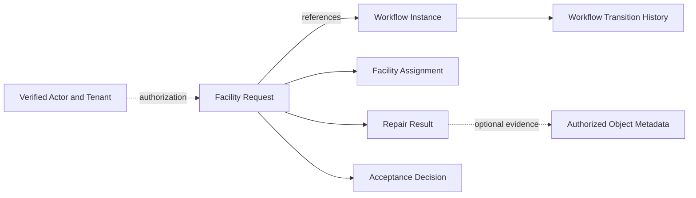

# Facility Maintenance — Candidate Application Data Model

> **Status:** DRAFT / PROPOSED / NOT IMPLEMENTED OR LIVE-VERIFIED
> **Owner:** Application (Ánh); reviewer to confirm
> **Related:** Issue #53, PR #60, PR #76, PR #78

## Purpose

Specify conceptual business-data ownership for Facility Maintenance, separated from generic Workflow Core persistence. This is **not** a verified SQL schema or database migration.

## Logical entities (candidates)

| Entity | Candidate fields | Owner |
| --- | --- | --- |
| Facility Request | Server-issued request ID; tenant scope; verified requester reference; title; description; physical location; linked Workflow instance ID | Facility Application |
| Facility Assignment | Request link; eligible technician; assignment metadata; version or Workflow coordination **OPEN** | Facility Application, subject to final rules |
| Repair Result | Request link; authorized technician; outcome; notes; event time; optional approved evidence references | Facility Application |
| Acceptance Decision | Request link; authorized reviewer; decision and rationale | Facility Application; actor and decision semantics **OPEN** |
| Workflow Instance | Pinned definition ID/version; authoritative state; instance version; lifecycle | Workflow Core |
| Transition History | Committed transition records and their order | Workflow Core |
| Verified Identity / ACL | Principal and resource authorization, not browser-supplied identities | Identity and authorization boundary |
| Object Metadata | Versioned object keys and provider-neutral operations, if attachment contract approved | Data adapter and Application authorization jointly defined |

No physical table names, foreign keys, unique constraints or data-retention durations are asserted without an approved migration and code evidence.

## Conceptual relationships

## Invariants

1. Facility does not store a second independently writable copy of Workflow state.
2. The Backend, not client controls, derives requester identity and enforces tenant/resource authorization.
3. Assignment and acceptance only mutate through a ratified contract; Workflow versus Application assignment semantics are unresolved.
4. A successful multi-record command must respect approved PostgreSQL transaction and optimistic version rules; object storage is not automatically atomic with SQL.
5. A failed or unknown write outcome must not generate false history, success confirmation or orphan evidence references.
6. Location and repair information are potentially sensitive and must follow an approved visibility matrix.

## Open decisions

- Exact fields and validation constraints (location taxonomy, priority, attachments).
- Assignment version model; repair outcomes; who accepts/rejects; retention and deletion.
- Physical schema, migration ownership, indexes, audit requirements, data integrity checks.
- Integration proof with private PostgreSQL 17 and local MinIO.

**Disposition:** Conceptual candidate; no schema implementation or LIVE E2E asserted.
