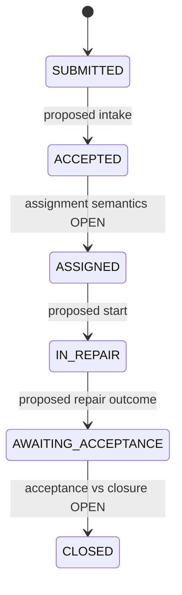

# Facility Maintenance — Candidate Workflow Definition

> **Status:** DRAFT / CONFLICTED CANDIDATE / NOT RATIFIED / LIVE_BLOCKED
> **Owner:** Application (Ánh); Workflow and security review pending
> **Related:** Issue #27, #39, #53; PR #60, PR #76, PR #78

## Purpose

Document the proposed Facility business path without confusing it with an active Workflow Core definition. The full Facility journey is deferred for the IT-first MVP. A **narrower second-definition Core reuse demonstration** requires separate acceptance evidence.

## Candidate flow — not executable specification

`SUBMITTED → ACCEPTED → ASSIGNED → IN_REPAIR → AWAITING_ACCEPTANCE → CLOSED` is an **unratified reference**. No exact transition keys, HTTP endpoints, roles, states or definition version are approved by this document.

## Responsibility and transition questions

| Candidate operation | Business rule | Decision pending |
| --- | --- | --- |
| Submit | Authorized requester creates eligible repair request | Initial facts, verification and binding |
| Intake | Coordinator validates request scope | Wrong-scope handling, rejection path, exact transition |
| Assign | Authorized coordinator selects eligible technician | Whether Workflow `ASSIGNED` state is necessary or a separate Application fact |
| Begin repair | Currently eligible technician starts task | Conditions and transition key |
| Report outcome | Authorized assignee records verified repair result | Incomplete/failed outcome; required evidence |
| Accept | Designated authorized actor reviews repair | Requester versus independent inspector, reject/rework |
| Close | Formal closure after acceptance | Whether closure separate or automatically implied — **must not assume** |

## Core / Application boundary

Workflow Core alone owns current state, transition mechanics, pinned definition and version, and successful transition history. Facility Application owns locations, technician eligibility, repair facts and acceptance rules. Identity/Gateway/BFF enforce trusted actor and protected HTTP routing. The Portal cannot invent states or change Workflow tables.

## Safety properties

- Deny unauthorized or cross-tenant actions; hide protected resource existence when required.
- Require approved version checks for each authorized transition; no mutation on conflicts or denied actions.
- Never claim assignment, rejection or automatic closing is supported merely because it appears in this candidate diagram.
- On `COMMIT_OUTCOME_UNKNOWN`, avoid false success or blind retry.
- Keep attachment uploads separate from transactional Workflow state until approved orchestration exists.

## Verification plan and gate

Before treating Facility as LIVE, approve requirements, use cases, business rules, definition ID/version and actor matrix; implement Backend/BFF APIs; execute real Keycloak, HTTP, PostgreSQL and MinIO tests; record exact SHA and independent review.

**Disposition:** DRAFT ONLY; no approved Facility workflow or production closure behavior.
