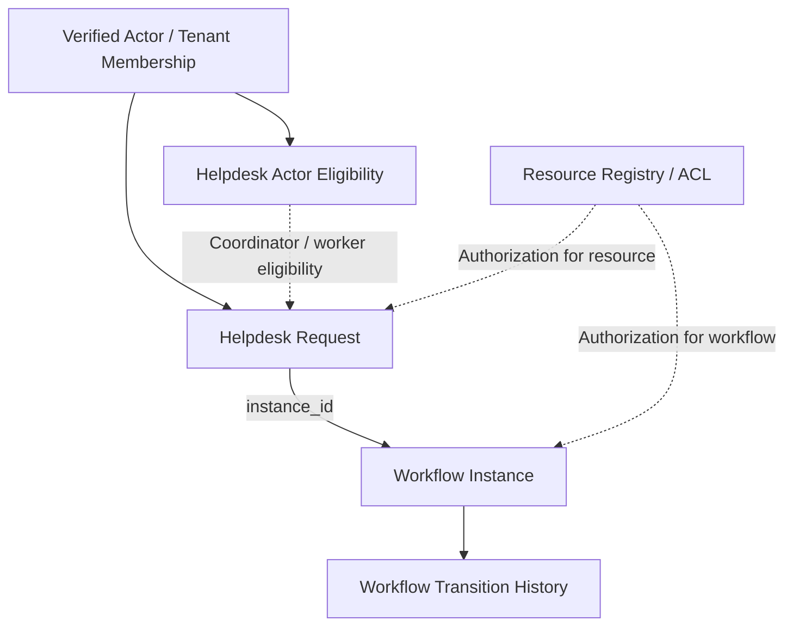

# IT Helpdesk — Application Data Model

**Status:** DRAFT — IMPLEMENTED CANDIDATE / LIVE_BLOCKED  
**Owner:** Application Team — Ánh  
**Source baseline:** PR #63 Backend candidate, commit `e12d105c89400a5fd69dd6cc1fca670ff1f04f51`

## 1. Purpose

This document describes the IT Helpdesk Application data model and its relationships with reusable DX-OS Core services.

The data model must preserve the distinction between business facts owned by Application and authoritative workflow state owned by Workflow Core.

This is documentation of an opt-in implementation candidate, not a production schema approval.

## 2. Data Ownership

| Component | Owned information |
|---|---|
| Helpdesk Application | Request title, description, requester, assignment, resolution |
| Workflow Core | Instance state, version, lifecycle, definition binding, transition history |
| Identity / Authorization | Verified actor identity, tenant membership and resource permissions |
| Data Management | Persistence and storage abstractions |

The Application must not maintain a second independently writable workflow status.

## 3. Conceptual Data Model

This diagram is conceptual; arrows do not necessarily represent physical SQL foreign keys.

## 4. Application Entities

### 4.1 Helpdesk Request

The PR #63 candidate defines `helpdesk_requests`.

| Field | Purpose |
|---|---|
| `request_id` | Server-generated UUID identifying the business request |
| `tenant_id` | Tenant scope |
| `requester_id` | Original requester |
| `instance_id` | Linked Workflow Core instance identifier |
| `title` | Issue title |
| `description` | Issue description |
| `assignee_id` | Current assigned technician, nullable |
| `assignment_version` | Version for independent assignment concurrency |
| `resolution` | Recorded technical result, nullable |

`request_id` is the primary key.

`instance_id` is unique and references the Workflow instance.

The request's current workflow state and version are not independently stored as writable Helpdesk status fields.

### 4.2 Helpdesk Actor

The candidate defines `helpdesk_actors` to hold tenant-scoped eligibility information.

| Field | Purpose |
|---|---|
| `tenant_id` | Tenant scope |
| `actor_id` | Canonical actor identifier |
| `submitter` | Submission eligibility |
| `coordinator` | Triage and assignment eligibility |
| `worker` | Technician eligibility |
| `display_name` | Optional trusted, provisioned display label |

Actor identity comes from verified authentication and authoritative provisioning.

The frontend must not determine eligibility by supplying a display name or arbitrary role.

## 5. Workflow Core Relationship

Each Helpdesk request links to an authoritative Workflow instance.

The candidate uses the immutable definition binding `it-helpdesk@1`.

The proposed main path is:

`SUBMITTED → TRIAGED → IN_PROGRESS → RESOLVED → CONFIRMED`

Workflow Core owns the current state, instance version and transition history.

The Application records assignment separately. Assignment changes increment `assignment_version`, not Workflow instance `version`.

## 6. Authorization Relationships

The candidate uses shared tenant and resource authorization structures, including:

- `tenant_memberships`
- `resource_registry`
- `resource_acl`
- `workflow_definition_bindings`

These structures are not equivalent to business roles.

An original requester, coordinator or assigned worker still requires the applicable verified authority and resource/action permissions.

The final authorization and visibility policies remain subject to review.

## 7. Data Consistency

The Backend candidate uses guarded PostgreSQL operations to coordinate Helpdesk business facts and Workflow state changes.

Important rules:

- A successful resolution must not leave a contradictory workflow state.
- Invalid or unauthorized actions must not create business or workflow writes.
- Assignment changes must respect the independent assignment version.
- Workflow transitions must respect the expected Workflow version.
- Unknown commit outcomes must not be treated as guaranteed success or rollback.

The current Application SQL is an opt-in disposable candidate outside the normal Flyway migration locations. This document does not request or approve a production migration.

## 8. Storage Boundary

The project architecture decision uses private PostgreSQL 17 and local MinIO object storage through `ObjectStoragePort`.

This does not mean the Helpdesk Application has an approved attachment API or verified object-storage transaction.

Any future attachment metadata, upload, authorization and cleanup contract must be documented separately before LIVE use.

## 9. Open Decisions

- Final resource ownership and authorization policy.
- Approved field-level and history-event visibility.
- Production database provisioning and privileges.
- Recovery procedure for uncertain commits.
- Attachment data and storage lifecycle.
- LIVE integration and acceptance evidence.

## 10. References

- Issue #53 — Internal Service Portal MVP Business/API Contract
- PR #60 — Business/API Contract Draft
- PR #63 — Helpdesk Backend Candidate
- PR #73 — Documentation Structure
- PR #76 — Application Documentation Drafts

**Document status: DRAFT — REVIEW REQUIRED / LIVE_BLOCKED.**
