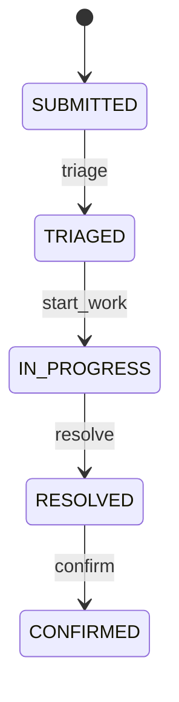

# IT Helpdesk — Candidate Workflow Definition

> **Status:** DRAFT — PROPOSED / NOT APPROVED / LIVE_BLOCKED  
> **Owner:** Application — Ánh (subject to Document Register confirmation)  
> **Related:** Issue [#53](https://github.com/lexuanbao258-collab/dxos-open-core/issues/53), [PR #60](https://github.com/lexuanbao258-collab/dxos-open-core/pull/60), [PR #63](https://github.com/lexuanbao258-collab/dxos-open-core/pull/63), [PR #71](https://github.com/lexuanbao258-collab/dxos-open-core/pull/71)  
> **Evidence boundary:** This is a design description, not a deployed Workflow definition or independent end-to-end (E2E) test result.

## Purpose and ownership

The IT Helpdesk Application interprets business actions and verifies actor eligibility and resource authorization. Reusable Workflow Core owns authoritative instance state, pinned definition version, optimistic concurrency and successful transition history. The Portal is an HTTP consumer and must never set Workflow state directly.

The Backend candidate binds new IT Helpdesk instances to `it-helpdesk@1`. Verify the deployed definition and source revision before calling that binding active.

## Candidate lifecycle

**The candidate ends at `CONFIRMED`, not `CLOSED`.** No rejection, failed-confirmation, reopen, rework, cancellation, escalation or auto-close transition is approved. These are open business decisions, not hidden Workflow capabilities.

| Business action | From → to | Eligibility proposal | Contract and data effects |
| --- | --- | --- | --- |
| Create | New → `SUBMITTED` | Verified eligible requester and explicit create grant | Backend creates business fact and pinned Workflow instance; initial version 0 |
| Triage | `SUBMITTED` → `TRIAGED` | Authorized coordinator | Workflow `triage`; `expectedVersion` |
| Assign | No Workflow state change | Authorized coordinator; eligible current worker | **Application command** `assign`; `expectedAssignmentVersion` |
| Start | `TRIAGED` → `IN_PROGRESS` | Current eligible authorized assignee | HTTP `start` maps to Workflow `start_work`; `expectedVersion` |
| Resolve | `IN_PROGRESS` → `RESOLVED` | Current eligible authorized assignee | Nonblank resolution and `expectedVersion` |
| Confirm | `RESOLVED` → `CONFIRMED` | Authorized original requester | Workflow `confirm`; `expectedVersion` |

Assignment is not counted as one of the four Workflow transitions. A successful assignment may change `assignmentVersion` while leaving `version` untouched. A removed assignee must lose technician-only eligibility.

## State and version invariants

1. Initial successful creation produces `SUBMITTED`, Workflow version `0`, and no transition-history event for creation.
2. Each of the four authorized Workflow transitions advances the authoritative version once, yielding version `4` at `CONFIRMED` for an uninterrupted main path.
3. Only a successful, committed transition creates its corresponding transition-history record. A rejected, conflicted or unauthorized operation does not append successful history.
4. The Application must recheck operation authority, tenant/resource visibility and business eligibility on every protected operation. An authenticated identity alone is insufficient.
5. A conflicting `expectedVersion` or `expectedAssignmentVersion` fails safely; clients must not silently retry mutations.
6. A lost response or `COMMIT_OUTCOME_UNKNOWN` is not proof of success or rollback. Reconcile through an authorized, approved server-side procedure.
7. The Portal must derive permitted actions from authorized Backend state and `allowedActions`, not from a user-selected demo role.

## HTTP mapping (candidate only)

The nine-route candidate uses `/api/v1/mvp/requests` for create/list/detail, triage, assign, start, resolve, confirm and authorized history. See [Application API contract](api-contract.md). The Portal/BFF transport and production OIDC security acceptance remain **LIVE_BLOCKED**. Do not expose generic Workflow mutations to clients based on this document.

## Open decisions and review gates

- Wrong-scope, incomplete request, rejection and escalation behavior.
- Business policy for dissatisfied requesters, rework and `CLOSED`.
- History visibility and actor/event field disclosure, including assignment audit.
- Version-concurrency tests and `COMMIT_OUTCOME_UNKNOWN` reconciliation.
- Independent Portal → BFF → Backend → PostgreSQL E2E with verified Keycloak and negative 401/403/404/409 paths.
- Final document owner, independent reviewer, accepted definition SHA and approved API contract.

**Decision:** DRAFT / REVIEW REQUIRED. This document does not grant runtime or merge acceptance.
