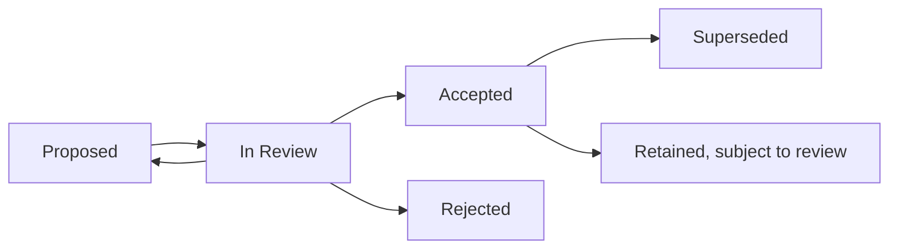

# DX-OS Open-Core — Architecture Decision Records

> **Document:** F07 — ADR Governance and Index  
> **Document lifecycle:** Draft (pending independent repository review)  
> **Scope:** Architecture decisions across DX-OS Core, Applications, integration and deployment  
> **Inventory baseline:** Not verified; no ADR status is asserted by this index.

## Purpose

Architecture Decision Records (ADRs) capture **why** a consequential architecture choice is made, what alternatives were assessed, the trade-offs accepted and how the choice will be validated. This README defines lightweight decision governance and serves as the discoverable ADR index. It does not replace the design process (`../DESIGN_PROCESS.md`; link pending Git verification) or the document register (`../00-project/document-register.md`; verify existence before linking).

**Accepted decision does not mean implemented, tested or released.** Those claims require separate verification at a pinned code and documentation revision.

## When an ADR Is Required

Create or update a proposal when a choice materially changes one or more of:

- System decomposition, module dependency boundaries, or Core/Application ownership.
- Authentication, authorization, trusted principal handling, security or data isolation.
- Published Core/API contracts, compatibility or workflow semantics.
- Data ownership, transaction consistency, persistence, migrations or storage strategy.
- Deployment topology, operational constraints or major technology commitments.

Ordinary formatting, bug fixes preserving an accepted contract, and routine implementation details usually require a reviewed PR **but not a new ADR**. If the significance is disputed, record it in the open-issues process before acceptance.

## ADR Identification and Filename Policy

- New ADRs use a sequential **`ADR-001`, `ADR-002`, ...** identifier and `ADR-NNN-short-kebab-case-title.md` filename, subject to checking all historical IDs first.
- Once assigned, an ID is permanent, never recycled, repurposed or silently renumbered.
- Preserve historical repository identifiers, including different zero padding (for example, `ADR-0023`), until the actual inventory and references have been reviewed. Do **not** normalize existing filenames merely to enforce the new convention.
- Reserve a new number through a reviewed change to this index. Avoid assigning a number based only on the draft list below.

## ADR Lifecycle



- **Proposed:** alternatives and consequences are being written; no authority granted.
- **In Review:** independent technical review is active.
- **Accepted:** designated decision authority has approved a specific ADR revision and recorded the decision evidence.
- **Rejected:** proposal was declined; the record remains available for context.
- **Superseded:** a newly accepted ADR explicitly replaces this decision and identifies its predecessor.

These are **decision statuses**, not the Document Register's `Planned / Draft / In Review / Approved / Superseded` document statuses. Keep both concepts distinct.

## Minimum ADR Template

Every consequential ADR must include the following sections, in English:

```markdown
# ADR-NNN — Decision Title

> Decision status: Proposed
> Decision authority: Pending
> Review baseline: Pending

## Context
What problem and constraints require a decision? Which requirements or contracts are affected?

## Alternatives
Option A: advantages, disadvantages, and risks.
Option B: advantages, disadvantages, and risks.

## Decision
State the chosen option only after the authority approves it; otherwise mark as proposed.

## Rationale
Compare maintainability, security, reuse, testability, deployment and cost where relevant.
Explain which criteria matter most and why.

## Consequences
Benefits, trade-offs, migration and operational impact, unresolved risks.

## Verification
Expected evidence, test or architecture checks, exact PR/commit when available.
Distinguish planned verification from observed results.
```

A proposal may show a preferred alternative without misrepresenting it as an accepted decision. Use measurable criteria or explicit qualitative rationale; avoid invented scores, benchmarks and guarantees.

## Review and Decision Authority

1. Author opens a PR with the context, alternatives, impacts and affected requirement/contract references.
2. An independent reviewer (not the principal author) checks boundary, security, compatibility and evidence claims.
3. The designated decision authority (established through baseline-and-ownership and the review record) explicitly **accepts or rejects** the proposal at an exact revision.
4. Update the ADR status in this index and the Document Register through the reviewed PR. Link the decision, any resulting Issue, implementation PR and verification evidence as these actually exist.
5. Architecture changes to an accepted choice require impact analysis and generally a **new superseding ADR**; editorial fixes use a proportionate PR without rewriting historical decisions.

Reviewer assignment, a merged PR, or existence of an ADR file **alone** does not demonstrate Accepted status. If reviewer/approver authority is unknown, leave the ADR Proposed/In Review and approval Pending.

## ADR Index — Provisional Inventory

The local documentation tree was inspected at `05c7e04f4e5d1e5693a6422fb301f0774155bf01`; independent F07 review and cross-repository ID reconciliation remain pending. A file's own status statement is not independent acceptance evidence.

| ID | Decision | Status | Supersedes | Evidence |
| --- | --- | --- | --- | --- |
| ADR-007 | [MVP object storage provider](ADR-007-data-storage.md) | File states accepted direction; independent approval unverified here | — | Tracked file and its historical source references; review record pending |

Other proposed filenames such as `ADR-001-modular-monolith.md` and references to `ADR-0023` are not confirmed tracked ADR files in this tree. Retain historical IDs and titles when independently reconciled; add links only for tracked files.

## Verification and Traceability

Each accepted ADR should point, where applicable, to:

- Requirement IDs and a canonical traceability matrix (do not duplicate the matrix here).
- Affected Core contracts, system diagrams and Application design files.
- The originating Open Issue and explicit decision/approval evidence.
- Implementation PRs and tests at exact commits, **only when actually verified**.
- The replacing ADR, if superseded; the older record remains accessible.

### Repository Inventory Procedure

Run these commands at the verified root of **each** repository and record remote, branch, SHA and date before updating the table:

```powershell
git remote -v
git branch --show-current
git rev-parse HEAD
git ls-files '*ADR*' '*adr*' 'docs/08-decisions/*'
git grep -n -E 'ADR-[0-9]+' -- docs 2>$null
```

Deduplicate identifiers across repositories, review whether any IDs use four digits, validate links, and investigate references to missing files. Record provenance for Accepted/Rejected/Superseded statuses; where unknown, label **Unverified** during inventory rather than fabricating a decision state.

## Related Governance

- `../DESIGN_PROCESS.md` — stage gates and approvals (unlinked pending Git verification).
- `../00-project/document-register.md` — canonical document lifecycle and ownership (unlinked pending verification).
- `../00-project/baseline-and-ownership.md` — formal baseline and decision authority (unlinked pending verification).
- `../10-reviews/open-issues.md` — open architectural questions and blockers (unlinked pending verification).
- `../10-reviews/f07-review-checklist.md` — independent F07 acceptance checklist (unlinked pending verification).

**F07 status: DRAFT / NOT REVIEWED.** No ADR inventory, decision status or Gate PASS is claimed by this draft.
