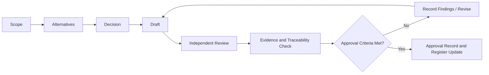

# DX-OS Open-Core — System Design Process

> **Document ID:** DXOS-G0-F02  
> **Version:** 1.0.0-draft  
> **Status:** DRAFT — pending independent review and repository-baseline verification  
> **Owner:** System Design Lead (assignment pending)  
> **Reviewer:** Independent Reviewer (assignment pending)  
> **Last updated:** 2026-10-28  
> **Authority:** Proposed process derived from F02 decisions Q01–Q14; it becomes normative only after G0 approval and registration.

## 1. Purpose and Scope

This document defines how TRICORE proposes, designs, reviews, traces, and accepts DX-OS Open-Core engineering documentation across stages G0–G10. It establishes **process rules**, not the business scope, architecture contracts, implementation state, or test outcomes. The Document Register (`00-project/document-register.md`, **planned/unverified**) is the canonical inventory for ownership and document lifecycle. Stage-specific checklists hold detailed criteria; this file holds the common method.

The process follows **stage-gated iterative engineering**: teams may iterate and draft dependent work concurrently, but may not approve outputs before their required upstream contracts and evidence are accepted. A completed Markdown file is never, on its own, proof of a completed stage.

## 2. Governing Principles

1. **Decision before claim:** state the problem, compare alternatives, and record the selected approach with its rationale.
2. **Core vs. application:** reusable mechanisms and application-specific business rules are evaluated separately; claimed reuse requires proof across two accepted application scenarios.
3. **One canonical source:** maintain one Document Register and one central traceability matrix; other documents link to those sources.
4. **Risk-proportionate review:** P0 work requires the complete workflow, P1 a shortened workflow, and P2 a minimal workflow; risk can escalate the classification.
5. **Independent scrutiny:** the primary author cannot be the sole reviewer or approve their own stage output.
6. **Evidence-bound assertions:** source code, tests, demonstrations, and approvals are not interchangeable evidence.
7. **Change control:** architecture-significant changes require a pull request (PR), independent review, and an Architecture Decision Record (ADR) where appropriate.
8. **No silent reconciliation:** when design and implementation disagree, log and resolve the discrepancy rather than assuming either is automatically correct.

## 3. Roles, Accountability, and Separation of Duties

| Role | Responsibilities | Approval boundary |
| --- | --- | --- |
| Document Owner (O) | Defines scope, compares alternatives, drafts, updates traceability and evidence, addresses findings | Cannot independently approve own document |
| Independent Reviewer (R) | Checks correctness, dependencies, security and failure cases, links and evidence; records findings | Must not be the document's primary author |
| Gate Approver (A) | Verifies gate prerequisites and reviewer outcome; records PASS, CONDITIONAL PASS, or BLOCKED | May be a team member, but must not self-approve their own deliverable without independent review |
| Contributors (C) | Provide business, architecture, code, testing, or operational inputs | Consulted; not automatically approval authority |
| Stakeholders (I) | Receive decisions, constraints, and unresolved risks | Informed |

**Three-person operating rule:** rotate Owner, Reviewer, and Approver assignments by deliverable. The same person can review one artifact and own another. If independent evaluation cannot be achieved for a critical deliverable, mark the gate **BLOCKED** and request external review rather than fabricating a sign-off. Names are assigned in the Document Register, not hard-coded here.

**RACI convention:** for each artifact: one **A**, one **O** (responsible author), at least one **R** independent of O, and optional C/I. RACI here is an operational mapping; individual stage rows below identify the accountable *role* until named assignments are recorded.

## 4. The Standard Document Workflow



| Step | Required result |
| --- | --- |
| Scope | Purpose, boundaries, inputs, assumptions, priority, owner, and affected requirements |
| Alternatives | At least meaningful options and trade-offs for architecture-significant P0 decisions; when only one viable option exists, explain why |
| Decision | Chosen design, rationale, consequences, open questions, and ADR reference when significant |
| Draft | Markdown matching the editorial standard; canonical links instead of copied contracts |
| Review | Independent findings with severity, location, owner, remediation, and retest requirement |
| Evidence | Claim-to-evidence linkage appropriate to design maturity; implementation claims require pinned runtime/source proof |
| Approve | Reviewer outcome, dependency gate status, unresolved risks, authorized gate decision, and register update |

**Priority tailoring:** P0 performs all seven steps with explicit alternatives and claim-level evidence. P1 retains scope, decision rationale, draft, independent review, and evidence for claims actually made; alternatives can be brief. P2 may use a short issue/PR record with scope, change, basic checks, and reviewer, unless the change affects a contract, threat boundary, or accepted design—in which case escalate to P0/P1. None of P0/P1/P2 allows invented evidence or self-approval.

## 5. Stage Model: G0–G10

The following table is the **process-level stage contract**. Each stage maintains its own detailed deliverable checklist and review record. Paths indicate intended document areas, not confirmation that files are tracked or approved.

| Gate | Purpose and key inputs | Required outputs (at stage level) | Exit criteria / dependent work |
| --- | --- | --- | --- |
| **G0 — Baseline & Governance** | Repository inventory, current branches/SHAs, team roles, existing docs | Documentation portal, this process, document register, ownership, editorial conventions, issue/decision tracking, G0 review | Verified baseline; accountable owners/reviewers; navigation and register accurate; governance blockers resolved |
| **G1 — Problem & Product Scope** | G0 baseline, stakeholder problems and assumptions | Problem statement, actor map, product vision, MVP boundaries, glossary, open questions | Problem-to-need links and MVP exclusions reviewed; no unresolved scope-critical blocker |
| **G2 — Requirements & Business Rules** | Approved product baseline and actors | Use cases, business rules, acceptance conditions, NFRs, requirements IDs, initial traceability | Critical flows, exceptions, authorization/business constraints and NFRs are reviewable and non-contradictory |
| **G3 — System Architecture** | G2 requirements, constraints, security/NFRs | Context/container views, Core/Application boundary, dependency rules, technology decisions, ADRs, threat/trust boundaries | Architectural choices justified, boundaries testable, dependencies and risks reviewed |
| **G4 — Core Design** | G3 approved boundaries and relevant G2 rules | Identity, Workflow, Data, Gateway contracts, invariants, failure paths, security rules and verification criteria | Contracts unambiguous; no application-specific rule leakage; required dependencies accepted |
| **G5 — Application Design** | G2 acceptance baseline, G3 boundaries, G4 contracts | Helpdesk domain/use cases/rules, workflows, data ownership, APIs, acceptance; selected second application and reuse proof design | Application-to-Core mapping is explicit; reuse claim remains conditional until demonstrated |
| **G6 — Integration** | Accepted Core and application contracts | Trust handoff, cross-boundary interaction design, error/transaction behavior, E2E paths, integration baseline | Compatible versions and boundary behavior reviewed; unapproved contracts cannot be treated as integrated |
| **G7 — Testing & Evidence** | Accepted requirements, contracts and implementation baseline | Test strategy and matrix, security/contract/concurrency/E2E results, indexed claim-level evidence, acceptance report | Reproducible results tied to SHA/environment/test IDs; failures and coverage gaps visible |
| **G8 — Deployment & Operations** | Implementation, G6/G7 evidence, infra constraints | Clean-install steps, configuration, migrations, ingress/identity setup, recovery/troubleshooting evidence | Clean installation and operating claims independently checked on specified baseline |
| **G9 — Open Source & Release** | License decisions, dependency inventory, accepted build/install baseline | Licensing policy, notices/attribution, release checklist, distribution and reproducibility notes | Ownership and dependency compliance addressed; release blockers closed or explicitly prevent release |
| **G10 — Independent Final Review** | All previous gate records, scope, evidence and unresolved findings | Architecture/security/integration review synthesis, open-issue disposition, final acceptance and defense evidence index | No unresolved final P0; reviewer decision states scope, verified claims, limitations and baseline |

**Cross-stage work:** G1–G3 inform G4/G5; G6 needs compatible G4 and G5 contract versions; G7–G8 may draft early, but runtime acceptance uses verified implementation baselines. G9 license discovery may begin in G0; release approval waits for its own gate. G10 cannot retroactively turn unverified earlier claims into proof.

## 6. Dependency Gates and Controlled Parallelism

| Work may start | Only when | Approval remains blocked until |
| --- | --- | --- |
| G3 architecture sketch | Preliminary G2 draft available and uncertainties labeled | Critical G2 requirements/constraints accepted |
| G4 Core module draft | G3 provisional boundaries identified | Relevant boundaries and dependencies reviewed |
| G5 Helpdesk design | G2 use cases and provisional G4 contracts available | App/Core interfaces and acceptance rules baselined |
| G5 second application candidate | Reuse objective stated | Application selection recorded and measurable reuse acceptance defined |
| G6 integration tests/specs | Both sides expose provisional versioned contracts | Compatible approved contract revisions and security handoffs |
| G7 test writing | Requirement and acceptance IDs exist | Executed results tied to an implementation commit and environment |
| G8 install guide | Candidate deployment assumptions documented | Actual clean-install evidence captured |
| G9 release preparation | License inventory underway | Ownership/license decisions and release verification complete |

A dependency change triggers **impact analysis** on downstream requirements, documents, contracts, tests, and evidence. The impact record must identify affected IDs and any previously approved artifacts that need re-review. **Drafting in parallel does not constitute early Gate PASS.**

## 7. Document Lifecycle vs. Gate Decision

Document lifecycle (authoritative in the planned Document Register):

```text
PLANNED → DRAFT → IN_REVIEW → APPROVED → SUPERSEDED
                 ↘ DRAFT (changes required)
```

- **PLANNED:** catalogued but not yet authored.
- **DRAFT:** content exists, not accepted.
- **IN_REVIEW:** a defined revision has been submitted for independent review.
- **APPROVED:** authorized approval at a pinned revision is recorded.
- **SUPERSEDED:** replaced by a cited newer approved revision.
- **BLOCKED** is a finding/dependency flag, not an alternative lifecycle stage.

Stage verdict is separate: **PASS**, **CONDITIONAL PASS**, or **BLOCKED**. Before review, report **NOT REVIEWED**, not a verdict. APPROVED individual documents do not imply stage PASS; a PASS gate does not prove every possible runtime behavior.

## 8. Gate Decision Rules

### 8.1 Required evidence package

Each gate review records:

1. Gate ID, date, scope and repository/documentation commit SHA(s).
2. Required deliverables with Document IDs, revision and lifecycle status.
3. Input dependencies, their approval references and compatible versions.
4. Traceability coverage for applicable requirements and acceptance criteria; explicitly named gaps.
5. Evidence index by **claim**, classified as design review, source inspection, executed test, environment/demo, or release/legal verification.
6. Independent review findings, severity, owner and disposition.
7. Gate verdict, rationale, conditions (if any), approver identity and date.

**Evidence strength:** a document can substantiate *design intent*; source inspection can substantiate *code structure on a revision*; a test report can substantiate *observed behavior under its documented setup*; neither proves every configuration, security property or release condition. Never infer a PASS from a PR URL or an unchecked box.

### 8.2 Severity

| Severity | Definition | Gate impact |
| --- | --- | --- |
| **P0 — Blocker** | Critical correctness/security violation, missing mandatory boundary/contract, invalid baseline, or evidence gap that defeats a gate's central claim | Gate **BLOCKED** until resolved and re-reviewed |
| **P1 — Major** | Material inconsistency, incompleteness or reproducibility limitation with bounded mitigation | Only **CONDITIONAL PASS** when explicitly accepted with owner, action, due trigger and safe scope; otherwise BLOCKED |
| **P2 — Minor** | Non-blocking clarity, formatting, or low-risk maintenance concern | May PASS if tracked and does not mask a P0/P1 |

### 8.3 Verdicts

- **PASS:** required deliverables and upstream gates are satisfied; traceability/evidence matches the claims; no P0/P1 that undermines the gate; independent reviewer and approver recorded.
- **CONDITIONAL PASS:** no P0; any P1 is bounded, documented with owner, action, trigger/deadline and explicit restriction on downstream claims. It is **not** permission to claim a capability is fully verified. A dependent gate may proceed only where the condition does not undermine that dependency.
- **BLOCKED:** any unresolved P0; missing critical dependency, missing required independent review, or inadequate evidence for the asserted outcome.
- **NOT REVIEWED:** preparation state; never represented as an acceptance result.

No numeric score can override a P0 blocker. Gate decisions apply only to the recorded revisions and scope.

## 9. Central Traceability and Claim Evidence

Use one canonical requirements traceability matrix (location **to be assigned and registered**, not a fabricated tracked path). Suggested record fields:

| Field | Meaning |
| --- | --- |
| Problem / Need ID | Why the requirement exists |
| `REQ-*` / `NFR-*` | Requirement and quality constraint |
| `UC-*` / `BR-*` | Behavior and business-rule linkage |
| Design / `ADR-###` / Contract ID | Chosen boundary and technical obligation |
| Source SHA / PR | Specific implementation revision if applicable |
| `TC-*` | Test and expected behavior |
| `EVD-*` | Claim-specific evidence, execution context and observed result |
| Review / Gate | Reviewer verdict and unresolved gaps |

IDs are stable and never silently reused. Mark a link as `OPEN`, `NOT IMPLEMENTED`, or `NOT VERIFIED` as appropriate; do not invent SHA, test outcomes or owners. For evidence, preserve the **claim, category, exact command/test name, environment, observed output, revision, date, limitations, reviewer**. Redact secrets.

## 10. Architecture Change Control and Discrepancies

A change to accepted scope, boundaries, security assumptions, authorities, public contracts, persistence or deployment assumptions requires:

1. A GitHub Issue or change request describing the discrepancy or proposal, impact and priority.
2. Alternatives/rationale and an **ADR** if the decision has durable architectural consequences.
3. A PR showing changed canonical documents, migration/compatibility implications, affected trace IDs, tests and evidence.
4. Independent review; approve only after affected dependencies have been reconciled.
5. Document Register, traceability matrix and evidence index updates; mark displaced revisions **SUPERSEDED** when applicable.

**Discrepancy record minimum:** `DISC-*` ID, detected date, observed code/design mismatch, pinned baselines, affected claims/IDs, severity, owner, disposition (`OPEN`, `ACCEPT DESIGN`, `ACCEPT IMPLEMENTATION`, `REWORK BOTH`, `DEFER WITH CONSTRAINT`), rationale and reviewer. Do not silently overwrite a decision or claim that code always wins.

## 11. Markdown and Repository Practices

- Apply the proposed Documentation Standard v1.0: English normative text; one H1 per document; semantic headings for indexes/ADRs; consistent numbering optional for long design files.
- Use lower-case kebab-case filenames except established `README.md`, `DESIGN_PROCESS.md`, and `ADR-###-...md`.
- Mermaid is the default for logical diagrams; images require a maintained source or documented limitation.
- Use **relative Markdown links only for tracked, verified targets**. For planned/unverified documents, use inline-code paths clearly labeled as planned.
- Use commit-pinned permalinks for source and execution evidence; ensure links and code fences render before approval.
- Review changes in PRs; keep one canonical version of each contract and avoid copying authoritative status across files.

## 12. Suggested Three-Person Execution Cadence

This is a proposed work pattern, **not a reported team assignment or historical completion**:

1. At the start of each iteration, assign at most a few P0 deliverables with an Owner, different Reviewer, and Approver; mark their prerequisite gates and risks.
2. Hold a brief design decision review before major drafting; capture undecided alternatives in open issues.
3. Open small PRs per coherent document or contract change; let another member review, not the principal author.
4. Perform dependency and evidence checks; resolve P0 before requesting any Gate PASS.
5. At gate review, pin both repositories' SHAs, check the Document Register, and record verdict plus restrictions.
6. When the baseline changes, open an impact/discrepancy review instead of silently reusing previous PASS evidence.

Suggested priority: protect the Helpdesk golden path, identity/security boundary, Workflow exact authorization, integration behavior, reuse proof and reproducible release gates. The specific backlog and personnel assignments must be validated against the current repositories.

## 13. G0–F02 Acceptance Boundary

**F02 is acceptable only after** the text matches the recorded Q01–Q14 decisions; stages G0–G10 have inputs, outputs, dependencies and exit rules; the team can distinguish document lifecycle from gate verdict; risk tailoring, independent review, evidence, discrepancy and ADR rules are testable; Markdown renders; and the reviewer verifies the pinned documentation repository revision. The detailed checklist is planned at `10-reviews/f02-review-checklist.md` until added to the repository.

**Current status: DRAFT / NOT REVIEWED.** This document records a proposed process. It does not assert that G0, F01, F02, a Core module, reuse proof, or any later gate has passed.
