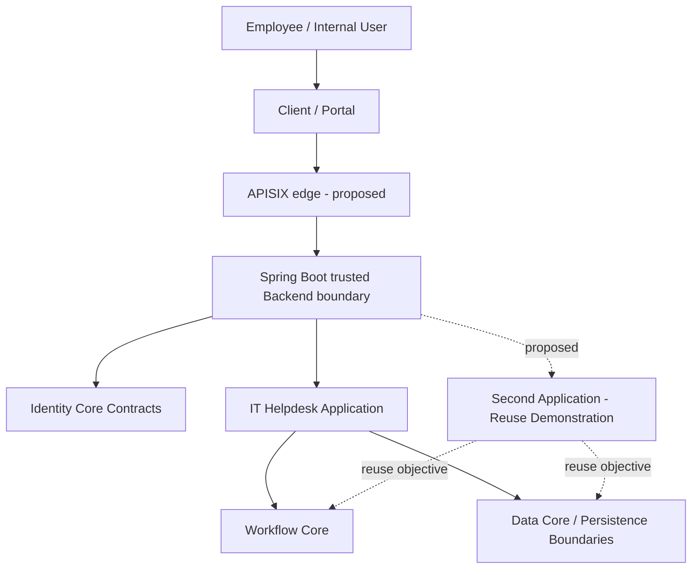

# DX-OS Open-Core — System Design Documentation

> **Document:** F01 · Documentation Portal  
> **Language:** English  
> **Status:** Draft — pending verification against the documentation repository baseline  
> **Authority:** The Document Register, when established, governs document ownership, status, and approval.

## Overview

DX-OS Open-Core is TRICORE's proposed foundation for internal service-request applications. Requests for IT assistance and other internal services are often managed through fragmented messages, making ownership, progress tracking, and accountability difficult to establish. DX-OS is designed to separate reusable technical capabilities—Identity, Workflow, Data, and API Gateway—from application-specific business processes. IT Helpdesk serves as the primary reference application; a second scenario is intended to test Core reuse without modifying Core for that application's business rules. This documentation guides readers from the problem and requirements to architecture, contracts, implementation evidence, and independent review. **A documented design is not evidence of completed implementation or acceptance.**

## Architecture at a Glance

**TO-BE / PROPOSED:** DX-OS exposes four provider-independent Core capabilities through published contracts. Keycloak/OIDC, Flowable BPMN, PostgreSQL/MinIO, and Apache APISIX with a Spring Boot Backend are selected target implementations, not definitions of Core. Flowable and APISIX integration is not established by this documentation. Provider replacement requires contract conformance, migration assessment, and verified security and consistency behavior.

This diagram shows **intended logical responsibilities**, not deployed services or verified runtime interactions. The second application remains to be selected and approved.

**Design boundary:** Core supplies reusable mechanisms and contracts. Applications own business meaning, use cases, validation, domain data, and application-specific access decisions. Identity providers, persistence engines, and other adapters do not replace those boundaries. Arrows express intended dependencies and collaborations, not proof of deployment, authorization, or transaction behavior.

## Start Here

Read in this order to understand the design and then evaluate its evidence:

1. **Problem and scope:** `00-project/` — business problem, actors, objectives, terminology, and MVP boundaries.
2. **Architecture:** `01-architecture/` — system context, Core/Application boundary, dependency rules, and design constraints.
3. **Reusable Core:** `02-core/` — Identity, Workflow, Data, and Gateway responsibilities and contracts.
4. **Applications:** `03-applications/` — Helpdesk business behavior and the selected reuse demonstration when approved.
5. **Integration:** `04-integration/` — cross-boundary contracts, trust handoff, and end-to-end interactions.
6. **Verification:** `05-testing/`, `09-evidence/`, `10-reviews/` — tests, reproducible evidence, review findings, and acceptance decisions.

These paths identify **documentation areas**, not a claim that every file already exists or is approved.

Tracked canonical entry points: [Document Register](00-project/document-register.md), [System Architecture](01-architecture/system-architecture.md), [Core/Application Boundary](01-architecture/core-application-boundary.md), [Identity contracts](02-core/identity/contracts.md), [Workflow contracts](02-core/workflow/contracts.md), [Data contracts](02-core/data/contracts.md), [Gateway contracts](02-core/gateway/contracts.md), and [IT Helpdesk requirements](03-applications/helpdesk/requirements.md). [ADR governance](08-decisions/README.md) and [Open Issues](10-reviews/open-issues.md) record decisions and unresolved review work.

For a guided path through tracked files, start with [Product Vision](00-project/product-vision.md), [Scope and MVP](00-project/scope-and-mvp.md), [Architecture](01-architecture/README.md), the [Identity](02-core/identity/README.md), [Workflow](02-core/workflow/README.md), [Data](02-core/data/README.md), and [Gateway](02-core/gateway/README.md) capability indexes, then [Applications](03-applications/README.md). These indexes distinguish current navigation from historical source pins and planned files.

## Reading Paths by Role

| Reader | Recommended path | What to establish |
| --- | --- | --- |
| Newcomer or OLP assessor | Project → Architecture → Applications → Testing → Evidence | What problem is solved, what is in scope, and what can be demonstrated? |
| System architect | Architecture → Core → Integration → Decisions | Which boundaries, dependencies, and trade-offs are justified? |
| Application developer | Applications → Core Contracts → Integration → Testing | Which business responsibilities belong to each application? |
| Security reviewer | Identity → Gateway → Workflow Authorization → Security Tests | Where are identity, trust, and authorization actually enforced? |
| Release reviewer or contributor | Deployment → Open Source → Evidence → Reviews | Can the project be installed, reproduced, reviewed, and redistributed? |

## Documentation Map

The following **target taxonomy** is the navigation map for the documentation repository. Entries remain plain paths until tracked entry files are verified. Planned and missing documents belong in the Document Register, not in invented links.

| Area | Coverage |
| --- | --- |
| `00-project/` | Problem, vision, scope, glossary, document ownership, and register |
| `01-architecture/` | System context, architecture, boundaries, dependencies, technology, and topology |
| `02-core/` | Identity, Workflow, Data, and Gateway designs, contracts, and acceptance criteria |
| `03-applications/` | Requirements, use cases, rules, workflows, data, APIs, and acceptance criteria |
| `04-integration/` | Identity handoff, application contracts, transactions, and E2E flows |
| `05-testing/` | Test strategy, security, contract, concurrency, E2E, and acceptance results |
| `06-deployment/` | Prerequisites, clean setup, configuration, migrations, recovery, and troubleshooting |
| `07-open-source/` | Licensing, attribution, dependency review, and release readiness |
| `08-decisions/` | Architecture Decision Records (ADRs), alternatives, and consequences |
| `09-evidence/` | Revision-pinned, reproducible source, test, and demo evidence |
| `10-reviews/` | Independent findings, unresolved issues, and gate decisions |
| `11-poc/` | Scoped experiments, results, limitations, and decisions informed by PoCs |

## Reuse and Verification

The architectural objective is to show that **at least two application scenarios can use shared Core capabilities without embedding application-specific rules into Core**. This is a claim to be tested, not an outcome already established by this README. The choice of the second application and its acceptance criteria must be recorded before asserting reuse success.

- **Source code:** [TRICORE DX-OS Open-Core repository](https://github.com/lexuanbao258-collab/dxos-open-core).
- **Evidence index target:** `09-evidence/README.md` — source revision, environment, commands, outputs, limitations, and reviewer decision.
- **Independent review target:** `10-reviews/` — findings and decisions tied to the same revision.
- **Review rule:** A proposed design, merged change, passing test, and independently accepted capability are different states; do not conflate them.

Use commit-specific permalinks when citing implementation evidence. Do not describe an unverified or unmerged change as accepted.

## Documentation Governance

The tracked [Document Register](00-project/document-register.md) is the document authority for inventory, ownership, lifecycle status, and review outcomes. Its provisional entries still require reconciliation. The supporting documents are:

- `00-project/document-style-guide.md` — Markdown language, naming, links, diagrams, and metadata conventions.
- `DESIGN_PROCESS.md` — design stages, deliverables, reviewers, and gate criteria.
- `08-decisions/README.md` — ADR index and decision lifecycle.
- `10-reviews/open-issues.md` — unresolved findings, severity, owner, and resolution.

These supporting files are tracked at the documentation baseline above. Use `PLANNED`, `DRAFT`, `IN_REVIEW`, `APPROVED`, and `SUPERSEDED` only with definitions and evidence established by the governance process.

## Contributing to Documentation

Before editing, consult the Document Register and the editorial standard when available. Write normative documentation in English; use one H1 per file, meaningful headings, consistent terminology, and relative links for verified internal files. Keep diagrams and contracts aligned with the code baseline, explicitly label assumptions, and attach immutable source references for implementation claims. Submit significant changes through peer review and record the outcome in the relevant review artifact.

---

**Maintenance note:** This README is an entry point, not the source of truth for architecture contracts, document approvals, release readiness, or evidence. Update it when navigation changes; update authoritative documents when design decisions change.
